# 14주차 (Hough Transform)

## Hough Transform

- Canny Edge Detection : 원본 이미지에서 에지 이미지를 추출하는 방법
- Hough Transform : 에지 이미지 속에 있는 특정한 모양 또는 패턴을 추출 및 분석하는 기법이다. (Lane Line Detection에서는 **직선 성분을 추출**하도록 한다.)
- 선은 점들의 집합이므로, 에지 이미지에서 많은 점(pixel)들이 일렬로 나열된 것이 직선이므로 이러한 것들의 검출이 필요하다.
- 평면의 이미지에서 직선을 직선의 방정식을 사용하여 표현한다.

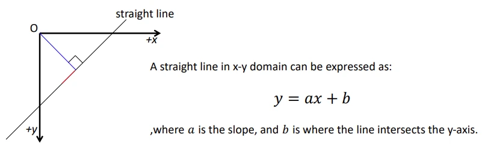

- +x, +y 가 우리가 알던 관점과는 다르다.

---

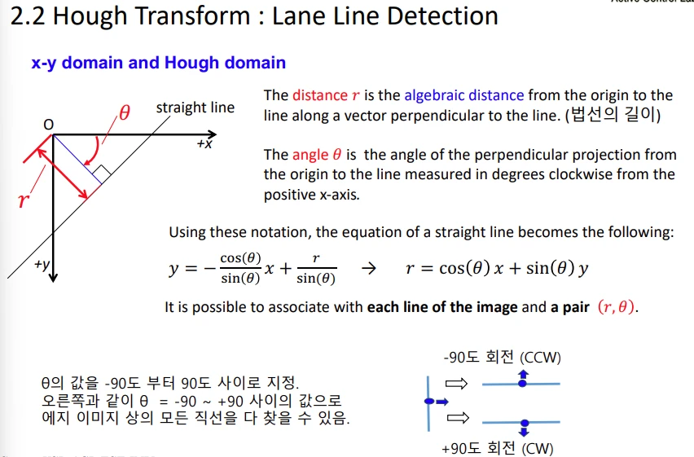

- 우리는 Hough Transform을 통해서 Canny Edge Detection을 통해 얻어낸 Edge Image로부터 Lane Line을 검출하고자 한다. 이때, 기존에 우리가 사용하던 **x, y와는 별개의 Hough Domain을 얻어낼 필요**가 있다.

    - Hough Domain : r과 θ로 이루어진다. +x를 기준으로 수선까지 반시계 방향으로 θ가 돌아가게 되고, 원점에서 이 직선에 직각으로 내린 수선의 길이를 r이라고 한다.

    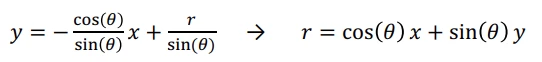

    (좌) x-y domain (우) Hough Domain 에서 나타낸 직선의 방정식이다.

    r과 θ의 함수로 직선이 나타날 수 있다.

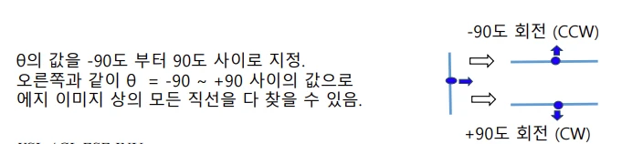

θ값은 -90도 ~ +90도 사이의 값으로 지정된다. -이면 CCW로 회전하게 되고 +이면 CW로 회전하게 된다.

---

- 이전에 나온 x-y Domain, Hough Domain에서의 직선의 방정식이 어떻게 도출되는 것일까?

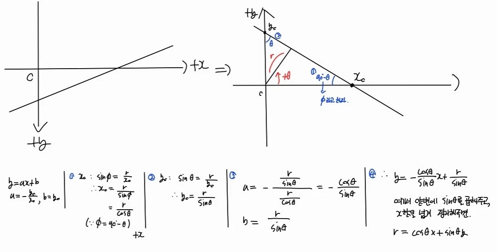

---

- Hough Transform 예제 1

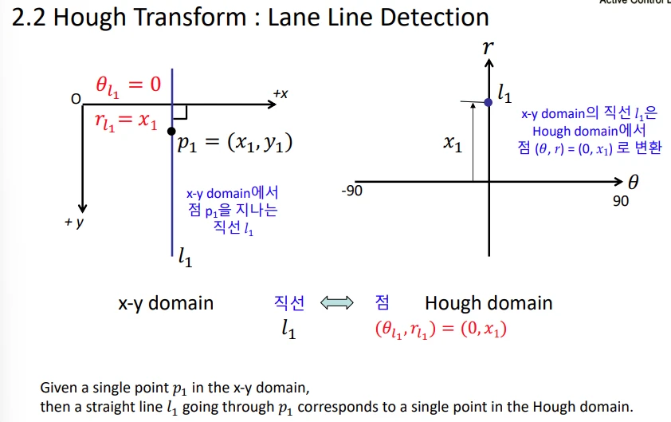

- (좌) x-y Domain에서 점 p1을 지나는, +x선에 대한 수직선 l1이 있다고 하자.

    - 이때 p1의 좌표는 (x1, y1)이므로, Hough Domain의 관점에서 보면 r = x1이고, θ는 0도이다.

        - θ값이 0도인 이유 : 원점에서 l1에 수선의 발을 내리면, 그냥 x축과 일치하기 때문에 +x의 각도는 0도이다. 따라서, θ가 0도인 것이다.

    - 이걸 Hough Domain으로 넘기면 (우)가 된다.
    - 이 예제에서 x-y Domain의 직선 l1은 Hough Domain에서 점 (θ, r) = (0, x1)으로 변환된다.

---

- Hough Transform 예제 2

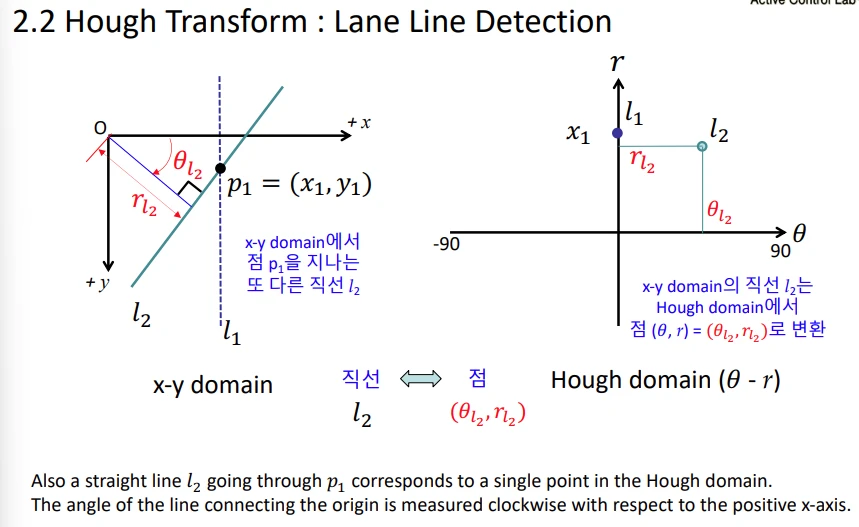

- l2라는 직선이 그어졌을 때, 이때는 기울어진 직선이기 때문에 θ는 0이 아니다.
- 이렇게 직선 l1과 l2를 구했는데, 이를 Hough Domain에서 나타내면 두 개의 점으로 바뀌게 된다.

---

- Hough Transform 예제 3

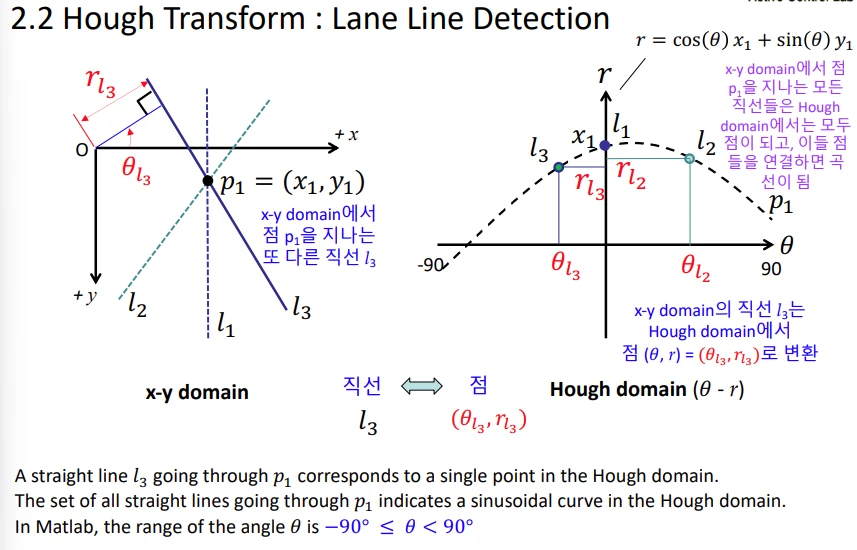

- l3가 이와 같이 그려지게 된다. 이렇게 되면 θ의 값은 -가 된다.

    - 왜냐면, 수선의 발을 내리고 +x와의 사잇각을 구하는 것인데, 수선의 발이 위에서 그려지므로 당연히 -θ가 나오게 된다.
    - 이때의 r은 rl3로 나와있다고 생각해보자.

- 이 결과를 바탕으로 l1, l2, l3가 Hough Domain에서 점 세 개로 표현될 수 있다.

> 위의 세 개의 직선은 모두 x-y Domain 상의 어떤 점 p1(x1, y1)을 지날 수 있는 대표적인 직선 세 개를 뽑은 것이라고 볼 수 있다. 물론, p1에 대해서 더 많은 선들이 존재할 수 있을 것이다.  
>   
> 하지만 우리는 -90 ≤ θ ≤ 90만 확인하면 되는데, 그 이유는 대칭이기 때문이다.

- (우) 그래서, -90 ≤ θ ≤ 90 사이의 직선을 모두 Hough Transform에서 점으로 찍어보면 이와 같은 그래프가 나오게 되고, 이 곡선은 우리가 앞에서 유도했던 **r = cos(θ)\*x1 + sin(θ)\*y1** 과 같다.

---

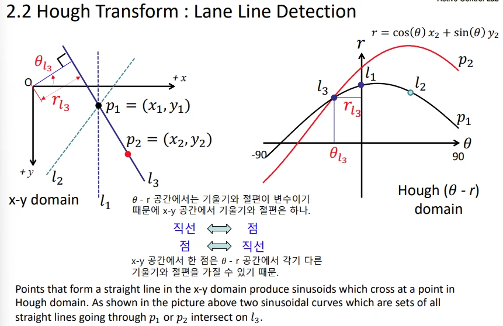

- p2(x2, y2)라는 점이 존재하고, 이 점은 l3가 지나가는 점이라고 생각해보자.
- 이 점에 대해서도 여러 선들이 만들어질 수 있을 것이고, p1 지점에 대해 생길 수 있는 
    -90 ≤ θ ≤ 90 에 대해서 Hough Domain에서 그래프로 나타낸 것과 같이 p2 지점에 대해서도 마찬가지로 -90 ≤ θ ≤ 90 에서 Hough Domain의 그래프로 나타낼 수 있을 것이다. 이 그림이 (우) 그림에 나온 p2, 빨간색 그래프이다.
- x-y Domain에서는 하나의 직선이었던 것이, Hough Domain에서는 하나의 점으로 바뀌게  된다.
- 그리고 -90 ≤ θ ≤ 90에 대해서 모든 직선을 점으로 바꾸게 되면, Hough Domain에서는 곡선으로 표현할 수 있게 된다.

---

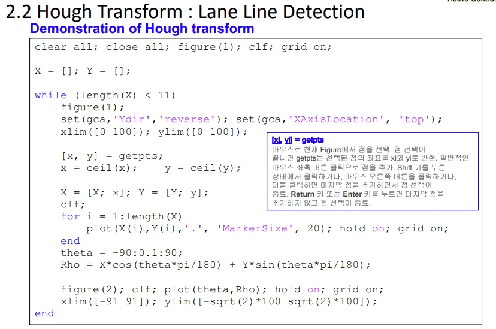

```matlab
clear; close all; figure(1); clf; grid on;

X = []; Y = [];

while (length(X) < 11)
    figure(1);
    set(gca, 'Ydir', 'reverse'); set(gca, 'XAxisLocation', 'top');
    xlim([0 100]); ylim([0 100]);

    [x, y] = getpts;
    x = ceil(x); y = ceil(y);

    X = [X; x]; Y = [Y; y];
    clf;

    for i = 1:length(X)
        plot(X(i), Y(i), '.', 'MarkerSize', 20); hold on; grid on;
    end

    theta = -90:0.1:90;
    Rho = X*cos(theta*pi/180) + Y*sin(theta*pi/180);

    figure(2); clf; plot(theta, Rho); hold on; grid on;
    xlim([-91 91]); ylim([-sqrt(2)*100 sqrt(2)*100]);
end
```

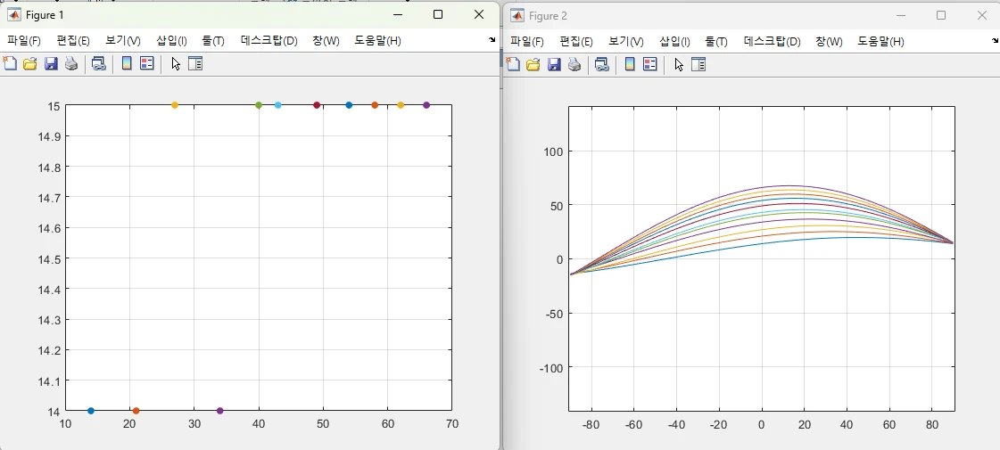

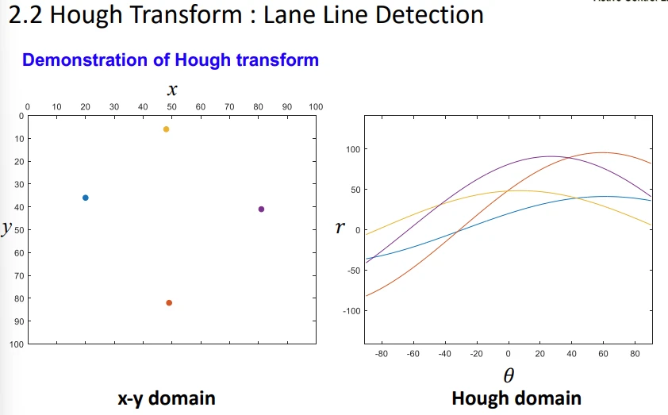

예시를 보면, 파란색과 노란색 곡선이 서로 만나는 점이 존재하게 된다. 이 점에 대한 데이터를 추적해보자.

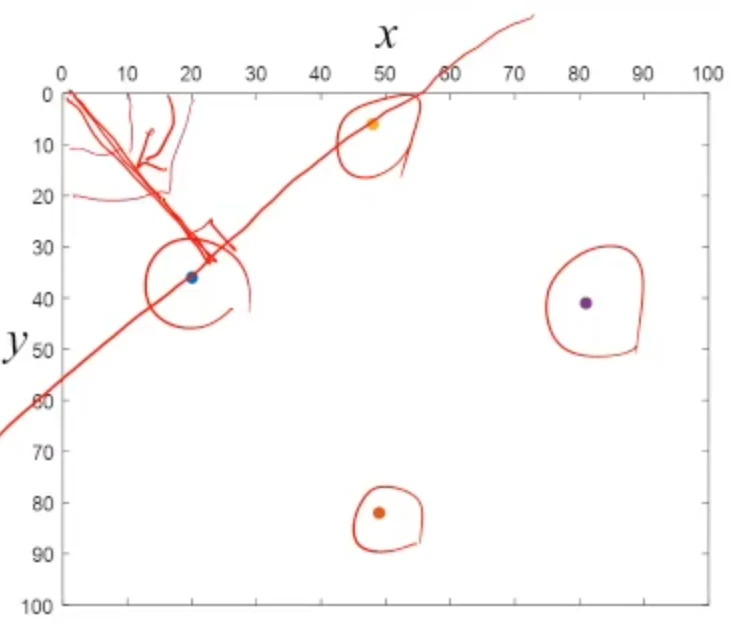

이런 식으로 두 점을 지나는 직선을 그리고, 해당 직선의 각도를 보면, +θ가 대략 45도 정도가 나오는 것을 확인할 수 있을 것이다. 

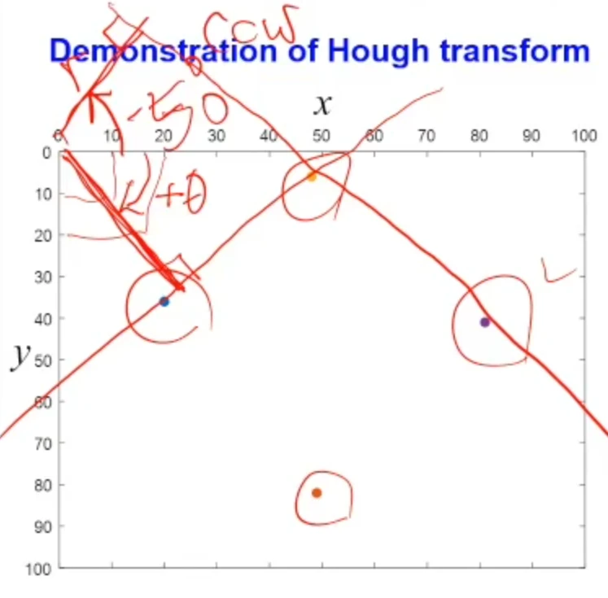

이와 비슷하게 노란색과 보라색이 만나는 것을 볼 수 있는데, 이전과 같은 방법으로 찾아보게 되면, -θ가 CCW로 돌아가기 때문에 θ가 약 -40도 정도가 나오게 된다.

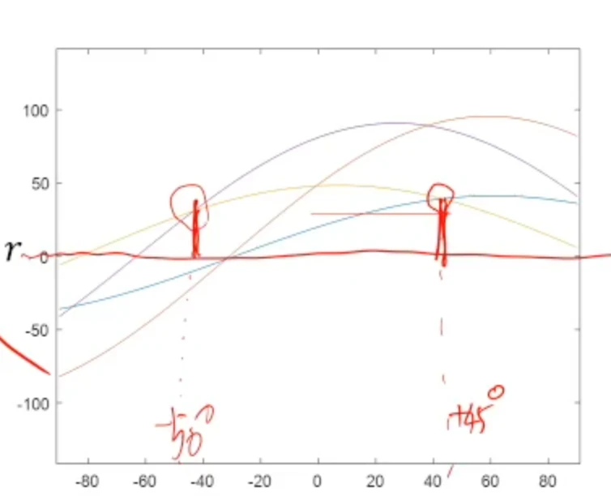

그리고, 이렇게 찾아낸 두 개의 직선의 r을 생각해보면, 완전히 같지는 않지만 둘 다 대략 30 정도가 나온다고 생각해 볼 수 있다. 

---

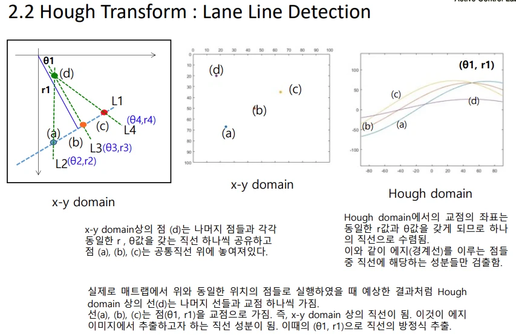

(a), (b), (c&#41;, (d) 네 개의 점이 있을 때, (d)와 (a), (b), (c&#41; 각각을 한 점씩 추가로 지나는 직선 세 개(L2, L3, L4) 그렸으며, (a), (b) (c&#41;를 동시에 지나는 직선(L1)이 존재한다고 하자.

- L1을 생각해볼 때, θ1은 L1에 대해 내려진 수선의 발에 대하여 +x 방향에서 구한 각도이다.
- 이런 방식으로, 이전에 사용했던 프로그램을 이용해 그림을 그려보면 위와 같이 그림이 나온다.

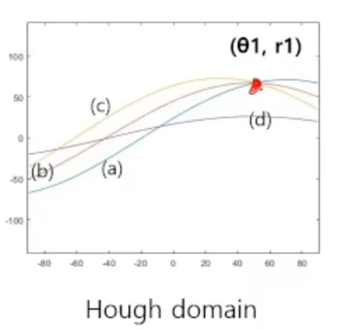

이 그림을 보게 되면, (a), (b), (c&#41; 세 개의 곡선이 한 점에서 만나는 것을 확인할 수 있고, 이것은 세 개의 직선이 만나는 것이라고 생각할 수 있다. (왜냐면, Hough Domain에서 하나의 점은 하나의 직선이기 때문에. 하지만 결국에는 같은 직선이라고 생각할 수 있음. 세 개의 점이 동시에 지나는 하나의 직선을 가지기 때문에 이와 같은 결과를 가진다고 볼 수 있는 것이다.)

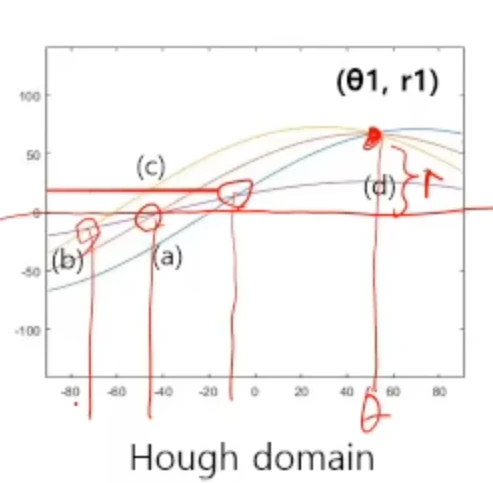

그리고, (a)와 (d), (b)와 (d), (c&#41;와 (d)를 지나는 직선이 하나씩 존재할 수 있게 되므로, 각각의 직선에 대한 r값과 θ값을 모두 구할 수 있을 것이다.

---

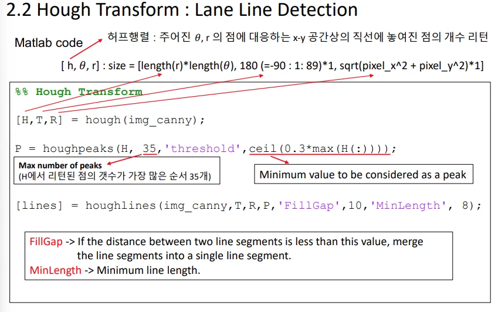

- Matlab에서 지원하는 Hough 라는 함수가 있다. 이를 통해 이미지 상에서 존재하는 직선들을 찾아내 볼 수 있다.

    - img_canny라는 것은 우리가 이전에 뽑았던 이미지를 의미한다.
    - matlab이 지원하는 hough 함수를 쓰면, H, T, R이 나오게 되는데, T, R은 우리가 사용하던 변수 θ와 r에 대응되는 변수이다.
    - H는 허프 행렬이다. **주어진 θ와  r의 점에 대응하는 x-y 공간 상의 직선에 놓여진 점의 개수**를 return한다. (즉, Hough Domain에 찍힌 점이 실제로 x-y Domain에서는 직선인데, 그 직선들 위에 존재하는 픽셀의 개수를 의미함.)

    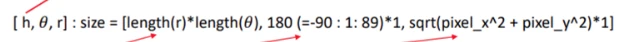

    - T : -90:1:89 (89까지만 찾음. 1을 뒤에 해주는 것은 180\*1 또는 1\*180으로 만드는 것을 의미)
    - **여기서 T는 -90:1:89의 값을 가짐. (theta의 범위)**
    - R : x, y 픽셀로 구하는 길이. edge로 여겨지는 직선에 대한 수선의 발로 보인다.
    - 감지할 직선의 R길이의 범위. 일반적으로 이미지 대각선 길이가 R이라고 하면, -R~R에 대해서 찾게 된다.

    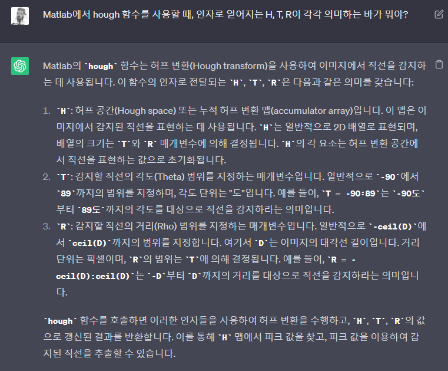

    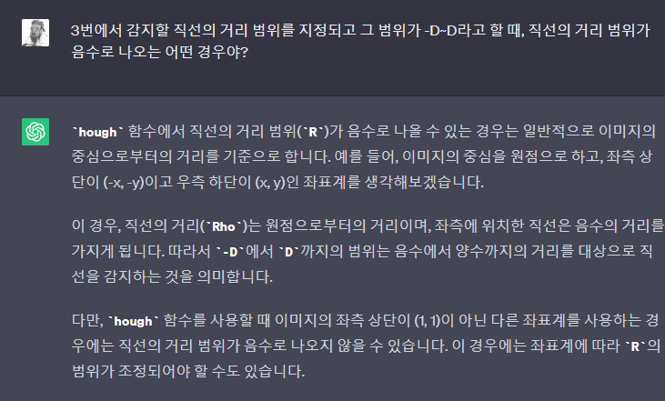

    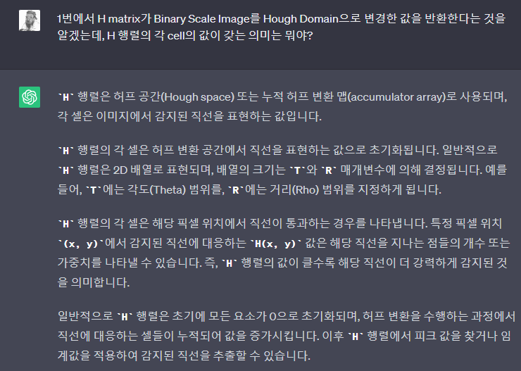

    - 정리해 본 결과, T와 R은 Hough Transform에 사용되는 parameter 값들이다.
    - T는 Canny Edge Detection을 통해 얻은 Binary Edge Image에 존재하는 각 Edge의 Pixel 들에 대해서 존재할 수 있는 모든 직선을 찾게 되는데, 그 직선들에 적용할 theta 값의 범위를 말한다. 일반적으로 -90:1:89로 찾게 된다. 즉, P1(x1,y1)이라는 점이 있다면, 그 점을 지나고 원점에 대하여 내린 수선의 발이 +x축과 이루는 각도가 -90, -89, -88, …, 88, 89인 직선들을 찾는다는 뜻이다.
    - R은 Hough Transform 과정에서 찾아낼 원점과 직선 사이의 거리 r의 범위를 의미하는 parameter이다. 일반적으로 Binary Edge Image의 크기인 sqrt(pixel_x^2 + pixel_y^2)를 D라고 할 때 -D:1:D 의 길이를 갖는 직선을 찾게 된다.
    - 따라서 H의 각 Cell은 R과 T를 각각 매칭시켰을 때, 해당 theta와 r 값을 갖는 직선 위에 존재하는 pixel의 개수를 의미하며, 이 값이 클수록 해당 edge의 세기가 강하다고 판단할 수 있다. (왜냐면, 이전에 Hysteresis Thresholding을 거쳐서 Strong edge/Strong edge 근처에 존재하는 Weak edge만 살려두었기 때문에)

    > 따라서 이후에 houghpeaks에서 peak값을 정할 때, H 행렬에서 가장 큰 값을 찾고 그것에 0.3을 곱한것을 반올림한 것을 임계치로 정해 그 값을 넘는 Edge를 특정 개수 이상으로 찾게 되는 것이다.

- houghpeaks 함수

    - 35 : Max number of peaks, H에서 리턴된 점의 갯수가 가장 많은 순서로 35개만 채택한다.
    - ceil : 그 선 중에서 기준선이 될 수 있는 것들이, H matrix의 값이 가장 큰 것에서 * 0.3한 것을 반올림 한 것을 peak라고 생각할 수 있는 최소의 숫자를 정하게 된다.

    ⇒ 이 데이터를 P라는 곳에 저장한다. 

- houghlines 함수

    - FillGap : 라인과 라인이 끊어졌을 경우, 10 픽셀 이내에 들어가면 그 라인과 라인을 잇는 다는 뜻이다. 즉, 끊어진 선을 연결해준다는 뜻이다.
    - MinLength : 8개의 픽셀 이상으로 구성되어야 선으로 취급하겠다는 뜻이다.

    ⇒ 이 데이터를 [lines]에 저장한다.

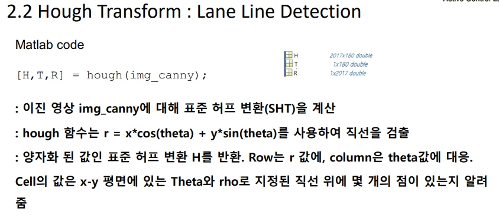

---

```matlab
%% Hough Transform

[H, T, R] = hough(img_canny);

P = houghpeaks(H, 35, 'threshold', ceil(0.3*max(H(:))));

[lines] = houghlines(img_canny, T, R, P, 'FillGap', 10, 'MinLength', 8);

c1 = []; c2 = []; l = [];

for k = 1:length(lines)
    c1 = [c1; [lines(k).point1 3]]; % point1, 시작점의 좌표 (x, y)
    c2 = [c2; [lines(k).point2 3]]; % point2, 끝점의 좌표 (x, y)
		% 3은 표시할 원의 반지름을 의미.

    l = [l; lines(k).point1 lines(k).point2];
		% line도 마찬가지로 point1 시작점, point2 끝점을 넣어준다.
end

% img_gray에 지정한 좌표에 대하여 line을 insert 하라.
img_line = insertShape(uint8(img_gray), 'Line', l, 'Color', ...
    'green', 'LineWidth', 3);

% 지정한 좌표, 시작점에 대하여 빨간색 원을 그림.
img_line = insertShape(uint8(img_line), 'Circle', c1, 'Color', ...
    'red');

% 지정한 좌표, 끝점에 대하여 노란 원을 그림.
img_line = insertShape(uint8(img_line), 'Circle', c2, 'Color', ...
    'yellow');

figure(7);
imshow(img_line);
```

---

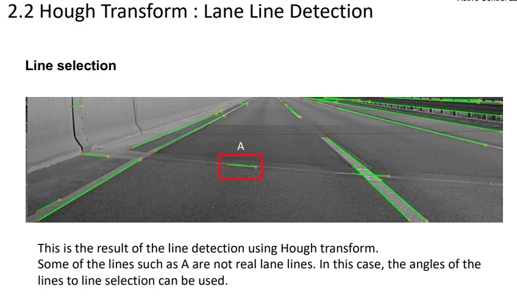

- 이렇게 좌→우로 그려진 Edge는 Lane이라고 판단할 수 있을까? 그럴 수 없을 것이다. 이것은 정지선과는 다른 개념이다. 정지선은 또 고려해야 할 사항이 매우 많다.
- 그래서, 이와 같은 A edge는 제거해 주어야 한다. 그러면 어떻게 해야 이런 A edge를 제거할 수 있을까?

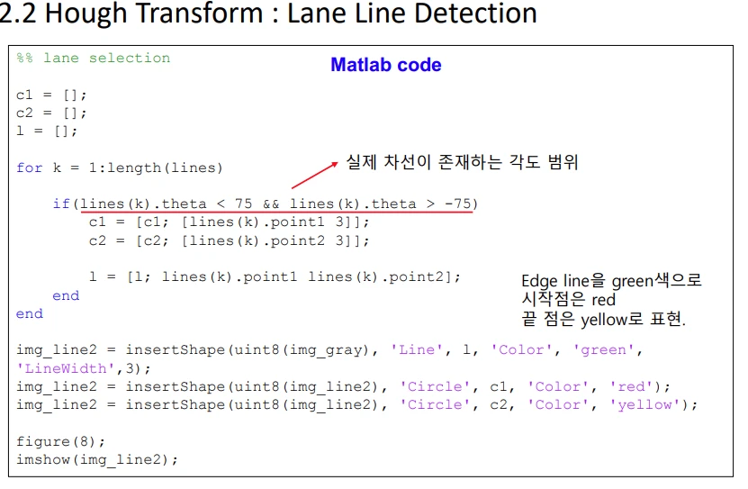

- 차선이 존재하는 각도 범위를 -75 ~ +75 사이라고 생각하고, 그러한 것들에 대해서만 데이터를 추가해주도록 한다.

```matlab
%% Lane selection

c1 = [];
c2 = [];
l = [];

for k = 1:length(lines)
    
    if(lines(k).theta < 75 && lines(k).theta > -75)
        c1 = [c1; [lines(k).point1 3]];
        c2 = [c2; [lines(k).point2 3]];
        
        l = [l; lines(k).point1 lines(k).point2];
    end
end

img_line2 = insertShape(uint8(img_gray), 'Line', l, 'Color', ...
    'green', 'LineWidth', 3);

img_line2 = insertShape(uint8(img_line2), 'Circle', c1, 'Color', ...
    'red');

img_line2 = insertShape(uint8(img_line2), 'Circle', c2, 'Color', ...
    'yellow');

figure(8);
imshow(img_line2);
```

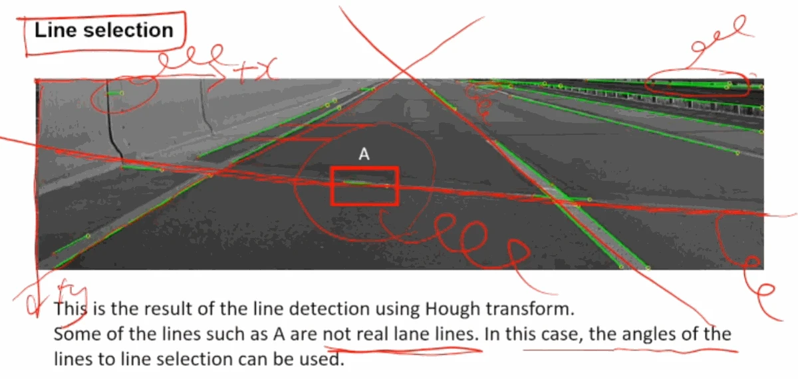

- 우리가 말하는 원점이 좌상단이다. 여기를 기준으로 -75~+75 사이에 존재하는 edge만 진짜 edge로 인정하겠다는 것이다.

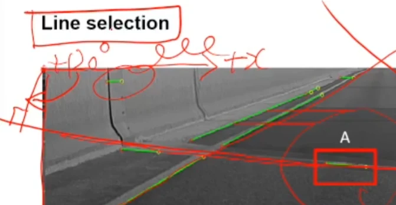

- 그래서, A에 대해서 수선의 발을 내리고 θ를 파악해보면, 이것은 +120도 정도가 돼서 범위를 벗어나는 것을 알 수 있다.

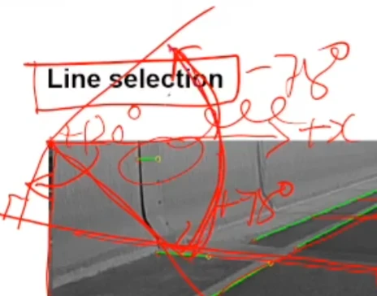

- -75 ~ +75 를 따져보면 이와 같이 만들어지게 될 것이다.

- 이런 방식을 적용하면, 도로의 Lane을 파악할 수 있다.

---

## Result of Canny Edge Detection and Hough Transform

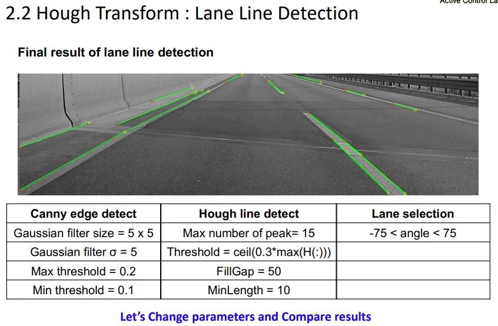

- Canny Edge Detection

    - Gaussian filter size 5x5
    - 표준편차(sigma) = 5
    - Max Threshold = 0.2
    - Min Threshold = 0.1

- Hough line detect

    - Peak 15개를 뽑아냄
    - Threshold는 전체값의 최대값에 0.3을 곱한값을 반올림한 것.
    - FillGap : 50pixel 이내로 떨어져 있으면 이어줌.
    - MinLength : 최소 10pixel 이상으로 이루어져야 가져감

- Lane selection

    - -75 &lt; θ &lt; +75 사이의 Edge를 Selection

⇒ 위의 parameter들을 조정하고 건드려보면서 결과를 낼 수 있게 된다.

⇒ 차량은 주행할 때 양쪽에 그어진 Lane들의 중앙으로 나아가게 된다.

---

- Lane Line Detection

⇒ Canny Edge + Hough Transform을 하면 오차가 조금 존재하게 되는데, 이걸 딥러닝으로 돌리면 엄청 정확하게 나온다. 

⇒ 이것은 Rule Based Method로 Detection을 실시하는 것이다. 

실제로 적용해보니까 70~80%는 되는데 20~30%는 오락가락 한다. ⇒ 이것은 DL을 쓰거나 RL을 쓴다. 결국 ML을 적용해야 한다는 결론에 도달하게 된다. ⇒ 95% 이상의 예측률 보장 가능.

- Lane Line Detection이 어두운 곳이나 밝은 곳에서 되지 않는 현상 → 블랙홀 현상, 화이트홀 현상

    - 차는 절대로 충돌하면 안되기 때문에 어렵다.

- 그리고 비 내릴 때. 비 내릴 때도 학습을 시킨다. 눈 내릴 때. (눈은 덮여버리니까 가상 선을 그려내야 한다. 하지만, Canny Edge Detection으로는 찾을 수 없다. 그래서 왜! Deep Learning으로 갈 수밖에 없는지가 나온다.)

    - Lane Line이 없는 도로는 어떻게 하나?

        - Rule Based로는 해결 불가능.

    - LIDAR를 아직 채택하는 회사들은 있음.

    - 하지만 LIDAR를 쓴다고, 카메라를 안쓰는 것은 아님. default임.

        - 구글 Waymo
        - Hyundai
        - Mobil Eye (Intel에 인수됨)

- 자율주행도 결국 AI… 수십년에 걸친 Rule Based Method가 AI에 의해 한 방에 끝났다.
