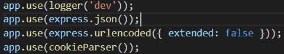
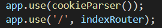
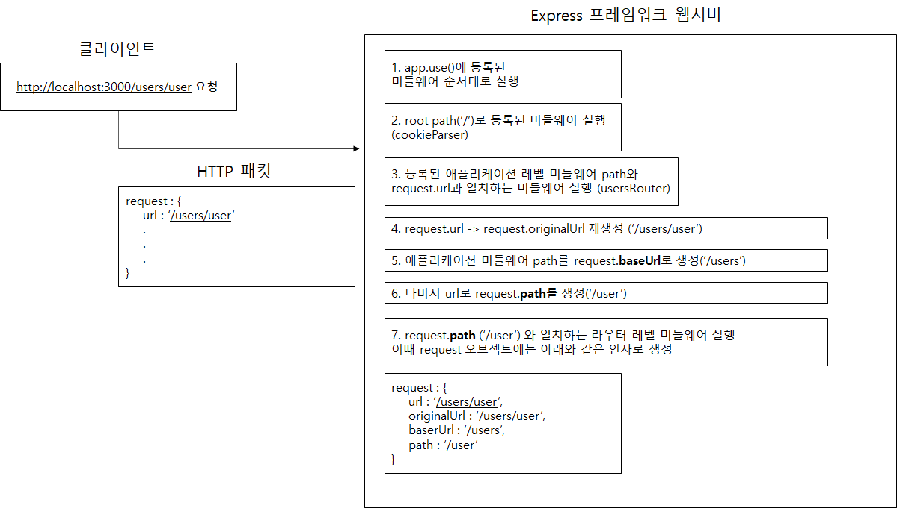

# app.use()

const app = express() 로 생성된 app 오브젝트에는 use()라는 함수가 존재한다. use() 함수를 이용하여 미들웨어를 등록하면 순서대로 실행된다.



위와 같은 코드는 4개의 미들웨어 함수를 등록한 것이다. 등록된 순서와 실행 순서는 동일하다.  
이 때 내부적으로 각 미들웨어 함수는 next라는 매개변수를 받아서, 자신의 함수 실행이 끝나게 되면 next()로 다음 등록된 미들웨어 함수를 호출해 순서대로 실행된다.

이렇듯 요청 → 미들웨어 함수 실행 → 응답 순으로 express 프레임워크가 동작한다.

이제 실제 코드로 동작 여부를 확인한다. 코드를 아래 2개만 등록했다고 가정하자.



이와 같이 코드를 구성하면, cookieParser()라는 미들웨어를 거쳐서 현재 req.headers에 들어있는 cookie가 parser되고, next()를 통해서 다음 미들웨어가 실행된다. 즉, cookieParser() 거친 뒤, indexRouter로 이동하게 되는 것이다.

## Middleware의 동작 레벨

1. Application 레벨
2. Router 레벨

미들웨어의 동작 레벨은 위 두 개로 나뉠 수 있으며, 애플리케이션 → 라우터 단계로 실행 순서가 이루어져 있다고 볼 수 있다.

애플리케이션 레벨과 라우터 레벨은 실행 단계의 차이이며, 기능적으로는 차이점이 없다. 즉, 애플리케이션 분기 + 라우터 분기로 더 세세하게 요청 URL을 분리해서 제어가 가능하다는 이점을 갖게 되는 것이다.

```javascript
var indexRouter = require('./routes/index');
var usersRouter = require('./routes/users');

var app = express();

app.use('/', indexRouter);
app.use('/users', usersRouter);
```

위의 예는 애플리케이션 단계에서 ‘/’와 ‘/users’로 URL을 분리하여 처리를 하도록 만든 것이다. 또한, callback 인자에 express.Router() 오브젝트를 생성하여 넣음으로 라우터 단계에서의 URL  제어도 가능하도록 등록하였다.

---

- router 레벨 ( /users router를 예로 든다. )

```javascript
var express = require('express');
var router = express.Router();

/* GET users listing. */
router.get('/', function(req, res, next) {
  console.log('originalUrl : '+req.originalUrl);
  console.log('baseUrl : '+req.baseUrl);
  console.log('path : '+req.path);
  res.send('respond with a resource');
});

router.get('/user', function(req, res, next) {
  console.log('originalUrl : '+req.originalUrl);
  console.log('baseUrl : '+req.baseUrl);
  console.log('path : '+req.path);
  res.send('respond with a resource');
});

module.exports = router;
```

위의 예는 라우터 단계의 미들웨어이다.

app.use()처럼 router.use()를 쓸 수도 있고, app.method() 처럼 router.method()도 사용 가능하다. use와 method의 다른 점은, use는 모든 method에서 동작하는 것이고, method()는 지정된 요청 (GET, POST, PUT, DELETE 등) 에서만 동작한다는 것이다.

위의 예시는 express에서 라우터 기능이 어떻게 흘러가는가를 보여주고 있다.

1. 애플리케이션 단계에서의 URL 제어

    - '/', 'users' 두가지 분기

2. 라우터 단계에서의 URL 제어 (예는 'users' 미들웨어)

    - '/', 'user' 두가지 분기

---

## app.use()

- 본격적으로 app.use()에 대해 알아본다. URL은 /users/user로 진행

```javascript
app.use(cookieParser());
app.use('/users', usersRouter);
.
.
.

router.get('/', function(req, res, next) {
  console.log('originalUrl : '+req.originalUrl);
  console.log('baseUrl : '+req.baseUrl);
  console.log('path : '+req.path);
  res.send('respond with a resource');
});

router.get('/user', function(req, res, next) {
  console.log('originalUrl : '+req.originalUrl);
  console.log('baseUrl : '+req.baseUrl);
  console.log('path : '+req.path);
  res.send('respond with a resource');
});
```

모든 요청에 대하여 cookieParser()를 실행, ‘/users’라는 URL이 들어오면 usersRouter를 실행. 이제 웹브라우저에 ‘http://localhost:3000/users/user 를 웹브라우저에 쳤을 때 url의 변화를 로그로 찍어본다.

*// cookieParser 로그 (이것은 아마도 index.js로 들어가서 거치는 api인 것 같다.)*

p originalUrl : /users/user  
p baseUrl :   
p path : /users/user

*// usersRouter 로그*

originalUrl : /users/user  
baseUrl : /users  
path : /user

---

여기서 중요한 request 오브젝트가 가지고 있는 멤버 변수에 대해 알아보자.

1. originalUrl

    - 이 변수는 express 에서 동작하는 http module의 request.url라는 변수를 라우팅을 목적으로 재생성한 변수이다. (cookieParser 가 request.headers.cookie 를 request.cookies로 가공을 거쳐 재생성한 것처럼) 실제 클라이언트가 브라우저에 입력한 url을 뜻한다.

2. baseUrl

    - 이 변수는 간단히 말하자면 **애플리케이션** 레벨에 등록된 URL을 뜻한다. 실제로 app.use() 함수에 path 값을 넣지 않던가 '/'를 통해 모든 요청에 해당하는 미들웨어를 등록하면 위의 cookieParser 로그처럼 값이 비어있다.

3. path

    - baseUrl이 애플리케이션 레벨의 URL이라면, 이 변수는 **라우터** 레벨에 등록된 URL 이다.

---



이 프로세스를 거치면서 라우팅된다.

결국 app.use()의 매개변수인 path는 originalUrl(실제로 입력한 path)와 match하는 애플리케이션 middleware를 동작시키는 것이고, 그 이후 express.Router()로 등록된 미들웨어일 경우, baseUrl을 제외한 나머지 path로 라우터 미들웨어를 동작시키는 것이다.

여기서 express.Router()로 등록된 애플리케이션 미들웨어의 path가 root path(’/’)일 경우에는, 라우터 레벨 단계 까지의 path와 일치하여야 실행되는 것 같다.

물론, 매개변수 path는 정규식 표현으로도 실행이 가능하다.

직접 미들웨어를 간단하게 등록하여 아래와 같이 실행이 가능하다.

```javascript
app.use('/users',cookieParser());

app.use('/', (req, res, next)=>{
  console.log('모든 요청에 log 남기기');
  next();
});

app.use('/', indexRouter);
app.use('/users', usersRouter);
```

> 이 방식을 사용하면, 모든 요청에 log를 남길 수 있게 된다.

---

또한, 중복으로 callback 함수를 등록할 수 있다.

```javascript
app.use('/', (req, res, next)=>{
  console.log('모든 요청에 log 1');
  next();
}, (req, res, next)=>{
  console.log('모든 요청에 log 2');
  next();
});
app.use('/', indexRouter);
app.use('/users', usersRouter);
```

[http://localhost:3000/users/user](http://localhost:3000/users/user) 요청 시 log

모든 요청에 log 1  
모든 요청에 log 2  
usersRouter '/users/user'
