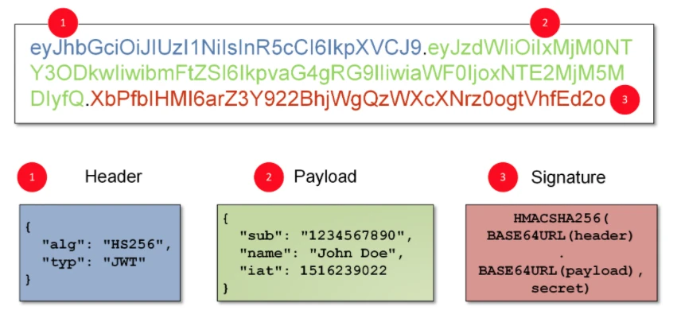
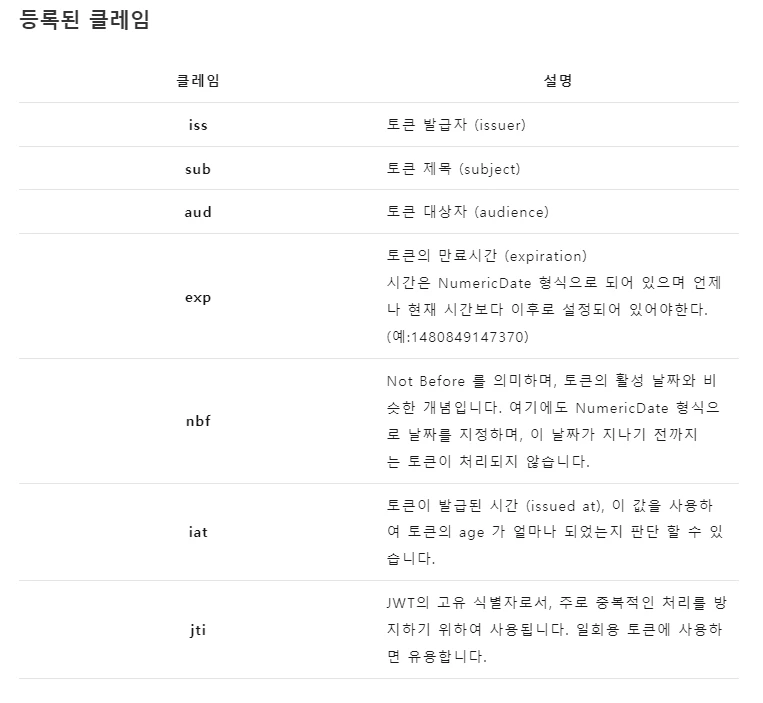
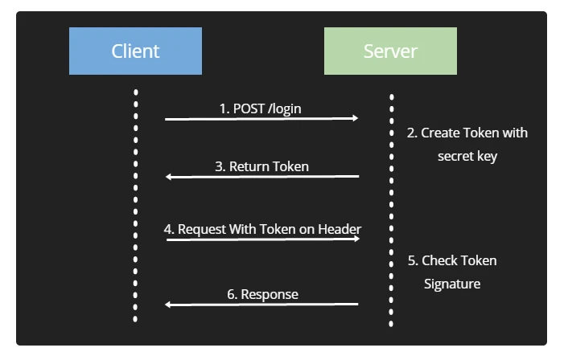

# JWT(Web Token)

> 참고  
>   
> [https://charming-kyu.tistory.com/44](https://charming-kyu.tistory.com/44)

## JWT

- JSON Web Token

JSON Web Token (JWT)은 웹 표준(RFC 7519)로서 두 개체에서 JSON 객체를 사용해 가볍고 자가 수용적인 방식으로 정보를 안정성 있게 전달해준다.

- 자가 수용적(Self-contained)

JWT는 필요한 모든 정보를 자체적으로 지니고 있다. JWT 시스템에서 발급된 토큰은 토큰에 대한 기본 정보, 전달할 정보 (로그인 시스템에서는 유저의 정보를 나타낼 것) 그리고 토큰이 검증됐다는 것을 증명해주는 signature를 포함하고 있다.

- 전달이 간편하고 용이함

JWT는 자가 수용적이므로, 두 개체 사이에서 손쉽게 전달될 수 있다. 웹서버의 경우는 HTTP의 헤더에 넣어서 전달할 수 있고, URL의 파라미터로 전달 할 수도 있다.

- HTTP Header / URI 파라미터를 이용해 전달 가능하다.

---

## JWT의 내용

> JWT의 생성  
>   
> JWT 토큰을 만들 때는 JWT를 담당하는 라이브러리가 자동으로 인코딩 및 해싱 작업을 해준다. 이 포스트에서는 NPM 라이브러리인 jsonwebtoken을 사용하여 HMAC SHA256 인코딩 및 해싱하는 과정을 구현한다.



JWT는 헤더(Header), 정보(Payload), 서명(Signature) 구조로 이루어져 있다.

- Header : 타입(JWT)과 알고리즘(BASE64 같은)을 담는다. (algorithm & token type)  
    → JWT를 생성할 때 사용된 정보들로, 검증할 때 사용된다. JSON을 base64UrlEncode() 메서드로 인코딩한 문자열이다.

```json
{
	"typ" : "JWT"
	"alg" : "HS256"
}
```

- Payload : 보통 유저정보(id 같은)와 만료 기간이 객체형으로 담긴다.

→ 일종의 Data. JWT에 저장되는 정보로 key : value로 구성된다. JSON을 base64UrlEncode() 메서드로 인코딩한 문자열이다. payload는 암호화되지 않기 때문에 개인정보는 사용하지 않아야 한다. AES암호를 사용하여 payload를 암호화할 수 있다.

- Signature : header, payload를 인코딩 한 값을 합친 뒤 SECRET_KEY로 해쉬한다.  
    → JWT에 대한 검증(확인)할 때 사용되는 암호화된 문자열이다.
- 클레임 : 사용되는 정보의 한 조각을 클레임(claim)이라고 함.  
    → 모든 등록된 클레임은 선택적으로 사용한다. 필수가 아니다.



---

## node express로 JWT 구현

- 가정 : 웹페이지는 CSR(Client Side Rendering)이라는 가정 하에 Node서버는 오로지 REST API 기능만 제공한다고 했을 때 Express와 Postman으로 간단하게 구현한다. JWT의 인증 순서는 아래와 같이 정의한다.



---

- [안정적인 토큰의 형태](16-stable-token-structure.md)
