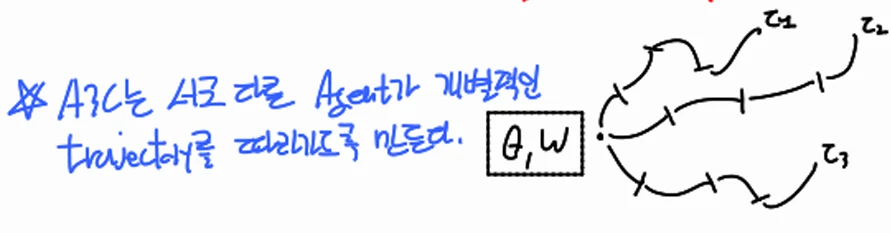
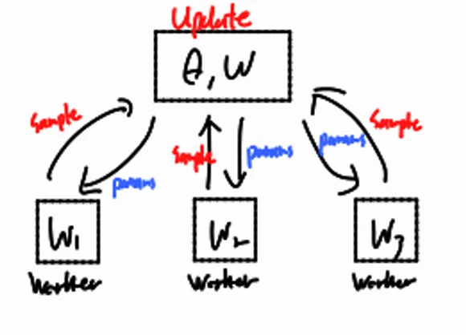
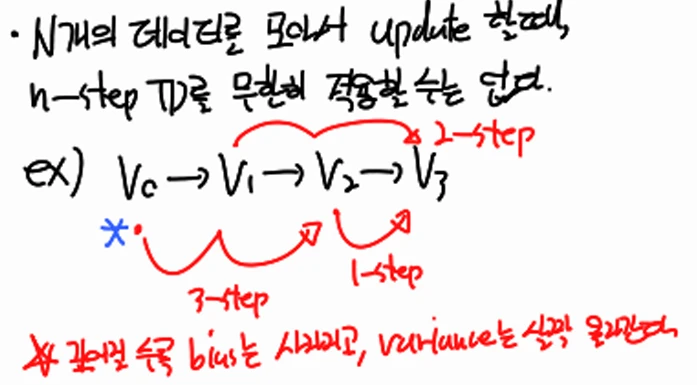
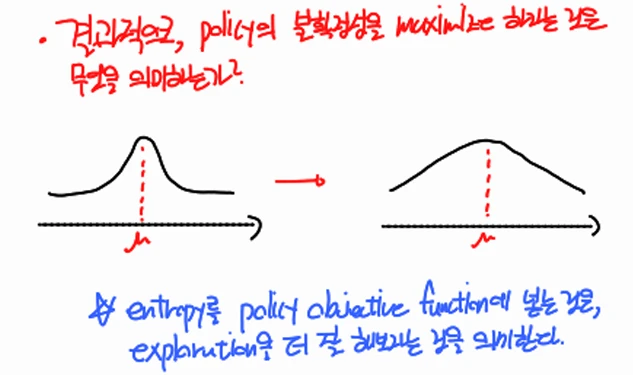

# 강화학습 4: Actor-Critic, A2C, A3C

작성일 2025-03-13 · 최종 수정일 2025-03-24
{ .post-date }

[REINFORCE](03-reinforce.md)는 unbiased하지만 variance가 컸다. 이 글에서는 그 variance를 줄여 가는 세 단계를 정리한다. Policy Gradient 식에서 $Q$를 꺼내 따로 학습하는 Actor-Critic, $Q$ 대신 Advantage를 쓰는 A2C, 그리고 여러 worker를 비동기로 돌리는 A3C다.

## Actor-Critic

### 아이디어

REINFORCE에서 얻은 식은 다음과 같았다. $\gamma^t$를 떼어 낸 근사식이다.

$$
\nabla_\theta J_\theta \approx \int_\tau \sum_{t=0}^{\infty} \Big( \nabla_\theta \ln p_\theta(a_t \mid s_t) \cdot G_t \Big) \, p_\theta(\tau) \, d\tau
$$

Actor-Critic의 목표는 Policy Gradient의 높은 variance를 낮추는 것이다. 아이디어는 이 식을 조건부 확률의 곱셈 법칙으로 변형해 $Q$를 꺼내는 것이다.

### 유도

trajectory의 확률을 시점 $t$를 기준으로 둘로 나눈다. Markov Property에 의해 $t$ 이후의 일은 $s_t, a_t$에만 의존한다.

$$
\begin{aligned}
p_\theta(\tau) &= p_\theta(s_{t+1}, a_{t+1}, \cdots \mid s_0, a_0, \cdots, s_t, a_t) \, p_\theta(s_0, a_0, \cdots, s_t, a_t) \\
&= p_\theta(s_{t+1}, a_{t+1}, \cdots \mid s_t, a_t) \, p_\theta(s_0, a_0, \cdots, s_t, a_t)
\end{aligned}
$$

이를 Policy Gradient 식에 넣는다. 합은 적분 전에 하든 후에 하든 결과가 같으므로 적분 밖으로 뺀다.

$$
\nabla_\theta J_\theta \approx \sum_{t=0}^{\infty} \int \nabla_\theta \ln p_\theta(a_t \mid s_t) \left[ \int G_t \, p_\theta(s_{t+1}, a_{t+1}, \cdots \mid s_t, a_t) \, d(s_{t+1}{:}a_\infty) \right] p_\theta(s_0, a_0, \cdots, s_t, a_t) \, d(s_0{:}a_t)
$$

대괄호 안은 $s_t, a_t$가 주어졌을 때 그 이후의 모든 변수에 대해 $G_t$를 적분한 것이다. 이것은 [첫 글](01-q-learning.md)에서 본 $Q(s_t, a_t)$의 정의 그대로다.

$$
= \sum_{t=0}^{\infty} \int \nabla_\theta \ln p_\theta(a_t \mid s_t) \, Q(s_t, a_t) \, p_\theta(s_0, a_0, \cdots, s_t, a_t) \, d(s_0{:}a_t)
$$

많은 것이 사라졌다. 남은 $\nabla_\theta \ln p_\theta(a_t \mid s_t) \, Q(s_t, a_t)$는 $s_t, a_t$만의 함수이므로, $s_0$부터 $a_{t-1}$까지는 적분하면 marginalize되어 없어진다.

$$
\nabla_\theta J_\theta \approx \sum_{t=0}^{\infty} \int \nabla_\theta \ln p_\theta(a_t \mid s_t) \, Q(s_t, a_t) \, p_\theta(s_t, a_t) \, ds_t \, da_t
$$

이제 $p_\theta(s_t, a_t)$를 따르는 $s_t, a_t$만 얻으면 표본을 만들 수 있다.

### 이렇게 해서 얻는 것

REINFORCE는 trajectory 하나를 끝까지 뽑고, episode가 끝난 뒤에야 갱신한다. $G_t$를 알려면 끝까지 가 봐야 하기 때문이다. trajectory마다 편차가 심하니 표본의 variance가 클 수밖에 없다.

새로 얻은 식에는 $G_t$ 대신 $Q$가 있다. 끝까지 가 보지 않고, $Q$도 신경망으로 parameterize해서 그 값을 쓰자는 것이다. 그 결과 parameter가 두 벌이 된다.

- **Actor** ($\theta$): policy $p_\theta(a_t \mid s_t)$를 갱신한다.
- **Critic** ($w$): $Q_w$를 갱신한다. Actor가 고른 action이 얼마나 좋은지 평가한다.

쉽게 말해 Critic의 비평을 받아 Actor가 개선된다.

식에는 여전히 $\sum$이 있으므로 원칙적으로는 끝까지 가 봐야 한다. 하지만 근사해서 표본 하나만 구해 쓴다. bias를 받아들이는 대신 variance를 줄이는 방법이다.

Critic은 DQN처럼 TD로 학습한다. 다만 next action을 현재의 policy로 뽑으므로 SARSA 방식이다.

$$
\big( R_t + \gamma Q_w(s_{t+1}, a_{t+1}) - Q_w(s_t, a_t) \big)^2
$$

이 값을 최소화하면 $Q_w(s_t, a_t)$가 TD Target 쪽으로 조금씩 다가간다.

### 알고리즘

1. $\theta, w$를 초기화한다.
2. 매 step마다 다음을 반복한다. REINFORCE는 episode마다 갱신했지만 이제는 step마다 갱신한다.

    - Actor 갱신 (최대화): $\theta \leftarrow \theta + \alpha \, \nabla_\theta \ln p_\theta(a_t \mid s_t) \, Q_w(s_t, a_t)$
    - Critic 갱신 (최소화): $w \leftarrow w - \beta \, \nabla_w \big( R_t + \gamma Q_w(s_{t+1}, a_{t+1}) - Q_w(s_t, a_t) \big)^2$

Critic을 갱신할 때는 DQN과 마찬가지로 TD Target을 상수로 취급해 미분하지 않는다. Actor와 Critic을 갱신하는 순서는 바뀌어도 크게 상관없다.

### 특징

- **Biased**: 표본 하나로 갱신하고, $Q$도 실제 값이 아니라 지금 가진 $Q_w$를 쓴다. 처음에는 엉뚱한 값이었다가 점차 나아진다.
- **Low variance**: $G_t$를 없앴으므로 variance는 작아진다.

## A2C (Advantage Actor-Critic)

A2C의 목표는 Actor-Critic의 variance를 조금 더 줄이는 것이다.

### Advantage

Actor-Critic의 식에서 $Q(s_t, a_t)$에, action의 함수가 아닌 것을 더하거나 빼도 결과는 달라지지 않는다. $a_t$에 대해 적분하면 그 항은 0이 되기 때문이다.

A2C는 $Q(s_t, a_t)$에서 $V(s_t)$를 뺀다. 이렇게 빼 주는 값을 baseline이라고 하고, $Q(s_t, a_t) - V(s_t)$를 **Advantage**라고 한다. 곱해지는 값의 크기가 줄어들어 표본의 variance가 낮아진다.

$$
\nabla_\theta J_\theta \approx \sum_{t=0}^{\infty} \mathbb{E}_{s_t, a_t} \Big[ \nabla_\theta \ln p_\theta(a_t \mid s_t) \, \big( Q(s_t, a_t) - V(s_t) \big) \Big]
$$

### Q를 V로 바꾸기

이대로는 $Q$와 $V$를 모두 근사해야 한다. Bellman 방정식으로 $Q$를 $V$로 바꿔 보자. $G_t = R_t + \gamma G_{t+1}$을 넣고, Markov Property로 조건을 줄인다.

$$
\begin{aligned}
Q(s_t, a_t) &= \int G_t \, p(a_{t+1}, \cdots \mid s_{t+1}) \, p(s_{t+1} \mid s_t, a_t) \, d(s_{t+1}{:}a_\infty) \\
&= \int \Big( R_t + \gamma \underbrace{\int G_{t+1} \, p(a_{t+1}, \cdots \mid s_{t+1}) \, d(a_{t+1}{:}a_\infty)}_{V(s_{t+1})} \Big) \, p(s_{t+1} \mid s_t, a_t) \, ds_{t+1} \\
&= \mathbb{E}_{s_{t+1}} \big[ R_t + \gamma V(s_{t+1}) \mid s_t, a_t \big]
\end{aligned}
$$

- $R_t$는 $a_{t+1}, \cdots$의 함수가 아니다. $R_t$를 구하는 데 $a_{t+1}$ 이후는 전혀 관여하지 않으므로 안쪽 적분 밖으로 뺄 수 있다.
- $G_{t+1}$은 $a_{t+1}, \cdots$의 함수이므로 안쪽 적분에 남고, 그 적분이 $V(s_{t+1})$이다.
- $s_{t+1}$에 대해 marginalize하므로 기댓값이 되고, $s_t, a_t$가 주어진 조건부 기댓값이다.

Advantage를 쓰려면 여기서 $V(s_t)$를 뺀다. $V(s_t)$는 $s_{t+1}$에 대해서는 상수이므로 기댓값 안으로 넣을 수 있다.

$$
Q(s_t, a_t) - V(s_t) = \mathbb{E}_{s_{t+1}} \big[ R_t + \gamma V(s_{t+1}) - V(s_t) \mid s_t, a_t \big]
$$

대입해서 정리하면 다음과 같다.

$$
\nabla_\theta J_\theta \approx \sum_{t=0}^{\infty} \mathbb{E}_{s_t, a_t} \Big[ \nabla_\theta \ln p_\theta(a_t \mid s_t) \; \mathbb{E}_{s_{t+1}} \big[ R_t + \gamma V(s_{t+1}) - V(s_t) \mid s_t, a_t \big] \Big]
$$

따라서 $\{s_i, a_i, s_{i+1}\}$을 뽑으면 표본 하나를 만들 수 있다. $p_\theta(a_t \mid s_t)$는 $\theta$로, $V_w(s_t)$는 $w$로 parameterize했으므로, episode를 진행하며 이 세 값을 모으기만 하면 계산이 된다.

- **Actor**: 앞에서와 같이 $\theta$로 $\ln p_\theta(a_t \mid s_t)$를 계산한다.
- **Critic**: Advantage는 원래 $Q(s_t, a_t) - V(s_t)$이지만 $V$만 쓰도록 변형했다. $R_t + \gamma V(s_{t+1}) - V(s_t)$이므로 $V$만 parameterize하면 되고, Critic의 갱신도 $V$를 기준으로 한다. target에 next action $a_{t+1}$이 들어가지 않으므로, target의 next action을 어떤 policy로 고를지는 따질 일이 없어진다. 다만 on-policy와 off-policy의 구분 자체가 없어지는 것은 아니다. $V$는 현재 policy의 value이고 gradient의 기댓값도 현재 policy로 모은 표본에 대한 것이므로, A2C는 on-policy 방법이다.

### 알고리즘

1. $\theta, w$를 초기화한다.
2. 표본 $N$개를 모은다. 표본 하나는 $\{s_i, a_i, s_{i+1}\}$이다.
3. Actor 갱신 (gradient ascent):

    $$
    \theta \leftarrow \theta + \alpha \, \nabla_\theta \sum_{i=t-N+1}^{t} \ln p_\theta(a_i \mid s_i) \, \big( R_i + \gamma V_w(s_{i+1}) - V_w(s_i) \big)
    $$

4. Critic 갱신 (gradient descent):

    $$
    w \leftarrow w - \beta \, \nabla_w \sum_{i=t-N+1}^{t} \big( R_i + \gamma V_w(s_{i+1}) - V_w(s_i) \big)^2
    $$

5. batch를 비우고 2로 돌아간다.

Critic을 갱신할 때는 Actor-Critic에서와 마찬가지로 TD Target $R_i + \gamma V_w(s_{i+1})$을 상수로 취급한다.

### 얻는 것과 bias의 원인

- Advantage를 써서 표본의 variance를 조금 낮췄다.
- 표본 하나로 갱신하던 Actor-Critic과 달리 표본 $N$개를 모아 갱신한다.
- bias는 있지만 variance는 이전보다 더 낮다.

bias가 생기는 원인은 두 가지로 정리했다.

1. **$\gamma^t$를 제거해 근사했다.** REINFORCE에서 $\gamma^t$를 뗐으므로 완벽한 gradient는 아니다. trajectory 전체를 제대로 표현하려면 $\gamma^t$가 있어야 한다.
2. **$V$를 $w$로 parameterize했다.** 근사한 State Value Function은 실제 값과 다를 수밖에 없다.

노트에는 "전체 표본이 아니라 $N$개의 batch를 쓴다"는 것도 세 번째 원인으로 적었는데, 이것은 bias가 아니라 variance에 관한 것이다. 표본 $N$개의 평균으로 기댓값을 추정하면 추정값이 흔들릴 뿐 한쪽으로 치우치지는 않고, $N$이 클수록 그 variance가 줄어든다.

## A3C (Asynchronous Advantage Actor-Critic)

### A2C의 문제

A2C는 연속으로 모은 표본 $N$개로 갱신한다. 그런데 이 표본들 사이의 상관관계를 고려하지 않는다. [DQN](02-dqn.md)에서 다뤘던 것과 같은 문제다. 표본 사이의 상관관계가 크면 i.i.d. 가정이 깨지고 SGD가 잘 동작하지 않는다.

A3C는 A2C에 세 가지를 더한다.

1. 비동기(asynchronous) agent로 상관관계를 낮춘다.
2. n-step TD를 쓴다.
3. objective function에 entropy를 더한다.

### 비동기 Agent

상관관계가 생기는 까닭은 agent 하나가 한 줄기의 경험만 이어서 모으기 때문이다. A3C는 agent를 여러 개 두어 경험의 줄기를 여러 개로 만든다.

*상자 안의 $\theta, w$는 공유하는 parameter이고, 거기서 뻗어 나간 세 갈래 $\tau_1, \tau_2, \tau_3$이 agent마다 따로 겪는 trajectory다.*

위 그림처럼 같은 $\theta, w$를 가지고 출발해도 agent마다 뽑는 action과 만나는 state가 달라서 trajectory는 서로 다른 방향으로 뻗는다. 한 갈래 안에서 이어진 표본들은 서로 비슷하지만, 다른 갈래의 표본과는 덜 닮았다.

*위의 상자가 global network($\theta, w$), 아래의 $W_1, W_2, W_3$이 worker다. worker에서 위로 올라가는 것이 표본(sample), 아래로 내려오는 것이 갱신된 parameter(params)다.*

구조는 위 그림과 같다. 여러 개의 local agent(worker)를 병렬로 돌리고, 그 결과로 global network 하나를 갱신한다. 각 worker가 표본을 구해 global network로 보내면, global network가 gradient update를 하고 갱신된 parameter를 worker에게 돌려준다. 이 과정을 data 병렬화라고 한다. 병렬로 돌리면 실행 순서가 뒤섞일 수 있지만, 그로 인한 충돌은 무시할 만하다고 본다. 서로 다른 경험을 하는 worker들의 표본이 섞이므로 상관관계가 어느 정도 완화된다.

### n-step TD

worker는 Actor를 갱신할 gradient 표본을 만들 때도, Critic을 갱신할 TD Error 표본을 만들 때도 n-step TD를 쓴다. n-step TD는 $G_t$를 몇 단계까지 풀어 쓰느냐의 차이다.

A2C에서는 $G_t = R_t + \gamma G_{t+1}$까지만 풀었다. 한 단계 더 풀어 $G_t = R_t + \gamma R_{t+1} + \gamma^2 G_{t+2}$로 놓고 같은 방식으로 정리하면 $V(s_{t+2})$가 나온다. 이번에는 $s_{t+1}, a_{t+1}, s_{t+2}$ 세 변수에 대한 기댓값이다.

$$
Q(s_t, a_t) = \mathbb{E}_{s_{t+1}, a_{t+1}, s_{t+2}} \big[ R_t + \gamma R_{t+1} + \gamma^2 V(s_{t+2}) \mid s_t, a_t \big]
$$

이 식이 기존의 $Q(s_t, a_t)$를 대신한다. Advantage를 유지하려면 여기서도 $V(s_t)$를 뺀다. $V(s_t)$는 $s_t$에서의 기댓값이라 상수로 취급할 수 있다.

표본 $N$개를 모아 갱신할 때 n-step TD를 한없이 적용할 수는 없다. 모아 둔 데이터의 끝까지만 볼 수 있기 때문이다.

*$V_0$부터 $V_3$까지가 모아 둔 구간이다. 빨간 화살표는 각 시점에서 끝점 $V_3$까지 건너뛰는 거리이며, 앞에서 출발할수록 길다(3-step, 2-step, 1-step).*

그림에서 맨 끝의 $V_3$이 "여기서부터는 추정값으로 대신한다"는 지점이다. 어느 시점에서 출발하든 화살표는 이 끝점에서 멈춘다. 그래서 맨 앞의 $t = 0$은 실제 reward를 세 개 쓰는 3-step이 되고, 끝에 가까운 $t = 2$는 reward를 하나만 쓰는 1-step이 된다. $s_0$부터 $s_3$까지 모았을 때 시점별로 적으면 다음과 같다.

| 시점 | 쓸 수 있는 TD | Advantage |
|---|---|---|
| $t = 0$ | 3-step | $A_0 = (R_0 + \gamma R_1 + \gamma^2 R_2 + \gamma^3 V(s_3)) - V(s_0)$ |
| $t = 1$ | 2-step | $A_1 = (R_1 + \gamma R_2 + \gamma^2 V(s_3)) - V(s_1)$ |
| $t = 2$ | 1-step | $A_2 = (R_2 + \gamma V(s_3)) - V(s_2)$ |

$N$이 커질수록 앞쪽 시점의 n-step TD는 더 깊어진다. step이 깊어질수록 식이 길어지므로 Advantage를 $A_i$로 묶어 적는다.

- $n$이 커질수록 Monte Carlo에 가까워진다. bias는 작아지고 variance는 커진다.
- $n$이 작을수록 TD에 가깝다. bias는 커지고 variance는 작아진다.

적당한 $n$을 쓰면 bias와 variance 사이의 균형이 맞아 Advantage의 신뢰도가 올라가고, gradient가 더 정확해진다.

### Entropy

Advantage를 $A_i$로 적으면 Actor의 갱신은 다음과 같다. 시점 $t$로부터 과거 $N$개의 표본으로 학습한다.

$$
\theta \leftarrow \theta + \alpha \, \nabla_\theta \sum_{i=t-N+1}^{t} \ln p_\theta(a_i \mid s_i) \, A_i
$$

여기에 entropy를 더한다. entropy는 확률 분포의 불확정성을 수치로 나타낸 것이다.

$$
H(p) \triangleq -\int_{-\infty}^{\infty} p(x) \ln p(x) \, dx
$$

$p(x)$가 Gaussian일 때 직접 계산해 보면 다음과 같다. $\ln p(x)$ 자리에만 Gaussian의 식을 넣는다.

$$
\begin{aligned}
H(p) &= -\int p(x) \ln \left( \frac{1}{\sqrt{2\pi\sigma^2}} \, e^{-\frac{(x-\mu)^2}{2\sigma^2}} \right) dx \\
&= \ln \sqrt{2\pi\sigma^2} \int p(x) \, dx + \frac{1}{2\sigma^2} \int p(x) \, (x-\mu)^2 \, dx \\
&= \frac{1}{2} \ln 2\pi\sigma^2 + \frac{1}{2} = \frac{1}{2} \big( 1 + \ln 2\pi\sigma^2 \big)
\end{aligned}
$$

첫 적분은 1이고, 둘째 적분은 $\mathbb{E}[(x-\mu)^2] = \sigma^2$이다. 결과는 $\mu$와 무관하고, 분산이 클수록 entropy가 커진다.

*왼쪽이 entropy가 작은 policy, 오른쪽이 entropy를 키운 policy다. 중심 $\mu$는 그대로이고 폭만 넓어진다.*

따라서 policy의 entropy를 키우라는 것은 위 그림의 왼쪽에서 오른쪽으로, policy의 분포를 넓게 퍼뜨리라는 뜻이다. 분포가 뾰족하면 $\mu$ 근처의 action만 뽑히지만, 넓게 퍼지면 $\mu$에서 먼 action도 뽑힌다. entropy를 policy의 objective에 넣는 것은 exploration을 더 잘 해 보라는 의미다.

$$
\theta \leftarrow \theta + \alpha \, \nabla_\theta \sum_{i=t-N+1}^{t} \Big( \ln p_\theta(a_i \mid s_i) \, A_i + \lambda \, H\big( p_\theta(\cdot \mid s_i) \big) \Big)
$$

$\lambda$는 entropy를 얼마나 반영할지 정하는 계수다.

### 알고리즘

worker 하나에 대한 알고리즘이다. 실제로는 여러 worker가 동시에 이 과정을 돈다.

1. $\theta, w$를 초기화한다.
2. 표본 $N$개를 모은다. 표본 하나는 $\{s_i, a_i, s_{i+1}\}$이다.
3. Actor 갱신: 위의 entropy가 포함된 식으로 갱신한다.
4. Critic 갱신: n-step TD Error에 gradient descent를 적용한다.

    $$
    w \leftarrow w - \beta \, \nabla_w \sum_{i=t-N+1}^{t} (A_i)^2
    $$

5. batch($N$개의 표본)를 비우고 2로 돌아간다.

A3C까지는 한 번 갱신에 쓴 표본을 바로 버린다. [다음 글](05-ppo.md)의 PPO는 이 "버리기"를 최대한 늦추고, 모은 표본을 곰탕 끓이듯 여러 번 우려먹는다.

## 정리

| | 표본에 곱해지는 값 | Critic | 갱신 단위 |
|---|---|---|---|
| REINFORCE | $G_t$ | 없음 | episode |
| Actor-Critic | $Q_w(s_t, a_t)$ | $Q_w$ (SARSA) | step |
| A2C | $R_t + \gamma V_w(s_{t+1}) - V_w(s_t)$ | $V_w$ | 표본 $N$개 |
| A3C | n-step Advantage $A_i$, entropy 추가 | $V_w$ | worker별 표본 $N$개 |

- Actor-Critic은 $G_t$를 근사한 $Q_w$로 바꿔 bias를 받아들이고 variance를 줄인다.
- A2C는 baseline $V(s_t)$를 빼서 variance를 더 줄이고, Critic이 $V$만 근사하면 되도록 식을 바꾼다.
- A3C는 비동기 worker로 표본의 상관관계를 줄이고, n-step TD로 bias와 variance의 균형을 조절하며, entropy로 exploration을 유도한다.

## 남았던 질문과 답

공부할 당시에는 풀지 못하고 남겨 둔 질문들이다. 글을 정리하면서 답을 찾아 덧붙였다.

**Q. Actor-Critic의 유도에서 $G_t$는 왜 안쪽 적분 안에 통째로 들어가는가? $G_t = R_t + \gamma G_{t+1}$인데, $s_{t+1}$ 이후에 대한 적분 안에 전부 들어가는 것으로 적어도 되는가?**

적분 기호 안에 무엇을 두고 무엇을 밖으로 꺼낼 수 있는지는 그 항이 어떤 변수의 함수인가로 정해진다. 안쪽 적분은 $s_{t+1}, a_{t+1}, s_{t+2}, \cdots$에 대한 적분이다. $G_t = R_t + \gamma R_{t+1} + \gamma^2 R_{t+2} + \cdots$의 각 항을 보면, 이 시리즈에서는 $R_t$를 $s_{t+1}$에 도달해야 받는 값으로 두었으므로 $R_t$는 $(s_t, a_t, s_{t+1})$의 함수이고, $R_{t+1}$ 이후는 더 뒤의 변수들의 함수다. 모든 항이 안쪽 적분 변수에 의존하므로 $G_t$는 밖으로 꺼낼 수 없다. 반대로 $s_0$부터 $a_{t-1}$까지에는 어느 항도 의존하지 않는다. $\nabla_\theta \ln p_\theta(a_t \mid s_t)$는 $(s_t, a_t)$만의 함수라 안쪽 적분 밖으로 나온다. 식의 모양은 다음과 같은 반복 적분이다.

$$
\iint f(x)\, g(x, y)\, p(y \mid x)\, p(x)\, dy\, dx = \int f(x) \left[ \int g(x, y)\, p(y \mid x)\, dy \right] p(x)\, dx
$$

$x$가 $(s_0, \cdots, a_t)$, $y$가 그 이후의 변수 전체, $f$가 $\nabla_\theta \ln p_\theta$, $g$가 $G_t$다. 대괄호 안은 $\mathbb{E}[G_t \mid s_t, a_t]$이고 이것이 $Q(s_t, a_t)$의 정의다. $G_t$를 $R_t + \gamma G_{t+1}$로 쪼개는 것은 그다음 단계의 일이다. 쪼갠 두 항도 모두 안쪽 적분 안에 있고, A2C 절에서 그 안쪽 적분을 한 번 더 나누어 $\mathbb{E}[R_t + \gamma V(s_{t+1}) \mid s_t, a_t]$를 얻는다.

**Q. Critic의 objective를 최소화하면서 gradient를 조금씩 반영하는 것이 "Monte Carlo update와 같다"는 것은 무슨 뜻인가?**

짐작한 대로다. 제곱 오차를 조금씩 줄이는 갱신이 곧 표본 평균을 점진적으로 계산하는 일이라는 뜻이다. 확률 변수 $Y$에 대해 $\mathbb{E}[(Y - q)^2]$을 최소화하는 $q$는 $\mathbb{E}[Y]$다. 표본 $y_n$이 하나 올 때마다 $(y_n - q)^2$의 gradient를 따라 갱신하면 다음과 같다. 상수 2는 step size에 넣었다.

$$
q_n = q_{n-1} + \alpha_n (y_n - q_{n-1})
$$

$\alpha_n = 1/n$이면 $q_n$은 정확히 표본 평균 $\frac{1}{n}\sum_{i=1}^{n} y_i$이고, $\alpha$가 작은 상수이면 최근 표본에 더 큰 가중치를 주는 이동 평균이다. Step size가 적당히 줄어들면 $q_n$은 $\mathbb{E}[Y]$로 수렴하는데, 표본 평균이 기댓값으로 수렴한다는 큰 수의 법칙과 같은 내용이다. Critic에서는 $Y$가 TD Target $R_t + \gamma Q_w(s_{t+1}, a_{t+1})$이다. Bellman 방정식의 우변은 $s_{t+1}, a_{t+1}$에 대한 기댓값인데, 이를 직접 계산하지 않고 표본을 하나씩 뽑아 위의 방식으로 평균을 낸다. 기댓값을 표본으로 추정한다는 뜻에서 Monte Carlo다. 다만 $G_t$를 끝까지 구해 쓰는 Monte Carlo 방법(REINFORCE)과는 구분해야 한다. 여기서 표본으로 추정하는 것은 한 step에 대한 기댓값뿐이고, target 안의 $Q_w$는 여전히 추정값(bootstrapping)이다.

## 참고 자료

- V. Mnih et al., "Asynchronous Methods for Deep Reinforcement Learning", ICML, 2016. <https://arxiv.org/abs/1602.01783>
- R. S. Sutton, A. G. Barto, "Reinforcement Learning: An Introduction", 2nd ed., MIT Press, 2018. 13장 Policy Gradient Methods. <http://incompleteideas.net/book/the-book-2nd.html>
