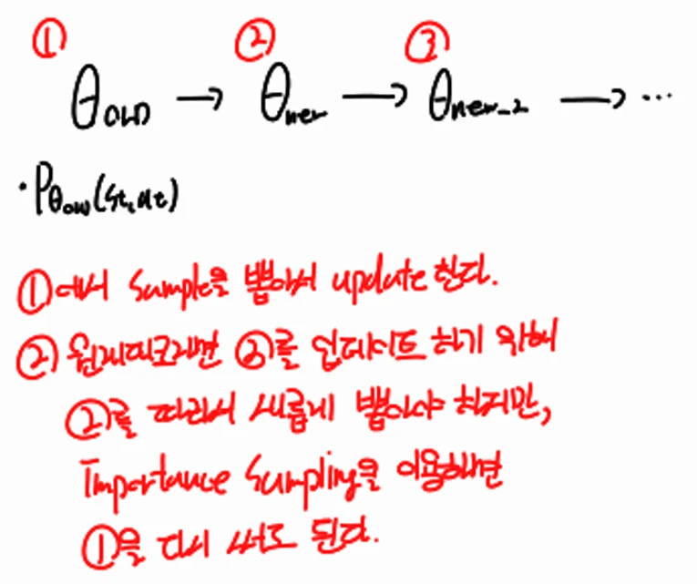
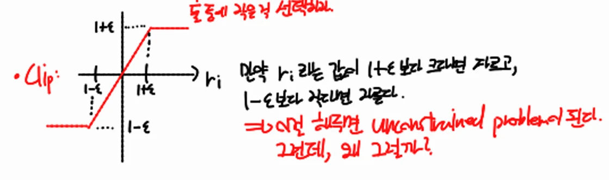
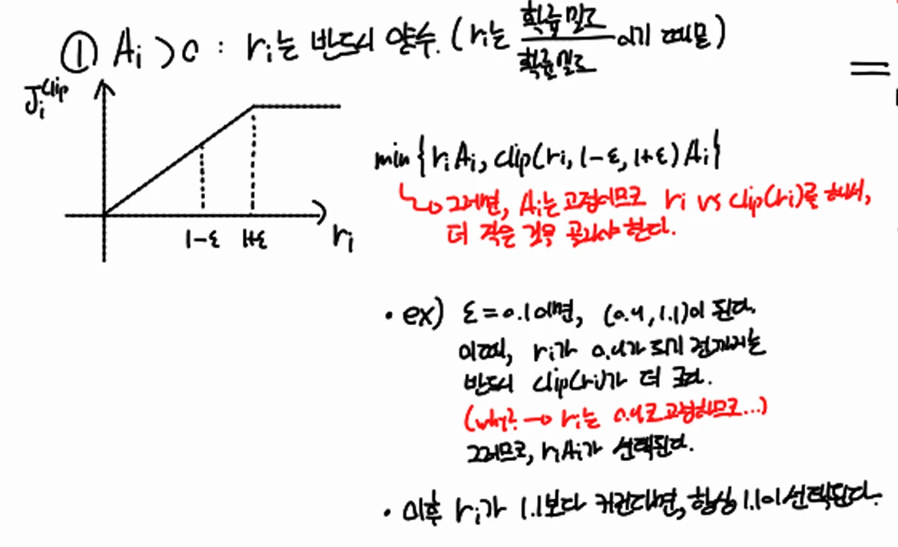
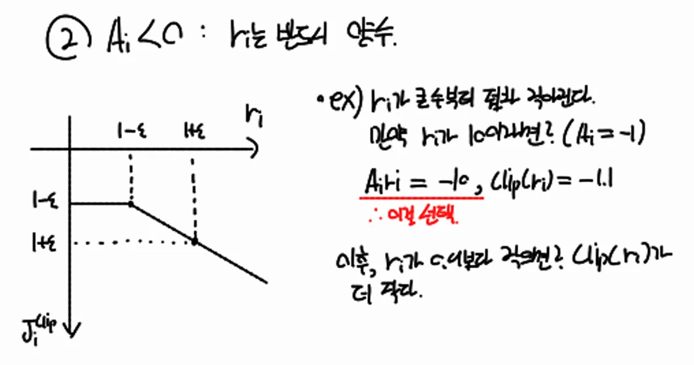
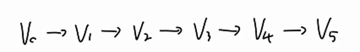

# 강화학습 5: PPO

작성일 2025-03-13
{ .post-date }

[A3C](04-actor-critic.md)까지의 on-policy 방법은 한 번 갱신에 쓴 표본을 바로 버렸다. PPO(Proximal Policy Optimization)의 가장 큰 차이는 이미 만든 데이터를 여러 번 다시 쓴다는 것이다. 이 글은 이를 가능하게 하는 세 가지를 차례로 정리한다.

1. **Importance Sampling**: 표본을 재사용할 수 있게 되는 원리
2. **Clipping**: 제약이 있는 최적화 문제를 제약이 없는 문제로 바꾸는 방법
3. **GAE(Generalized Advantage Estimation)**: 여러 n-step TD를 한꺼번에 쓰는 방법

## Importance Sampling

### 왜 표본을 버려야 했는가

A3C에서 쓰던 gradient를 다시 적으면 다음과 같다. $A_t$는 Advantage다.

$$
\nabla_\theta J_\theta \approx \sum_{t=0}^{\infty} \int \nabla_\theta \ln p_\theta(a_t \mid s_t) \, A_t \, p_\theta(s_t, a_t) \, p(s_{t+1} \mid s_t, a_t) \, ds_t \, da_t \, ds_{t+1}
$$

이 식을 표본 평균으로 근사하려면 $s_t, a_t, s_{t+1}$을 다음 두 분포에서 뽑아야 한다.

1. $p_\theta(s_t, a_t)$를 따르도록 $s_t, a_t$를 뽑는다.
2. $p(s_{t+1} \mid s_t, a_t)$를 따르도록 $s_{t+1}$을 뽑는다.

문제는 1번이다. 표본 $N$개로 한 번 갱신하고 나면 $\theta$가 바뀐다. 이전 표본은 옛 $\theta$의 분포에서 나온 것이므로 더는 쓸 수 없다. 갱신된 $\theta$로 표본을 새로 뽑아야 한다.

### 다른 분포에서 뽑고 보정하기

Importance Sampling은 어떤 분포 $p$에서 sampling하기 어려울 때, 다른 분포 $q$에서 뽑되 importance weight $p/q$를 곱해 마치 $p$에서 뽑은 것과 같은 효과를 얻는 방법이다.

$$
\mathbb{E}_{x \sim p}[f(x)] = \int f(x) \, \frac{p(x)}{q(x)} \, q(x) \, dx = \mathbb{E}_{x \sim q}\left[ f(x) \, \frac{p(x)}{q(x)} \right]
$$

이것을 policy의 갱신에 적용하면 어떻게 되는지를 아래 그림이 보여 준다.



*(1) $\theta_{\text{OLD}}$, (2) $\theta_{\text{new}}$, (3) $\theta_{\text{new2}}$의 순서로 parameter가 갱신된다. 아래의 메모는 (2)를 갱신할 때 (1)에서 뽑은 표본을 다시 써도 된다는 내용이다.*

parameter가 그림의 윗줄처럼 $\theta_{\text{OLD}} \rightarrow \theta_{\text{new}} \rightarrow \theta_{\text{new2}} \rightarrow \cdots$로 갱신되어 간다고 하자. 먼저 (1) $\theta_{\text{OLD}}$에서 표본을 뽑아 갱신하면 (2) $\theta_{\text{new}}$가 된다. 원래대로라면 (2)를 다시 갱신하기 위해서는 (2)의 분포 $p_{\theta_{\text{new}}}(s_t, a_t)$를 따라 표본을 새로 뽑아야 한다. Importance Sampling을 쓰면 그럴 필요가 없다. 앞의 식에서 $p$ 자리에 지금의 policy를, $q$ 자리에 $\theta_{\text{OLD}}$의 policy를 놓으면, (1)에서 뽑아 둔 표본에 비율만 곱해 계속 쓸 수 있다.

gradient 식의 $p_\theta(s_t, a_t)$에 $p_{\theta_{\text{OLD}}}(s_t, a_t)$를 곱하고 나눈다.

$$
\nabla_\theta J_\theta \approx \sum_{t=0}^{\infty} \int \nabla_\theta \ln p_\theta(a_t \mid s_t) \, A_t \, \frac{p_\theta(s_t, a_t)}{p_{\theta_{\text{OLD}}}(s_t, a_t)} \, p_{\theta_{\text{OLD}}}(s_t, a_t) \, p(s_{t+1} \mid s_t, a_t) \, ds_t \, da_t \, ds_{t+1}
$$

비율 부분을 풀어 보면 다음과 같다.

$$
\frac{p_\theta(s_t, a_t)}{p_{\theta_{\text{OLD}}}(s_t, a_t)} = \frac{p_\theta(s_t) \, p_\theta(a_t \mid s_t)}{p_{\theta_{\text{OLD}}}(s_t) \, p_{\theta_{\text{OLD}}}(a_t \mid s_t)} \approx \frac{p_\theta(a_t \mid s_t)}{p_{\theta_{\text{OLD}}}(a_t \mid s_t)}
$$

여기서 $p_\theta(s_t)$와 $p_{\theta_{\text{OLD}}}(s_t)$의 값이 거의 같다고 보고 약분한다. 왜 그렇게 볼 수 있는지는 이해하지 못했지만, 상당히 중요한 가정이다. 이 가정이 성립하려면 결국 $\theta \approx \theta_{\text{OLD}}$여야 한다. 의미로도 해석은 된다. $p_{\theta_{\text{OLD}}}$가 $p_\theta$를 대신하고 있는데 둘이 너무 다르면, 낡은 분포의 표본으로 갱신하는 셈이라 성능이 떨어질 것이다.

다음으로 $\ln$의 미분을 풀면 $\nabla_\theta \ln p_\theta(a_t \mid s_t) = \nabla_\theta p_\theta(a_t \mid s_t) / p_\theta(a_t \mid s_t)$이다. 분모의 $p_\theta(a_t \mid s_t)$가 위 비율의 분자와 약분된다.

$$
\nabla_\theta J_\theta \approx \sum_{t=0}^{\infty} \int \frac{\nabla_\theta p_\theta(a_t \mid s_t)}{p_{\theta_{\text{OLD}}}(a_t \mid s_t)} \, A_t \, p_{\theta_{\text{OLD}}}(s_t, a_t) \, p(s_{t+1} \mid s_t, a_t) \, ds_t \, da_t \, ds_{t+1}
$$

이제 표본은 $p_{\theta_{\text{OLD}}}$에서 뽑는다. $\theta$를 갱신해도 $\theta_{\text{OLD}}$는 그대로이므로 과거의 표본을 버리지 않고 다시 쓸 수 있다. 다만 $\theta_{\text{OLD}}$를 너무 오래 그대로 두면 $\theta$와 지나치게 멀어지므로 주기적으로 $\theta_{\text{OLD}}$도 갱신한다.

### 갱신식과 제약 조건

$p_{\theta_{\text{OLD}}}$는 $\theta$의 함수가 아니므로 미분 기호를 밖으로 뺄 수 있다. 표본 $N$개에 대한 갱신은 다음과 같다.

$$
\theta \leftarrow \theta + \alpha \, \nabla_\theta \sum_{i=t-N+1}^{t} \frac{p_\theta(a_i \mid s_i)}{p_{\theta_{\text{OLD}}}(a_i \mid s_i)} \, A_i
$$

그런데 표본으로 구한 이 값이 원래의 적분과 같으려면 앞에서 쓴 가정 $p_{\theta_{\text{OLD}}}(s_t) \approx p_\theta(s_t)$가 지켜져야 한다. 조건부로만 성립하는 등식이고, 이 조건이 제약(constraint)이 된다. $\theta$가 $\theta_{\text{OLD}}$에서 너무 멀어지면 안 된다.

정리하면 풀어야 할 문제는 다음과 같다.

- **Objective**: 미분을 빼고 보면, 다음 값을 최대화하면 된다.

$$
\max_\theta \sum_{i=t-N+1}^{t} \frac{p_\theta(a_i \mid s_i)}{p_{\theta_{\text{OLD}}}(a_i \mid s_i)} \, A_i
$$

- **Constraint**: 두 분포의 차이가 작아야 한다. 곧 두 분포의 KL Divergence가 매우 작아야 한다. PPO 논문에서는 state마다 만족되도록 기댓값을 취한 형태로 적는다.

$$
\mathbb{E}_{s_t} \Big[ \mathrm{KL}\big[ p_{\theta_{\text{OLD}}}(\cdot \mid s_t), \; p_\theta(\cdot \mid s_t) \big] \Big] \le \delta
$$

이 제약이 붙은 문제는 풀기 어렵다. 그래서 Clipping을 도입한다.

## Clipping

두 분포의 비율을 ratio라는 뜻에서 $r_i$로 적는다.

$$
r_i \triangleq \frac{p_\theta(a_i \mid s_i)}{p_{\theta_{\text{OLD}}}(a_i \mid s_i)}
$$

그리고 objective를 다음과 같이 바꾼다.

$$
\max_\theta \sum_{i=t-N+1}^{t} J_i^{\text{Clip}}, \qquad J_i^{\text{Clip}} \triangleq \min \big\{ r_i A_i, \; \mathrm{clip}(r_i, 1-\epsilon, 1+\epsilon) \, A_i \big\}
$$



*가로축은 $r_i$, 빨간 선은 $\mathrm{clip}(r_i, 1-\epsilon, 1+\epsilon)$이다. 가운데 구간에서는 $r_i$를 그대로 내보내고, 양쪽 바깥에서는 평평하다.*

$\mathrm{clip}$은 위 그림의 빨간 선처럼 $r_i$가 $1+\epsilon$보다 크면 $1+\epsilon$으로, $1-\epsilon$보다 작으면 $1-\epsilon$으로 잘라 내는 함수다. $r_i$가 $1$ 근처에 있을 때만 값이 그대로 통과한다. $J_i^{\text{Clip}}$은 원래 값 $r_i A_i$와 잘라 낸 값 $\mathrm{clip}(r_i) A_i$ 중 더 작은 쪽을 고른다. $\epsilon$이 아주 작은 수일 때, 이렇게 하면 제약이 없는 문제가 된다고 한다. 왜 그런지 경우를 나누어 본다.

### $J_i^{\text{Clip}}$의 모양

$r_i$는 확률 밀도를 확률 밀도로 나눈 값이므로 항상 양수다. 그래서 $A_i$의 부호로 경우를 나눈다. 예로 $\epsilon = 0.1$이면 clip 범위는 $(0.9, 1.1)$이다.

**$A_i > 0$인 경우.** $A_i$가 양수로 고정이므로 $r_i$와 $\mathrm{clip}(r_i)$ 중 작은 쪽이 선택된다.



*가로축은 $r_i$, 세로축은 $J_i^{\text{Clip}}$이다. 직선으로 올라가다가 $r_i = 1+\epsilon$부터 평평해진다.*

그래프에서 볼 것은 오른쪽의 평평한 구간이다. $r_i$가 $1+\epsilon$을 넘으면 $r_i$를 아무리 키워도 $J_i^{\text{Clip}}$이 늘지 않는다. 구간별로 어느 값이 선택되는지를 적으면 다음과 같다.

| $r_i$의 범위 | $\mathrm{clip}(r_i)$ | 선택되는 값 |
|---|---|---|
| $r_i < 0.9$ | $0.9$로 고정 | $r_i A_i$ (원래 값이 더 작다) |
| $0.9 \le r_i \le 1.1$ | $r_i$ | $r_i A_i$ (둘이 같다) |
| $r_i > 1.1$ | $1.1$로 고정 | $1.1 A_i$ (잘라 낸 값이 더 작다) |

표의 세 줄을 이으면 위의 그래프가 된다. $J_i^{\text{Clip}}$은 $r_i$에 따라 직선으로 올라가다가 $r_i = 1 + \epsilon$에서 평평해진다.

**$A_i < 0$인 경우.** 예로 $A_i = -1$이라 하자. 음수를 곱하므로 대소가 뒤집힌다.



*세로축이 아래로 향해 있고 값은 모두 음수다. $r_i$가 $1-\epsilon$보다 작은 구간은 평평하고, 그 오른쪽으로는 $r_i$가 커질수록 계속 내려간다.*

이번에는 평평한 구간이 왼쪽에 있다. $r_i$를 $1-\epsilon$ 아래로 줄여도 $J_i^{\text{Clip}}$이 더 올라가지 않는다. 반대로 오른쪽은 잘리지 않아서, $r_i$가 커지면 $J_i^{\text{Clip}}$이 끝없이 내려간다. 예를 들어 $r_i = 10$이면 원래 값은 $-10$, 잘라 낸 값은 $-1.1$이므로 더 작은 $-10$이 선택된다.

| $r_i$의 범위 | $\mathrm{clip}(r_i) A_i$ | 선택되는 값 |
|---|---|---|
| $r_i > 1.1$ (예: $r_i = 10$) | $-1.1$ | $r_i A_i = -10$ (원래 값이 더 작다) |
| $0.9 \le r_i \le 1.1$ | $r_i A_i$ | $r_i A_i$ (둘이 같다) |
| $r_i < 0.9$ | $-0.9$ | $-0.9$ (잘라 낸 값이 더 작다) |

$J_i^{\text{Clip}}$은 $r_i$가 커질수록 계속 내려가고, $r_i$가 $1 - \epsilon$보다 작아지면 평평해진다.

### 왜 제약이 필요 없어지는가

위의 두 그래프에서 평평한 구간이 핵심이다. objective를 최대화하는 쪽에서 보면, 평평한 구간으로 더 들어가 봐야 얻는 것이 없다.

**$A_i$가 양수일 때.** Advantage가 양수라는 것은 $R_t + \gamma V(s_{t+1}) - V(s_t) > 0$, 곧 그 action의 결과가 $V(s_t)$로 예상한 것보다 좋았다는 뜻이다. 좋은 평가를 받은 action이므로 objective를 키우려면 그 action의 확률을 키워야 하고, 그러면 $r_i$가 커진다. 그런데 $J_i^{\text{Clip}}$은 $r_i$가 $1 + \epsilon$을 넘으면 더 커지지 않는다. $r_i$를 아무리 키우려 해도 얻는 것이 없으므로 그 이상 키우지 않는다. 따라서 두 분포는 비슷하게 유지된다.

**$A_i$가 음수일 때.** 그 action의 결과가 예상보다 나빴다는 뜻이다. objective를 키우려면 $r_i$를 줄여야 한다. 그런데 $r_i$가 $1 - \epsilon$보다 작아지면 $J_i^{\text{Clip}}$이 더 커지지 않는다. 그래서 $r_i$를 너무 많이 줄이지 않게 된다.

두 경우 모두 $r_i$가 $1$에서 멀어지는 방향으로는 더 얻을 것이 없다. 제약을 명시적으로 걸지 않아도 간접적으로 제약을 만족하게 되는 것이다.

## GAE (Generalized Advantage Estimation)

PPO에서는 Advantage $A_i$로 하나의 n-step TD를 쓰지 않고 GAE를 쓴다. n-step TD Error의 끝판왕이라 할 수 있다. 아이디어는 "아예 $\infty$-step TD까지 다 쓰면 안 될까?"다.

### n-step Advantage의 가중합

n-step TD Error를 차례로 적으면 다음과 같다.

$$
\begin{aligned}
A_t^{(1)} &= R_t + \gamma V(s_{t+1}) - V(s_t) \\
A_t^{(2)} &= R_t + \gamma R_{t+1} + \gamma^2 V(s_{t+2}) - V(s_t) \\
&\;\;\vdots \\
A_t^{(n)} &= R_t + \gamma R_{t+1} + \cdots + \gamma^{n-1} R_{t+n-1} + \gamma^n V(s_{t+n}) - V(s_t)
\end{aligned}
$$

1-step부터 $\infty$-step까지를 모두 구해 가중합을 낸다. 가중치는 지수적으로 줄어든다(exponential moving average). 1-step의 가중치가 가장 크고 뒤로 갈수록 작아진다. bias가 큰 쪽과 variance가 큰 쪽을 섞어 둘 다 낮추려는 시도다.

$$
\text{TD}(\lambda) \;:\; \sum_{n=1}^{\infty} (1-\lambda) \, \lambda^{n-1} A_t^{(n)}
$$

예를 들어 $\lambda = 0.1$이면 $0.9 A_t^{(1)} + 0.9 \times 0.1 \, A_t^{(2)} + 0.9 \times 0.1^2 \, A_t^{(3)} + \cdots$이다. 앞에 $(1-\lambda)$를 곱하는 이유는 무한 등비급수의 합 때문이다. 첫 항이 $1-\lambda$, 공비가 $\lambda$이므로 가중치의 합이 $\frac{1-\lambda}{1-\lambda} = 1$이 된다.

### $\delta_t$로 정리하기

1-step TD Error를 $\delta_t$로 적는다.

$$
\delta_t \triangleq R_t + \gamma V(s_{t+1}) - V(s_t)
$$

2-step부터는 $\delta$들의 결합으로 표현할 수 있다. $\gamma V(s_{t+1})$을 더하고 빼면 된다.

$$
\begin{aligned}
A_t^{(2)} &= \big( R_t + \gamma V(s_{t+1}) - V(s_t) \big) + \gamma \big( R_{t+1} + \gamma V(s_{t+2}) - V(s_{t+1}) \big) \\
&= \delta_t + \gamma \delta_{t+1}
\end{aligned}
$$

일반적으로는 다음과 같다.

$$
A_t^{(n)} = \sum_{k=t}^{t+n-1} \gamma^{k-t} \delta_k
$$

이를 $\text{TD}(\lambda)$에 넣고 $\delta$별로 묶는다.

$$
\begin{aligned}
\sum_{n=1}^{\infty} (1-\lambda) \lambda^{n-1} A_t^{(n)}
&= (1-\lambda) \Big\{ \delta_t + \lambda (\delta_t + \gamma \delta_{t+1}) + \lambda^2 (\delta_t + \gamma \delta_{t+1} + \gamma^2 \delta_{t+2}) + \cdots \Big\} \\
&= (1-\lambda) \Big\{ \delta_t (1 + \lambda + \lambda^2 + \cdots) + \gamma \delta_{t+1} (\lambda + \lambda^2 + \cdots) + \gamma^2 \delta_{t+2} (\lambda^2 + \lambda^3 + \cdots) + \cdots \Big\} \\
&= (1-\lambda) \left( \delta_t \cdot \frac{1}{1-\lambda} + \gamma \delta_{t+1} \cdot \frac{\lambda}{1-\lambda} + \gamma^2 \delta_{t+2} \cdot \frac{\lambda^2}{1-\lambda} + \cdots \right) \\
&= \sum_{k=t}^{\infty} (\gamma\lambda)^{k-t} \, \delta_k
\end{aligned}
$$

괄호 안의 무한 등비급수를 합으로 바꾸면 $(1-\lambda)$가 약분된다. 이 식을 GAE라 하고 $A_t^{\text{GAE}}$로 적는다.

$$
A_t^{\text{GAE}} \triangleq \sum_{k=t}^{\infty} (\gamma\lambda)^{k-t} \, \delta_k
$$

GAE는 Clip된 objective의 $A_i$로도 쓰고, $V$를 갱신할 때도 쓴다.

### 유한한 표본에 맞춘 변형

무한 등비급수를 쓰려면 $\infty$까지 가 봐야 한다. 하지만 가진 표본은 $N$개뿐이다. 논문에서는 합을 현재 step $t$까지만 계산한다.

$$
\hat{A}_i^{\text{GAE}} \triangleq \sum_{k=i}^{t} (\gamma\lambda)^{k-i} \, \delta_k
$$



*$V_0$부터 $V_5$까지가 모아 둔 구간이다. 화살표 하나가 1-step TD Error 하나($\delta_0 \sim \delta_4$)에 해당한다.*

예를 들어 위 그림처럼 $s_0$부터 $s_5$까지, 곧 화살표 다섯 개에 해당하는 $\delta_0$부터 $\delta_4$까지를 모았다면 다음과 같다. 각 시점에서 출발해 오른쪽 끝까지 남아 있는 화살표를 모두 더하되, 멀리 있는 것일수록 $\gamma\lambda$를 여러 번 곱해 작게 반영한다.

$$
\begin{aligned}
\hat{A}_0^{\text{GAE}} &= \delta_0 + \gamma\lambda \, \delta_1 + \gamma^2\lambda^2 \, \delta_2 + \gamma^3\lambda^3 \, \delta_3 + \gamma^4\lambda^4 \, \delta_4 \\
\hat{A}_1^{\text{GAE}} &= \delta_1 + \gamma\lambda \, \delta_2 + \gamma^2\lambda^2 \, \delta_3 + \gamma^3\lambda^3 \, \delta_4 \\
&\;\;\vdots \\
\hat{A}_4^{\text{GAE}} &= \delta_4
\end{aligned}
$$

즉 1-step TD Error 여러 개의 합으로 GAE를 구한다. 공부할 당시에는 이렇게 하면 원래의 뜻이 흐려진다고 생각했다. GAE는 $\infty$까지 가야 무한 등비급수가 성립해 가중치의 합이 1이 되는데, 가진 표본이 부족하다고 $t$에서 끊으면 그 성질이 깨진다고 본 것이다. 이 생각은 틀렸다. 끊은 식도 1-step부터 구할 수 있는 가장 긴 step까지의 Advantage를 가중 평균한 것이고, 무한 급수에서 그보다 긴 step에 갔을 가중치가 가장 긴 step 하나에 모이므로 가중치의 합은 여전히 1이다. 계산은 글 끝의 "남았던 질문과 답"에 적었다.

## 알고리즘

1. $\theta, w$를 초기화한다.
2. 표본 $N$개를 모은다. 표본 하나는 $\{s_i, a_i, s_{i+1}\}$이다.
3. 모은 표본으로 아래 두 갱신을 여러 번(epoch) 반복한다.

    - Actor 갱신. $J_i^{\text{Clip}}$ 안에 $r_i$가 있고 $r_i$가 $\theta$의 함수다. $J_i^{\text{Clip}}$ 안의 $A_i$로는 GAE를 쓴다.

        $$
        \theta \leftarrow \theta + \alpha \, \nabla_\theta \sum_{i=t-N+1}^{t} J_i^{\text{Clip}}
        $$

    - Critic 갱신. GAE 안에 1-step TD로 표현된 $V$들이 있고, $w$가 그 $V$를 표현하는 network의 weight다.

        $$
        w \leftarrow w - \beta \, \nabla_w \sum_{i=t-N+1}^{t} \big( \hat{A}_i^{\text{GAE}} \big)^2
        $$

4. batch를 비우고 2로 돌아간다.

표본 $N$개를 쓸 수 있는 만큼 최대한 쓰고 나서 버린다는 것이 A2C, A3C와의 차이다.

## 부록: Stable-Baselines3로 PPO 돌리기

PPO를 직접 구현하지 않고 써 볼 때는 Stable-Baselines3를 쓸 수 있다. 여러 알고리즘이 구현되어 있고 multi-processing을 지원한다. 사용법을 간단히 적어 둔다.

Stable-Baselines3는 Gym 라이브러리 기반의 환경을 쓴다. 따라서 환경을 class로 만들고 `gym.Env`를 상속해야 한다.

- `observation_space`와 `action_space`를 정의한다.
- `reset()`: episode가 새로 시작될 때 호출된다. state를 반환한다.
- `step()`: episode 진행 중에 다음 state로 넘어갈 때 호출된다. state, reward, done, info를 반환한다. info는 쓰지 않아도 된다.
- `render()`: 학습 과정이나 결과를 눈으로 볼 때 쓴다. 꼭 필요하지는 않다.

아래는 참고한 블로그 글의 예시로, 테트리스 환경 8개를 병렬로 만들어 PPO로 학습한다.

```python
from stable_baselines3 import PPO
from stable_baselines3.common.env_util import make_vec_env
from tetris_gym import TetrisApp

tetris_env = make_vec_env(TetrisApp, n_envs=8)
model = PPO('MlpPolicy', tetris_env, verbose=1)
model.learn(total_timesteps=(1e+6))
model.save("tetris")
```

`total_timesteps`는 episode 수와 관계없이 전체 timestep을 몇 번 진행할지를 뜻한다. 학습이 끝나면 모델이 `.zip` 파일로 저장된다.

## 정리

- on-policy 방법이 표본을 버려야 하는 이유는 gradient가 현재 policy의 분포에 대한 기댓값이기 때문이다. Importance Sampling으로 옛 policy $\theta_{\text{OLD}}$의 분포에 대한 기댓값으로 바꾸면 표본을 다시 쓸 수 있다.
- 그 대가로 $\theta$와 $\theta_{\text{OLD}}$가 가까워야 한다는 제약이 생긴다. PPO는 비율 $r_i$를 $[1-\epsilon, 1+\epsilon]$으로 잘라 낸 objective를 써서 이 제약을 간접적으로 만족시킨다.
- Advantage로는 모든 n-step TD Error를 지수 가중합한 GAE를 쓴다. 정리하면 1-step TD Error $\delta_k$에 $(\gamma\lambda)^{k-t}$를 곱해 더한 값이다.

## 남았던 질문과 답

공부할 당시에는 풀지 못하고 남겨 둔 질문들이다. 글을 정리하면서 답을 찾아 덧붙였다.

**Q. Importance Sampling의 비율에서 $p_\theta(s_t)$와 $p_{\theta_{\text{OLD}}}(s_t)$를 같다고 보고 약분할 수 있는 근거는 정확히 무엇인가?**

둘이 같아서 약분하는 것이 아니다. State의 분포를 옛 policy의 것으로 바꿔 넣은 대리 목적함수(surrogate objective)를 일부러 쓰는 것이고, 그래도 되는 근거는 PPO의 바탕이 된 TRPO(Schulman et al., 2015)에 있다. 새 policy의 성능은 옛 policy의 Advantage $A^{\text{OLD}}$로 다음과 같이 정확히 쓸 수 있다. $\rho_\theta(s)$는 policy $p_\theta$를 따를 때 state $s$를 방문하는 빈도를 $\gamma$로 할인해 더한 값이다.

$$
J(\theta) = J(\theta_{\text{OLD}}) + \sum_s \rho_\theta(s) \sum_a p_\theta(a \mid s)\, A^{\text{OLD}}(s, a)
$$

여기서 $\rho_\theta$를 $\rho_{\theta_{\text{OLD}}}$로 바꾼 것을 $L(\theta)$라 하자. 근거는 두 가지다. 첫째, $\theta = \theta_{\text{OLD}}$에서 $L$과 $J$는 값도 gradient도 같다. $J$를 미분할 때 $\rho_\theta$를 미분한 항에는 $\sum_a p_{\theta_{\text{OLD}}}(a \mid s) A^{\text{OLD}}(s, a)$가 곱해지는데, Advantage의 평균은 0이므로 이 항이 사라지기 때문이다. State 분포를 바꿔치기해서 생기는 오차는 $\theta - \theta_{\text{OLD}}$의 2차부터 나타난다. 둘째, 그 오차의 크기에는 상한이 있다.

$$
J(\theta) \;\ge\; L(\theta) - C \max_s \mathrm{KL}\big[ p_{\theta_{\text{OLD}}}(\cdot \mid s),\; p_\theta(\cdot \mid s) \big]
$$

$C$는 $\gamma$와 Advantage의 최대 크기로 정해지는 상수다. 두 policy의 KL Divergence가 작으면 $L$을 키우는 것이 $J$를 키우는 것을 보장한다는 뜻이다. 본문에서 제약 조건이 KL Divergence로 적힌 이유가 이것이고, "$\theta \approx \theta_{\text{OLD}}$여야 한다"는 이해를 정확한 형태로 쓴 것이 이 부등식이다.

**Q. GAE를 유한한 $t$에서 끊는 변형은 무한 등비급수라는 원래의 의미를 흐린다. 그렇게 변형한 값을 그대로 cost function으로 써도 되는가?**

써도 된다. 끊은 값도 n-step Advantage의 가중 평균이고, 가중치의 합은 여전히 1이기 때문이다. 쓸 수 있는 step의 수를 $m = t - i + 1$이라 하면 다음이 성립한다.

$$
\sum_{k=i}^{t} (\gamma\lambda)^{k-i}\, \delta_k = (1-\lambda) \sum_{n=1}^{m-1} \lambda^{n-1} A_i^{(n)} + \lambda^{m-1} A_i^{(m)}
$$

가중치를 더하면 $(1-\lambda)(1 + \lambda + \cdots + \lambda^{m-2}) + \lambda^{m-1} = (1 - \lambda^{m-1}) + \lambda^{m-1} = 1$이다. $m = 2$로 확인하면 $(1-\lambda)\delta_i + \lambda(\delta_i + \gamma\delta_{i+1}) = \delta_i + \gamma\lambda\,\delta_{i+1}$로 좌변과 같다. 무한 급수에서 $m$-step보다 긴 Advantage들에 나뉘어 갔을 가중치 $\lambda^{m-1}$이, 구할 수 있는 가장 긴 $m$-step Advantage 하나에 모인 것이다. 공부할 당시에는 끊으면 가중치의 합이 1이라는 성질이 깨진다고 생각했는데, 계산해 보면 깨지지 않는다. 각 $A_i^{(n)}$이 Advantage의 추정값이므로 그 가중 평균도 추정값이고, 그래서 Actor의 objective와 Critic의 오차 양쪽에 그대로 쓸 수 있다. 달라지는 것은 batch 안에서의 위치에 따른 성격이다. 앞쪽 표본은 긴 step까지 섞이고, 끝에 가까운 표본일수록 짧은 step만 남아 $V$에 더 많이 기댄다. 마지막 표본은 1-step TD Error 하나다.

## 참고 자료

- J. Schulman, F. Wolski, P. Dhariwal, A. Radford, O. Klimov, "Proximal Policy Optimization Algorithms", 2017. <https://arxiv.org/abs/1707.06347>
- J. Schulman, P. Moritz, S. Levine, M. Jordan, P. Abbeel, "High-Dimensional Continuous Control Using Generalized Advantage Estimation", ICLR, 2016. <https://arxiv.org/abs/1506.02438>
- Stable-Baselines3 사용법을 정리할 때 참고한 블로그 글: <https://tw0226.tistory.com/80>
- J. Schulman, S. Levine, P. Moritz, M. Jordan, P. Abbeel, "Trust Region Policy Optimization", ICML, 2015. <https://arxiv.org/abs/1502.05477>
