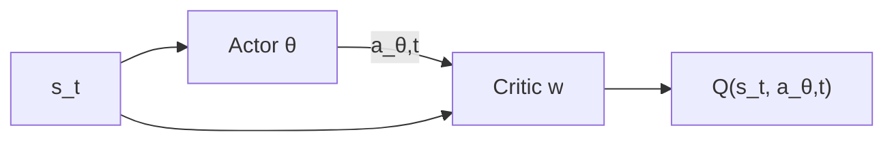

# 강화학습 6: DDPG

시리즈의 마지막 글이다. DDPG(Deep Deterministic Policy Gradient)는 Actor-Critic 구조에 DQN의 Replay Buffer와 Target Network를 결합해, 연속적인 action space에서 policy를 학습하는 방법이다. 이 글에서는 deterministic policy에서 gradient가 어떻게 유도되는지, 그리고 그 결과가 왜 off-policy가 되는지를 따라간다.

## DDPG의 아이디어

앞의 Policy-based 방법들은 stochastic policy를 썼다. network가 분포의 parameter($\mu_t$, $\sigma_t$)를 내놓고, 그 분포에서 action을 뽑았다. DDPG는 deterministic policy를 쓴다. network가 action $a_{\theta,t}$ 하나를 바로 내놓는다.

| | network의 출력 | action |
|---|---|---|
| Stochastic Policy | $\mu_t, \sigma_t$ | 분포에서 sampling |
| Deterministic Policy | $a_{\theta,t}$ | 출력 그대로 |

분포로 보면, policy가 $a_{\theta,t}$에 놓인 $\delta$ function이 되도록 $\theta$를 학습시키는 것이다.

deterministic policy를 택하는 이유는 다음과 같이 정리했다.

- 연속적인 stochastic policy에서 sampling하려면 비용이 커질 수 있다. deterministic하게 정하면 sampling 비용이 줄어든다.
- stochastic policy의 gradient는 variance가 크다. deterministic policy는 variance가 낮아 더 안정적으로 학습된다.
- 다만 variance가 없으면 exploration이 어렵다. 그래서 action에 noise를 더한다.

## 핵심 1: Deterministic Policy에서 $V = Q$

DDPG도 Actor-Critic과 마찬가지로 $G_0$의 기댓값을 최대화하도록 $\theta$를 갱신한다. $s_1{:}a_\infty$는 $s_1, a_1, s_2, \cdots$를 줄여 쓴 것이다.

$$
\begin{aligned}
J_\theta = \mathbb{E}[G_0] &= \int G_0 \, p(s_0, a_0, s_1, \cdots) \, d(s_0{:}a_\infty) \\
&= \int \left[ \int G_0 \, p(a_0, s_1, a_1, \cdots \mid s_0) \, d(a_0{:}a_\infty) \right] p(s_0) \, ds_0 \\
&= \int V(s_0) \, p(s_0) \, ds_0
\end{aligned}
$$

조건부 확률의 곱셈 법칙으로 $p(s_0)$를 떼어 내면, 대괄호 안이 $V(s_0)$의 정의다.

이제 Bellman 방정식으로 $V$를 $Q$로 바꾼다.

$$
\begin{aligned}
V(s_0) &= \int G_0 \, p(a_0, s_1, a_1, \cdots \mid s_0) \, d(a_0{:}a_\infty) \\
&= \int \left[ \int G_0 \, p(s_1, a_1, \cdots \mid s_0, a_0) \, d(s_1{:}a_\infty) \right] p(a_0 \mid s_0) \, da_0 \\
&= \int Q(s_0, a_0) \, p(a_0 \mid s_0) \, da_0
\end{aligned}
$$

$V$는 $Q$의 평균이라는 식이다. 그런데 지금의 policy $p(a_0 \mid s_0)$는 $a_{\theta,0}$에 놓인 $\delta$ function이다. $\delta$ function을 곱해 적분하면 그 위치의 값만 남으므로, $Q(s_0, a_0)$에 $a_{\theta,0}$을 대입한 것이 된다.

$$
V(s_0) = Q(s_0, a_{\theta,0})
$$

## 핵심 2: 받고 가는 Reward

앞의 글들에서는 reward $R_t$를 next state $s_{t+1}$에 도달해야 받는 것으로 보았다. DDPG에서는 $s_t, a_t$가 정해지면 그 즉시 받는 것으로 본다. 즉 $R_t$는 $s_t, a_t$의 함수다.

$$
s_0, a_0 \;\rightarrow\; R_0 = R(s_0, a_0)
$$

이 관점에서 $Q$를 next $Q$로 표현한다.

$$
\begin{aligned}
Q(s_0, a_0) &= \int (R_0 + \gamma G_1) \, p(s_1, a_1, \cdots \mid s_0, a_0) \, d(s_1{:}a_\infty) \\
&= \iint (R_0 + \gamma G_1) \, p(s_2, a_2, \cdots \mid s_1, a_1) \, d(s_2{:}a_\infty) \; p(s_1, a_1 \mid s_0, a_0) \, ds_1 \, da_1 \\
&= \iint \big( R_0 + \gamma Q(s_1, a_1) \big) \, p(a_1 \mid s_1) \, p(s_1 \mid s_0, a_0) \, ds_1 \, da_1
\end{aligned}
$$

둘째 줄에서는 Markov Property로 조건을 $s_1, a_1$만 남겼고, 셋째 줄에서는 $\int G_1 \, p(s_2, a_2, \cdots \mid s_1, a_1) \, d(s_2{:}a_\infty)$가 $Q(s_1, a_1)$이라는 것을 썼다.

여기서 $R_0$는 적분 밖으로 나온다.

- $R_0$는 $s_0, a_0$만의 함수다. 받고 가는 reward이므로 $s_1$도 $a_1$도 필요하지 않다.
- $R_0$가 빠져나간 뒤 남는 $\iint p(a_1 \mid s_1) \, p(s_1 \mid s_0, a_0) \, ds_1 \, da_1$은 1이다. $s_1$이 주어졌을 때 $a_1$에 대해 적분하면 1이고, $s_0, a_0$이 주어졌을 때 $s_1$에 대해 적분하면 1이다.

$Q(s_1, a_1)$ 쪽은 $p(a_1 \mid s_1)$이 deterministic policy, 곧 $\delta$ function이므로 $a_1$에 대한 적분이 $a_{\theta,1}$을 대입하는 것으로 끝난다. $a_0$ 자리에도 policy가 고른 $a_{\theta,0}$을 넣으면 다음을 얻는다.

$$
Q(s_0, a_{\theta,0}) = R(s_0, a_{\theta,0}) + \gamma \int Q(s_1, a_{\theta,1}) \, p(s_1 \mid s_0, a_{\theta,0}) \, ds_1
$$

## Gradient 유도

지금까지의 흐름을 모으면 다음과 같다.

1. $J_\theta = \int V(s_0) \, p(s_0) \, ds_0$. 이 식에서 $\theta$의 함수가 될 수 있는 것은 $V$뿐이므로 $V$를 미분해야 한다.
2. $V(s_0) = Q(s_0, a_{\theta,0})$
3. $Q(s_0, a_{\theta,0}) = R(s_0, a_{\theta,0}) + \gamma \int Q(s_1, a_{\theta,1}) \, p(s_1 \mid s_0, a_{\theta,0}) \, ds_1$

따라서 3의 미분을 알면 된다.

$$
\nabla_\theta J_\theta = \int \nabla_\theta V(s_0) \, p(s_0) \, ds_0 = \int \nabla_\theta Q(s_0, a_{\theta,0}) \, p(s_0) \, ds_0
$$

$R$은 $a$의 함수이고 $a$는 $\theta$의 함수이므로 chain rule이 필요하다($\theta \rightarrow a \rightarrow R$). $a_{\theta,0}$을 $\theta$로 미분한 것을 $a'_{\theta,0}$으로 적는다. 적분 안은 $Q(s_1, a_{\theta,1})$과 $p(s_1 \mid s_0, a_{\theta,0})$이 모두 $\theta$에 의존하므로 곱의 미분으로 두 항이 나온다.

$$
\begin{aligned}
\nabla_\theta Q(s_0, a_{\theta,0}) = \; & a'_{\theta,0} \, \nabla_{a_{\theta,0}} R_0 \\
& + \gamma \int Q(s_1, a_{\theta,1}) \; a'_{\theta,0} \, \nabla_{a_{\theta,0}} p(s_1 \mid s_0, a_{\theta,0}) \, ds_1 \\
& + \gamma \int \nabla_\theta Q(s_1, a_{\theta,1}) \; p(s_1 \mid s_0, a_{\theta,0}) \, ds_1
\end{aligned}
$$

$a'_{\theta,0}$은 $s_1$의 함수가 아니므로 적분 밖으로 나와 묶인다. 앞의 두 항을 묶으면 다음과 같다.

$$
a'_{\theta,0} \, \nabla_{a_{\theta,0}} \left( R_0 + \gamma \int Q(s_1, a_{\theta,1}) \, p(s_1 \mid s_0, a_{\theta,0}) \, ds_1 \right)
$$

이 괄호 안에서 $Q(s_1, a_{\theta,1})$은 $a_{\theta,1}$의 함수이므로 $a_{\theta,0}$에 대해서는 상수로 취급한다. 그리고 괄호 안의 식은 $Q(s_0, a_{\theta,0})$과 같다. 결과는 다음과 같다.

$$
\nabla_\theta Q(s_0, a_{\theta,0}) = a'_{\theta,0} \, \nabla_{a_{\theta,0}} Q(s_0, a_{\theta,0}) + \gamma \int \nabla_\theta Q(s_1, a_{\theta,1}) \, p(s_1 \mid s_0, a_{\theta,0}) \, ds_1
$$

$Q(s_0, a_{\theta,0})$의 미분이 재귀적으로 표현되었다. $Q_0$의 미분을 알려면 $Q_1$의 미분을 알아야 하고, $Q_1$의 미분을 알려면 $Q_2$의 미분을 알아야 한다. 이를 끝까지 풀어 $\sum$으로 적으면 일반형이 된다.

$$
\nabla_\theta J_\theta = \sum_{t=0}^{\infty} \int \gamma^t \, a'_{\theta,t} \, \nabla_{a_{\theta,t}} Q(s_t, a_{\theta,t}) \; p(s_0) \, p(s_1 \mid s_0, a_{\theta,0}) \cdots p(s_t \mid s_{t-1}, a_{\theta,t-1}) \, d(s_0{:}s_t)
$$

여기서도 REINFORCE에서와 마찬가지로 $\gamma^t$를 떼어 내고 근사한다. 그대로 두면 수렴이 어렵기 때문이다.

$$
\nabla_\theta J_\theta \approx \sum_{t=0}^{\infty} \int a'_{\theta,t} \, \nabla_{a_{\theta,t}} Q(s_t, a_{\theta,t}) \; p(s_0) \, p(s_1 \mid s_0, a_{\theta,0}) \cdots p(s_t \mid s_{t-1}, a_{\theta,t-1}) \, d(s_0{:}s_t)
$$

표본 하나는 $a'_{\theta,t} \, \nabla_{a_{\theta,t}} Q(s_t, a_{\theta,t})$이다. Q를 action으로 미분한 값에, action을 $\theta$로 미분한 값을 곱한 것이다. Q가 커지는 방향으로 action을 옮기도록 $\theta$를 고친다는 뜻이다.

## 핵심 3: Off-policy

위 식의 표본에는 policy의 확률이 곱해져 있지 않고 transition probability만 있다. 표본을 만들 때 "어떤 policy로 action을 뽑았는가"가 관여하지 않는다는 뜻이다. target policy가 behavior policy의 영향을 받지 않으므로 off-policy라고 볼 수 있다.

다만 여기에는 단서가 하나 붙는다. 위 식의 transition probability에는 $a_{\theta,t-1}$이 들어 있으므로, 어떤 state가 얼마나 자주 나오는지(state의 분포)는 여전히 policy에 의존한다. 식을 그대로 따르면 state는 현재 policy로 얻은 것이어야 한다. Off-policy DPG(Silver et al., 2014)는 objective를 behavior policy가 방문하는 state 분포 $\rho^\beta$에 대한 평균으로 바꾸고, gradient를 $\mathbb{E}_{s \sim \rho^\beta}\big[ a'_\theta \, \nabla_a Q(s, a) \big]$로 근사해 쓴다. Action에 대한 적분이 없어서 Actor 쪽에 importance sampling이 필요 없다는 것이 deterministic policy의 이점이다. DDPG가 Replay Buffer에서 뽑은 state로 gradient를 계산하는 것은 이 근사에 따른 것이다.

- REINFORCE, Actor-Critic, A2C, PPO는 모두 on-policy다. gradient의 표본을 behavior policy로 얻기 때문이다.
- DDPG는 off-policy다. 그래서 Experience Replay를 쓸 수 있다.

식 그대로 $\sum$을 계산하려면 episode 전체가 표본 하나가 되고, 그 안의 state들은 상관관계가 심하다. DDPG는 DQN과 똑같이 Replay Buffer에 transition을 저장해 두고 균등한 확률로 무작위로 뽑아 이 상관관계를 줄인다.

## 동작 원리와 구조

- $s_0$에서 시작해 network로 action을 고른다.
- transition probability에 따라 state가 바뀐다.
- 이를 반복하며 objective를 구한다.

그런데 식에는 $Q(s_t, a_{\theta,t})$가 들어 있고, 이 $Q$를 직접 구하기는 어렵다. 그래서 $Q$도 parameterize한다. Q-network($w$)는 1-step TD로 $Q$를 학습하고, policy network($\theta$)는 그 $Q$를 써서 갱신한다. 결국 Actor-Critic 구조다.

DDPG의 Q-network는 DQN과 달리 $s_t$와 $a_{\theta,t}$를 함께 입력으로 받는다. policy network가 action을 이미 하나로 정해 주기 때문이다.

## 알고리즘

$\theta, w$를 초기화하고 다음을 반복한다. off-policy이고 Replay Buffer를 쓰므로 매 step마다 갱신할 수 있다.

**(1) Action 수행: $a_{\theta,t} + \epsilon_t$**

deterministic policy에는 variance가 없어 그대로는 exploration이 되지 않는다. 그래서 action에 noise $\epsilon_t$를 섞는다.

**(2) Replay Buffer에 저장: $(s_t, a_t, R_t, s_{t+1})$**

$a_t$는 (1)에서 실제로 수행한 action이다.

**(3) Actor 갱신**

$$
\theta \leftarrow \theta + \alpha \sum_i \nabla_\theta Q_w(s_i, a_{\theta,i})
$$

Replay Buffer에서 뽑은 mini-batch를 쓰므로 $i$에 대한 합이 있다. 표본이 $Q$의 미분이므로 $Q_w$를 $\theta$로 미분한다. chain rule로 풀면 위에서 본 $a'_{\theta,i} \, \nabla_{a} Q_w$다.

**(4) Critic 갱신**

$$
w \leftarrow w - \beta \, \nabla_w \sum_i \Big( R_i + \gamma Q_{w^-}(s_{i+1}, a_{\theta^-,i+1}) - Q_w(s_i, a_i) \Big)^2
$$

- SARSA와 같은 꼴의 1-step TD다.
- Target Network를 분리해 TD Target을 고정한다.
- TD Target에 들어가는 next action도 분리된 network에서 가져온다. 즉 Q-network뿐 아니라 policy network도 target용이 따로 있다.

**(5) Target Network 갱신**

$$
w^- \leftarrow (1-\lambda) \, w^- + \lambda w, \qquad \theta^- \leftarrow (1-\lambda) \, \theta^- + \lambda \theta
$$

DQN처럼 일정 주기마다 통째로 덮어쓰지 않고, moving average로 조금씩 따라가게 한다.

## 장점과 한계

- **장점**: 연속적인 action space를 다룰 수 있다. Replay Buffer와 Target Network 덕분에 과거의 데이터를 다시 쓰면서도 안정적으로 학습한다.
- **한계**: exploration이 어렵다. policy가 deterministic이기 때문이며, noise를 더하는 방식으로 해결한다.

exploration을 noise에 전적으로 의존한다는 이 한계는 [주식 거래 실험](../../research/sailab/05-ddpg-stock-trading.md)에서 실제로 문제가 되었다.

## 시리즈 정리

| 알고리즘 | 학습 대상 | policy | on/off-policy | 핵심 |
|---|---|---|---|---|
| Q-Learning | $Q$ (표) | Q에 대한 greedy | off | TD Target에 max |
| DQN | $Q_w$ | Q에 대한 greedy | off | Replay Buffer, Target Network |
| REINFORCE | $p_\theta$ | stochastic | on | $\ln$ trick, episode 단위 갱신 |
| Actor-Critic | $p_\theta$, $Q_w$ | stochastic | on | $G_t$를 $Q_w$로 대체 |
| A2C | $p_\theta$, $V_w$ | stochastic | on | Advantage |
| A3C | $p_\theta$, $V_w$ | stochastic | on | 비동기 worker, n-step TD, entropy |
| PPO | $p_\theta$, $V_w$ | stochastic | on | Importance Sampling, Clipping, GAE |
| DDPG | $a_\theta$, $Q_w$ | deterministic | off | deterministic policy gradient |

## 남았던 질문과 답

공부할 당시에는 풀지 못하고 남겨 둔 질문들이다. 글을 정리하면서 답을 찾아 덧붙였다.

**Q. gradient를 유도할 때, 묶어 낸 괄호 안의 식 $R_0 + \gamma \int Q(s_1, a_{\theta,1}) \, p(s_1 \mid s_0, a_{\theta,0}) \, ds_1$을 왜 $Q(s_0, a_{\theta,0})$으로 놓을 수 있는가? 그 안의 $Q(s_1, a_{\theta,1})$은 왜 $a_{\theta,0}$에 대해 상수로 취급하는가?**

$Q(s_0, a)$를 "첫 action만 임의의 $a$로 하고 그 뒤로는 policy를 따를 때의 기댓값"으로 보면 된다. 이 함수는 policy가 고르는 action이 아닌 $a$에 대해서도 정의되고, Bellman 방정식도 임의의 $a$에 대해 성립한다.

$$
Q(s_0, a) = R(s_0, a) + \gamma \int Q(s_1, a_{\theta,1}) \, p(s_1 \mid s_0, a) \, ds_1
$$

괄호 안의 식은 이 우변의 $a$ 자리에 $a_{\theta,0}$을 넣은 것이므로 $Q(s_0, a_{\theta,0})$이다. 상수 취급은 $\theta$가 $Q(s_0, a_{\theta,0})$에 영향을 주는 경로가 둘이라는 데서 나온다. 하나는 첫 action $a_{\theta,0}$을 거치는 경로이고, 다른 하나는 그 뒤의 policy, 곧 $Q(s_1, a_{\theta,1})$ 안의 $\theta$를 거치는 경로다. 전체 미분은 두 경로의 합이다.

$$
\nabla_\theta Q(s_0, a_{\theta,0}) = a'_{\theta,0} \, \nabla_a Q(s_0, a)\big|_{a = a_{\theta,0}} + \gamma \int \nabla_\theta Q(s_1, a_{\theta,1}) \, p(s_1 \mid s_0, a_{\theta,0}) \, ds_1
$$

첫 항은 뒤의 policy를 고정하고 첫 action만 움직였을 때의 변화다. 이때 $a$가 들어 있는 곳은 $R(s_0, a)$와 $p(s_1 \mid s_0, a)$뿐이다. $s_1$이 정해지고 나면 그 뒤의 일은 첫 action과 무관하므로 $Q(s_1, a_{\theta,1})$에는 $a$가 없다. "상수로 취급한다"는 것은 이 편미분을 가리키는 말이다. $Q(s_1, a_{\theta,1})$ 안의 $\theta$를 무시한 것이 아니라, 그 의존성은 둘째 항이 따로 맡는다.

**Q. policy는 어떤 과정을 거쳐 deterministic하게 나오고, 그 과정에서 noise는 어떻게 적용되는가?**

Actor는 state를 입력받아 action 벡터 하나를 출력하는 network다. 출력층에 $\tanh$를 두어 $[-1, 1]$의 값을 내고, 여기에 action의 상한을 곱해 실제 범위로 옮긴다. 분포에서 뽑는 단계가 없으므로 같은 state에는 항상 같은 action이 나온다. Noise는 환경에서 데이터를 모을 때만 쓰이고, 넣는 자리에 따라 두 가지다.

- **Action noise**: 출력에 더한다. $a_t = a_{\theta,t} + \epsilon_t$. DDPG 논문은 시간적으로 상관된 Ornstein-Uhlenbeck process를 쓴다. Replay Buffer에는 noise가 더해진, 실제로 수행한 action이 저장된다.
- **Parameter noise**: Actor의 가중치에 더한다. 가중치를 흔든 복사본으로 행동하므로, 복사본이 유지되는 동안에는 같은 state에 같은 action이 나오는 일관된 탐색이 된다. [주식 거래 실험](../../research/sailab/05-ddpg-stock-trading.md)에서 쓴 구현은 이 복사본을 episode가 시작될 때만 새로 만든다.

갱신할 때는 noise가 들어가지 않는다. Actor의 gradient는 buffer의 state에 대해 noise 없는 $a_{\theta,i}$로 계산하고, Critic의 TD Target도 noise 없는 target Actor의 출력을 쓴다. 행동한 policy(noise 있음)와 학습하는 policy(noise 없음)가 달라도 되는 것은 DDPG가 off-policy이기 때문이다. Buffer에 든 $(s_i, a_i, R_i, s_{i+1})$은 어떤 policy로 얻었든 "$s_i$에서 $a_i$를 하면 이렇게 된다"는 정보로서 $Q$의 학습에 쓰인다.

## 참고 자료

- T. P. Lillicrap et al., "Continuous control with deep reinforcement learning", ICLR, 2016. <https://arxiv.org/abs/1509.02971>
- D. Silver et al., "Deterministic Policy Gradient Algorithms", ICML, 2014. <https://proceedings.mlr.press/v32/silver14.html>
