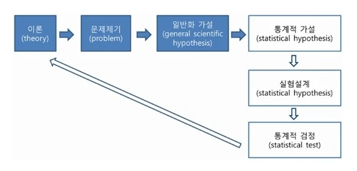
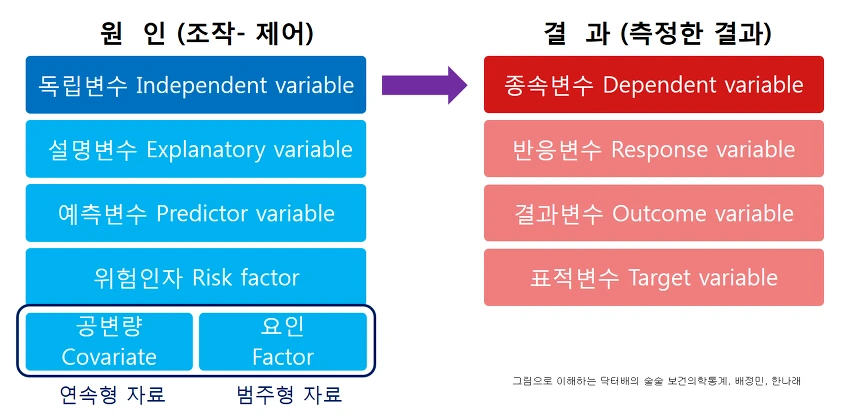
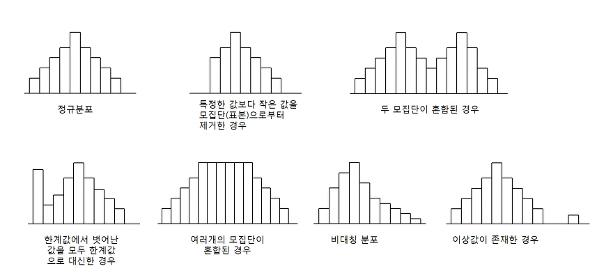
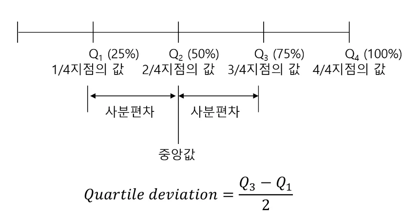
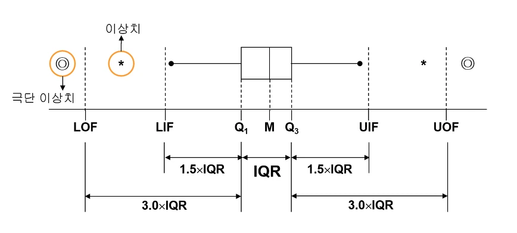
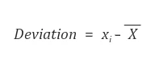
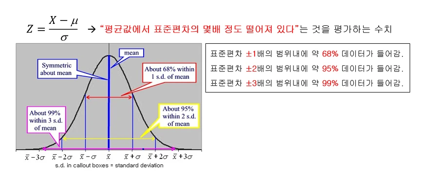
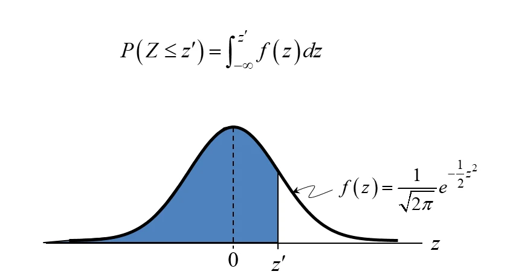
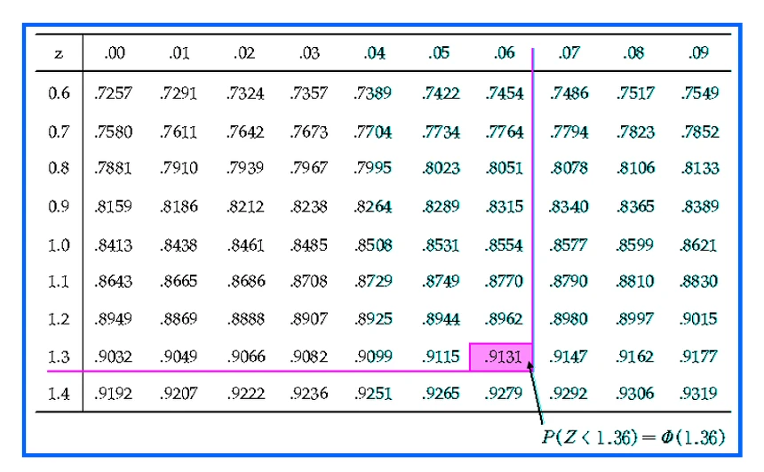

# 통계학 기본

작성일 2024-02-11
{ .post-date }

## 가설 설정

위 그림은 경험 과학의 일반적인 연구절차이다. 연구자는 어떤 현상에 대해서 가설을 설정하고, 그것을 확인하기 위해서 통계적 가설을 설정한다. 다음으로 통계적 가설을 검증하기 위해 실험을 설계하여 연구자가 설정한 가설이 참인지 거짓인지 통계적으로 검정한다.

**경험 과학**은 실험 또는 관찰을 통해 **수집한 자료<strong>(경험)</strong>를 바탕으로 일반화된 이론**을 내 놓는다. 즉 통계는 수집한 자료를 이용하여 연구가설의 참 거짓을 판정하는 수학적 또는 확률적 논리를 제공한다.

## 변수

- **양적변수**: 숫자로 얻을 수 있는, 또는 숫자로 표현된 데이터
- **질적변수**: 숫자로 표현할 수 없는 범주형 데이터

통계분석을 위해 자료를 수집하려고 한다면, 무턱대고 자료를 수집해서는 안된다. 제대로된 자료를 얻기 위해서는 개체(Item), 요인(Factor), 변수(Variable)에 대한 개념을 이해해야 한다.

> 개체(Item)는 연구자 또는 관찰자가 관심을 갖는 대상

개체는 우리가 알고 싶은 대상이다. 예컨대 우리가 신입사원을 대상으로 연구를 진행한다고 하면, 개체는 신입사원이 된다.

> 요인(Factor)는 개체에 관한 특성 중 연구자가 특별히 관심을 갖는 특성

요인은 개체에 관한 특성 중 연구자가 특별히 관심을 갖는 특성을 말한다. 예를 들어 신입사원에 대한 경력사항, 신체조건, 경제 조건 등 연구자가 알고 싶어하는 공통된 특성들의 집합이다.

> 변수(Variable)는 요인을 구성하고 있는 요소

변수는 요인을 구성하고 있는 요소를 말한다. 예컨대 경력사항이 요인이라면 변수로는 초중고 학위, 근무연수, 직무 등이 될 것이다.

## 척도

자료는 범주형 자료와 연속형 자료로 구분된다. 척도도 역시 “범주형 자료”와 “연속형 자료”에 따라 명목척도, 순위척도, 등간척도, 비율척도로 구분된다.

- **범주형 자료**

명목 척도(nominal scale): 이름뿐인 척도

명목척도는 말 그대로 이름뿐인 척도 또는 단위이다. 대표적인 명목 척도의 예는 성별(남/여), 국적, 직업, 거주 지역 등이 있다.

순위척도(ordinal scale): 관찰대상이 지니는 속성에 따라 순위를 결정하는 척도

순위척도란, 관찰대상이 지닌 속성에 따라 순위를 결정하는 척도이다. 그런데, 순위 간 간격이 같다고 확신할 수는 없다.

- **연속형 자료**

등간척도(interval scale): 속성을 평가할 수 있는 균일한 간격을 두고 측정하는 척도

등간척도는 관측대상이 지닌 속성의 차이를 양적인 차이로 측정하기 위하여 척도간 간격을 균일하게 분할하여 측정하는 척도이다. 척도의 간격을 균일하게 나누어 사용하게 되면, 관측 대상의 속성을 정량적으로 측정할 수 있을 뿐만 아니라 사칙 연산을 수행하여 비교할 수 있다. 대표적인 등간척도로는 섭씨 온도, 리커트 척도 등이 있다.

⇒ 등간척도는 절대 영점이 없다. (온도의 경우 0도라고 해서 온도가 없는 것이 아니기 때문이다.)

비율척도(ratio scale): 절대 영점이 있는 등간 척도

거리, 무게, 시간 등이 대표적인 비율척도라고 할 수 있다. 따라서 이것은 절대 영점이 있는 등간척도이며, 따라서 사칙연산이 가능하고 평균을 내는 것도 가능하다.

> 통계 데이터를 제대로 다루기 위해서는 척도의 의미와 처리 방식에 대해서 숙지해야 한다. 왜냐면 척도의 종류에 따라서 데이터 처리 방식이 서로 다르기 때문이다.   
>   
> 예컨대 범주를 나타내는 명목 척도와 순위 척도를 가지고 평균을 내서는 안된다. 이것은 아무런 의미를 갖지 않기 때문이다. 범주형 척도는 빈도수를 이용해서 정량화해야 한다.  
>   
> 반면에 연속형 척도인 등간척도와 비율척도는 사칙연산이 가능하기 때문에 평균값과 편차값을 계산하여 통계 처리를 할 수 있다.

## 독립변수와 종속변수

독립변수: 독립변수는 연구자가 의도적으로 변화시키는 변수이다.

⇒ 통계에서 독립변수는 다른 변수에 영향을 받지 않으며, 오히려 종속 변수에 영향을 준다.

종속변수: 종속변수는 연구자가 독립변수의 변화에 따라 어떻게 변하는지 알고 싶어하는 변수이다.

> 독립변수는 연구자가 마음대로 조정할 수 있는 변수이다. 왜냐면 독립변수가 변함에 따라 종속변수가 어떻게 변화하는지 알고싶기 때문이다.

독립변수와 종속변수는 인과 관계를 가지고 있다. 독립변수와 종속변수는 모두 연속형 자료와 범주형 자료가 될 수 있다. 보통 독립변수가 연속형 자료라면 공변량(Covariance)라고 부르고, 범주형 자료라면 요인(Factor)라고 부른다.

## 기술 통계와 추리 통계

- **기술 통계**(Descriptive Statistics): 기술 통계는 우리가 수집한 데이터를 묘사하고 설명하는 통계 기법들을 말한다. 기술 통계는 크게 두 가지로 나뉘는데, 하나는 우리가 수집한 데이터를 대표하는 값이 무엇인지, 또는 어떤 값에 집중되어 있는지를 다루는 기법이다. 즉 데이터의 집중화 경향(Central tendency)에 대한 기법이라고 할 수 있다. **평균**, **중앙값**, **최빈값** 등이 바로 집중화 경향에 속한다.

    다른 하나는 우리가 수집한 데이터가 어떻게 퍼져 있는지를 설명하는 기법이다. 이를 분산도(Variation)라고 한다. 말 그대로 데이터가 전반적으로 어떻게 분포되어 있는지, 즉 뭉쳐있는지 퍼져 있는지를 설명하는 방법이다. 대표적으로 **표준편차**, **사분위 값** 등이 있다.

- **추리 통계**(Inferential Statistics): 추리 통계는 수집한 데이터를 바탕으로 추론 및 예측하는 통계 기법이다. 하지만 추리 통계는 결국 예측일 뿐이기 때문에 항상 맞지는 않을 수도 있다. 그 이유는 제한된 데이터인 표본을 사용하기 때문이다.

## 도수분포표와 히스토그램

도수분포표(Frequency table)는 빈도표라는 의미이며, 도수 분포표란 자료의 분포를 몇 개의 구간으로 나누고, 나누어진 각 구간에 속하는 자료가 몇 개인지 정리한 표이다. 구간을 나누는 이유는 무엇일까? 구간을 나누면 개별적인 데이터를 보는 것보다 데이터의 전체적인 분포 즉 모양을 요약해서 볼 수 있기 때문이다.

- 도수분포표를 만드는 방법

1) 자료의 개수를 센다.

2) 자료 내에서 최대/최소값을 찾는다.

3) 몇 개 구간(급의 수)로 나눌지 결정한다.

자료의 개수나 분포에 따라 달라져야 한다.

각 구간에 5개 이상의 숫자가 들어가도록 하는 것이 좋다.

너무 많은 구간을 나누지 않도록 한다. (일반적으로 5~15구간)

4) 구간의 폭 (급의폭)을 구한다.

구간폭 = (최대값-최소값)/구간수

되도록이면 정수, 짝수, 5의 배수를 사용하는 것이 좋다.

5) 구간의 경계값 (급의 경계값)을 구한다.

6) 구간별 자료의 개수(도수)를 적는다.

- 히스토그램

히스토그램은 도수분포표를 그래프로 시각화한 것이다. 히스토그램의 모양을 통해서 구간별 빈도수를 알 수 있으며, 이를 통해 우리가 수집한 데이터가 어떻게 나타나는지를 한 눈에 알 수 있다.

> 즉 히스토그램을 그리면 수집한 데이터가 종모양(정규분포)을 이루고 있는지 등을 파악할 수 있다는 것이다.

## 중심화 경향(Central tendency)

- 최빈값: 수집한 데이터 중 그 빈도가 가장 많이 나타나는 데이터 (명목 자료의 대표값)
- 중앙값: 자료를 크기 순으로 정렬했을 때, 중앙에 위치하는 값 (순위 자료의 대표값)

- 평균값: 자료를 모두 더해서 전체 자료의 개수로 나눈 값 (정량적 자료의 대표값)

    우리가 주로 사용하는 평균치는 산술평균이다. 산술평균은 자료값을 모두 더해서 자료의 개수로 나눈 값이다. 그 외에도 기하평균, 조화평균, 가중평균 등이 있다. 통계에서는 주로 산술평균이 많이 사용된다.

## 분산도(Variation)

분산도는 중심화 경향과 달리 수집한 자료의 대표값에는 관심이 없다. 대신 데이터가 얼마나 퍼져있고 모여있는지에 관심을 갖는다.

- 범위: 자료의 최대값과 최소값의 차이

범위는 수집한 데이터가 얼마나 떨어져 있는지를 살펴볼 수 있는 통계이다. 하지만 범위는 자료의 최소값과 최대값이라는 극단적인 두 값을 가지고 도출된 통계치이기 때문에, 데이터의 분포를 나타내는 데에는 한계점을 가지고 있다.

- 사분편차: 자료 정렬 후, 자료 분포의 중앙부에서 전자료의 50%를 포함한 범위의 반

사분편차는 자료를 크기순으로 정렬하고 그 자료의 분포의 1/4에 해당하는 자료값과 3/4에 해당하는 자료값의 차이를 반으로 나눠준 값을 말한다.

그렇다면 사분편차는 어떻게 사용될까? 예를 들어 100명의 수학시험 성적이 있다고 할 때, 이 성적을 정렬한 후 25등, 75등의 수학점수의 차이를 반으로 나눈 것이 사분편차이다. 이것의 의미는 1~25등 점수와 75~100등 점수는 보지 않고 대체로 가운데 몰려있는 50%의 데이터의 분포를 보겠다는 것이다. 그렇다면 왜 1~25등과 75~100등의 점수는 보지 않을까? 이것은 대체로 가운데 몰려있는 50%의 데이터의 분포를 보겠다는 것이다. 1~25등, 75~100등의 점수는 다소 극단적인 값들이라고 판단하는 것이다. 따라서 사분편차에서는 전체 데이터의 1/4과 3/4 지점 사이의 데이터 분포를 보는 통계치라고 할 수 있다. 

즉, 사분편차가 크다는 것은 분포가 크게 퍼져있다는 것이고, 사분편차가 작다는 것은 이 범위에 데이터가 몰려있다는 것이다.

- 박스 플롯: 사분위와 뗄래야 뗄 수 없는 그래프가 바로 박스플롯이다.

⇒ *박스 플롯은 데이터의 분포와 이상치를 동시에 보여주는 시각화 방식이다.*

박스 플롯에서 Q1은 상위 25%값, Q3는 상위 75%값을 나타낸다. M은 중앙값 또는 Q2로 쓰인다. 물론 평균값을 박스플롯에 나타내기도 한다. IQR(Inter Quatile Range)은 Q1, Q3의 범위 즉 차이를 말한다. 그리고 Q1과 Q3 양단에 길게 뻗은 수염 같은 것을 Box Whisker(수염)라고 하며, 이 길이는 보통 IQR의 1.5배이다. Box Whisker 바깥에 있는 데이터들은 보통 Outlier라고 하여 이상값으로 판단한다. 데이터 범위 내에서 아주 크거나 아주 작은 값들이기 때문인데, 그래서 이렇게 이상한 이상치들은 통계분석을 하기 전에 포함시킬 것인지 아니면 없앨 것인지 고민해야 한다.

[낯선 시각화, 박스플롯(Boxplot)과 친해지기 - 뉴스젤리 : 데이터 시각화 전문 기업](https://newsjel.ly/archives/newsjelly/14177)

## 표준편차와 분산

통계에서 편차란, 관측치(개별 자료)와 전체 자료 평균(전체 자료 집합) 간 차이를 말한다. 즉, 개별 자료가 평균으로부터 얼마만큼 떨어져 있는지를 나타내는 것이 바로 편차이다. 편차가 크다는 말은 개별 자료들이 전체 평균과 많이 떨어져 있다는 의미이다. 

이렇게 수집한 각 값들의 편차로부터 평균적인 편차를 구할 수는 없을까? 불가능하다. 왜냐면 결국 개별 자료의 편차를 모두 더하면 0이 되기 때문이다. 평균과 개별 값이 얼마나 떨어져 있는지가 +, - 부호로 계산되기 때문에 결국 모두 더하면 0이 된다. 따라서 새롭게 고안해 낸 방법이 바로 분산이다.

- 분산: 분산은 편차를 제곱한 후 다 더해서 전체 자료의 개수로 나눠준 값이다. 즉 편차의 제곱합을 나타낸 값이라고 할 수 있다. 이러한 방법을 통해 편차의 합이 0이 되는 것을 방지할 수 있다.

    그런데 이 방법은 단위가 제곱으로 표현된다는 문제가 있으므로, 제곱근을 구한다.

- 표준편차: 분산에 제곱근을 취해서 본래 자료의 단위로 돌아오게 만든 값. 이를 통해 값들의 편차가 얼마나 되는지를 쉽게 알 수 있다.

    > 중요한 점은 표준편차가 평균 편차는 아니라는 것이다. 가장 정확한 것은 절대 편차에서 절댓값을 취해 평균을 구하는 것이다. 이렇게 하지 않는 이유는 표준편차가 계산 과정에서 편리함이 크기 때문이다.

## 모집단과 표본

- 모집단(Population): 연구자가 알고 싶어하는 대상 / 집단 전체

모집단은 연구자가 알고 싶어하는 집단 전체를 말한다. 예컨대 어떤 연구자가 대한민국 남자와 여자의 평균 키를 알고싶어 한다면, 모집단은 대한민국의 모든 남자의 키와 여자의 키가 된다.

그런데 어려운 경우도 있다. 어떤 의학자가 개발한 백신 A, B가 있는데, 이 백신 A를 처방했을 때와 백신 B를 처방했을 때 효과의 차이를 알고자 한다. 여기서 모집단은 무엇인가? 모집단은 백신 A를 처방했을 때 모든 효과 그리고 백신 B를 처방했을때의 모든 효과이다. 이렇듯 어떤 측면에서 모집단은 굉장히 추상적인 개념이다.

- 표본(Sample): 연구자가 측정 또는 관찰한 결과들의 집합

모수를 알기 위해서 전수조사를 실시하는 것이 좋지만, 현실적으로 전수조사는 불가능하다. 따라서 연구자들은 표본을 수집해 해당 표본을 측정 또는 관찰하여 모집단의 특성을 추정하게 된다.

## 정규분포와 표준정규분포, 그리고 Z-score

정규분포는 좌우대칭의 종 모양으로 생긴 분포이다. 때론 가우스 분포라고도 한다. 정규분포는 모수가 평균이 μ이고, 표준편차가 σ인 연속확률 분포이다. 여기서 평균은 분포의 중심을 나타내며, 표준편차는 분포가 흩어진 정도를 나타낸다.

즉, 분포의 표준편차가 클수록 종모양 분포는 옆으로 퍼진 분포를 가지게 되고, 표준편차가 작을수록 평균으로 집중되어 뾰족하게 생긴 종모양을 이루게 된다. 모평균이 μ이고 표준편차가 σ인 정규 분포를 따르는 확률 변수 X가 취할 수 있는 값은 -무한대에서 +무한대까지이다.

서로 다른 정규분포를 가진 집단들을 서로 비교하기 위해 정규분포를 표준화하는 방법이 있는데, 이를 표준 정규분포라고 부른다.

그렇다면 어떻게 서로 다른 모양의 정규분포를 표준화할 수 있을까? 바로 정규분포의 평균을 0으로 만들고, 표준편차를 1로 만드는 것이다. 우리가 수집한 데이터에서 그 데이터 집단 전체의 평균을 빼고, 표준편차로 나누어 주면 된다. 이는 개별 데이터에서 전체 데이터의 평균 만큼 빼줘서 0으로 평행이동 한 것과 같으며, 표준편차로 개별 데이터를 나눴기 때문에 그 집단의 표준편차를 1로 만든 것이라고 할 수 있다.

> 이렇게 표준화된 개별 데이터를 Z-score라고 한다. Z-score는 평균이 0이고 표준편차가 1인 정규분포의 확률변수가 된다.

1) Z-score의 분자는 어떠한 개별 데이터가 평균으로부터 얼마나 떨어져 있는지를 의미

2) Z-score의 분모는 그 데이터가 표준 편차의 몇 배 정도 떨어진 것인지를 의미

표준 정규분포에서는 Z-score -1에서 +1에 전체 데이터의 68%가 들어가 있고, Z-score -2에서 +2 범위에 전체 데이터의 95%가 들어가 있다. 만약에 어떤 개별 데이터의 Z 값이 3 이상이 나온다면, 이 값은 이상한 값이라고 추론할 수 있을 것이다.

표준 정규분포는 하나의 연속확률 함수이기 때문에, 그 면적을 통해 특정 지점의 확률을 알 수 있다.

⇒ 이미 계산되어 있는 표를 통해서 면적을 계산할 수 있음.

## 모집단 분포와 표본 분포

- **모수**(Parameter)

모수(Parameter)란, 모집단의 특성을 나타내는 수치이다. 모평균, 모분산, 모표준편차, 모비율, 모상관관계 등이 있다. 다시 말해, 모수란 모집단을 구성하는 데이터를 설명하는 수치값이라고 할 수 있다.

우리가 실제로 알고 싶어하는 것은 모집단 데이터가 아니라 모집단 특성을 설명하는 모수이기 때문에 모수는 굉장히 중요하다. 

그런데, 대부분의 모집단 분포는 완전하게 알려진 것이 없다. 그렇다면 어떻게 모집단의 특성을 알 수 있을까? 표본을 추출해서 모집단의 모수를 추정할 수 있다. 이 과정은 모집단을 구성하고 있는 모든 데이터들이 뽑힐 가능성을 동등하게 부여하고, 객관적으로 무작위 추출한 랜덤 표본이어야 한다. 이러한 표본을 확률 표본(random sample)이라고 한다. 

이를 다시 말하면, 확률 표본이란, 동일 분포(Identical Distribution)와 독립 분포(Independent Distribution)를 따르는 표본이라고 할 수 있다. 동일 분포란, 추출한 확률 표본이 같은 모집단에서 추출되었다는 뜻이고, 독립 분포란 표본을 추출할 때 표본들이 서로 영향을 미치지 않아 같은 확률로 추출되었다는 의미이다.

- **통계량**(Statistics)

통계량(Statistics)은 확률 표본의 특성을 설명하는 값이다. 통계량에는 표본평균, 표본분산, 표본표준편차, 표본비율, 표본상관관계 등이 있다. 그렇다면 모수와 통계량은 무엇이 다를까?

모수는 모집단이 변하지 않기 때문에 그 값이 변하지 않지만, 통계량은 표본을 어떻게 추출하느냐에 따라서 그 값이 다르게 나타난다. 그렇다면 통계량을 이용해 어떻게 모수를 추정할 수 있을까?

예를 들어, 모평균을 추정하기 위해 30개씩 n번 표본을 무작위로 추출했다고 해보자. 그러면 표본 평균(통계량)은 우리가 추출한 확률 표본 X1, X2, X3, …, Xn에 따라 그 값이 변화한다. 여기서 중요한 것은 표본 평균은 확률 표본이 어떻게 추출되느냐에 따라 특정 확률로 변화하므로, **표본 평균은 확률 변수**라고 할 수 있다. 그리고 n번 반복 추출된 표본들 각각의 평균값들은 확률 변수이기 때문에, 그에 대응하는 발생 확률값들이 있을 것이다. 그 확률 값들의 분포를 계산하면, 표본 평균들의 확률 분포를 그릴 수 있다.

예를 들어서 무작위로 표본 30개씩 반복해서 100번 추출했다고 하자. 그러면 100번 추출한 표본 30개의 평균값들을 10개 구할 수 있을 것이다. 그 여러 번 추출된 표본들 각각의 평균값들에 대한 발생 분포를 그려보면, **확률 변수에 대응하는 확률을 가진 확률 분포를 그릴 수 있다.** 우리는 이것을 통계량의 확률 분포라고 할 수 있고, 이를 **표본 분포**(Sampling Distribution)이라고 한다.

우리가 통계량의 확률 함수 또는 표본 분포를 안다고 가정하면, 우리는 이를 통해 모수를 추정할 수 있다.

## 중심극한정리

중심극한정리에서 말하는 표본평균분포는 내가 수집한 표본을 말하는 것이 아니다. 표본평균분포는 영어로 Sampling Distribution of Sample Mean인데, 이는 표본평균분포는 모집단에서 표본크기가 n인 표본(ex. 30개)을 여러번 반복해서 추출했을 때 각각의 표본 평균들이 이루는 분포를 말한다. 그리고 중심극한 정리는 그 표본의 크기가 커질수록 (보통 30이상) 표본 평균들이 이루는 분포가 모집단의 분포에 가까워진다는 말이다.

중심극한정리는 표본 수집을 기반으로 한 추리통계에서 아주 중요한 이론적 근거를 제시하고 있다. 쉽게 말하자면, 우리는 이 정리를 통해 모집단이 어떤 분포를 가지고 있던지 간에, 표본의 크기가 충분히 크다면 표본 평균들의 분포가 모집단의 모수를 기반으로 한 정규분포를 이룬다는 점을 이용하여 특정 사건(내가 수집한 표본의 평균)이 일어날 확률값을 계산할 수 있게 된다.

다시 말해 중심극한정리는 표본 평균들이 이루는 표본 분포와 모집단 간의 관계를 증명함으로써, 수집한 표본의 통계량을 이용해 모집단의 모수를 추정할 수 있는 수학적 근거를 마련해준다.

## 귀무가설과 대립가설

귀무가설(H0)과 대립가설(H1)은 통계적 가설을 검정하기 위해 설정해야 하는 가설이다. 어떤 가설을 채택할지 확률적으로 따져보고 둘 중 하나를 채택해야 한다.

- 귀무가설(영가설): 모집단의 특성에 대해 옳다고 제안하는 잠정적인 주장  
    ⇒ ~과 같다. ~의 효과는 없다. ~와 같다. 와 같은 형식으로 설정된다.
- 대립가설(대안가설): 귀무가설이 거짓이라면 대안적으로 참이 되는 가설  
    ⇒ ~과 다르다. ~의 효과는 있다. ~와 다르다. 와 같은 형식으로 설정된다.

이렇게 두 가지 가설을 세웠다면, 우리가 수집한 표본 데이터를 바탕으로 귀무가설이 옳은지, 아니면 옳다고 볼 수 없는지를 판단해야 한다. 이를 **귀무가설의 유의성 검정**이라고 한다. 우리는 표본을 추출하고 그 표본으로부터 얻은 정보를 기초로 하여 귀무가설이 참인지 거짓인지를 판정하게 된다. 따라서 항상 오류의 가능성이 존재한다.

“귀무가설이 참이라고 가정했을 때, 표본으로부터 얻어지는 통계치가 나타날 확률”을 p값이라 한다.

중심극한정리에서 언급되었듯이, 모집단의 분포에 관계없이 표본의 수가 커지게 되면 표본들의 평균들이 이루는 분포는 모집단의 분포에 가까워진다. 우리가 이 표본 평균분포를 안다면, 표본을 추출해서 얻어진 표본 평균이 표본 평균분포 하에서 나타날 확률이 어느정도인가를 계산할 수 있다.

p값이 낮다는 것은, 귀무가설이 참이라는 가정 하에서 표본을 추출했을 때, 이런 표본 평균이 관측될 확률이 낮다는 것을 뜻한다. (*즉, p값은 귀무가설이 참이라는 가정 하에 이러한 표본 평균이 나타날 확률을 말함.*) 즉 p값이 매우 낮으면, 이러한 표본 통계량은 우연히 나타나기 어려운 케이스이기 때문에 귀무가설을 기각하고 대립가설을 채택해야 한다.

## 1종 오류와 2종 오류

- 1종 오류: 귀무가설(H0)이 실제로는 참이어서 채택해야 함에도, 표본의 오차 때문에 이를 채택하지 않는 오류를 말한다. 보통 알파라고 표기하고, 유의수준이라고 부른다.
- 2종 오류: 귀무가설(H0)이 거짓이라서 채택하지 말아야 하는데 표본의 오차 때문에 이를 채택하는 오류를 말한다. 보통 베타라고 표기한다.

…
