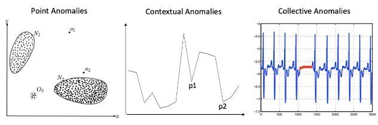
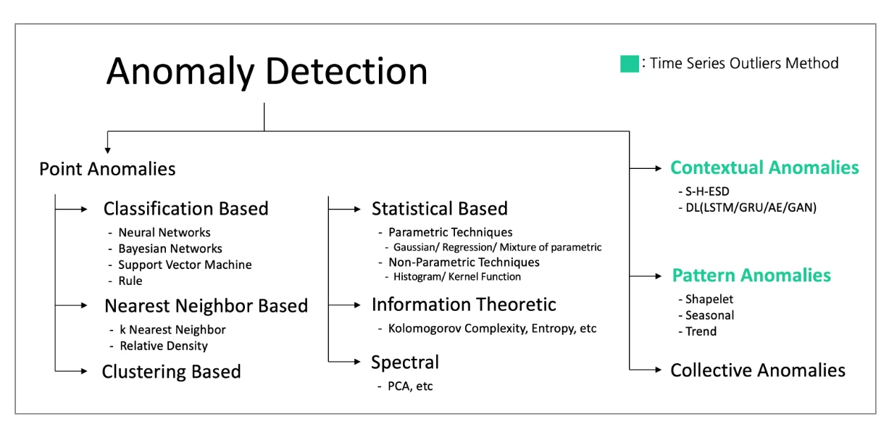

# 데이터 분석 공부

[친절한 데이터 사이언티스트 되기 강좌](https://recipesds.tistory.com/)

---

## &lt;중심극한정리&gt;

어떤 분포이던지, 샘플을 아주 많이 뽑으면 확률분포가 가우시안으로 수렴한다고 중심극한정리를 설명하는 사람이 있다. 하지만 이것은 굉장히 큰 오해이다. 중심극한정리의 정확한 정의는 다음과 같다.

> 샘플링을 해서 그 샘플에 대한 평균을 (무한히) 계속 내 보면 그 평균의 분포는 실제 분포와 상관없이 가우시안 분포이다. 정리해서 말하면, n이 커질 경우 표본 평균의 분포는 정규분포를 따르게 된다는 것이다.

- **예시**

**표본평균분포**란, 내가 수집한 표본을 의미하는 것이 아니라 “모집단에서 표본크기가 n인 표본(n = 30개)을 여러 번 반복해서 추출(N=200)했을 때 이루는 분포”를 말한다. 그 표본의 크기가 커질 수록 표본 평균들이 이루는 분포가 정규분포에 가까워진다는 정리이다.

- **정리**

    - 표본 평균(sample mean)들이 이루는 분포는 복원추출 횟수가 충분한 경우, 모집단의 원래 분포와 상관없이 가우시안 분포를 따른다.
    - 동일한 확률 분포를 따르고 서로 독립인 N개의 확률 변수의 관찰값의 평균값은 N이 충분히 크다면 가우시안 분포를 따른다.
    - N개의 확률 변수가 어떤 확률 분포를 따르든지 상관없이 N이 충분히 크다면, 그 합은 가우시안 분포를 따른다.

---

## &lt;시계열 데이터 이상 탐지(Anomaly Detection)&gt;

[시계열 데이터 이상 탐지(Anomaly Detection)](https://today-1.tistory.com/58)

### Anomaly

Anomaly란 일반적인 데이터와는 다른 메커니즘에 의해 발생된 데이터(1980, Hawkins) 혹은 확률 밀도가 낮은 빈도의 데이터(2006, Harmeling) 등 다양하지만 일반적이지 않은 데이터라고 정의된다. 그리고 Anomaly는 주가 급등 신호와 같이 긍정적인 표현으로 쓰이는 Novelty, 불량 신호와 같이 부정적인 표현으로 쓰이는 Abnormal, 일반 범위를 극단적으로 벗어나는 Outlier 등 다양한 용어로도 표현된다.

### Approaches

Anomaly Detection 문제를 정의하고 구체적으로 모델을 설계하기 위한 접근 방법

- **Nature of Input Data**

이상 탐지의 가장 중요한 요인은 입력 데이터의 특징이다. 데이터의 특성이 범주형/연속형인지, univariate인지 multivariate인지, independent인지 relational인지 등을 파악해야 한다.

입력 데이터의 특징에 따라 서로 다른 통계 모델 혹은 방법론을 적용해야 올바른 결과를 얻어낼 수 있다.

- **Type of Anomaly**

    1. Point Anomalies

        일반적으로 가장 많이 접하고 쉬운 유형이며, 대부분 연구의 초점이 된다. Point Anomalies는 기존에 수집된 데이터의 정적인 정상 분포에 초점을 두고 이와 다른 유형을 파악하는 것을 말한다.

        (ex. card fraud detection)

    2. Contextual Anomalies

        주로 시계열과 공간 데이터에서 연구되는 것으로, Contextual과 Behavioral 두 개의 동적인 고유 특성을 지니고 있어 이를 바탕으로 다른 유형을 파악한다.

    3. Collective Anomalies

        연속형과 그래프 데이터에서 연구되는 것으로, 데이터 집합이 전체 데이터 집합과 비교하여 다른 유형을 파악한다.

**Point Anomalies**는 전체 데이터내에서 발생할 수 있으며, **Contextual Anomalies**는 관련 있는 데이터 집단 내에서만 발생 가능하다. 이와 대조적으로 **Collective Anomalies**는 전체 혹은 집단 내 데이터 context에 따라 발생할 수 있다. 그러므로 **하나의 방법론만 사용해 Anomaly Detection을 진행하는 게 아니라 상황에 따라 복합적으로 활용**할 수 있어야 한다.

- **Data Labels**

1. Supervised Learning

    정상과 비정상에 대한 Data Labels가 모두 존재한다면 사용하는 방법론이다. 이 경우, 일반적으로 정상 대 비정상에 대한 분류를 문제로 정의하고 모델링한다. 비교적 간단하면서도 좋은 성능을 내기 때문에 BaseLine 모델로 활용한다. 그러나 데이터 불균형과 새로운 비정상에 대한 탐지가 어렵다는 문제가 있다.

2. Semi-supervised Learning

    정상에 대한 Data Labels가 존재한다면 주로 사용하는 방법론으로, 비정상에 대한 데이터가 필요하지 않기 때문에 지도학습 방법론에 비해 더 광범위하게 적용 가능하다.

3. Unsupervised Learning

    정상과 비정상에 대한 Data Labels가 모두 존재하지 않는다면 사용하는 방법론이다. Data Labels가 필요하지 않기 때문에 지도/준지도 학습에 비해 더 광범위하게 적용이 가능하지만, 데이터의 이상이 훨씬 빈번하다는 암묵적인 가정을 하고 모델링하기 때문에 더 많은 Anomaly를 찾아낸다.

[이상탐지 Anomaly Detection](https://h3imdallr.github.io/2017-06-20/anomaly_detection/)

---

## &lt;다양한 Anomaly Detection 방법론들&gt;

- Point Anomalies

- Contextual Anomalies

    - S-H-ESD
    - DL(LSTM/GRU/AE/GAN)

- Pattern Anomalies

    - Shapelet
    - Seasonal
    - Trend

[Anomaly Detection - Overview](../deep-learning/34-anomaly-detection-overview.md)

---

## &lt;이상치 탐지 관련 공부&gt;

[이상치 탐색을 위한 통계적 방법과 활용 방안](13-statistical-outlier-detection.md)

[이상 탐지(Anomaly Detection)](https://velog.io/@nadagyeong/이상-탐지Anomaly-Detection)

[이상 탐지(Anomaly Detection) 정리](../deep-learning/35-anomaly-detection-summary.md)

---

## &lt;정규성 검정&gt;

[3D 스캐닝 기법을 활용한 갱내채광 석회석 광산 광주의 안전성 분석](https://www.jksmer.or.kr/articles/xml/QmMn/)
