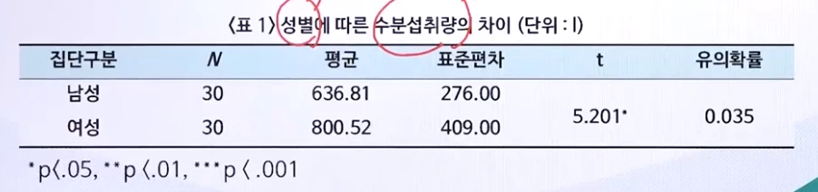
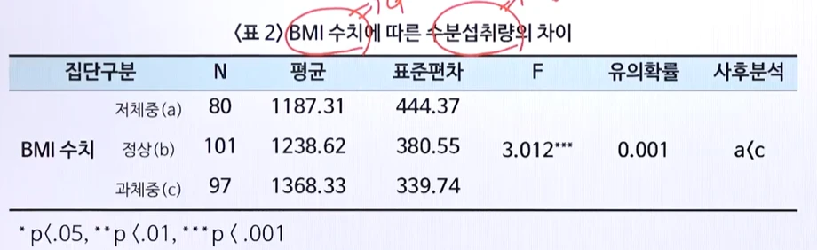
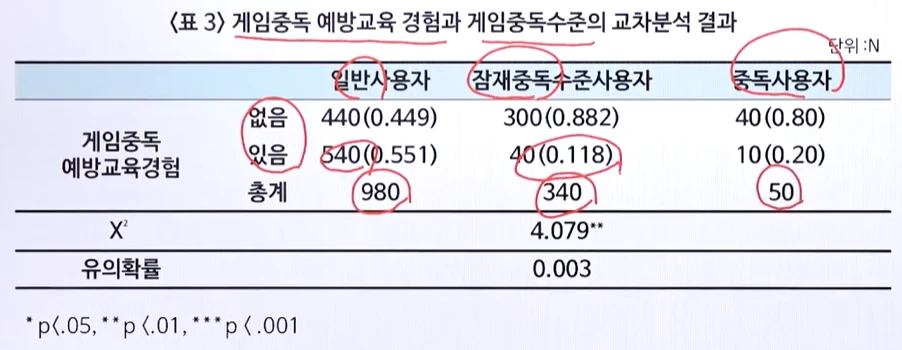
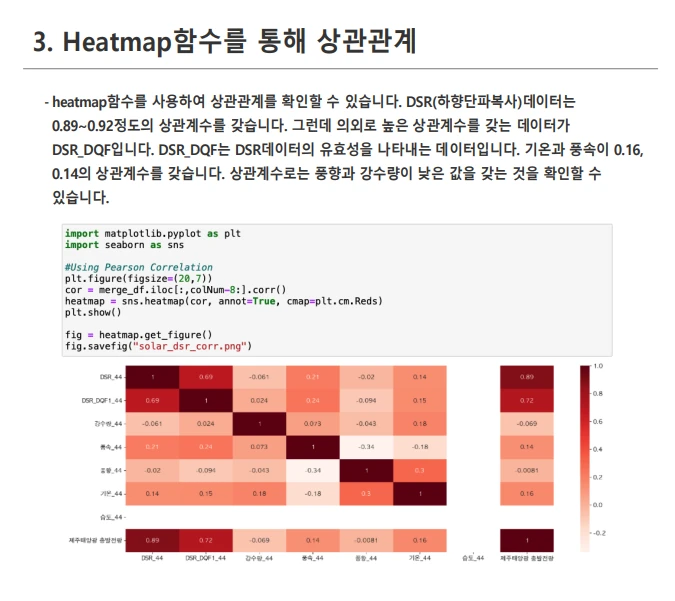

# 논문통계분석 기초

작성일 2024-03-11 · 최종 수정일 2024-03-26
{ .post-date }

[정규성 검정 (Python)](https://signature95.tistory.com/14)

정규성을 확인하는 방법은 시각적으로 표를 그려보는 방법, 통계 검정을 통해 확인하는 방법이 존재

## 정규분포(Normal Distribution)

Feature의 Value 분포를 그렸을 때, 중심(평균값)을 기준으로 좌우 대칭 형태로 나타나는 분포 그래프를 말하며, 육안으로는 종 모양을 띄는 그래프를 말한다.

표준 정규분포(Standard Normal Distribution)는 평균이 0이고 표준 편차가 1인 분포를 말하며, Z-분포라고 부르기도 한다.

> 데이터 값이 정규분포를 따르는지 검정하는 법을 정규성 검정이라고 한다.

---

## &lt;유의성검정과 티검정&gt;

[논문통계분석 기초와 논문 작성법 (2) 유의성검정과 티검정](https://www.youtube.com/watch?v=k1-GLghpt_o&list=PLutixWYnB7MVovMqHleFwpc-wFRtXuXlq&index=1)

질적 변수는 대부분 기술통계 수준에서 분석을 하지만, 연구 문제나 가설을 분석할 때는 양적 변수에 대해서 분석을 하게 된다. 양적 변수를 분석하게 될 때 하게 되는 첫 번째 검정이 **유의성 검정**이다.

우리가 구하는 모든 데이터는 모집단 데이터가 아닌 표본 데이터이다. 모평균과 모표준편차를 구해내는 것은 현실적으로 불가능에 가깝기 때문에, 표본을 바탕으로 모집단을 추정하게 된다.

대부분의 경우, 표본으로부터 얻은 정보에 대해 **유의성검정**을 실시하여 유의 확률을 얻어야 한다.

### 유의확률과 유의수준

- 유의확률: p라고 표기

- 유의수준: 유의 수준의 기준은 아래 세 가지이며, 숫자가 작을 수록 엄격하다.

    - p &lt; .05
    - p &lt; .01
    - p &lt; .001

유의확률은 내가 모은 데이터의 유의수준이며, 이것은 t값에 의해 결정된다. 즉 기준인 유의수준과 유의확률을 비교하여 유의성을 검정하게 되는 것이다. 유의확률은 유의수준보다 클 수도 있고, 작을 수도 있다. 만약 유의확률이 유의수준보다 크면 **비유의적**이라고 하고, 유의수준보다 작으면 **유의적**이라고 한다. 보통 유의적이라고 하면 귀무가설이 기각되고 대립가설이 채택되었다고 하며, 비유의적이라고 한다면 귀무가설이 채택되고 대립가설이 기각되었다고 한다.

- **귀무가설**: 통계학에서 처음부터 버릴 것을 예상하는 가설
- **대립가설**(연구가설): 가설 검정 이론에서 귀무가설에 대립하는 명제

### t-검정

t검정이란, 두 집단의 평균 차이를 검증하기 위한 분석방법이다. 

- **성별에 따른 수분섭취량의 차이**

    - 성별: 질적변수(Group을 구별하기 위한 변수, 정성적 변수)
    - 수분섭취량: 양적변수(계산을 하기 위한 변수, 정량적 변수)

- **t검정의 독립/종속변수**

    - 독립변수: 분석하고자 하는 내용 안의 집단 변수
    - 종속변수: 분석하고자 하는 내용에서 계산되는 변수 

> 그래서 성별간의 수분섭취량이 통계적으로 유의하게 차이가 존재하는가? 라는 것은, 반드시 유의성검정을 실시해야만 알 수 있다.

t검정을 실시하면 유의확률을 얻어낼 수 있는데, 이를 통해서 유의성검정을 실시할 수 있다. 유의확률과 유의수준을 비교하면 된다. 위의 예시의 경우, 통계적으로 유의한 차이가 존재함을 확인했다.

그런데, t검정은 통계적으로 유의한 차이가 존재하는지만 찾아내는 것이 아니다. 반드시 그 결과에 대한 해석이 필요하다. 현재 예시에서는 가장 간단하게 ‘여성이 남성보다 물을 많이 마신다.’를 알 수 있을 것이고, 이는 독립변수가 종속변수에 영향을 준다는 것이라고 할 수 있다. 

---

## &lt;분산분석&gt;

[논문통계분석 기초와 논문 작성법 (3) 분산분석](https://www.youtube.com/watch?v=3v_APzBdDv0&list=PLutixWYnB7MVovMqHleFwpc-wFRtXuXlq&index=4)

**분산분석**은 **세 집단 이상의 평균 차이를 검증하기 위한 분석방법**이다. 이 방법도 t검정과 마찬가지로 **독립변수**와 **종속변수**를 갖는다.

별표의 개수로 유의수준을 결정한다.

위의 예시의 경우, 저체중/정상/과체중을 독립 변수로 사용해 세 집단을 나누어서 분석을 진행한다. 이것도 t검정과 비슷하게, 여러 집단의 평균이 통계적으로 유의하게 다른지 분석하는 것이다.

우리가 구하는 데이터는 모집단의 데이터가 아니라 표본 데이터이기 때문에 반드시 통계적으로 유의한 차이가 있는지를 검증해야 한다. 분산분석은 그 중에서도 분산을 바탕으로 비교를 하며, 그 결과는 F값과 유의확률로 나타난다.

만약 유의적인 차이가 있다고 한다면, 평균에 유의한 차이가 있다고 생각할 수 있다. 그래서 차이가 존재한다면, 어떤 집단 간에 차이가 존재하는지도 알아보아야 한다.

- **사후분석**

분산분석이 유의한 차이를 가질 때, 어떤 집단 간에 차이가 존재하는지 확인하는 방법. 위의 예시에서는 a&lt;c라는 결과가 나왔고, 이는 a와 c만 차이가 있다는 것을 의미한다.

- **해석**
1. 평균에서 유의한 차이가 존재하는 지를 확인
2. 독립변수와 종속변수 간의 차이 해석. 즉, BMI 수치는 수분 섭취에 영향을 준다.

> 분산분석을 논문에 사용했다면, 통계분석에 대한 해석을 4장에 하게 되며, 5장에서는 결론을 쓰며 이 해석이 무엇을 의미하는지를 밝히고 어떻게 이용해야 하는지 추가적인 시사점을 밝힌다.

---

## &lt;카이제곱 검정&gt;

[논문통계기초 04 2논문통계분석 기초와 논문 작성법 (4) 카이제곱분석](https://www.youtube.com/watch?v=fK68ap2YDD0&list=PLutixWYnB7MVovMqHleFwpc-wFRtXuXlq&index=6)

카이제곱 검정은 명목형인 두 변수 간의 관계를 검증하기 위한 분석방법이다.

- **변수의 종류**

    - 질적변수(정성적 변수, 그룹 변수, 명목척도와 서열척도)
    - 양적변수(정량적 변수, 계산을 위한 변수, 등간척도와 비율척도)

> 즉 두 질적변수 간의 관계를 알아보는 방법이 카이제곱 검정이다.

위의 예시는 일반사용자/잠재중독수준사용자/중독사용자 그룹 별로 게임중독 예방교육경험을 받은 경험에 대한 비율이 비슷한지를 검사하는 것이며, 유의확률과 유의수준을 비교하여 알아낸다.

만약 비율 간의 차이가 유의하다면, 추가적인 해석을 진행해야 한다.

> 대략적인 해석을 한다면, 게임 중독에 대한 위험 수준이 낮을 수록 게임중독 예방교육경험이 많을 수 있다고 생각해볼 수 있다. 그러나 이 분석에서는 독립변수와 종속변수를 얘기하지 않았으므로, 어떤 변수가 영향을 주고 받았는지를 정확히 얘기하기는 힘들다. 하지만 어느 정도 영향을 줄 수 있다는 해석을 제시할 수는 있다.

⇒ 다시 찾아보니, 영향을 줄 수 있다는 해석은 잘못된 해석이라고 함. 중독수준에 따라서 예방교육을 경험한 비율이 다르다고 하는게 맞는 표현임.

카이제곱 검정은 동질성과 상관성을 모두 검정할 수 있음.

- 동질성 연구: 동질성 연구의 영가설은 집단 간 차이가 없다는 것이다. 

    - 동질성 연구는 카이스퀘어 값과 유의도로 판단한다.

- 상관성 연구: 상관성 연구의 영가설은 두 변수 간의 관계가 없다는 것이다.

    - 상관성 연구는 Phi 또는 Cramer’s V 값과 유의도로 판단한다.

    > 카이스퀘어, Phi, Cramer’s V가 모두 유의수준이 같다. 다만, 2x2와 같은 특정 상황에서 피어슨 상관계수와 같기 때문에 해석에 용이함이 있다.

---

## &lt;상관관계분석&gt;

[논문통계분석 기초와 논문 작성법 (5) 상관관계분석](https://www.youtube.com/watch?v=d_bx-g2gHHo&list=PLutixWYnB7MVovMqHleFwpc-wFRtXuXlq&index=3)

상관관계분석이란 두 양적 변수의 선형관계에 대한 유의성을 검증하기 위한 방법이다.

- **상관관계 분석 절차**

    > 상관관계 분석은 직선(선형) 관계를 비교하는 것이지, 비선형(곡선) 관계를 비교하는 방법이 아니다. 따라서 만약 비선형 관계를 갖는 것이 있다면, 상관관계 분석에서는 마치 관계가 없는 것처럼 나타나게 된다.

    - 1단계: 유의성 검정 - 두 변수의 선형 관계의 유의성 검정
    - 2단계: 상관계수&#40;r)의 크기를 비교 - 어떤 게 더 관계가 큰가를 파악

- **상관계수**

    - -1 &lt; r &lt; 1
    - 상관계수의 절대값이 클수록 선형관계가 크다는 것을 의미
    - 양수이면 비례하는 것이며, 음수이면 반비례하다는 것이다.

> 상관 분석은 두 자료가 관계가 있다는 것을 나타내지, 각 변수가 다른 변수에 어떠한 영향을 미치는지는 알 수 없다. 이걸 알기 위해서는 회귀 분석을 진행해야 한다.

- **기상청 분석 예시 자료**

[https://bd.kma.go.kr/kma2020/file/2022_Python_Edu_training.pdf](https://bd.kma.go.kr/kma2020/file/2022_Python_Edu_training.pdf)

- **no correlation between temperature and refrigerator**

[https://www.sciencedirect.com/science/article/pii/S0140700701000470](https://www.sciencedirect.com/science/article/pii/S0140700701000470)

---

## &lt;회귀분석&gt;

[논문통계분석 기초와 논문 작성법 (6) 회귀분석](https://www.youtube.com/watch?v=X4IpcWeZHjs&list=PLutixWYnB7MVovMqHleFwpc-wFRtXuXlq&index=5)

상관분석을 통해 두 변수 간에 관계가 있음을 확인했을 때, 독립변수가 종속변수에 미치는 영향을 검증하는 분석방법이다. 이를 통해 독립변수와 종속변수의 관계식을 얻을 수 있다.

- **단순회귀분석/다중회귀분석**

    - 단순회귀분석: 독립변수가 한 개인 경우에 독립변수와 종속변수의 관계를 알아보는 방법
    - 다중회귀분석: 독립변수가 여러 개인 경우에 독립변수와 종속변수의 관계를 알아보는 방법

### 일상생활 만족도가 게임중독수준에 미치는 영향

- 1단계: 회귀식 전체의 유의성 판단

    - 모든 통계분석에서 유의성은 P값(유의확률)을 가지고 판단하게 된다.

- 2단계: 독립변수들의 Beta(표준화계수)나 B(비표준화계수)의 유의성 검증

    - 표준화계수: 원자료를 표준화 시켜 분석한 결과 도출되는 표준화 회귀계수
    - 비표준화계수: 원자료를 사용하여 회귀분석한 결과 도출되는 회귀계수. 샘플의 개수가 다 다르기 때문에 이를 표준화 시킨 것이 표준화 계수이다.

- 3단계: 논문의 필요 목적에 따라 비표준화계수/표준화계수를 적절히 이용한다.

    - 비표준화계수: 관계식을 정리 (B를 이용한 관계식)
    - 표준화계수: 유의적인 독립변수들의 Beta의 상대적 크기 비교 → 중요도비교

- 4단계: 모형의 적합도 검증 (R^2)

    - 이는 독립변수가 종속변수를 얼마나 설명하는가에 대한 설명력을 말한다.
