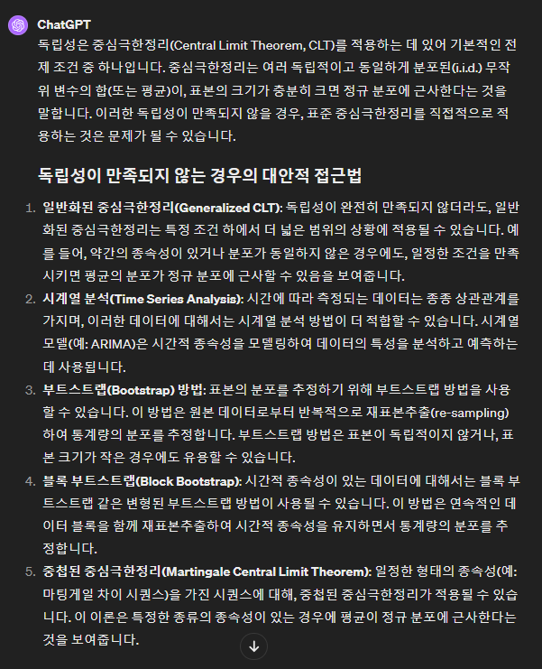

# 중심극한정리와 중심화 경향

## 중심극한정리

### &lt;개요&gt;

[중심 극한 정리](https://ko.wikipedia.org/wiki/중심_극한_정리)

- 중심극한정리는 동일한 확률분포를 가진 독립확률변수 n개의 평균의 분포는 n이 적당히 크다면, 정규분포에 가까워진다는 정리이다. 이는 확률과 통계학에서 큰 의미가 있으며, 실용적인 면에서도 품질관리, 식스 시그마에서 많이 사용된다.

---

### &lt;정리&gt;

> 중심극한정리는 주어진 조건에 따라서 여러가지가 있다.

#### 린데베르그-레비 중심극한정리

가장 많이 쓰이는 중심극한정리는 린데베르그-레비 중심극한정리이며, 같은 분포를 가지는 독립 확률 변수에 대해 다룬다. 

- **조건**

확률 변수 $X_1, X_2, ...$ 들이

1. 서로 독립적이고,
2. 같은 확률 분포를 가지고,
3. 그 확률 분포의 기댓값 $\mu$와 표준편차 $\sigma$가 유한하다면,

해당 표본의 평균의 분포는 특정한 정규분포에 수렴한다.

> 이것은 표본들이 서로 독립적이고 같은 확률 분포를 가져야 한다는 조건이 존재하며, 서로 같은 분포에서 수집되어야 한다는 조건이 빠진 랴푸노프 중심극한정리, 린데베르그 중심극한정리 또한 표본이 독립적이어야 한다는 조건이 붙기 때문에, 표본이 독립적이지 않으면 적용할 수 없다.

#### 중심극한정리에 대한 대안

⇒ 중심극한정리의 적용이 어렵다면, 시계열 분석, 부트스트랩, 블록 부트스트랩 등을 사용하는 방식을 고려할 수 있다.

---

## 중심화 경향

[\[개념 통계 08\] 중심화 경향이란 무엇인가](https://drhongdatanote.tistory.com/28)

> 중심화 경향이란, 수집한 자료 전체를 대표하는 값이 무엇인지 나타내는 통계이다.

- **평균**(Mean)

평균값은 자료를 모두 더해서 전체 자료의 갯수로 나눈 값이다. 이는 정량적 자료의 대표값이다. 우리가 주로 사용하는 평균치는 산술평균이다. 하지만 평균의 단점은, 일부 극단적인 값 또는 이상한 값들에 영향을 받는다는 것이다.

- **중앙값**(Median)

중앙값은 자료를 크기 순으로 나열했을 때, 그 순위의 중앙에 위치하는 값을 말한다. 평균에 비해서 극단 이상치의 영향을 상대적으로 적게 받는다는 것이다.

- **최빈값**(Mode)

최빈값은 자료에서 가장 많은 빈도를 갖는 값으로, 명목 자료의 대표 값으로 자주 사용된다.
