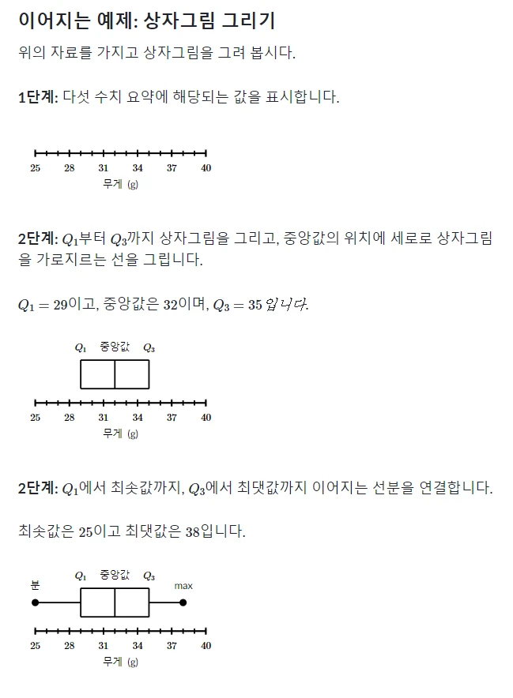

# 박스 플롯

[상자그림 복습 (개념 이해하기) | 양적 자료 요약 | Khan Academy](https://ko.khanacademy.org/math/statistics-probability/summarizing-quantitative-data/box-whisker-plots/a/box-plot-review)

- 중위값: 가운데 두 수의 평균이며, 홀수 개일 경우, 중앙의 값이다.
- 제 1사분위수: 중앙값을 기준으로 왼쪽 값들의 중앙값
- 제 3사분위수: 중앙값을 기준으로 오른쪽 값들의 중앙값 
- 최댓값과 최솟값: 자료의 최댓값과 최솟값

통계학적으로, Q1, Q3보다 크거나 작은 모든 것들을 이상치라고 정의한다. 

- IQR = Q3 - Q1
- Outliers: **Q1 - 1.5IQR**보다 작거나, **Q3 + 1.5IQR**보다 큰 것
