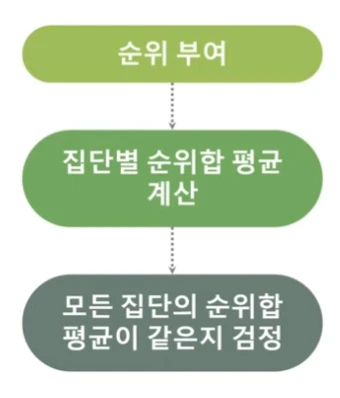
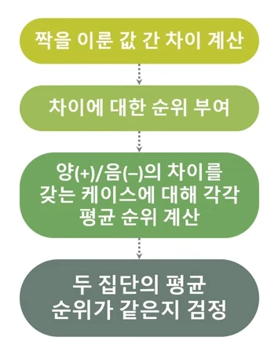
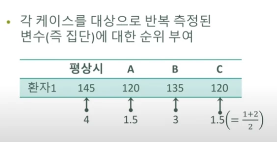

# 독립표본/대응표본의 비모수 검정

[통계데이터분석 - 비모수검정1 - 순위검정 🔑nonparametric test | rank test | 윌콕슨순위합검정 | 크러스칼-왈리스검정 | 윌콕슨부호순위검정 | 프리드먼검정](https://www.youtube.com/watch?v=5t7oPQ5xI9Q)

비모수통계는 모집단의 분포를 잘 모르거나 표본 데이터가 (1) **정규분포를 따른다고 가정하기 어렵거나** (2) **표본크기가 작거나** (3) **이상점이 문제가 되거나** (4) **전통적 통계적 검정 방법이 존재하지 않을 경우** 사용한다.

- **비모수검정**

    - **순위검정**: 데이터의 순위 이용. 전통적인 방식
    - **퍼뮤테이션 검정**: 데이터 표본의 재추출을 통해 생성한 경험적 분포 이용
    - **부트스트래핑**: 데이터 표본의 재추출을 통해 생성한 경험적 분포 이용

---

- **윌콕슨 순위합 검정**

**독립 표본 t 검정**은 두 집단 간의 차이를 검정한다. 반면 **윌콕슨순위합검정**은 모수통계의 독립표본t검정에 해당하며, 중위수가 동일한지를 검정한다.

⇒ 이상점에 대해 엄격한 가정이 불가능하다면, 중위수에 대한 분석이 더 좋을 수 있다.

두 집단의 중위수가 동일하다는 귀무가설이 사실이라면(즉, 두 집단이 동일한 모집단에 속한다면) 두 집단의 순위합 평균이 비슷할 것을 기대할 수 있음.

> ex) 미국 남부와 북부의 수감률에는 통계적으로 유의한 차이가 있는가?  
> **독립 변수**: 지역(북부/남부), **종속 변수**: 수감률

---

- **크루스칼 왈리스 검정**

모수 통계에서 세 개 이상의 집단 간 차이 검정을 할 때는 **분산분석**(일원 분산분석)을 사용한다. 이에 대응하는 비모수 통계기법은 **크루스칼 왈리스 검정**이다. 

모든 집단의 관측값을 통합하고 작은 값에서부터 큰 값의 크기 순으로 순위를 부여한다. 이후 집단별 순위합 평균을 계산하고 모든 집단의 순위합 평균이 같은지를 검정한다.

> ex) 월 별로 오존 농도에 차이가 있는가?  
> **독립 변수**: 월(Month), **종속 변수**: 오존 농도  
> ⇒ 먼저 월 별로 오존 농도 차이가 있는지 월 별 오존 중위수를 확인. 이후에 검증 시작.

---

- **윌콕슨 부호순위 검정**

모수 통계에서 **대응표본 t 검정**은 **서로 다른 집단에 속한 관측값이 짝을 이루고 있는 경우** 또는 **관측값이 반복적으로 측정된 경우**의 두 집단 간의 차이를 검정한다. 

윌콕슨 부호순위 검정은 **모수통계**의 **대응표본 t 검정**에 해당한다. 순위를 이용하므로 이상점의 영향이 대응표본 t 검정보다 다소 적어진다.

**immer dataset**

1931, 1932년의 보리 수확량 데이터. 1931년과 1932년은 연속되는 해이기 때문에 **서로 독립이라고 보기 어렵다.** 따라서 **대응표본 평균 검정을 수행하는 것이 적절**하다고 할 수 있다.

> 영향을 미칠 수 있는 데이터이기 때문에 독립 표본이 아니고, 대응표본을 수행하는 것이 옳다고 판단한다.

> 분석을 하기에 앞서 우선 기술통계를 확인한다. 중위수를 확인하는 것이 좋으며, 중위수에서 나타나는 차이가 통계적으로 유의한지를 보기 위해 통계분석을 이용한다.

---

- **프리드먼 검정**

반복 측정된 세 개 이상의 집단 간 차이 검정. 모수통계의 **반복측정 분산분석**에 해당

⇒ 순위가 같으면 평균값을 부여한다. 각 케이스마다 평균 순위의 차이가 0인지 검정한다.

> ex) 12명의 실험 참가자에게 4가지 잔디를 기르게 한 뒤의 평가를 내렸다. 이 경우, 4가지 잔디를 기른 사람이 동일하기 때문에 집단 간 독립인 **kruskal-wallis test**를 사용할 수 없다. 즉, 대응 표본에 대한 검정인 **friedman test**를 사용한다.
