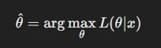
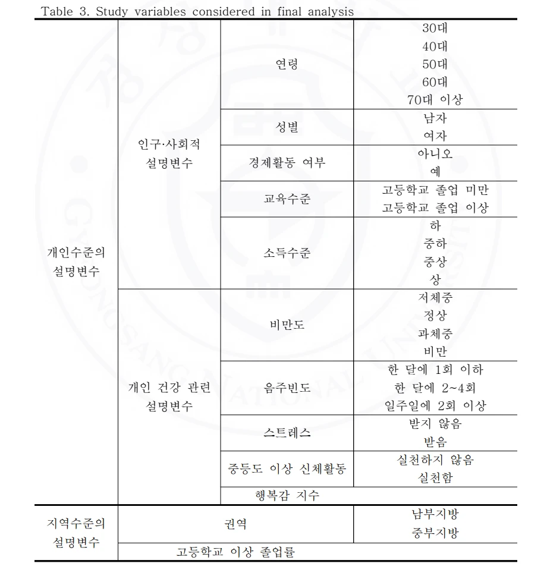
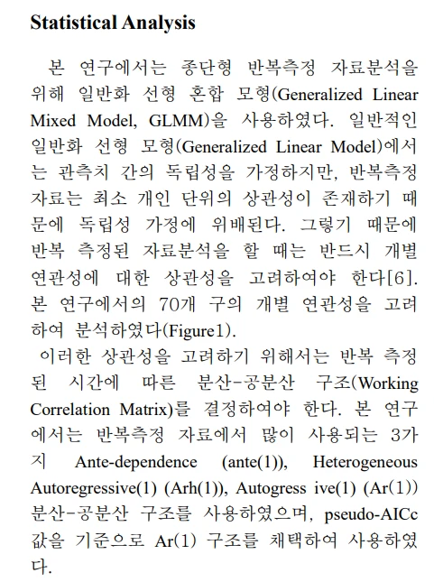
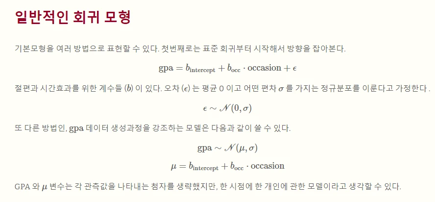

# GLMM

작성일 2024-08-15
{ .post-date }

## &lt;기본 통계 개념&gt;

### 확률 분포의 이해

- **정규 분포**: 정규 분포는 종 모양의 대칭 분포로, 데이터가 평균을 중심으로 균등하게 퍼져 있을 때 사용된다. 이는 통계 분석의 기초로, 많은 통계 기법에서 중요한 역할을 한다. 모수 통계의 기본 가정이 되기도 한다.
- **이항 분포**: 두 가지 가능한 결과로 구성된 실험을 여러 번 반복했을 때, 성공 횟수를 모델링한다. 이항 분포는 사건이 독립적이고 확률이 일정할 때 적용된다.

- **포아송 분포**: 포아송 분포는 일정한 시간이나 공간 내에서 발생하는 사건의 횟수를 모델링할 때 사용된다. 사건이 독립적이고 특정 시간 동안 발생할 확률이 매우 작은 경우에 적합하다.

    - ex) 병원의 응급실에 오는 환자의 수, 고객 콜센터에 걸려오는 전화의 수 등이 포아송 분포를 따를 수 있다.

    [포아송 분포 - 공돌이의 수학정리노트 (Angelo's Math Notes)](https://angeloyeo.github.io/2021/04/26/Poisson_distribution.html)

    - 포아송 분포의 정의: 정해진 시간 안에 어떤 사건이 일어날 횟수에 대한 기댓값을 $\lambda$라고 할 때, 그 사건이 n회 일어날 확률은 다음과 같다.

    $$
    f(n;λ)=\frac{λ^ne^{−λ}}{n!}
    $$

    - 포아송 분포는 이항분포에서 유도될 수 있으며, $\lambda = np$라고 할 때 $p = \frac{\lambda}{n}$에서 유도가 가능하다. 다시 말해 포아송 분포는 수 많은 사건 중(즉, n→∞) 특정한 사건이 발생할 확률이 매우 적은(즉, p→0) 확률변수가 갖는 분포임을 알 수 있다.

### 선형 회귀(Linear Regression)

선형 회귀는 두 개 이상의 변수 간의 선형 관계를 모델링한다. 주로 독립 변수와 종속 변수 간의 관계를 분석하는 데 사용된다. 기본적인 선형 회귀는 데이터를 통해 직선을 피팅하여, 이 직선이 얼마나 잘 데이터를 설명하는지 평가한다.

$$
Y=β_{0}+β_{1}X+ϵ
$$

여기서 $Y$는 종속 변수, $X$는 독립 변수, $\beta_{0}$는 절편, $\beta_{1}$는 기울기(계수), $\epsilon$은 오차이다.

선형 회귀의 목표는 최적의 계수를 찾아 데이터를 잘 설명하는 직선을 만드는 것이며, **독립 변수와 종속 변수 간에 선형 관계가 있다는 가정**, **잔차가 정규 분포를 따른다는 가정**, **독립 변수 간에 다중 공선성이 없다는 가정** 등을 전제로 한다.

### 다중공선성

다중공선성은 선형 회귀 분석에서 독립 변수들 간에 높은 상관관계가 존재하는 상황을 의미한다. 이는 회귀 분석의 결과에 부정적인 영향을 미칠 수 있으며, 모델의 해석을 복잡하게 만든다.

다중공선성이 존재하면, 회귀 계수의 값이 불안정해져 작은 변화에도 회귀 계수의 값이 크게 변할 수 있어 예측의 신뢰성을 저하시킬 뿐만 아니라 계수의 해석이 어려워지고, 표준 오류도 증가한다.

- **다중공선성 감지 방법**

    - 분산 팽창 계수(Variance Inflation Factor, VIF)

         VIF는 특정 독립 변수가 다른 독립 변수들과 얼마나 상관되어 있는지를 측정하는 지표이다. 일반적으로 5를 넘으면 다른 독립 변수와 높은 상관을 가지고 있다고 판단한다.

    - 조건수

        조건수는 회귀 모형의 독립 변수 행렬이 얼마나 잘 조건화되어 있는지를 나타낸다. 조건수가 30을 초과하면 다중공선성이 문제일 수 있다.

    - 상관행렬

        상관행렬은 독립 변수들 간의 상관계수를 계산하여, 상관계수가 높은 변수들을 확인한다. 0.8 이상이라면 높은 상관관계로 간주할 수 있다.

- **다중공선성 해결 방법**

    - 변수 제거

    - 주성분 분석(Principal Component Analysis, PCA)

        상관된 독립 변수들을 결합한 새로운 변수를 만들어 다중공선성 해결이 가능하다.

    - 표준화 또는 정규화

        독립 변수들을 표준화하거나 정규화하여 다중공선성을 줄일 수 있다.

    - 릿지 회귀(Ridge Regression)

### 잔차의 정규 분포(등분산성과 정규성)

잔차란, 선형 회귀 분석에서 예측된 값과 실제 관측된 값 간의 차이를 말한다. 쉽게 말해, 잔차는 모델이 예측한 값과 실제 데이터 사이의 오차이다.

> 잔차 = 실제 값 - 예측된 값

여기서 실제 값은 관측된 데이터 포인트이고, 예측된 값은 회귀 모델을 통해 계산된 값이다.

**잔차는 모델의 적합성을 평가하는 데 사용된다.** 잔차가 작을수록 모델이 데이터를 잘 설명하고 있음을 의미한다. 그러나 잔차가 크거나 특정한 패턴을 보인다면 모델이 적합하지 않음을 나타낼 수 있다.

- **잔차의 등분산성 가정**

선형 회귀에서 등분산성 가정은 잔차의 분산이 모든 독립 변수 값에 대해 일정한 것을 의미한다. 이 가정이 충족되면 모델이 예측한 값의 신뢰성이 높아지고, 회귀 계수의 추정치가 **효율적**이고 **불편**(*편향적이지 않다*)하다고 판단된다.

$$
Var(ϵ_{i})=σ^{2}
$$

등분산성은 회귀 모델에서 각 독립 변수의 값에 대해 잔차의 분산이 일정하다는 것을 의미한다. 즉, 예측된 값과 실제 값 간의 오차가 독립 변수 값에 따라 변하지 않는다는 것이다. 

- **잔차의 등분산성 가정의 중요성**

등분산성이 충족될 때, 최소제곱법(OLS)으로 추정한 회귀 계수들은 불편하고 효율적이다. 이는 추정된 계수들이 실제 계수에 가까운 값일 확률이 높다는 것을 의미한다.

만약 등분산성 가정이 충족되지 않으면, t-검정, F-검정 등의 통계적 검정이 잘못된 결과를 초래할 수 있다. 이 경우, p 값이나 신뢰 구간이 왜곡될 수 있다.

**이분산성**(등분산성의 위반)이 존재하면, 회귀 계수의 표준 오류가 과소 또는 과대평가되어 통계적 검정이 왜곡될 수 있으며 모델이 실제 데이터를 잘 설명하지 못하고 특정 구간에서만 잘 동작하게 될 수 있다.

- **등분산성의 검토**

    - 잔차 플롯(Residual Plot)
    - 브레시 페건 검정

- **잔차의 정규성 가정**

선형 회귀 분석에서는 잔차가 정규 분포를 따른다는 가정이 중요한 역할을 한다. 이 가정이 충족되면, 회귀 모델의 추정치와 예측을 신뢰할 수 있으며, 통계적 검정의 결과가 타당성을 갖는다.

잔차가 정규 분포를 따른다는 것은 잔차의 평균이 0이고, 분산이 일정한 정규 분포로 분포되어 있다는 것을 의미한다. 잔차의 정규성을 검토하기 위해 QQ Plot, 히스토그램 등을 사용할 수 있다.

- **왜 잔차의 정규성이 중요한가?**

잔차가 정규 분포를 따르며, 등분산성 가정을 만족한다는 것은 회귀 분석의 여러 통계적 절차의 타당성에 영향을 미칠 수 있으므로, 이를 잘 검토해야 한다. 만약 잔차의 정규성이 충족되지 않는다면 다른 모델링 접근법을 고려하거나 데이터를 변환해야 한다.

⇒ 이때 WLS, Robust Standard Errors, 변수 변환(로그 변환, 제곱근 변환) 등을 활용 가능

### 일반화 선형 모델(GLM)

GLM은 선형 회귀를 확장하여 종속 변수가 정규 분포를 따르지 않을 때도 사용할 수 있는 모델이다. GLM은 링크 함수와 함께 다양한 분포를 사용하여 종속 변수와 독립 변수 간의 관계를 모델링한다.

- **링크 함수**

    - 링크 함수는 종속 변수와 독립 변수 간의 비선형 관계를 모델링할 수 있도록 도와준다. 예를 들어, 로지스틱 회귀에서는 로짓 링크 함수를 사용한다.
    - GLM에서는 종속 변수가 이항 분포, 포아송 분포 등 다양한 분포를 따를 수 있다.

    > 즉, 포아송 분포를 사용하는 경우 독립 변수에 따라서 포아송 분포를 따르는 종속 변수가 나타날 수 있다고 가정하는 것이라고 볼 수 있다. (포아송 분포는 일정한 시간이나 공간 내에서 발생하는 사건의 횟수를 모델링할 때 사용됨.)

- **GLM의 예시**

    - 로지스틱 회귀: 이항 분포를 따르는 종속 변수를 모델링할 때 사용된다. 예를 들어, 특정 질병에 걸릴 확률을 예측하는 모델이 이에 해당한다.
    - 포아송 회귀: 포아송 분포를 따르는 종속 변수를 모델링할 때 사용된다. 예를 들어, 시간당 발생하는 교통사고의 수를 예측할 때 사용된다.

### 고정 효과와 무작위 효과

- **고정효과**(Fixed Effects)

    - 고정 효과는 모든 관측치에 동일하게 적용되는 효과를 말한다. 예를 들어, 특정 약물의 효과를 측정하는 연구에서 약물 자체의 효과는 고정 효과로 간주될 수 있다.
    - 예시: 학생들이 여러 학교에 소속되어 있고, 연구자는 특정 학교에서 사용하는 특정 교육 방법이 학생들의 성적에 미치는 영향을 평가하고자 한다. 이 경우, **교육 방법은 고정효과**이다. 이는 연구자가 특정 교육 방법의 효과를 모든 학교에서 동일하게 평가하고자 하기 때문이다.

- **무작위효과**(Random Effects)

    - 무작위 효과는 개별 관측치 간의 차이를 설명하는 효과로, 모집단에서 무작위로 선택된 그룹이나 개체에 해당한다. 예를 들어, 각 병원의 고유한 특성은 무작위 효과로 고려될 수 있다.
    - 예시: 여러 병원에서 환자의 치료 효과를 비교하는 연구에서 **병원은 무작위효과로 설정될 수 있다.** 이는 연구자가 특정 병원들에 대한 결과를 전체 병원 모집단으로 일반화하고자 하기 때문이다. 또한, 병원 간의 차이(예, 각 병원의 특성, 의료진의 숙련도 등)를 반영하여 모델링 할 필요가 있다.

- **고정효과와 무작위 효과의 차이**

    - 고정효과는 모든 데이터에 걸쳐 일정하지만, 무작위 효과는 특정 그룹 또는 개체에 따라 달라질 수 있다. GLMM은 두 가지 효과를 동시에 고려하여 모델을 구축할 수 있다.

---

## &lt;로지스틱 회귀분석과 다중 로지스틱 회귀분석&gt;

### 로지스틱 회귀분석

이항 또는 이진 범주형 종속 변수를 예측하기 위해 사용된다. 예를 들어, 특정 질병의 유무와 같은 이진 결과를 예측할 때 적합하다.

종속 변수가 연속형이 아닌 범주형일 때 사용되며, 독립 변수는 연속형 또는 범주형일 수 있다.

- **모델 구조**

$$
\log \left( \frac{p}{1-p} \right) = \beta_0 + \beta_1X_1 + \beta_2X_2 + \cdots + \beta_nX_n
$$

여기서 p는 특정 사건이 발생할 확률이고, $X_{i}$는 독립변수, $\beta_{i}$는 회귀 계수이다. 로지스틱 회귀에서는 회귀 계수 $\beta_{i}$는 독립 변수 $X_{i}$가 종속 변수의 로그 오즈에 미치는 영향을 나타낸다. 예를 들어, $\beta_{i}$ &gt; 0이면, $X_{i}$가 증가할 때 특정 사건이 발생할 확률이 증가함을 의미한다.

> 의미를 해석해보자. 이진 범주형 종속 변수이기 때문에 일어나거나 일어나지 않는다. 그러므로 일어날 확률이 p라고 하고, 이것을 log(로지스틱)로 정의하는 것이다.  
>   
> 일어날 확률이 p일 때, p/(1-p)는 오즈이며, 일어날 확률/일어나지 않을 확률을 말한다. 이렇게 $X_{i}$가 독립변수이므로, 만약 $\beta_{i}$가 0보다 크다면 $X_{i}$가 증가할 때 특정 사건이 발생할 확률이 증가한다고 생각할 수 있다.   
>   
> $\beta_{i}$가 0보다 크다면 결국 확률 자체가 양수가 되므로, 적어도 p가 더 크다고 생각할 수 있다. 그러므로 $\beta_{i}$가 0.1 정도로 작은 수가 될 수는 있지만, 결국 종속 변수 자체는 커지게 되는 것이므로 확률이 증가한다고 볼 수 있는 것이다.

> **오즈**(Odds)와 **오즈비**(Odds Ratio)  
>   
> 주로 의학, 생물학, 사회과학 등 다양한 분야에서 두 사건 간의 상대적 가능성을 비교할 때 사용하는 통계적 개념이다.  
>   
> 1) **오즈**  
> 오즈는 특정 사건이 발생할 확률과 발생하지 않을 확률의 비율을 나타낸다. 
>
> $$
> Odds=\frac{p}{1-p}
> $$
>
> 예를 들어, 동전을 던져서 앞면이 나올 확률이 0.5라고 한다면 사건의 오즈는 1이다. 즉, 앞면이 나올 오즈는 1:1이다.  
>   
> 2) **오즈비**
>
> 오즈비는 두 집단 간의 오즈를 비교한 비율로, 특정 요인에 의해 두 집단 간의 사건 발생 가능성의 차이를 나타낸다.
>
> $$
> \text{Odds Ratio} = \frac{\text{Odds of G1}}{\text{Odds of G2}}
> $$
>
> - OR &gt; 1: 첫 번째 집단에서의 사건 발생 가능성이 더 높다는 것을 의미
> - OR = 1: 두 집단 간의 사건 발생 가능성에 차이가 없다는 것을 의미
> - OR &lt; 1: 첫 번째 집단에서의 사건 발생 가능성이 두 번째 집단보다 낮다는 것을 의미
>
> ex) 예를 들어, 새로운 약물의 효과를 비교할 때, 치료 그룹에서 질병이 개선될 오즈가 2이고 대조군에서의 오즈가 1이라면, 오즈비는 2가 된다. 이는 치료 그룹이 대조군에 비해 질병 개선 가능성이 2배 더 높다는 것을 의미한다. **중요한 것은 두 그룹에서 서로 같은 이벤트를 다뤄야 한다는 것이다.**

### 다중 로지스틱 회귀분석

다중 로지스틱 회귀분석은 종속 변수가 세 개 이상의 범주를 가질 때 사용된다. 예를 들어, 제품의 선호도(좋다, 보통, 나쁘다)와 같은 다항 범주형 데이터를 예측하는 데 적합하다.

다중 로지스틱 회귀는 이항 로지스틱 회귀를 확장하여, 종속 변수가 다중 범주를 가지는 경우에 대해 여러 개의 이항 로지스틱 회귀 모델을 구축한다.

- **모델 구조**

    다중 로지스틱 회귀 모델은 각 범주에 대해 기본(참조) 범주와 비교하는 형태로 구성된다.

    $$
    \log \left( \frac{P(Y = k)}{P(Y = \text{기본 범주})} \right) = \beta_{0k} + \beta_{1k}X_1 + \beta_{2k}X_2 + \cdots + \beta_{nk}X_n
    $$

    ⇒ 기본 범주는 하나를 선택할 수 있다. 기본 범주는 모델에서 다른 범주와의 비교 기준이 되고, 이를 통해 로그 오즈를 구할 수 있게 된다. (즉, 사건 k가 일어날 확률 / 기본 범주의 확률로 로그 오즈를 구하는 것이라고 보면 된다.)

    - 여기서 P(Y=k)는 종속 변수가 범주 k에 속할 확률이다.
    - P(Y=기본 범주)는 종속 변수가 기본 범주에 속할 확률이다.
    - $X_{i}$는 독립 변수이다.
    - $\beta_{ik}$는 기본 범주와 범주 k 간의 회귀 계수이다.  
        ⇒ 즉, 기본 범주를 기준으로 비교하고자 하는 범주 k와의 회귀 계수가 i개 존재하는 것이다.

- **예시**

어떤 설문조사에서 고객 만족도를 만족, 보통, 불만족의 세 가지 범주로 나누어 조사했다고 가정하자. 이때 불만족을 기본 범주로 설정하고, 독립 변수로 고객의 나이와 사용 기간을 포함했다고 한다.

1) 만족 vs 불만족 (기본 범주)

$$
\log_{}{\frac{P(Y = 만족)}{P(Y=불만족)}}=β_{0만족}+β_{1만족}×나이+β_{2만족}×사용 기간
$$

2) 보통 vs 불만족 (기본 범주)

$$
\log_{}{\frac{P(Y = 보통)}{P(Y=불만족)}}=β_{0보통}+β_{1보통}×나이+β_{2보통}×사용 기간
$$

> 위 수식에서 1)번은 만족 범주에 대한 로그 오즈를 구하는 것이며, 이 값이 기본 범주인 불만족 범주와 비교된다. 2)번에서는 보통 범주에 대한 로그 오즈를 구하는 것이며, 이 값 역시 기본 범주인 불만족과 비교된다.

3) **로그 오즈 해석**

각 독립 변수의 계수는 그 변수가 증가할 때 특정 범주로 이동할 로그 오즈에 미치는 영향을 나타낸다.

예를 들어 만족/불만족 일 때, 어떠한 독립 변수의 계수가 크다면, 그 독립 변수가 클수록 커질수록 불만족이 아닌, 만족 범주로 분류될 가능성이 높다는 것이다.

가령 $\beta_{1만족}>0$이라고 하면, 나이가 많아질수록 만족 범주로 분류될 가능성이 불만족 범주보다 커진다는 것을 의미한다. 반대로 $\beta_{1만족}<0$이라고 한다면, 나이가 많아질수록 만족 범주로 분류되지 않고 불만족 범주로 분류될 가능성이 높다는 것이다.

> 일반적으로 가장 의미 있는 범주를 기본 범주로 설정하며, 다른 범주와의 비교가 가장 유의미한 결과를 도출할 수 있는 범주를 선택하는 것이 좋다.

---

## &lt;GLMM을 위한 수학적 배경&gt;

### 우도(Likelihood)와 최대우도법(MLE, Maximum Likelihood Estimation)

우도는 주어진 데이터가 특정 모델 또는 파라미터 값에서 발생할 확률을 측정하는 함수이다. 최대우도법(Maximum Likelihood Estimation, MLE)은 주어진 데이터를 가장 잘 설명하는 모델 파라미터를 추정하는 방법이다.

- **우도 함수**

    - 특정 모델에서 데이터가 관측될 확률을 우도 함수라고 한다. 예를 들어, 정규 분포의 우도 함수는 데이터가 평균 $\mu$와 표준편차 $\sigma$를 갖는 정규 분포에서 관측될 확률을 나타낸다.

$$
L(θ∣x)=P(X=x∣θ)
$$

파라미터 $\theta$는 확률 모델을 정의하는 변수 또는 변수들의 집합이다. 이 변수들은 주어진 데이터 $X$가 특정한 확률 분포를 따를 때, 그 분포의 형상을 결정하는 역할을 한다. 예를 들어, 정규 분포의 경우, $\theta$는 평균 $\mu$와 표준편차 $\sigma$로 구성될 수 있다.

**우도함수**는 **주어진 데이터 x가 특정한 파라미터** $\theta$ **하에서 관측될 가능성을 나타낸다.** 즉, 특정한 파라미터 값을 가정할 때, 관측된 데이터 x가 발생할 확률을 계산한다.

> 조건부확률로 표현하면 파라미터 $\theta$가 주어질 때, x가 나타날 확률을 의미하고, 이를 Likelihood function에서 표현하면 $L(\theta | x)$로 표현되는 것이다.

- **최대우도 추정**

    - MLE는 우도 함수를 최대화하는 파라미터 값을 찾는 방법이다. 이는 주어진 데이터를 가장 잘 설명하는 파라미터의 값을 찾는 과정이다.

    

    - 여기서 $\hat{\theta}$은, 우도 함수를 최대화하는 파라미터 추정치이다.
    - 다시 말하면, MLE라는 것은, x가 나타날 확률을 최대화하는 확률 분포를 결정하는 요소들의 집합인 $\theta$를 찾는 것이다. 정규 분포를 예로 들면, $\theta$는 평균 $\mu$와 표준 편차 $\sigma$로 이루어진다.

- **로그 우도**

    - 로그 우도는 주어진 데이터가 특정 파라미터 하에서 관측될 가능성을 나타내는 우도를 로그 함수로 변환한 것이다. 로그 우도는 최대우도법에서 중요한 역할을 하며, 복잡한 계산을 단순화하고 수학적 편의성을 제공하는 도구로 사용된다.
    - 우도 함수는 종종 매우 작은 값이 될 수 있기 때문에, 계산 과정에서 곱셈 대신 덧셈을 사용하기 위해 로그 우도를 사용한다. 로그 우도는 우도 함수의 자연 로그를 취한 값이다.
    - **로그 우도 수식**

    $$
    ℓ(θ∣X)=logL(θ∣X)
    $$

    특정한 확률 분포가 주어졌을 때 데이터 X가 나타날 확률값에 자연 로그를 씌운 값. 이러한 변환을 하는 이유는, 종종 확률값이 너무 작게 나와서 곱하면 너무 작아지기 때문이다.

    - **다중 관측치의 로그 우도**

    $$
    ℓ(θ∣X_{1},X_{2},…,X_{n})=log(∏^{n}_{i=1}P(X_{i}∣θ))
    $$

    관측치가 매우 많을 경우, 조건부확률은 n개의 데이터가 주어진 파라미터 $\theta$ 하에서 나타날 확률인 $P_{i}$를 모두 곱한 값이므로, 그 값이 매우 작아질 수 있다. 그런데 log를 취한다면 모두 log의 덧셈으로 변환이 가능하므로 그 효과를 조금 줄일 수 있는 것이다.

    $$
    ℓ(θ∣X_{1},X_{2},…,X_{n})=∑_{i=1}^{n}logP(X_{i}∣θ)
    $$

    ⇒ 이와 같이 변환되어 표현할 수 있다. 

- **로그 우도의 활용**

로그 우도는 모델의 적합도와 복합성을 평가하는데 사용되기도 하며, 우도비 검정(Likelihood Ratio Test)에서도 중요한 역할을 한다. 우도비 검정은 두 모델 간의 적합도를 비교할 때, 두 모델의 로그 우도를 비교하여 더 나은 모델을 선택하는 데 사용된다.

- **GLMM에서의 MLE**

GLMM은 고정 효과와 무작위 효과를 모두 포함하는 복잡한 모델이다. 이 모델의 파라미터(확률 분포)를 추정하기 위해 MLE가 사용되며, 이는 반복적인 계산이 필요할 수 있다.

---

## &lt;혼합 모델(Mixed Model)&gt;

혼합 모델은 고정 효과와 무작위 효과를 모두 포함하는 통계 모델이다. 혼합 모델은 데이터를 분석할 때, 관측치 간의 상관관계를 고려하고, 계층적 또는 중첩된 데이터 구조를 모델링하는 데 사용된다. 혼합 모델은 특히 복잡한 데이터를 분석할 때 유용하다.

### 선형 혼합 모델(LMM, Linear Mixed Model)

선형 혼합 모델은 종속 변수와 독립 변수 간의 선형 관계를 모델링하는 혼합 모델의 한 형태이다. LMM은 고정 효과와 무작위 효과를 모두 포함하여, 데이터의 변동성을 보다 정확하게 설명할 수 있다.

- **고정 효과**: 모든 관측치에 동일하게 적용되는 효과
- **무작위 효과**: 관측치 간의 차이를 설명하는 효과로, 특정 그룹 또는 개체에 대한 고유한 특성
- **LMM의 일반적 형태**

$$
Y_{ij}=β_{0}+β_{1}X_{ij}+u_{i}+ϵ_{ij}
$$

여기서 $Y_{ij}$는 종속 변수, $X_{ij}$는 독립 변수, $u_{i}$는 무작위 효과, $\epsilon_{ij}$는 오차이다.

### 일반화 선형 혼합 모델(Generalized Linear Mixed Model, GLMM)

GLMM은 선형 혼합 모델을 확장하여, 종속 변수가 정규분포를 따르지 않을 때에도 사용할 수 있는 GLM에 고정 효과와 무작위 효과를 분석하는 Mixed Model의 개념을 더한 모델이다.

- **GLMM의 구성 요소**

    - **고정 효과**(Fixed Effects): GLMM에서 고정 효과는 모든 관측치에 동일하게 적용된다. 예를 들어, 특정 약물의 평균 효과는 고정 효과로 모델링 된다.
    - **무작위 효과**(Random Effects): 무작위 효과는 개별 단위(ex. 환자, 학교, 병원 등)에 따라 다를 수 있는 효과를 모델링한다. GLMM에서는 무작위 효과가 그룹 내 변동성을 설명하는 데 사용된다.
    - **링크 함수**(Link Function): GLMM은 링크 함수를 사용하여 비선형 관계를 모델링할 수 있다. 예를 들어, 로지스틱 회귀에서는 로짓 링크를 사용하여 이항 분포를 모델링한다.
    - **분포**(Distribution): GLMM에서는 종속 변수가 이항 분포, 포아송 분포 등 다양한 분포를 따를 수 있다.

- **GLMM의 일반적 형태**

$$
g(E[Y_{ij}])=β_{0}+β_{1}X_{ij}+u_{i}
$$

여기서 $g(x)$는 링크 함수, $E[Y_{ij}]$는 종속 변수의 기대값, $\beta_{0}$, $\beta_{1}$는 고정 효과, $u_{i}$는 무작위 효과이다.

- **계층적 데이터 모델링**

계층적 데이터 모델링은 혼합 모델의 핵심 개념 중 하나이다. 계층적 데이터는 그룹이나 클러스터 내에서 여러 관측치를 포함하는 데이터로, 학교별 학생 성적, 병원별 환자 데이터 등이 이에 해당한다.

1) 계층적 구조: 계층적 데이터는 데이터가 여러 수준으로 구조화되어 있음을 의미한다. 예를 들어, 학생들은 학교에 소속되고, 학교는 지역에 소속되는 계층 구조를 가질 수 있다.

2) 중첩된 데이터: 중첩된 데이터는 한 그룹의 관측치가 다른 그룹의 관측치 내에 포함된 구조를 나타낸다. 예를 들어, 환자들이 같은 병원에 속해 있을 때, 환자 데이터는 병원 데이터에 중첩되어 있다.

3) 모델링 방법: 계층적 데이터 구조를 적절히 모델링하려면, 고정 효과와 무작위 효과를 모두 포함하는 혼합 모델을 사용해야 한다. 이렇게 함으로써 각 계층의 변동성을 설명하고, 그룹 간의 차이를 명확히 할 수 있다.

---

## &lt;모델 진단&gt;

모델 진단은 GLMM과 같은 통계 모델의 적합성을 평가하고, 결과의 신뢰성을 확보하기 위한 중요한 과정이다. 적절한 모델진단을 통해 모델의 가정이 충족되는지 확인하고, 결과가 의미 있는지를 평가할 수 있다.

### 모델 적합성 평가

모델 적합성 평가는 모델이 데이터를 얼마나 잘 설명하는지를 평가하는 과정이다. **GLMM**에서 주로 사용되는 모델 적합성 평가 방법에는 **잔차 분석**, **AIC**(아카이케 정보 기준), **BIC**(베이지안 정보 기준) 등이 있다.

- **잔차 분석**

    - 잔차: 잔차는 관측된 값과 모델이 예측한 값 간의 차이를 나타낸다. 잔차 분석은 이러한 차이를 평가하여 모델의 적합성을 진단하는 데 사용된다.
    - 잔차 플롯: 잔차 플롯을 통해 잔차가 무작위로 분포되어 있는지, 특정 패턴을 보이는지 확인할 수 있다. **잔차가 무작위로 분포되어 있다면, 모델이 데이터를 잘 설명한다고 볼 수 있다.**
    - 표준화 잔차: 표준화 잔차는 잔차를 표준 편차로 나눈 값으로, 잔차의 크기를 비교하고 이상치를 감지하는 데 유용하다.

- **AIC와 BIC**

    - AIC: AIC는 모델의 적합성과 복잡성을 평가하는 데 사용된다. AIC는 값이 낮을수록 모델이 데이터를 잘 설명하면서도 복잡성이 적다고 판단한다. 여러 모델을 비교할 때, AIC가 낮은 모델을 선택하는 것이 일반적이다.
    - BIC: BIC는 AIC와 유사하지만, 모델의 복잡성을 더 엄격하게 penalize 한다. BIC 값이 낮을수록 좋은 모델로 간주한다.

- **우도비 검정**

    - 우도비 검정은 두 개의 중첩된 모델을 비교하는 데 사용된다. 더 복잡한 모델이 단순한 모델보다 데이터를 유의미하게 더 잘 설명하는지 평가할 때 유용하다.

        - deviance

### 과도산포(Overdispersion) 및 다중공선성(Multicollinearity)

모델 진단 과정에서 과도산포와 다중공선성은 흔히 발생하는 문제이다. 이 문제를 해결하지 않으면 모델의 결과가 왜곡될 수 있다.

- **과도산포**

    - 과도산포는 **관측된 데이터의 변동성**이 **모델이 예측한 변동성보다 클 때 발생**한다. 특히 포아송 분포와 같은 모델에서 자주 발생한다.

    - **문제점**: **과도산포가 존재하면 모델의 표준 오류가 과소 추정될 수 있다.** 이는 회귀 계수의 통계적 유의성이 과대 평가되도록 만들어, 실제로는 유의하지 않은 변수들이 유의한 것으로 판단될 위험이 있다. 즉, **잘못된 결론을 내릴 수 있으며, p 값이 부정확해져 연구의 신뢰성을 해칠 수 있다는 문제가 있다.**

        > **표준 오류**(Standard Errors): 표준 오류는 **회귀 계수의 추정치**가 **실제 값에서 얼마나 벗어날 수 있는지**, 즉, 추정치의 표준 편차를 의미한다. (여기서 말하는 회귀 계수의 추정치란, 모델을 통해 만들어진 회귀 계수의 값이다.) 표준 오류가 작을수록 추정치가 실제 계수에 가까울 확률이 높다.  
        >   
        > 표준 오류는 특정 독립 변수의 계수가 실제 계수에서 얼마나 벗어날 수 있는지. 즉, 그 계수 추정치의 불확실성을 나타낸다. 회귀 분석에서는 일반적으로 각 계수에 대해 하나씩 표준 오류가 존재하며, 이는 그 계수의 추정치에 대한 신뢰도를 반영한다.  
        >   
        > ⇒ 즉, **특정한 독립 변수가 실제 계수에서 얼마나 벗어날 수 있는지를 나타내는 요소.**

    - **과도산포의 검정**

        - 피어슨 잔차: 관측된 값과 예측된 값 간의 차이를 제곱하여 분산을 평가하는 방법이다. 피어슨 잔차를 사용하여 과도산포를 검정할 수 있다.

        $$
        ∑{\frac{(Y_{i}−\hat{Y_{i}})^{2}}{\hat{Y_{i}}}}
        $$

        여기서 $Y_{i}$는 관측된 값, $\hat{Y_{i}}$는 예측된 값이다. **이 통계량이 자유도보다 크게 나타나면 과도산포가 있을 수 있다.**

        - **잔차의 평균 제곱**(MSR): 잔차의 평균 제곱 값을 자유도(Degrees of Freedom)로 나눈 값이 1보다 크게 나타나면 과도산포를 의심할 수 있다.

    - **해결 방법**: 과도산포를 처리하기 위해서는 과산포를 설명할 수 있는 추가적인 무작위 효과를 모델에 포함시키거나, 로버스트 표준 오류를 사용하여 과도산포에 대한 영향을 완화하거나, 가중 최소제곱법을 사용하거나, 음이항 분포와 같은 대체 분포를 사용하는 방법이 있다.

- **다중공선성**

    - 두 개 이상의 독립 변수가 강하게 상관되어 있을 때 발생한다. 이는 모델의 계수 추정이 불안정해지고, 해석이 어려워질 수 있다.
    - **해결 방법**: 다중공선성을 줄이기 위해 상관된 변수를 제거하거나, 주성분 분석(PCA)과 같은 방법을 사용하여 변수를 결합할 수 있다.

### 무작위 효과의 변동성 평가

GLMM에서 무작위 효과는 모델의 중요한 부분이다. 무작위 효과의 변동성을 평가하여 모델이 각 그룹 또는 개체 간의 차이를 얼마나 잘 설명하고 있는지 확인할 수 있다.

- **무작위 효과 분산**

    - 무작위 효과의 분산은 각 그룹 간의 차이를 설명하는 정도를 나타낸다. 이 값이 크다면 그룹 간의 차이가 크다는 것을 의미하며, 모델에서 무작위 효과의 중요성을 시사한다.

- **ICC**(Intraclass Correlation Coefficient)

    - ICC는 같은 그룹 내에서의 관측치 간의 상관관계를 나타내며, 무작위 효과의 분산이 전체 변동성에서 차지하는 비율을 계산한다. ICC 값이 높을수록 그룹 내 관측치 간의 상관관계가 강하다는 것을 의미한다.

### 모델의 예측력 평가

모델의 예측력은 모델이 새로운 데이터를 얼마나 잘 예측하는지를 평가하는 데 사용된다. 교차 검증이나 테스트 데이터셋을 활용하여 모델의 일반화 능력을 평가할 수 있다.

> 모델 진단은 GLMM 분석의 필수적인 부분으로, 모델이 데이터를 적절히 설명하는지 확인하고, 결과의 신뢰성을 확보하기 위한 과정이다. 잔차 분석, AIC/BIC, 우도비 검정 등을 통해 모델 적합성을 평가하며, 과도산포와 다중공선성 문제를 해결해야 한다. 무작위 효과의 변동성 평가와 모델의 예측력 평가도 중요한 진단 도구이다.

---

## &lt;결과 해석&gt;

GLMM의 결과를 해석하는 과정은 가장 중요하다. 올바르게 해석된 결과는 연구의 결론을 도출하고 실질적인 인사이트를 제공한다. 이 장에서는 GLMM의 결과를 어떻게 해석해야 하는지에 대해 설명한다.

### 고정 효과의 해석

고정 효과는 모든 관측치에 동일하게 적용되는 효과로, 이 효과는 모델에서 가장 중요하다.

- **계수 해석**

    - 고정 효과의 계수($\beta$)는 독립 변수와 종속 변수 간의 관계를 설명한다. 예를 들어, 로지스틱 회귀 모델에서 계수는 로그 오즈비로 해석될 수 있으며, 이는 특정 독립 변수가 종속 변수의 가능성에 미치는 영향을 나타낸다.

    - 예시

        - $\beta$ = 0.5인 경우, 독립 변수가 1 단위 증가할 때, 종속 변수의 로그 오즈가 0.5만큼 증가
        - $\beta$ = -0.5인 경우, 독립 변수가 1 단위 증가할 때, 종속 변수의 로그 오즈가 0.5만큼 감소

- **p값 해석**

    - p값은 고정 효과가 통계적으로 유의미한지를 나타낸다. 일반적으로 p값이 0.05보다 작으면, 해당 변수는 종속 변수에 유의미한 영향을 미친다고 결론지을 수 있다.
    - p값이 0.05보다 크다면, 그 변수는 종속 변수에 유의미한 영향을 미치지 않는 것으로 해석할 수 있다.

- **신뢰 구간**

    - 신뢰 구간은 계수 추정치의 불확실성을 반영하며, 계수가 실제로 존재할 수 있는 범위를 제시한다. 일반적으로 95% 신뢰 구간을 사용하며, 이 구간이 0을 포함하지 않는다면 그 계수는 통계적으로 유의미하다고 볼 수 있다.

### 무작위 효과의 해석

무작위 효과는 그룹별 차이와 같은 데이터 내의 변동성을 설명하는 데 중요한 역할을 한다.

- **무작위 효과 분산**

    - 무작위 효과의 분산은 그룹 간의 변동성을 측정한다. 분산 값이 크면, 그룹 간의 차이가 크다는 것을 의미한다. 이는 모델에서 그룹의 차이를 잘 설명하고 있음을 나타낸다.

- **BLUPs** (Best Linear Unbiased Predictors)

    - BLUPs는 각 그룹에 대한 무작위 효과의 추정치를 의미한다. 이를 통해 각 그룹이 고정 효과와 비교하여 얼마나 다르게 행동하는지 알 수 있다.

### 모델의 전체 적합성 평가

모델의 전체 적합성을 평가하는 것은 각 개별 계수의 해석뿐만 아니라, 모델이 전체적으로 데이터를 얼마나 잘 설명하는지를 평가하는 데 중요하다.

- Pseudo-$R^2$: GLMM에서 모델의 설명력을 나타내는 지표이다. 전통적인 선형 회귀와 유사하게, 모델이 종속 변수의 변동성을 얼마나 잘 설명하는지를 나타낸다. 값이 클수록 모델의 설명력이 높음을 의미한다.
- AIC/BIC: 앞서 설명한 바와 같이 모델의 적합성을 평가하는 지표로, 여러 모델 간의 비교에서 유용하다. 값이 낮을수록 좋은 모델로 간주된다.

### 결과의 시각화

- 예측값 플롯
- 잔차 플롯
- 랜덤 효과의 시각화

---

## &lt;GLMM 사용 예시(논문)&gt;

### GLMM을 이용한 고혈압 유병률의 지역 간 차이 분석

- **반응 변수(종속 변수)**

    - 고혈압 유병률

- **설명 변수(독립 변수)**

    - 인구/사회적 변수

        - 연령
        - 성별
        - 경제활동 여부
        - 교육수준
        - 소득수준

    - 개인건강 관련 변수

        - 음주
        - 흡연
        - 비만
        - 스트레스
        - 중등도 이상 신체활동

    - 지역 수준의 변수

        - 권역

            - 남부 지방
            - 중부 지방

        - 고등학교 이상 졸업률

    - 그 외

        - 수면시간
        - 여가활동 여부
        - 행복감 지수

        - 개인 영양

            - 일주일 아침식사 횟수
            - 과일 섭취 여부
            - 채소 섭취 여부
            - 저염식 선호 여부

본 논문에서 반응변수로 사용된 것은 **고혈압 유병 여부**이다. 고혈압 유병 여부는 2013년도 지역사회건강조사 설문 중 ‘의사로부터 고혈압을 진단받은 적이 있습니까?’라는 질문에 ‘예’라고 응답한 경우 고혈압 환자라고 분류하고, ‘아니오’라고 응답한 경우 고혈압 환자가 아니라고 분류하는 **이진변수**다.

⇒ 그러므로 이항 분포를 링크 함수로 사용했을 것이다.

- **독립성 가정**

본 논문에서 사용된 2013년도 지역사회건강조사 자료는 개인이 지역에 내재되어 있는 **계층적 자료**이다. 서론에서 언급했듯이, **계층적 자료**는 **같은 지역으로부터 추출된 개인들의 사이에 상관관계가 높게 나타날 수 있어**, 이로 인해 전통적인 회귀 모형에서 중요한 가정 중 하나인 **독립성을 만족시키지 못하는 경우가 생길 수 있다.**

- **계층적 선형모형(Hierarchical Linear Model)**

일반적으로 **계층적 선형모형**은 이러한 문제를 해결하기 위해, 한 지역에 속한 개인수준의 설명변수와 지역수준의 설명변수를 동시에 하나의 모형에 반영하여 분석할 수 있는 통계기법이다.

> 개인수준과 지역수준을 동시에 반영하여 분석하는 것의 중요성을 강조.  
> **계층적 선형모형은 혼합 모형의 하위 개념으로 볼 수 있다.** 하지만 계층적 선형모형은 특정 계층적 구조에서의 데이터 분석에 중점을 둔다는 점에서 차이가 있다.

> 하지만 이 고혈압 유병 여부와 같이 반응변수가 이진변수로 구성된 경우, 계층적 선형모형에서 가정하고 있는 반응변수가 설명변수들과의 관계가 선형이고, 정규분포를 이룬다는 가정을 충족하지 못한다는 문제가 발생한다.  
> ⇒ **이러한 단점을 보완한 모형으로, 계층적 일반화선형모형이 개발되었다.**

**GLMM에서 무작위 효과의 정규성과 잔차의 정규성(등분산성)**

- **계층적 선형모형**

계층적 선형모형은 기본적으로 각 수준의 기댓값이 회귀계수와 선형을 이루어야 하며, 각 수준의 랜덤효과가 정규분포를 이룬다고 가정한다. (무작위 효과는 정규성을 이루어야 하며, 잔차도 정규성을 이루어야 한다?) 

1) 무작위 효과의 정규분포

GLMM에서는 무작위 효과가 정규분포를 이룬다고 가정하여, 그룹 간 변동성을 모델링한다.

2) 잔차의 정규성

잔차는 모델의 예측값과 실제 관측값 간의 차이를 의미하며, 잔차의 정규성 가정은 모델이 데이터를 적절히 설명하는지 평가하는 데 중요하다. 정규성 가정이 성립하면, 회귀 계수의 추정과 통계적 검정이 더 정확하게 수행된다.

- **계층적 일반화선형모형**

계층적 일반화선형모형은 반응변수와 설명변수가 비선형관계이고, 종속변수가 이항분포를 갖는 경우와 포아송분포, 다항분포를 갖는 경우 등에 적합한 다층모형을 일컬어서 말한다.

본 논문에서 활용된 자료는 지역과 개인이 계층적인 관계로 이루어져 있고, 반응변수가 이진변수이기 때문에 계층적 일반화선형모형을 이용하였다.

> 논문의 제목은 GLMM을 이용했다고 되어있는데, 계층적 일반화선형모형을 이용했다고 말하고 있다. 이는 계층적 일반화선형모형이 GLMM의 하위 범주에 속하기 때문일 것이다.

일반적으로 반응변수 $Y$가 $E(Y) = \pi$인 베르누이 확률변수일 때 p개의 설명변수 $x1,x2,...,x_{p}$를 사용한 일반화선형모형 $g(\pi)=\eta_{j} =\beta_{0}+\sum_{k=1}^{p}\beta_{k}x_{kj},j=1,...,n$ 에서 자주 사용되는 연결함수로는 다음이 있다.

1) 로짓(Logit) 함수

2) probit 함수

3) Complementary log-log 함수

- **베르누이 확률변수**: 두 가지 가능한 결과(일반적으로 “성공”과 “실패”로 표현되는)를 가진 확률변수이다. 이 확률변수는 특정 사건이 일어날 확률을 나타내는 이항 확률변수의 특수한 형태로, 실험이 오직 한 번 수행되는 경우를 의미한다.

    - 값의 범위: 베르누이 확률변수는 1과 0의 두 가지 값 중 하나를 가진다.
    - 성공 확률 p: 성공(즉, 1이 될 확률)을 p라고 하면, 실패(즉, 0이 될 확률)는 1-p가 된다.
    - 예시: 동전을 한 번 던져 앞면이 나올 확률을 1로, 뒷면이 나올 확률을 0으로 설정할 수 있다.

- **GLMM에서의 링크 함수**

    - GLMM에서 베르누이 확률변수와 같은 이항형 데이터를 모델링할 때, 적합한 링크 함수를 사용하는 것이 중요하다. 링크함수는 종속 변수의 기대값과 선형 예측값 사이의 관계를 연결해 주는 함수이다.
    - GLMM에서 베르누이 확률변수를 반응 변수로 사용할 경우, 대체로 로짓 함수를 쓴다.

---

## &lt;반복측정 분석을 통한 미세먼지와 고혈압 유병률의 상관관계 분석: 2009-2013 지역사회 건강조사 자료를 이용하여&gt;

[kj-ph.snu.ac.kr](http://kj-ph.snu.ac.kr/xml/05480/05480.pdf)

---

intercept: 절편
