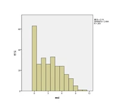

# Count Data Model

Count data model은 관심 종속변수가 카운팅 형식의 숫자일 때 적용 가능한 회귀 방식의 분석이다. 

푸아송 회귀 모델을 사용해 결과를 얻는 것은 일반적인 선형 회귀 모델로부터 결과를 얻는 것보다 훨씬 간단하고, 결과의 해석 또한 간단하다. 

> 종속변수가 정규분포가 아닌 경우에 다중회귀분석이 불가능하므로, Count Data Model을 사용하여 정규분포가 아닌 데이터에 대해 회귀분석이 가능하다.

[\[통계공부\] Count regression model / 정규분포 확인하기(SPSS)](https://m.blog.naver.com/mssim1987/221040203274)

- **Count Model의 종류**

    1. Poisson regression: Mean과 Variance가 같다고 가정
    2. Negative binomial regression: Variance가 Mean보다 큼

- **사전 확인할 사항**

1) 통계분석방법으로 사용하고자 한다면 기술통계에서부터 Count Model의 적용이 필요함을 암시해야 한다. 즉, 정규분포가 아니라는 정보를 제시해야 한다.

⇒ 이와 같이 Skewed 데이터에 대해서 적용한다.

2) 평균과 분산을 비교할 때 분산이 매우 큰지 확인

3) skewness 값이 굉장히 크게 나타남

4) 통계 방법에 대한 reference를 제시

5) 분포의 특성에 따라 poisson, negative binomial regression을 선택해야 한다.

poisson은 표준오차를 실제보다 작게 잡기 때문에 통계적으로 유의한 변수가 많게 나온다.

negative binomial regression은 이를 adjust한 것이다.

[Count Data Models Example.pdf](https://docs.google.com/file/d/0BwogTI8d6EEiOHdjSlZPbW5weHM/edit?resourcekey=0-2kiK33kzU-HhvjUqMNOyeA)

- **의사의 방문 횟수에 영향을 미치는 요소는 무엇일까? (회귀분석)**

    - 종속 변수: 의사의 방문 횟수
    - 독립 변수: 개인 보험을 가지고 있는지, 의료보험이 있는지, 나이, 학력
