# 시계열 분석에 대한 조사 및 공부

## &lt;시계열 데이터의 상관분석&gt;

[Time-Series 데이터 상관관계 분석 방법들의 원리와 장단점](https://tech.onepredict.ai/7b5cb659-687d-48a4-ac80-827d30e49fb3)

### Time-series Correlation

Correlation이란 2개의 변수가 갖는 선형 상관관계를 의미한다. 

- **Colinearity**

Colinearity는 Regression Model을 생성할 때 독립변수 중 2개 이상이 강한 선형 상관관계를 가지는 상황을 뜻한다.

예를 들어, 아래 그림과 같이 두 변수가 함께 상승하거나, 감소하는 경향을 보이는 경우를 말한다.

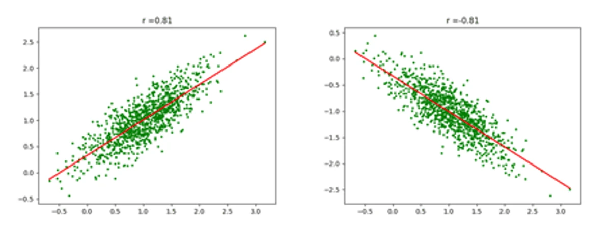

- **Multicolinearity**

3개 이상의 독립변수 사이에서 강한 선형 상관관계가 나타나는 경우이다. 이러한 경우 예측 모델에서의 파라미터 예측이 불안정해진다. 따라서 몇 개의 특정 파라미터가 매우 커져 조그만 데이터의 변화에도 결과값이 크게 달라질 수 있으며, 학습 때마다 모델이 매번 다른 결과를 도출할 수도 있다.

> 이러한 불안정성을 피하기 위해서는 변수들간의 연관성을 찾아 미리 알고 모델을 구성하는 것이 중요하다. Time-series 데이터간 correlation을 찾는 몇 가지 방법을 알아보자.   
>   
> 대표적인 방법으로는 두 시계열 데이터의 상관 관계를 수치로 나타내는 방식인 **피어슨 상관 계수**와 **켄달 상관 계수**가 있으며, 두 시계열 데이터의 인과 관계를 파악하기 위한 방식으로는 **TLCC**, 길이가 다른 시계열 데이터에 대해서는 **DTW**가 있다.

### Pearson Correlation Coefficient(피어슨 상관 계수)

정규성을 만족하는 두 변수 간의 선형 상관관계를 계량화한 수치이다. +1 ~ -1사이의 값을 가지며, +1은 완벽한 양의 선형 상관 관계, 0은 선형 상관 관계가 없음, -1은 완벽한 음의 선형 상관 관계를 의미한다. 이는 상관을 나타내는 것이므로 변수 사이의 인과 관계를 설명하지는 않는다.

또한 Pearson Correlation은 데이터가 등분산성을 가진다고 가정하므로, 변수 데이터가 정규 분포를 갖지 않거나 Outlier가 발생할 경우 잘못된 결과가 나타날 수 있다.

- **조건**

    1. 두 변수는 연속형 변수이다.
    2. 두 변수는 정규분포를 따른다.
    3. 두 변수는 선형 관계를 가진다.
    4. 두 변수는 등분산성을 만족한다.

### Kendall Tau Rank Correlation Coefficient(켄달 상관 계수)

순위 상관 계수의 한 종류이며, 두 변수들 간의 순위를 비교하여 연관성을 계산한다. Pearson과 같이 두 데이터의 연관성을 +1 ~ -1 사이의 값으로 나타낸다. (전체 구간에 대한 결과)

두 변수간 데이터 그 자체가 아닌 순위를 비교하는 것이기 때문에, 변수 데이터가 정규 분포를 가지지 않으면 잘못된 결과를 얻을 수 있는 Pearson 상관 계수의 단점이 보완된다.

### Time Lagged Cross Correlation (TLCC)

TLCC는 하나의 time-series를 조금씩 shifting 시키면서 데이터 전체 범위에 대하여 Pearson 상관 계수를 계산하는 방식이다. 따라서 TLCC는 Pearson, Kendall Correlation과는 다르게 두 데이터 사이에서의 인과관계를 파악할 수 있다.

TLCC는 전체 구간에 대한 결과이므로, 추가적으로 시간에 따라 상세하게 분석을 하고자 한다면, Windowed time Lagged Cross Correlation (WTLCC)을 사용하면 된다. 데이터를 여러 개의 window로 나누고 위와 같은 TLCC 분석을 각 window마다 하는 것이 WTLCC이다.

### Dynamic Time Warping (DTW)

DTW는 time-series 데이터 간의 최소거리를 가지는 직선 경로를 찾는 방식이다. 데이터 각 시간 시점에서 길이를 구하는 것이 Euclidean 방식이고, 데이터 각 지점에서 시간 지점과 상관없이 최단 직선 경로를 찾는 것이 DTW이다. Signal의 길이가 서로 다르더라도 DTW를 적용할 수 있다.

---

## &lt;시계열 예측&gt;

실제 공장에서 사용되는 여러 센서를 분석하여 상관관계를 정리하고, 이 상관관계를 바탕으로 결과를 예측하는 모델을 설계한 내용을 다루는 논문, 1page 가량의 매우 단순한 논문이다.

[딥러닝 전에, 알아보자 시계열 분석! - (1) 시작하자 시계열! -](https://albertmade.tistory.com/3)

시계열 분석이란, 시간 순서대로 정렬된 데이터에서 의미 있는 요약과 통계 정보를 추출하기 위한 노력을 의미한다. 시계열 분석은 대부분 예측 과정에 많이 사용되지만, 과거의 행동을 진단하는 과정을 포함한다. 

> 즉, 과거가 미래에 어떤 영향을 주는가? 에 대한 해답을 찾아가는 것이 시계열 분석의 주 목적

⇒ 시계열 분석은 대체로 의학, 기상학, 경제학에서 많이 사용된다.

의학과 경제학 뿐만 아니라, 정말 다양한 분야에서 시계열 데이터와 시계열 분석은 중요한 위치를 차지하고 있다. 특히 통계적 시계열 분석의 시초가 되는 자기회귀(Autoregression)는 실험 물리학자인 우드니 율(Udny Yule)이 태양의 흑점 데이터를 분석하기 위해 사용했을 정도로, 시계열 데이터와 시계열 분석은 자연과학 분야에서도 중요한 위치를 차지한다.

### 시계열 데이터의 중요 요소

- **추세**(Trend): 장기적으로 증가하거나, 감소하는 경향성이 존재하는 것을 의미한다.
- **계절성**(Seasonality): 계절적 요인의 영향을 받아 1년, 혹은 일정 기간 안에 반복적으로 나타내는 패턴을 의미한다.
- **주기성**(Cycle): 정해지지 않은 빈도, 기간으로 일어나는 상승 혹은 하락을 의미한다.  
    ⇒ 단, 주기성은 학자마다 정의가 조금씩 다르다.
- **잡음**(Random, Residual): 설명될 수 없는 요인 또는 돌발적인 요인에 의해 일어나는 변화로, 예측 불가능한 임의의 변동을 의미한다. Time Series  Decomposition에서는 추세, 순환 계절성을 뺀 나머지를 말한다.

- **분해 방식**

    - **덧셈 분해**(Additive Decomposition): 시계열 데이터가 덧셈으로 이루어져 있다고 가정하여 분해하는 방식을 말한다.

        $y_t = S_t + T_t + R_t$

    - **곱셈 분해**(Multiplicative Decomposition): 시계열 데이터가 곱셈으로 이루어져 있다고 가정하여 분해하는 방식을 말한다. ⇒ 단, Multiplicative 모델은 데이터에 0이 있어서는 안된다.

        $y_t = S_t*T_t*R_t$

> 덧셈 분해는 Trend와 Seasonal이 별개이고, 곱셈 분해는 Trend에 따라 Seasonal이 변화한다. 따라서 데이터의 특성에 따라서 적용해야 하는 모델이 다르다.

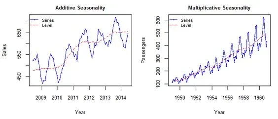

위의 그림에서 첫 번째 예시는 시간이 지남에 따라(Trend가 변화함에 따라) 변동폭이 일정하지만, 두 번째 그림은 Trend가 상승함에 따라 변동폭 역시 증가하고 있다. 즉, 첫 번째 예시는 Additive가 적절하고, 두 번째 예시는 Multiplicative가 적절하다.

> 이와 같이 **시계열 분해**(Time Series Decomposition)는 시계열의 구성 요소들을 쉽게 파악할 수 있도록 도와준다.  
>   
> 대표적인 시계열 예측 모델인 **ARIMA**는 정상성을 가정하고 있다. 만약 **정상성**을 가정하지 못할 경우(시간에 따라 변동폭이 일정하지 않을 경우) 별도로 로그 변환을 해 준다. 즉, 곱셈 분해는 다음과 같은 방식으로 변형한다.  
> $logy_t = logS_t + logT_t + logR_t$

### 시계열 데이터의 정상성

시계열 데이터를 활용해서 미래의 데이터를 예측할 때에는 두 가지 전제가 필요하다.

1. 과거의 데이터에 일정한 패턴이 발견된다.
2. 과거의 패턴은 미래에도 동일하게 반복될 것이다.

⇒ 이 두 가지 전제는 Stationary한 데이터에 대해서만 미래 예측이 가능하다는 것을 의미한다.

- **정상성(Stationary)**

    - 시간과는 별개로 데이터의 통계적 특성이 변하지 않는 것
    - 평균, 분산, 공분산이 변하지 않아야 한다.

즉, 어떤 시계열 데이터가 시간에 따라서 평균, 분산, 공분산이 변하지 않고 일정한 것을 말한다. 평균은 이동평균으로, 분산은 이동표준편차로, 공분산은 자기공분산으로 검증할 수 있다.

- 조건 1: 이동 평균이 같아야 한다.
- 조건 2: 이동 표준편차가 같아야 한다.
- 조건 3: 자기공분산이 같아야 한다.

### 이동 평균(Rolling Mean)

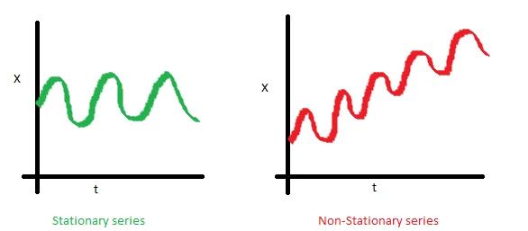

위 그림은 시간의 흐름과는 별개로 데이터의 이동평균이 동일하다는 것을 의미한다. 

### 이동 표준편차 (Rolling std)

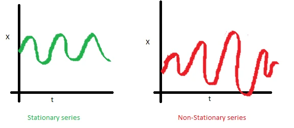

이동 평균과 마찬가지로 일정 구간의 표준편차를 구한 것이다.

### 자기공분산(Autocovariance)

자기공분산을 이해하기 위해서는 공분산의 개념을 먼저 알아야 한다. 분산은 데이터가 얼마나 퍼져있는 지를 나타내는 것인데, 공분산은 확률변수 X와 Y가 주어졌을 때, X와 Y가 어떤 모양으로 퍼져있는 지를 나타낸다. 즉, X가 커질 때 Y도 커지는지, 혹은 작아지거나 상관이 없는지 알게 해주는 지표가 바로 공분산이다.

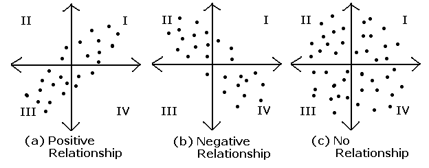

만약 X와 Y가 독립이라면 공분산은 0이 된다. 그러나 이러한 공분산에도 한계가 있는데, 바로 X와 Y의 단위 크기에 영향을 받는다는 것이다.

ex) 100점 만점인 두 과목의 점수 공분산은 상관성이 부족해도 100점 만점이기 때문에 큰 값이 나오고, 10점짜리 두 과목의 점수 공분산은 상관성이 아주 높더라도 10점 만점이므로 작은 값이 나온다.

따라서 공분산 자체가 두 변수 간의 상관성을 직접적으로 대표하지 못한다. 이를 보완하기 위해 나온 개념이 바로 상관계수이다.

- **상관계수**

공분산을 Normalize하여(두 변수의 표준편차의 곱으로 나눠서) 두 변수 간의 상관성이 항상 -1에서 1 사이의 값으로 표현되도록 보정한 것.

이렇게 일정 범위로 정해지며 상관계수 값이 두 변수 간의 상관성을 직접 대표할 수 있게 된다.

- **자기공분산**

자기공분산은 말 그대로 자기 자신과의 공분산이 아니고, h라는 간격 만큼 이동시킨 자기 자신과의 공분산을 뜻한다. 즉, 일정 시차 h를 사이에 둔 자기 자신과의 공분산을 의미한다. 

따라서 X(t), X(t+h) 사이의 공분산과 X(t-h), X(t) 사이의 공분산이 같아야 한다. 이 조건은 X가 Stationary한, 정상성을 갖춘 시계열 변수라는 조건 하에서만 성립한다.

- **자기상관계수**(Autocorrelation)

자기상관계수란, 자기 공분산을 표준편차로 나누어서 Normalize하여, -1에서 1사이의 값으로 표현되도록 보정한 것이다.

> 상관계수와 자기상관계수의 차이점은, 상관계수는 Y와 X1, X2, X3 등 각기 다른 변수들과의 관계를 분석하는 반면, 자기상관계수는 Y의 t 시점, (t-1) 시점, (t-2) 시점 등 동일한 변수의 다른 시차를 두고 관계를 분석한다.

---

## &lt;시계열 데이터의 중심극한정리&gt;

[Do time series data obey the central limit theorem?](https://www.quora.com/Do-time-series-data-obey-the-central-limit-theorem)

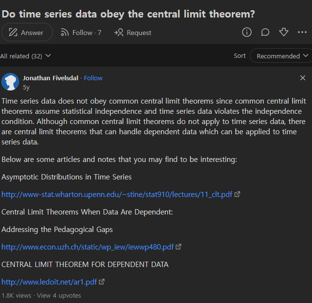

[http://www-stat.wharton.upenn.edu/~stine/stat910/lectures/11_clt.pdf](http://www-stat.wharton.upenn.edu/~stine/stat910/lectures/11_clt.pdf)

[https://www.econ.uzh.ch/apps/workingpapers/wp/iewwp480.pdf](https://www.econ.uzh.ch/apps/workingpapers/wp/iewwp480.pdf)

[http://www.ledoit.net/ar1.pdf](http://www.ledoit.net/ar1.pdf)

---

## &lt;Anomaly Detection&gt;

[5 Anomaly Detection Algorithms every Data Scientist should know](https://towardsdatascience.com/5-anomaly-detection-algorithms-every-data-scientist-should-know-b36c3605ea16)

- Isolation Forest
- Local Outlier Factor
- Robust Covariance
- One-Class SVM
- One-Class SVM (SGD)

---

## &lt;시계열 통계분석의 이해&gt;

[part 3 통계분석의이해4 5 시계열분석 중심극한정리](https://www.youtube.com/watch?v=vsn1C7Ja6KI)

### 데이터의 정규성

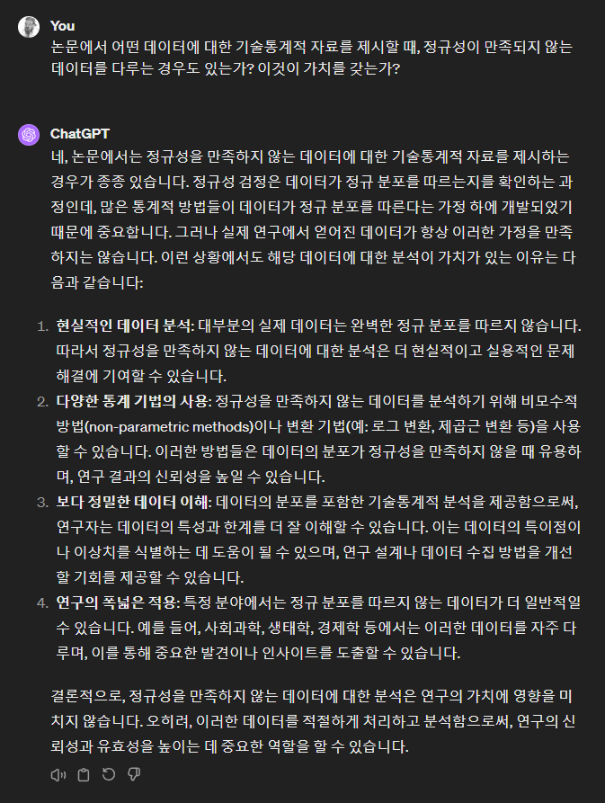

[LinkedIn Changhyun Lee 페이지: 통계검정에서 정규성검정 꼭 필요할까? | t test | AB Test | 데이터분석](https://kr.linkedin.com/posts/changhyun-lee-85b513233_통계검정에서-정규성검정-꼭-필요할까-t-test-ab-test-activity-7017862229169508352-Jzfi)

정규성 검정은 중요하긴 하나, 대부분의 정규성 검정은 매우 엄격한 정규성 검정을 실시하기 때문에 실제로는 살아남을 수 있는 데이터가 많지 않다. 따라서 왜도와 첨도에 의한 검정을 실시하기도 한다.

(*왜도는 2보다 작고 첨도는 7보다 작은 것을 확인.*)

---

## &lt;기존 논문 분석&gt;

> 기존에 코로나19 데이터를 다룬 논문을 찾아보았다.

### 빅데이터를 활용한 코로나19 팬데믹의 자살에 대한 영향 분석

### 시계열 모형과 빅데이터 분석기법을 이용한 코로나 확진자 수 예측

⇒ TOP 10%

### 빅데이터를 활용한 코로나 이후 소비습관과 여가생활의 변화 분석

⇒ TOP 1%

### 빅데이터 분석을 통한 코로나19 시대의 홈(home) 트렌드와 패션

⇒ TOP 5%

### 빅데이터를 통한 코로나19 전후 패션 대여 서비스 인식변화 분석

### 코로나19 팬데믹은 경제적 불평등을 심화시켰는가? 유럽 국가를 대상으로 한 미시데이터 실증

### 통신사 빅데이터를 활용한 코로나 전염병 전후 대구 대학가 유동인구 분석 – 서울과의 비교를 중심으로

### 코로나19 팬데믹 상황의 건강 및 운동 인식에 대한 빅데이터 분석

### 코로나19와 청소년 생활·심리변화

### 코로나19가 가져온 오프라인 소비 패턴의 변화 2020년 신용카드 데이터 분석

### 시계열 데이터를 활용한 코로나19 동향 예측

### 정치체제와 코로나 팬데믹: 세계보건기구 데이터 분석

### 지역 특성 데이터에 기반한 코로나19 사망 위험 분석(KCI)

**핵심 내용**

- **분석 방법**

각 지역별 각종 독립변수(*인구 대비 의료 예산, 나이, 인구밀도, 고령화율, 흡연, 음주, 인구 대비 의료기관, 인구 대비 의료 종사자 수 등*)를 만들고, 이 독립변수가 종속변수(*지역별 코로나 사망자 수*)에 미치는 영향에 대해서 다중선형회귀분석을 진행함.

- **결측치**

수집할 수 없었던 사망자 수 데이터는 결측치로 두고, 시도별 사망자 수 데이터에서 각 시군구 평균값으로 대체하였다.

- **데이터 처리**

극단값이 존재하면 선형회귀분석의 결과가 왜곡될 수 있으므로, 극단값 필터링을 진행한다. 특히 시군구별 인구밀도 값은 많은 극단값들이 존재하여, log 변환을 수행해 정규분포로 변환한다.

(전/후 박스플롯 figure 제시)

또한 보건분야 예산액, 나이, 고령화 비율, 음주율도 동일하게 극단값을 제거해주며, 의료시설 현황, 의료진 현황, 사망자 수는 log 변환을 수행해 정규분포가 되도록 변환한다.

- **정규성 검정**

모든 데이터에 대해서 왜도를 첨부하였다. (***단, 첨도는 첨부되지 않았음.***)

- **상관분석**

회귀분석을 진행할 경우, 모든 독립변수에 대해서 상관분석이 실시된다. 각 변수에 대해서 모든 상관을 제시하고 결과를 해석한다.

- **회귀분석**

각 독립변수에 대해서 회귀분석을 진행, 다중공선성 진단을 실시하고, 이상이 없으므로 회귀분석의 결과에 대해서 해석한다.

⇒ 이 때, 이치에 맞지 않는 결과가 나온 것으로 보이는 고령화 비율, 음주율, 의료진은 추가 분석의 가능성을 제시하며 분석에서 제외하였음.

> 결과적으로 나이가 많을수록, 인구밀도가 높을수록, 의료시설이 적을수록 시군구별 사망자 수가 높다는 것을 보였음.

- **결론**

본 논문은 코로나19 사망 위험에 영향을 미치는 지역 특성 요인으로 나이, 인구밀도, 의료시설을 도출하였고, 이를 다중 선형회귀분석 기법으로 시군구별 사망자 수 예측을 위한 모형을 생성했다. 이 모형을 검정한 결과 결정계수는 0.749였으며, 모형이 적합하다고 판단된다.

본 논문의 분석 결과가 지역별 의료 자원 배분의 효율성 증진과 정책 활용에 도움이 될 것으로 기대한다. 본 논문은 계속해서 추가적인 개인 특성과 지역 특성을 함께 고려하여 코로나19 사망 요인에 대해 종합적으로 분석할 계획이다.

> 지역별로 사망자 수가 다르다는 것은 지역 별로 다소 민감한 결과가 될 수 있는데, 최대한 어떤 지역이 떨어지는지 특정이 안되도록 일반적인 결과만 제시함으로써 논문의 가치를 확보하였다.

> 아래는 지역 특성 데이터에 기반한 코로나19 사망 위험 분석 논문에서 제시된 선행 연구 목록, 회귀분석이 담겨있다.

### 경상북도 지역의 코로나19 발생률 및 사망률 관련 요인

- **카이제곱검정**

[\[이론\] 카이제곱 검정(Chi-Squared Test)이란?](https://m.blog.naver.com/gksshdk8003/222305638201)

카이제곱검정은 두 범주형 변수에 대한 분석 방법으로, 다음 세 가지 검정이 있다.

1. **적합도 검정**

    적합도 검정은 한 범주형 변수의 각 그룹별 비율이 특정 비율과 같은지 검정한다. 또한, 관측 데이터가 특정 분포를 따르는지 검정할 때도 사용한다.

    ⇒ **일표본 t-검정과 유사**

    > 일표본 t검정은 어떠한 표본의 평균이 일반적으로 알려진 모집단의 평균과 차이가 있는지 혹은 없는지를 검정하는 방법이다. 대체로 표본의 수가 30이하인 경우에 유효하며, 귀무가설은 ‘표본의 평균은 모평균과 차이가 없다.’이고, 대립가설은 ‘표본의 평균은 모평균과 차이가 있다.’가 된다.

2. **동질성 검정**

    부모집단에 대해 열 변수의 분포가 동질한지 검정한다. 즉, 부모집단 별로 정해진 수 만큼의 자료를 조사(행 별 합계 고정)하여, 각 범주별로 비율이 다른지 검정하는 것이다.

    예를 들어, 남자 100명과 여자 300명을 부모집단으로하여, 선호 음료 유형이 서로 동질적인지 비교하는 데에 사용 가능하다.

3. **독립성 검정**

    전체 조사 대상을 고정한 뒤, 조사 결과를 바탕으로 두 범주형 변수 간 연관 관계가 유의한지 카이제곱 검정을 통해 확인하는 것이다.

    이는 대표본 가정이 필요한데, 보통 각 항의 기대 도수가 5보다 크면 대표본 가정을 만족한다고 본다. 만약 대표본 가정을 만족하지 않으면, 피셔의 정확도 테스트로 검정 방법을 바꿔야 한다.

⇒ **본 논문에서는 독립성 검정을 통해 코로나19 환자의 사망/퇴원에 영향을 미치는 범주형 변수에 대해서 조사한다.** 

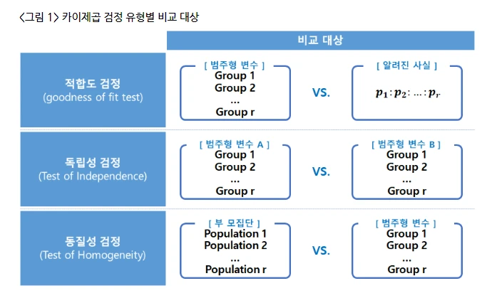

- **Q. 카이제곱검정에서 유의하다는 것의 의미와 범주형 변수의 의미**

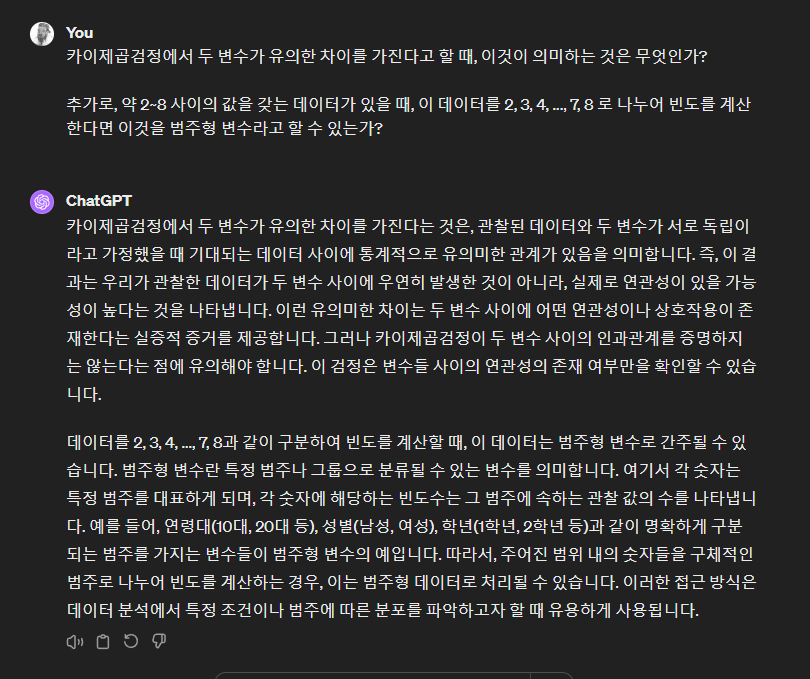

- **Q. 카이제곱검정의 대표적 기법 세 가지와 대표본가정**

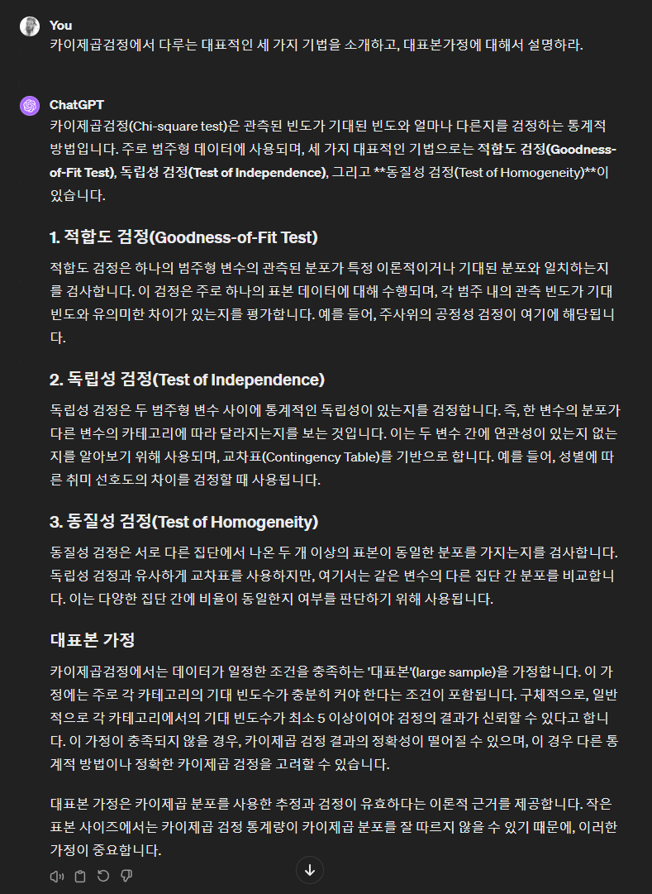

- **다중 로지스틱 회귀분석**

종속변수가 범주형 변수인 경우, 종속변수와 독립변수 간의 관계를 찾는 분석 방법이다. 다중 분석인 경우, 여러 개의 독립변수를 사용한다.

---

⇒ **독립성 검정을 바탕으로 제시된 결과이다. 독립성 검정을 간단히 해석하자면, 한 범주 내에서 서로 다른 결과가 나왔을 때, 이 결과가 유의한 의미를 갖는지를 검정하는 것이다.**

- **확진자들의 퇴원 및 사망은 입원기간에 따라 유의한 차이가 있었다.** (p&lt;0.001)

    > 이것이 갖는 의미는, 입원기간에 따라서 환자가 퇴원하거나 사망하는 정도가 통계적으로 유의하게 차이가 있다는 것이다. 제시된 자료로 추측컨대, 대체로 입원기간이 짧을수록 사망 확률이 높았다. 이는 임상적으로 중요한 의의를 가지며, 코로나19 환자의 경우 대체로 입원 후 짧은 시간 동안에 치료하는 것이 중요할 수 있다는 의미로 해석될 수 있다. 이에 따라 의료 시스템 내에서 환자를 치료할 때 인력, 시간 등의 배분에 대해 고려해 볼 수 있다는 점에서 큰 의미를 가진다고 볼 수도 있다.

- **경북지역 확진자들의 사망 관련요인을 비교한 결과 연령별**(p&lt;0.001)**, 기저질환유무**(p&lt;0.001)**, 거주형태<strong>(p&lt;0.033)</strong>에서 유의한 차이가 있었다.**

    > 이것 역시 마찬가지로 연령, 기저질환, 거주형태가 코로나19 환자의 사망/퇴원에 영향을 미친다고 설명하는 것이다.

> 경상북도 논문은 범주형 변수에 대한 회귀분석 (***로지스틱 회귀분석***)을 진행하며, 지역특성 논문은 양적 변수에 대한 회귀분석  (***다중선형 회귀분석***)을 진행한다.

### 질병관리청의 데이터를 이용한 COVID-19 확진자의 사망에 대한 영향요인과 혈액변수의 타당도

### 빅데이터를 이용한 소아청소년에서의 코로나 바이러스 감염증-19와 치과 방문의 연관성 분석

### 빅데이터 분석을 통한 중국과 한국의 미세먼지의 상관관계 분석 코로나 이전과 이후 비교

### 코로나19 데이터의 시각화

### 모빌리티 및 공공빅데이터 기반 코로나 확진자 수 예측 및 정책 제언

### 코로나19가 범죄에 미친 영향

**핵심 내용**

- **핵심**

본 논문은 기술통계적 수치 제시 및 시계열 그래프를 바탕으로 코로나19와 범죄와의 연관성에 대한 가설을 제시하였다.

- **한계**

그러나 몇 가지 연구 한계가 존재하는데, 첫 번째로 시계열 그래프만으로 분석하였으며, 추론통계를 활용한 증명을 하지 않았다. 두 번째로, 코로나19 상황의 특징을 나타내는 변수가 고려되지 않았다. (ex. 코로나 확진자 수, 거리두기 강도 등) 

- **가치**

하지만 이러한 연구에도 불구하고 본 연구는 다음과 같은 가치를 가진다. 첫 번째로, 기존에 거의 진행되지 않았던 코로나 19와 범죄와의 관계를 설명하였다. 특히 112 신고데이터를 활용하여 코로나19와 범죄와의 관계를 분석한 최초의 국내 연구이다. 두 번째로, 코로나19가 계속 진행되고 있는 상황에서 이 연구는 범죄예방에 도움을 줄 수 있는 매우 시의성 있는 연구이다.

- **후속 연구**

본 연구의 부족한 부분을 보완하기 위해 향후 다음과 같은 연구가 필요하다. 첫 번째로, 추론통계를 활용하여 코로나19의 범죄에 대한 영향을 증명하는 연구가 필요하다. 두 번째로, 코로나19 상황의 특징을 나타내는 변수 (ex. 코로나 확진자 수, 거리두기 강도 등)를 고려하면서, 코로나19와 범죄와의 관계를 검증할 필요가 있다. 마지막으로, 코로나19가 가정폭력, 성폭력, 사기, 사이버 범죄 등 다양한 개별범죄들에는 어떤 영향을 주는지 검증하는 연구가 필요하다.

---

## &lt;Anomaly의 위험성에 관한 조사&gt;

### 의약품제조및품질관리에관한규정 전문

[온도계 있었는데도 독감 백신 보관 실수…520억 허공에 날리나](https://www.donga.com/news/Society/article/all/20200922/103055389/1)

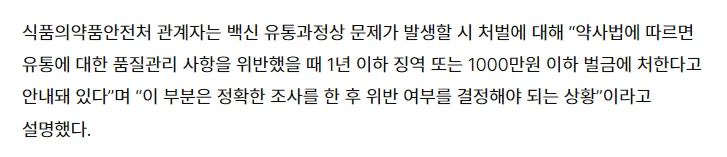

---

## &lt;콜드체인의 성능평가에 대한 기존 연구&gt;

[콜드체인 평가 : 논문 검색 결과 - DBpia 연구자를 돕는 똑똑한 학술콘텐츠 플랫폼](https://www.dbpia.co.kr/search/topSearch?searchOption=all&query=콜드체인+평가)
