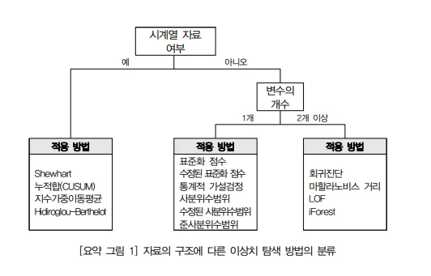
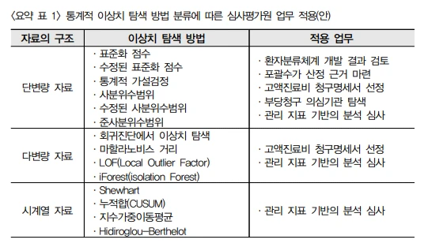
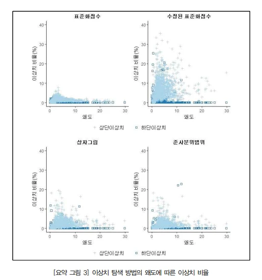
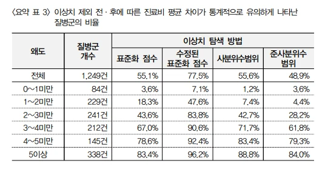
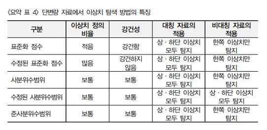
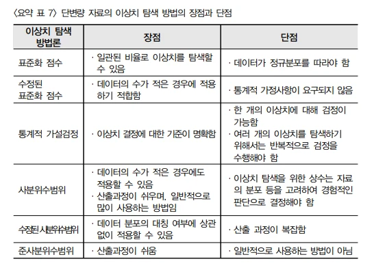
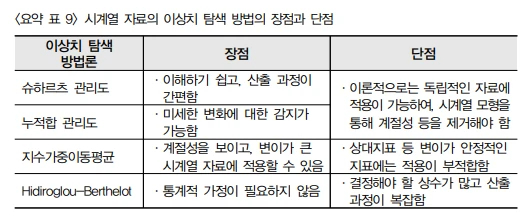
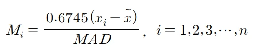
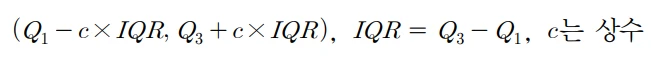

# 이상치 탐색을 위한 통계적 방법과 활용 방안

## &lt;이상치 탐색 개요&gt;

### 이상치 탐색의 개념

- 통계학 측면에서 이상치는 관측치들이 주로 모여있는 곳에서 멀리 떨어져 있는 관측치로 정의된다. 이상치 탐색은 탐색 영역에 따라 outlier detection, noise detection, anomaly detection, novelty detection, fraud detection, intrusion detection 등 다양한 용어로 사용된다.

- 이상치는 비합리적인 이상치와 합리적인 이상치로 구분할 수 있다.

    - 비합리적인 이상치는 입력 오류 등 자료의 오염으로 인해 발생한 이상치를 의미
    - 합리적인 이상치는 정확하게 측정되었으나, 다른 자료들과 전혀 다른 경향이나 특성을 보이는 이상치를 의미한다.

- 이상치 탐색은 분석 결과의 안정성을 위한 이상치 제거, 자료의 대체 등을 위한 목적과 중요한(새로운) 정보 탐색을 위한 목적으로 활용된다.

### 이상치 탐색의 분류

- 단변량 자료에서 이상치 탐색 방법은 이상치 영역을 정의하여 이상치를 탐색하는 방법으로, 정의된 이상치 영역의 포함 여부에 대한 판단 개념이다.
- 다변량 자료에서 이상치 탐색 방법은 연관성이 존재하는 2개 이상의 변수 정보를 활용하여 관측치 사이의 거리, 밀도 등을 기반으로 이상치를 탐색하는 방법이다.
- 시계열 자료에서 이상치 탐색 방법은 단변량 자료의 이상치 탐색 방법과 유사한 개념이며, 본 연구에서는 감시(surveillance)를 위한 기법을 중심으로 검토한다.

---

## &lt;이상치 탐색 방법&gt;

### 단변량 자료에서 이상치 탐색

- **1) 표준화 점수(Z-score)를 활용한 이상치 탐색**

    - 표준화 점수는 평균이 $\mu$이고, 표준편차가 $\sigma$인 정규분포를 따르는 관측치들이 자료의 중심(평균)에서 얼마나 떨어져 있는지를 나타낸다.

- **2) 수정된 표준화 점수(Modified Z-score)를 활용한 이상치 탐색**

    - 표준화 점수는 평균과 표준편차에 의존하므로, 산출 과정에 이상치의 영향을 받는 문제점이 있다.
    - 수정된 표준화 점수는 표준화 점수의 문제점을 보완하기 위해 중앙값과 중앙값 절대편차(MAD)를 이용하여 산출한다.
    - Iglewicz와 Hoaglin(1993)은 수정된 표준화 점수의 절대값이 3.5보다 큰 경우에 이상치로 판단하는 것을 제안하였다.

- **3) 통계적 가설검정을 활용한 이상치 탐색**

    - 통계적 가설 검정 방법은 최소값 혹은 최대값의 이상치 여부에 대한 검정임
    - 이상치로 판단된 관측치를 제외해 나가면서 이상치가 존재하지 않을 때까지 반복적으로 검정을 수행하여 이상치를 정의한다.

    - 그럽스 T 검정(Grubbs T-Test)

        - 그럽스 T-검정은 정규분포를 만족하는 단변량 자료에서 이상치를 검정하는 방법이며, t-분포에 근거한 임계치를 산출하여 검정통계량이 임계치보다 큰 경우 이상치로 결정

    - Generalized ESD(Extreme Studentized Deviated) Test

        - 그럽스 T-검정을 일반화한 방법으로, 여러 개의 이상치에 대한 검정이 가능함.
        - 검정통계량은 내림차순으로 정렬하여 각 관측치별로 산출되며, 검정통계량이 t-분포에 근거한 임계치보다 크면 해당 관측치를 이상치로 결정함.

- **4) 사분위수를 활용한 이상치 탐색**

    - Box Plot을 이용한 필터링 방식으로, 사분위수범위는 제 1사분위수(Q1)와 제 3사분위수(Q3)의 차이로 정의되며, 사분위수 범위의 1.5배를 초과하는 관측치는 약한 이상치, 3배를 초과하는 관측치는 강한 이상치를 의미한다.

- **5) 수정된 사분위수를 활용한 이상치 탐색**

    - 수정된 사분위수를 활용한 이상치 정의 방법은 기존의 사분위수범위를 활용한 방법을 일반화한 것으로, 비대칭 분포에서도 이상치를 합리적으로 정의할 수 있다.
    - 수정된 사분위수범위는 데이터의 치우침 정도에 대한 강건한 척도인 medcouple(MC)을 활용하여 이상치를 정의한다.

- **6) 준사분위수범위(Semi Interquartile Range, SIQR)을 활용한 이상치 탐색**

    - 준사분위수범위는 사분위수범위를 변형한 통계량으로, 사분위범위의 절반으로 정의되며, 비대칭 자료에서 활용할 수 있는 방법임.

### 시계열 자료에서 이상치 탐색

시계열 자료에서 이상치 탐색은 대부분 모형 적합을 통해 관측치 사이의 연관성을 제거한 잔차를 추출한 후, 잔차에 대해 방법을 적용함.

감시(surveillance) 목적의 통계적 공정관리(Statistical Process Control, SPC) 기법을 시계열 자료의 이상치 탐색에 활용할 수 있음.

감시를 위한 기법 또한 관측치 사이의 독립성을 만족해야 적용이 가능하나, 일반적으로 독립성 가정에 대한 부분은 무시되는 경우가 많음.

- **1) 슈하르트 관리도**

    - 슈하르츠 관리도는 관리하고자 하는 값을 중심선(Central Line)으로 하여, 관리하한(Lower Control Limit)과 관리상한(Upper Control Limit)을 설정하고, 관측값을 시간의 경과에 따라 표시하는 통계적인 과정이다.
    - 슈하르츠 관리도의 관리한계는 일반적으로 (관리값) $\pm$3*(관리통계량의 표준편차)로 정의되며, 관리모수와 관리통계량에 따라 다양한 관리도가 존재함.

- **2) 누적합(Cumulative Sum, CUSUM) 관리도**

    - 슈하르츠 관리도는 이해하기 쉽고 적용이 간편한 장점이 있으나, 현재의 관측값으로 이상치 여부를 판단하기 때문에 작은 변화나 변화 속도가 늦은 경우에는 비효율적이다.
    - 누적합 관리도는 처음부터 현재까지 통계량의 누적합을 사용하는 방법으로, 작은 변화에 대한 효과가 누적된 통계량을 통해 추세의 작은 변화를 감지하는데 유용하다.
    - 누적합 관리도의 이상치 정의는 의사결정 구간을 벗어나는 시점을 의미한다.
    - 작은 변화에 대한 이상치를 탐지하기 때문에, 변이가 큰 자료보다 안정적인 자료에서 적용하기 적합하다.

- **3) 지수가중이동평균(Exponentially Weighted Moving Average, EWMA)**

    - 지수가중이동평균 방법은 최근 관측값에 큰 가중치를 주어 최근 변화를 반영하여 이상치를 탐지하는 방법이다.
    - 지수가중이동평균값을 기반으로 관리상한과 관리하한을 정의하고, 관리한계를 벗어나는 시점의 관측치를 이상치로 판단한다.
    - 지수가중이동평균과 관리한계를 정의할 때, 많은 연구에서 상수에 대한 다양한 수치를 제안하고 있으나, 사용자의 경험적 판단에 의해 결정하는 것이 가장 합리적이다.

- **4) Hidiroglou-Berthelot 방법**

    - Hidiroglou-Berthelot(H-B) 방법은 앞에서 언급한 시계열 자료의 이상치 탐색 방법과 다르게, 이전 시점과 현재 시점의 비로 이상치를 탐지하는 방법이다.
    - 이는 정기적으로 수행되는 경기동향조사에서 활용되며, 단위의 크기를 고려하여 이상치에 대한 허용 범위를 정의하는 방법이다.
    - 비율에 대해 사분위범위를 적용하여 제안한 방법으로, 통계적 가정이 필요하지는 않다. 그러나 결정해야 할 상수가 많고, 산출 과정이 복잡하다.

---

## &lt;적용 사례&gt;

### 단변량 자료에서의 사례분석

⇒ 산포도를 이용하여 나타내는 방법

⇒ 이상치를 이용한 필터링을 적용한 뒤의 수치적인 결과를 제시

- 표준화 점수를 활용한 이상치 탐색 방법은 많은 이상치를 정의하지 않으며, 자료의 분포에 따라 이상치 비율이 크게 변하지 않는 강건한 특성을 보임
- 수정된 표준화 점수를 활용한 이상치 탐색 방법은 정의되는 이상치가 많으며, 분포에 따라 이상치 비율에 대한 변이 차이가 큼.
- 수정된 사분위수 범위를 활용한 이상치 탐색 방법은 대칭이 아닌 분포에서 상/하단 이상치를 모두 탐지해야 하는 경우에 적용할 수 있음.

- 준사분위수범위를 활용한 이상치 탐색 방법은 비대칭인 자료에서 활용할 수 있도록 제안된 방법이나, 그 특징이 명확하게 나타나지 않음.

    - 비대칭분포에서 상/하단 이상치를 모두 탐지해야 하는 경우에는 준사분위수 범위 방법보다 수정된 사분위수 방법을 활용하는 것을 제안함

---

## &lt;결론 및 고찰&gt;

### 단변량 자료의 이상치 탐색 방법의 장점과 단점

### 시계열 자료의 이상치 탐색 방법의 장점과 단점

---

## &lt;단변량 자료에서 이상치 탐색 방법&gt;

### 1. 표준화 점수(Z-score)를 활용한 이상치 탐색

- 표준화 점수는 평균이 $\mu$이고, 표준편차가 $\sigma$인 정규분포를 따르는 관측치들이 자료의 중심(평균)에서 얼마나 떨어져 있는지를 나타낸다.

    - 표준화 점수 산출을 위해서는 관측치들이 정규분포를 따른다는 가정을 만족해야 한다.
    - 정규분포를 만족하지 않는 경우, 로그변환, Box-Cox 변환을 적용하여 정규분포를 만족하도록 관측치를 변환하는 방법이 있다.

- n개의 관측치에 대한 표준화 점수는 다음과 같이 정의한다.

$$
Z_i = \frac{x_i - \mu}{\sigma}, i = 1,2,3,...,n
$$

- 일반적으로 표준화 점수의 절대값이 3보다 큰 경우에 이상치로 정의하며, 연구마다 이상치 정의를 위한 기준은 다양하게 제시한다.

    - 미국 국립표준기술연구소(National Institute of Standards and Technology)에서는 표준화 점수의 절대값이 3.5를 초과하는 경우 이상치로 정의한다.
    - Aggarwal(2013)은 표준화 점수의 절대값이 3을 초과하는 경우 이상치로 정의한다.

- 이상치 정의를 위한 절대적인 기준은 없으며, 경험에 근거하여 이상치 판단 기준을 제시하는 것이 합리적인 대안이다.

### 2. 수정된 표준화 점수(Modified Z-score)를 활용한 이상치 탐색

- 표준화 점수는 평균과 표준편차에 의존하므로, 산출 과정에 이상치의 영향을 받는 문제점이 있음. 수정된 표준화 점수는 표준화 점수의 문제점을 보완하기 위해 중앙값과 중앙값 절대편차를 이용하여 산출함.

    - 중앙값은 관측치를 오름차순으로 정렬하였을 때, 중앙에 위치한 관측치를 의미하며 관측치의 수가 짝수인 경우에는 중앙에 위치한 두 값의 평균으로 산출된다.
    - 중앙값의 절대편차는 관측치와 중앙값 차이의 절대값에 대한 중앙값으로, 아래 수식과 같이 정의된다.

    

- n개의 각 관측치에 대한 수정된 표준화 점수는 다음과 같이 정의된다.

    

- 수정된 표준화 점수를 활용한 이상치 탐색 방법은 관측치의 수가 적은 경우에 적합한 것으로 알려져 있음.
- Iglewicz와 Hoaglin(1993)은 수정된 표준화 점수의 절대값이 3.5보다 큰 경우에 이상치로 판단하는 것을 제안함.

### 3. 통계적 가설검정을 활용한 이상치 탐색

- 1) 딕슨의 Q 검정: 데이터 수가 30개 미만인 경우에 적절함
- 2) Grubb’s Test: 데이터에 한 개 이상의 이상치가 존재하는지 확인 가능함.
- 3) Generalized ESD: 이상치의 개수를 정확히 알고 있는 경우에 제안된 방법임.
- 4) 카이제곱 검정: 데이터가 정규분포를 만족하나, 자료의 수가 적은 경우에 이상치를 검정하는 방법임.

### 3. 사분위수 범위를 활용한 이상치 탐색

사분위수 범위는 제 1사분위수(Q1)와 제 3사분위수(Q3)의 차이로 정의되며, 사분위수 범위를 활용한 이상치 정의 수식은 아래와 같음.

일반적으로 상수&#40;c)는 1.5와 3을 사용하며, 사분위수 범위의 1.5배를 초과하는 관측치는 약한 이상치, 3배를 초과하는 관측치는 강한 이상치로 정의한다.

---

## &lt;정규성 검정&gt;

[\[번역\] 29가지 통계 개념 - 정규성 가정](https://chukycheese.github.io/statistics/assumption-of-normality/)

1. **카이제곱 정규성 검정**: 사용하기 쉽지만, 표본의 개수가 20개 미만인 경우에 사용 가능하다.
2. **디아고스티노-피어슨 검정**: 왜도와 첨도를 사용해서 데이터가 정규분포와 일치하는 지를 살펴보는 방법이며, 표본의 크기가 20개보다 큰 경우에만 사용할 수 있다.
3. **자크-베라 검정**: 비교적 직관적인 방법이며, 디아고스티노-피어슨 검정과 마찬가지로 기본적 아이디어는 정규분포에서 기대하는 왜도와 첨도, 그리고 데이터에서 얻은 값이 일치하는 지를 살펴보는 것이다. JB 통계량이 클수록 정규분포에서 얻은 것일 확률이 높다.
4. **콜모고로프-스미르노프 적합성 검정**: 이 방법은 알려진 분포(ex. 정규분포)와 주어진 데이터를 비교하는 방법이다.
5. **릴리포스 검정**: 임계값과 비교할 수 있는 검정 통계량 T를 계산한다. 검정 통계량이 임계값보다 크다면 데이터가 정규분포를 따르지 않는다는 신호라고 할 수 있다. 또한, 유의수준과 비교할 수 있는 p-value도 계산해준다.
6. **샤피로-윌크 검정**: 임의의 표본이 정규분포에서 추출된 것인지를 알려주는 방식이다. 검정 통계량 W 값을 주는데, 값이 작은 경우 주어진 데이터가 정규분포를 따르지 않는다는 것을 말해준다.

---

## &lt;코로나19 데이터를 분석하는 것의 위험성&gt;

[내가 COVID-19 데이터를 시각화하지 않는 이유](https://chukycheese.github.io/data-analytics/why-im-not-making-covid19-visualization/)
