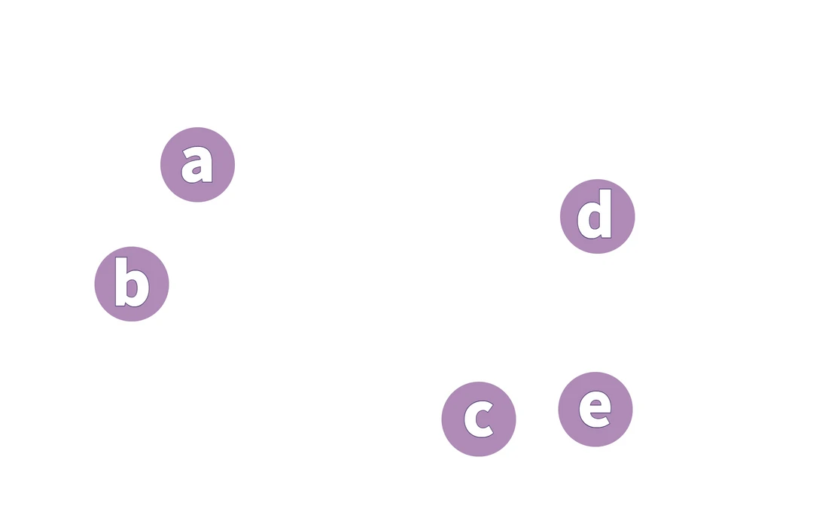
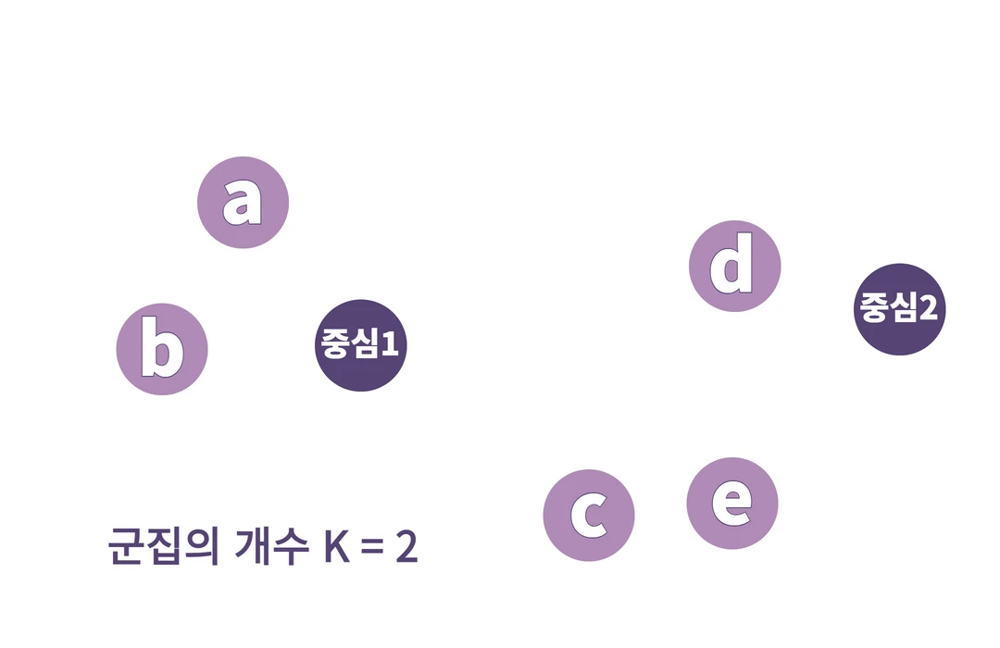
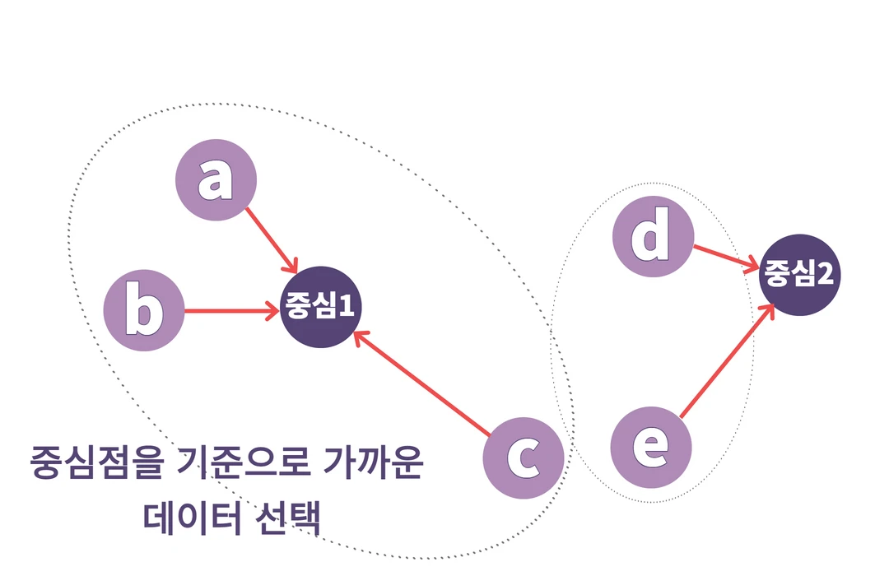
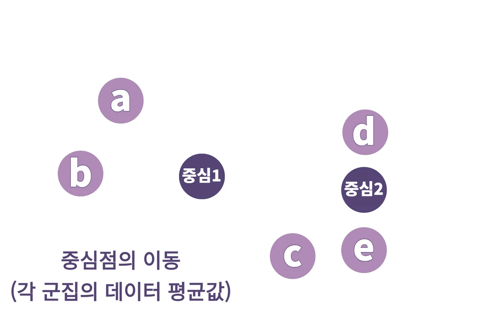
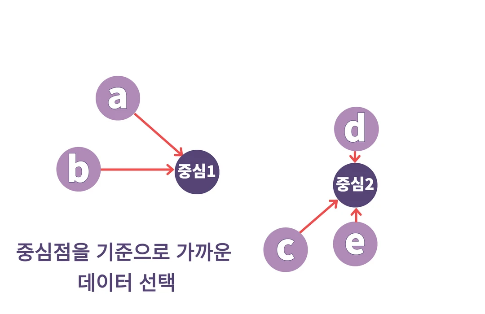
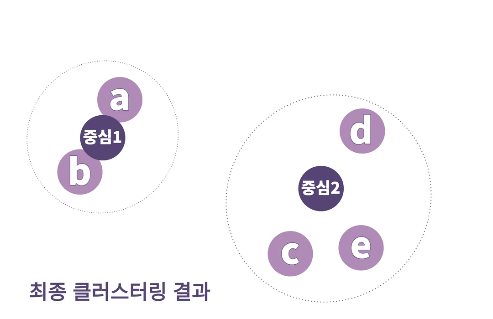
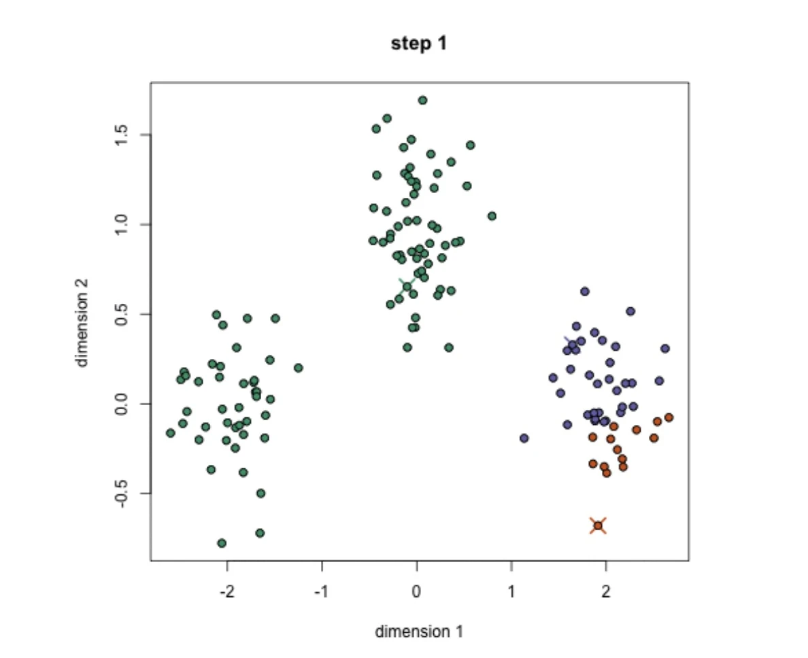
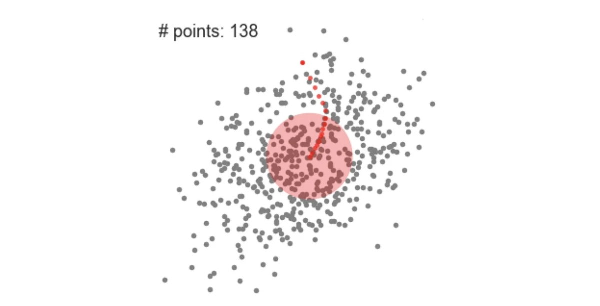

# 클러스터링 기초 공부

작성일 2024-02-05
{ .post-date }

## &lt;클러스터링이란?&gt;

**클러스터링**은 서로 다른 성질의 데이터를 혼합해 유사한 데이터를 몇 개의 클러스터(그룹)으로 분류하는 분석 기법이다.

### 클러스터링의 종류

- **계층적 클러스터링**(Hierarchical Clustering)

    유사한 데이터들을 차례로 묶어 계층적으로 결합하는 방법이다. 여기서 유사하다는 의미는 ‘데이터가 가까이 위치한다’는 것이다.

    계층적 클러스터링은 사전에 군집의 개수를 지정하지 않는다는 특징이 있다.

- **분할적 클러스터링**(Partitional Clustering)

    분할적 클러스터링이란, 각 데이터들을 사전에 정해둔 군집 중 하나의 군집으로 분할하는 방법이다. 즉, 사전에 군집의 개수를 지정해준다는 특징이 있다. 클러스터링을 진행하기 전 군집수를 k개로 지정한 후, 유사도가 높은 데이터끼리 묶어 k개의 군집에 분할해주는 것이다.

    **k-mean 클러스터링**은 대표적인 분할적 클러스터링에 속한다.

클러스터링을 시행하는 이유는 거대한 양의 데이터들을 유사한 속성으로 묶어, 숨겨진 유의미한 구조를 파악할 수 있다는 장점이 있기 때문이다. 

**클러스터링**(Clustering)은 사전정보가 존재하지 않으므로 비지도학습에 속하며, **분류**(Classification)는 사전정보가 존재하므로 지도학습에 속한다.

---

## &lt;k-mean 클러스터링&gt;

k-mean 클러스터링이란, 각 데이터와 군집 내의 중심점 사이의 평균 거리를 계산하여 가장 가까운 k개의 군집으로 배정하는 방법이다.

[데이터를 유사한 속성으로 묶어준다고요? 📊 : "디지털"한 일잘러 되는 비법](https://ablearn.kr/newsletter/?idx=13465571&bmode=view)

### k-mean 클러스터링의 과정 (1)

⇒ 이와 같은 데이터 a, b, c, d, e를 클러스터링으로 군집화하려고 한다.

⇒ k-평균 클러스터링을 이용할 경우, 이와 같이 임의의 k값과 k 만큼의 임의의 중심점을 정한다.

⇒ 설정한 중심점을 기준으로 가장 가까운 데이터를 선택하여 군집으로 만들면 된다. 데이터 a, b, c는 중심 1과 가깝게 나타났으며, 데이터 d, e는 중심 2와 가깝게 나타났다.

따라서 a, b, c는 **중심1에 군집화**되고, d, e는 **중심2에 군집화**된다.

⇒ 그 다음에는 중심점이 이동한다. 이때의 중심점은 각 군집의 데이터들의 평균값이다.

⇒ 이제 새롭게 정해진 중심을 기준으로 군집을 다시 만들어주면 된다. 이때 데이터 a와 b는 중심1과 가깝게 나타났으며, 데이터 c, d, e는 중심 2와 가깝게 나타났다.

⇒ 이렇게 두 개의 군집이 만들어지며, 새롭게 형성된 군집을 바탕으로 중심점을 이동하여 다시 군집을 형성한다. **이 때, 기존의 군집이 변화되지 않는다면 군집화가 적절하게 이루어진 것이다.**

### k-mean 클러스터링의 과정 (2)

[http://www.nextobe.com/2020/05/14/데이터-과학자가-알아야-할-5가지-클러스터링-알고리/](http://www.nextobe.com/2020/05/14/데이터-과학자가-알아야-할-5가지-클러스터링-알고리/)

k-mean 클러스터링은 사용할 클래스/그룹을 선택하고 각각의 중심점을 **무작위로 초기화**한다. 사용할 클래스의 수를 파악하려면 데이터를 빠르게 살펴보고 뚜렷한 그룹을 식별하는 것이 좋다. ⇒ 플로팅을 해보고 정하면 된다.

각 데이터 포인트는 해당 포인트와 각 그룹 센터 사이의 거리를 계산한 다음, 그 포인트가 가장 가까운 그룹에 속하도록 그룹화하여 분류된다.

이렇게 분류된 점을 기반으로 그룹의 모든 벡터의 평균을 취하여 그룹 중심을 재계산한다.

설정된 반복 횟수 동안, 또는 그룹 중심이 반복하는 사이에 많이 변화하지 않을 때까지 이 단계를 반복한다. 그룹의 중앙을 무작위로 몇 번 초기화 한 다음, 최상의 결과를 얻은 것처럼 보이는 실행을 선택할 수도 있다.

### k-mean 클러스터링의 장점과 단점

- **장점**

모든 포인트와 각 그룹 중앙 사이의 거리를 계산하므로, 복잡도가 O(n)으로 매우 빠르다.

- **단점**

얼마나 많은 그룹/클래스가 있는지 선택해야 한다. 이에 따라서 데이터에서 얻을 수 있는 정보나 인사이트가 달라질 수 있으므로 잘 결정해야 한다.

다른 예시로 k-median 클러스터링은 k-mean 클러스터링 방식과는 다르게 median 값을 사용한다. 그래서 이상치에 덜 민감하지만, 중앙값을 고르기 위해 반복적인 정렬이 필요하므로 일반적으로 복잡도가 더 높다.

---

## &lt;Mean-shift 클러스터링&gt;

Mean-shift 클러스터링은 데이터 포인트의 밀집된 영역을 찾기 위해 시도하는 **슬라이딩 윈도우 기반의 알고리즘**이다. 이는 중심점에 대한 후보를 슬라이딩 윈도우 내의 포인트의 평균으로 업데이트하여 작동하는 각 그룹/클래스의 중심점을 찾는 것이 목표라는 것을 의미하는 **centroid 기반 알고리즘**이다. 이러한 후보 윈도우는 후 처리 단계에서 필터링되어, 거의 중복을 제거하여 최종 세트의 중심점과 해당 그룹을 형성한다.

### Mean-shift 클러스터링의 과정

1. Mean-shift를 설명하기 위하여 위의 그림과 같이 2차원 공간에서 일련의 점을 고려한다. 점 C(무작위로 선택)를 중심으로 반경 r이 커널을 중심으로 하는 원형 슬라이딩 윈도우로 시작한다. Mean-shift는 융합이 될 때까지 각 단계에서 이 커널을 반복적으로 고밀도 영역으로 이동시키는 hill climbing 알고리즘이다.

1. 모든 반복에서 슬라이딩 윈도우는 중심점을 윈도우 내의 점들의 평균으로 이동시킴으로써, 더 높은 밀도의 영역쪽으로 이동한다. 슬라이딩 윈도우 내의 밀도는 그 안의 포인트의 수에 비례한다.

    당연히 윈도우에서 점의 평균으로 이동하면 점 밀도가 더 높은 영역으로 점차 이동한다.

1. 커널 내부에 더 많은 포인트를 수용 할 수 있는 방향이 없을 때까지 평균에 따라 슬라이딩 윈도우를 계속 이동시킨다. (더 이상 밀도를 증가시키지 않을 때까지 원을 움직인다. 위의 이미지에서는 빨간색 윈도우 내에 있는 것들이 한 그룹이라고 볼 수 있다.
1. 1-3 단계의 프로세스는 모든 점이 윈도우 안에 놓일 때까지 많은 슬라이딩 윈도우를 통해 수행된다. 여러 개의 슬라이딩 윈도우가 겹치면 가장 많은 점을 포함한 윈도우가 유지된다. 그런 다음 데이터 포인트가 있는 슬라이딩 윈도우에 따라 데이터 포인트가 클러스터된다.

### Mean-shift 클러스터링의 장점과 단점

- **장점**

Mean-shift 방식은 k-means 클러스터링과는 다르게 자동으로 클러스터의 수를 정하게 된다. 이는 엄청난 이점이며, 클러스터 센터가 최대 밀도 포인트로 수렴한다는 사실은 자연스러운 데이터 중심의 의미에서 이해하기 쉽고 잘 맞는 것처럼 매우 바람직하다.
