# DSBA 클러스터링

작성일 2024-02-05
{ .post-date }

[07-1: Clustering - Overview](https://www.youtube.com/watch?v=X6kCkqQPRvE)

## &lt;Clustering Overview&gt;

- **Unsupervised**: 비지도 학습에서 군집화(Clustering)를 통해 비슷비슷한 객체들을 모아주게 된다.

    ⇒ 하지만 객체를 아무렇게나 비슷하게 찾으면 안되고, 반드시 같은 그룹 내의 객체는 유사성을 지녀야 하며, 서로 다른 그룹에 속해 있다면 반드시 구별되어야 한다.

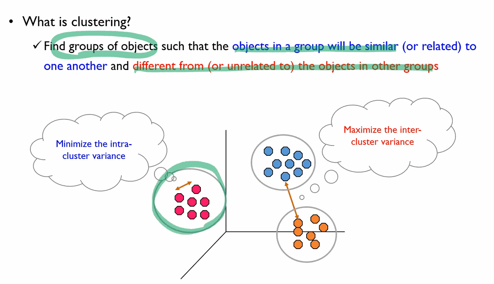

- Minimize the intra-cluster variance
- Maximize the inter-cluster variance

⇒ 군집 내에서의 variance는 최소화하며, 군집 간의 variance는 최대화 해야 한다.

> intra-cluster variance/inter-cluster variance에 따라서 군집화의 타당성이 평가된다.

### 클러스터링은 어디에 쓰이는가?

- **데이터의 이해**

데이터 내에서 유사한 특성을 가진 데이터만 묶어줌으로써 추가적인 분석이 가능하도록 하며, 이에 대한 인사이트를 제공할 수 있다.

- **요약**

데이터에 대한 요약 및 Visualization

⇒ Self-organizing Map(군집화와 시각화를 동시에 할 수 있는 알고리즘)

[https://ratsgo.github.io/machine learning/2017/05/01/SOM/](https://ratsgo.github.io/machine%20learning/2017/05/01/SOM/)

- **전략 수립**

### 클러스터링의 과정

- **Feature Selection**

어떤 변수를 사용하여 Vector화 할 것인가?

- **Clustering Algorithm Selection**

어떤 클러스터링 알고리즘을 사용할 것인가?

- **Validation of results**

결과의 타당성을 어떻게 검증할 것인가?

- **Interpretation**

결과를 어떻게 해석할 것인가?

> 클러스터링은 비지도학습에 따라 수행되는 비지도학습의 과정이기 때문에 정답이 존재하지 않는다. 다만, 허용 가능한 범위인지 그 타당성을 판단하는 과정은 반드시 수반되어야 한다.

군집의 개수는 판단하는 상황에 따라 다르며, 우리가 inter-cluster variance/intra-cluster variance를 측정하는 방법과 원하는 정도에 따라서 타당성 평가가 달라질 수 있다.

- **Elbow Point**

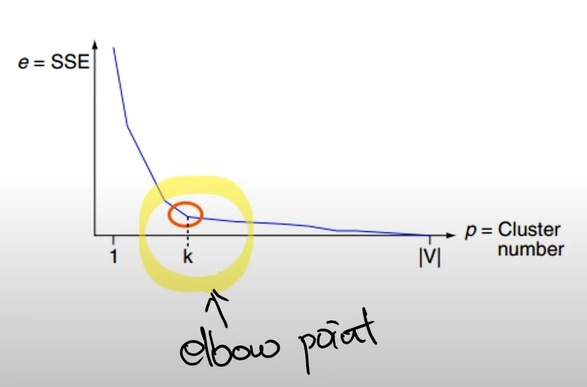

⇒ 단조감소하는 경우에는 위와 같은 Elbow Point를 Optimal Point로 결정하기도 한다.

### 군집화의 타당성은 어떻게 평가할 것인가?

> **There is no globally accepted validity measure**  
> ⇒ 절대적인 기준은 없다. 다양한 접근법이 존재한다.

- **External**: 이미 클러스터링의 개수와 멤버쉽이 알려졌다고 가정하고, 알고리즘이 생성한 결과와 정답을 비교하는 방법이다. ⇒ 비현실적인 검증 방법이며, 새로운 알고리즘이 알려졌을 때, 그 알고리즘의 성능 평가 방법으로 사용하기도 한다. 즉, 연구자가 사전에 생성한 방법을 잘 따라가는 지를 확인하는 방법이다. 연구나 논문을 위해 사용되며, 실용적이지는 못하다.
- **Internal**: 클러스터의 응집성(Intra-cluster variance)을 강조하는 방법이다.
- **Relative**: 클러스터의 **응집성**(Intra-cluster variance)과 **분리성**(Inter-cluster variance)을 모두 강조하는 방법이며, 실제로 많이 활용되는 접근법이다.

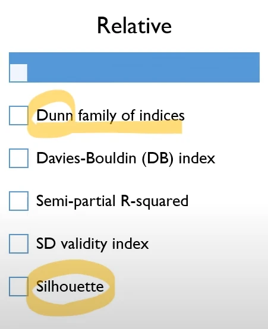

### Dunn Index

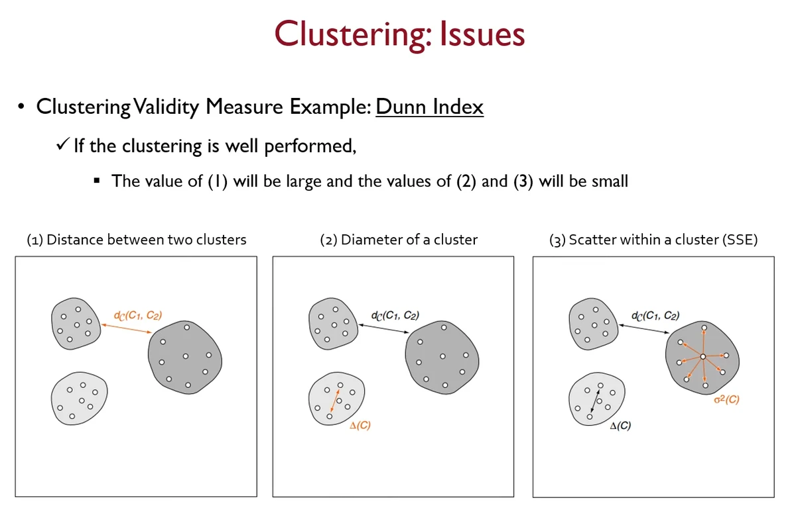

- **두 군집 간의 거리를 어떻게 정의할 것인가?**

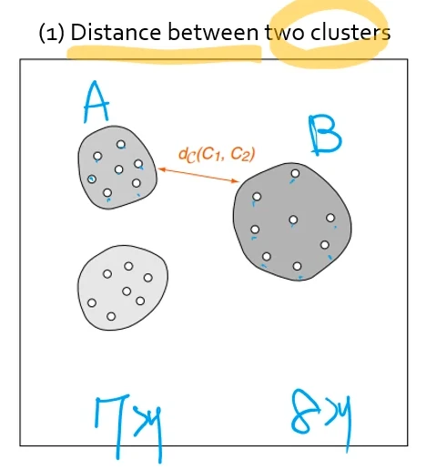

⇒ A, B 군집 내의 모든 객체 간의 Pair-wise Distance를 계산하고, 그 선 중에서 가장 적은 것을 **두 군집 간의 거리**라고 표현한다.

- **각 군집의 지름은 어떻게 표현할 것인가?**

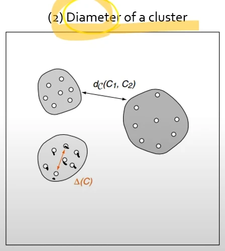

⇒ 각 군집 내의 모든 객체 간의 Pair-wise Distance를 계산하고, 그 중의 최댓값을 찾는다.

> 좋은 군집이라고 한다면, 1) 두 군집 간의 Distance는 커야 하며, 2) 각 군집의 지름인 diameter는 작아야 한다.

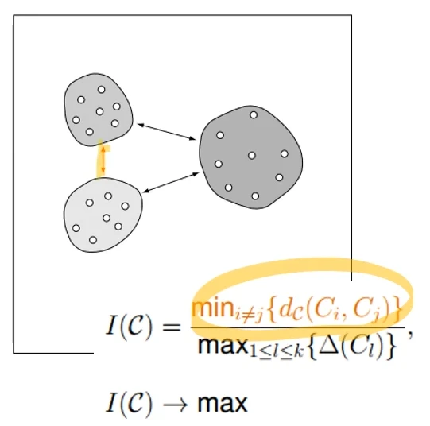

Dunn Index의 분자는 군집 간의 거리인 Distance들 중에서 minimum 값이며, 분모는 군집 내의 거리인 Diameter 중에서 maximum 값이다. 즉, Distance가 클수록 좋으며, Diameter가 작을수록 좋다.

### Silhouette

실루엣 지표는 조금 더 계산이 까다로운데, 각각의 객체마다 계산을 진행한다. 

- **a(i)**: i 객체로부터, 자신과 같은 군집에 속하는 다른 객체들 간의 거리의 평균을 구한다.  
    ⇒ 군집이 작을 수록 좋기 때문에, a(i)는 작을수록 좋다.
- b(i): i 객체로부터, 자신이 속하지 않은 한 군집 내의 객체들과의 거리의 평균들 중 가장 작은 값.

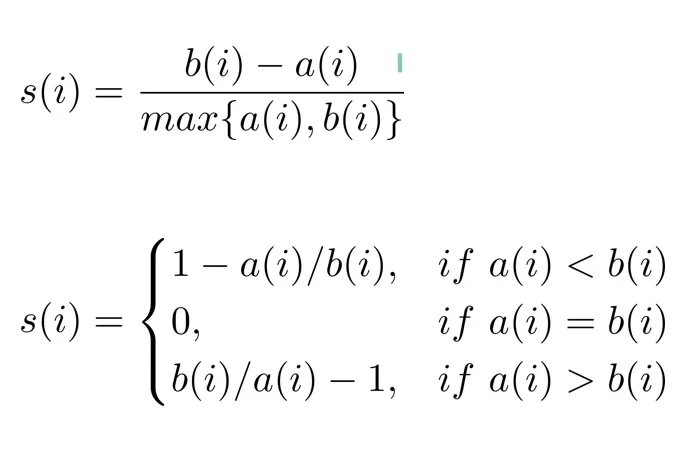

a(i)가 최소로 가질 수 있는 값은 0이며, 이 때 s(i) 값은 1이 된다. 

반대로 s(i)의 최솟값은 -1인데, 그 이유는 b(i)의 최솟값이 0이기 때문에 (뜬금없이 다른 군집의 모든 원소가 나와 같은 위치에 있는 경우) s(i) = -a(i)/a(i)가 되기 때문이다.

⇒ 군집화가 잘 되어 있으면 이론적으로 음수는 나와서는 안된다.

> 각각의 객체에 대해서 모두 s(i) 값을 구한 후, 이를 평균낸 것이 silhouette 값이다.

⇒ Dunn Index/Silhouette 모두 클수록 좋다.

### 클러스터링의 분류

- **Hard Clustering**: 하나의 객체가 두 개 이상의 군집에 속하는 것을 허용하지 않음.

    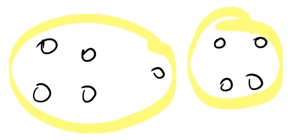

- **Soft Clustering**: 하나의 객체가 두 개 이상의 군집에 속하는 것을 허용함.

    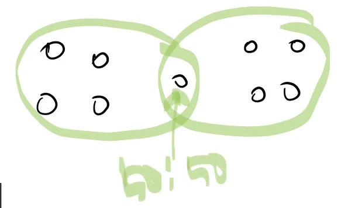

- **Partitional Clustering**: 구분을 동시다발적으로 진행하는 것
- **Hierarchical Clustering**: 계층적 군집화는 부분적으로 나누어서 Bottom-up, Top-down 방식으로 진행하는 것

---

## &lt;K-Means Clustering&gt;

K-Means 클러스터링은 대표적인 분리형 군집화 알고리즘이며, 이는 데이터가 존재하는 전체 영역을 부분적으로 구분해 가면서 특정 유사한 객체의 군집을 찾아내는 방법을 말한다.

각각의 군집은 단 하나의 군집 중심(Centroid)을 가지며, 각각의 데이터 포인트들은 가장 가까운 Centroid에 할당된다. 즉, **클러스터의 개수가 반드시 사전에 정의되어 있어야 한다.**

⇒ K는 일종의 hyperparameter

- **Procedure**

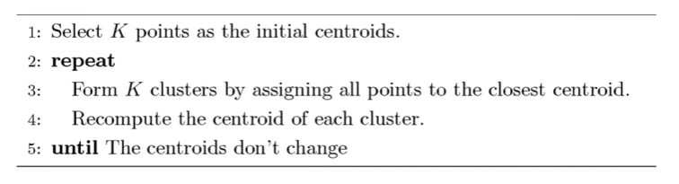

우리는 K-Means Clustering 과정에서 두 개의 미지수를 최적화 해야 한다.

1. Centroid
2. Membership

> 그런데 K-Means Clustering에서 1) 2)를 동시에 최적화하는 것은 매우 힘들다. 하지만 둘 중 하나를 고정해놓고 최적화 하는 것은 쉬울 수도 있다.

예를 들어 1)을 고정해 놓고, 2)를 최적화한다. 그 다음에 2)를 고정해 놓고, 1)을 최적화 한다. 그 다음에 다시 1)을 고정해 놓고, 2)를 최적화 하는 과정을 반복하며 수렴하게 만든다. (변화가 없을 때까지)

> 그런데 최적화를 한다고 하더라도, 초기 Centroid의 위치에 영향을 크게 받게 된다. 그러나 이 알고리즘은 복잡도가 그렇게 높지는 않으므로, 무작위로 클러스터링을 해 보고 가장 많이 나타나는 결과를 바람직한 결과로 선택하면 된다.

### K-Means Clustering의 한계

K-Means Clustering은 거리를 기준으로 판단하기 때문에 모양이나 밀도를 고려하지 않고 클러스터링을 수행할 수도 있다. 특히 구형이 아닌 것들에 대해서는 매우 취약하다.

⇒ 하지만 이 방법이 절대 쓸모없는 것은 아니며, 이는 극단적인 예시라고 생각할 수 있다.

---

## &lt;DBSCAN&gt;

[09-4: DBSCAN (Kor)](https://www.youtube.com/watch?v=O_EigN9iF6E)

밀도 기반의 군집화 방법이며, 대표적으로 DBSCAN을 사용한다.

- Can find an arbitrary shape of cluster  
    ⇒ 원형 모양이 아닌 군집을 찾아낼 수 있음.
- Can remove noise from clustering result  
    ⇒ Noise를 찾아 제거할 수 있음. (꼭 모든 객체를 할당시키지 않을 수 있음.)

### DBSCAN의 기본적인 가정(Idea)

- 군집 내의 데이터 포인터의 밀도가 높다.
- 군집에 포함되지 않는 개체의 밀도는 매우 낮다.

### Def 1: Epsilon-neighborhood of a point

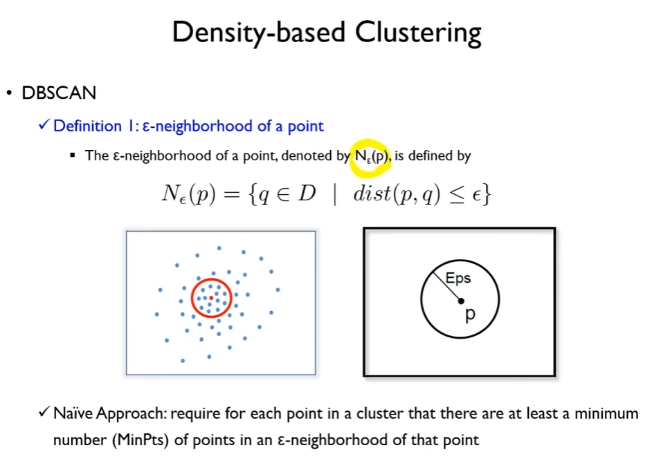

특정한 포인트 p의 epsilon neighborhood는 데이터셋에 존재하는 모든 q를 의미한다. 이 q는 특정한 포인트 p와의 거리가 epsilon보다 작은 점들의 집합을 말한다. 이 방법은 밀도 기반의 클러스터링 방식이기 때문에, 이와 같은 방법을 통해서 밀도를 고려할 수 있는 것이다.

- **Naive Approach**: 어떤 클러스터에서 임의의 점 하나를 선택해도, 반경 epsilon 안에는 우리가 정한 MinPts 이상의 개수의 점이 존재하도록 클러스터를 설정하는 것이다.

    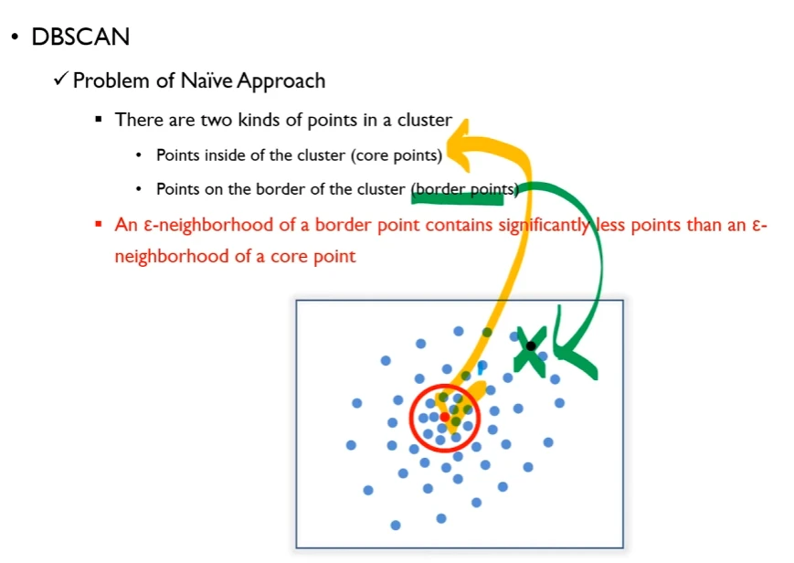

    Core Points 에서는 조건을 만족하기 쉽지만, Border Points는 조건을 쉽게 만족할 수 없기 때문에 Border Points의 Epsilon-Neighborhood가 훨씬 더 적은 데이터 포인트를 포함하게 된다.

### Better Idea of epsilon-neighborhood

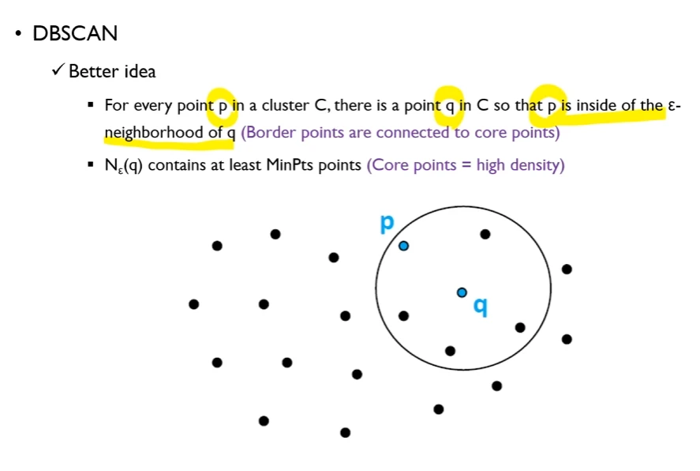

p와 q라는 두 점이 존재할 때, 두 점 사이의 관계를 파악한다. 이 때, p는 q의 epsilon-neighborhood이다. 이는 Border Points와 Core Points가 연결되어 있다는 뜻이다.

Core Points에 해당하는 q가 MinPts 이상의 점을 Neighborhood 안에 가져야 한다.

### Def 2: Directly density-reachable(Core-point condition)

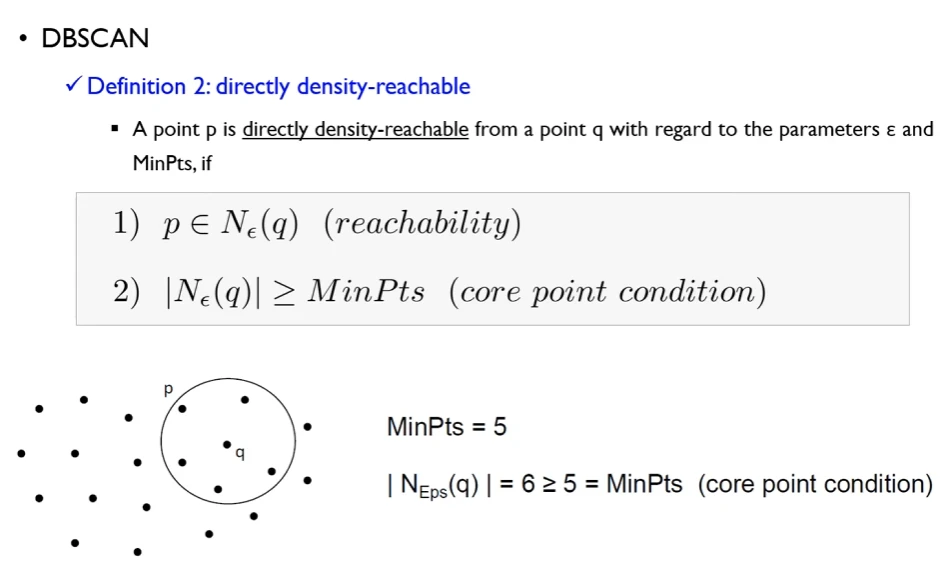

p라는 점이, q라는 점으로부터 directly density-reachable하다고 정의하기 위해서는 다음 두 가지를 만족해야만 한다. ⇒ 이전의 Idea를 구현한 것

1. p는 q의 epsilon-neighborhood 안에 있어야 한다. (reachability)

2. q의 epsilon-neighborhood에 포함되는 point의 개수는 MinPts 이상이어야 한다. (core point condition) ⇒ 자기 자신도 포함

    > p는 q로부터 directly density-reachable하다. (이것이 Core Points를 판단하는 기준)  
    > 그러니까, Epsilon-Neighborhood 조건을 만족해야만 Core Points인 것이다.  
    > 이 조건을 만족하지 않으면 밀도가 낮은 영역에 있는 Border Points이다.

### Def 3: density-reachable

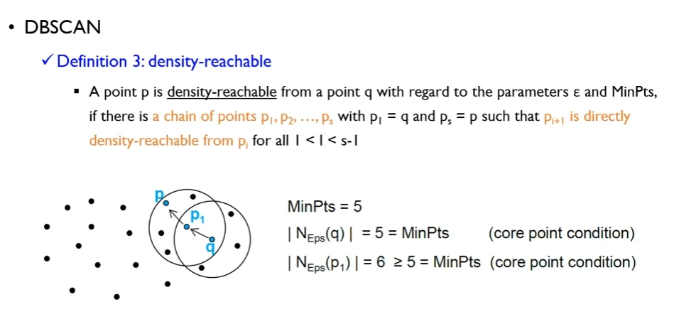

위의 클러스터링 예제에서 p는 q에 대해서 directly density-reachable하지는 않다. 왜냐면, p는 q의 epsilon neighborhood에 포함되지 않기 때문이다. 그런데 p는 p1에 대해서 directly density-reachable하다.

⇒ 따라서 p는 q에 대해서 directly density-reachable 하지는 않다. 하지만 p는 q에 대해서 density-reachable하다. 이는 중간 매개체인 p1이 존재하기 때문이다.

### Def 4: density-connected

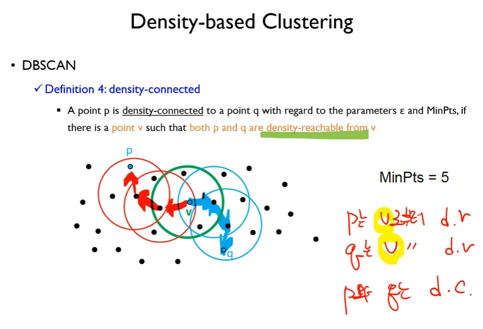

### Def 5: Cluster

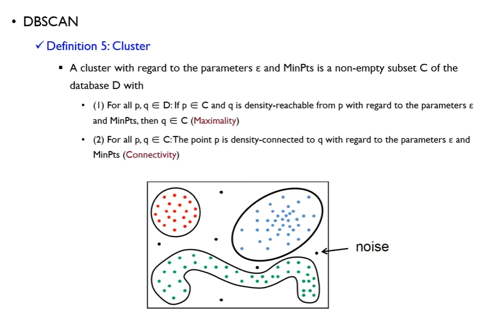

어떤 하나의 임의의 점에서 시작하여 Density-connected한 점이 없을 때까지 이어간다. 이때, 어떠한 점들과도 Density-connected되지 않은 점들은 Noise로 판단된다.

### Hyperparameter setting

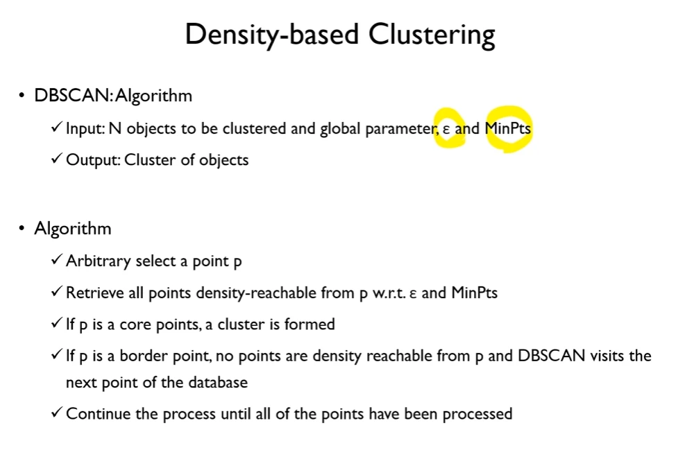

이 알고리즘의 Input은 N개의 object와 epsilon, MinPts가 있다. 이는 시각화를 통해서 정성적으로 판단을 해도 되고, **Dunn Index**, **Silhouette** 등으로 판단하면 된다.

이 방식은 어느 점으로부터 시작해도 차이가 없으며, 모든 Density-Reachable한 Point를 찾아내고, 만약 p가 Core-point일 경우에는 Core Points가 만들어진다. 만약 p가 Border-point라면, Density-Reachable한 Point가 없기 때문에 다른 Core-Point를 찾아낸다.

⇒ 모든 Point가 탐색될 때까지 진행한다.

---

## &lt;Mean-Shift Clustering&gt;

[짧은 머신러닝 안내서: Mean shift clustering](https://www.youtube.com/watch?v=VkQrt2kPXak)

### Mean-Shift Clustering?

- Kernel Density Estimation 과정

    - Kernel: 데이터의 발생점을 기준으로 어느 정도 오차범위를 표현

        ⇒ 어느 정도의 오차 범위를 갖는 Kernel을 통해서 데이터 필터링(**Flat Kernel**)

    - Density: 여러 오차범위로 교차 가중된 곳은 밀도가 높다.

        ⇒ 오차 범위가 하나의 원형 집합을 의미하며, 그것의 교집합을 말함.

        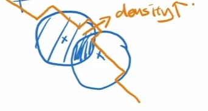

    - Estimation: 밀도의 분포를 추정하는 과정

- Mode seeking or Hill Climbing 방식이라고 말한다.

    - Mode seeking: 밀도가 높은 꼭대기(Mode)를 찾아 등반하는 과정.

    - 같은 꼭대기로 등반하는 데이터 포인트들을 하나의 군집으로 분류한다.

        > 정리하자면, Mean-Shift는 밀도가 높은 곳으로 등반해 나가는 방식의 알고리즘이다.

### 알고리즘 개요

1. n개의 데이터 포인트가 곧 n개의 후보 mode라고 가정

2. 각 후보 mode마다 다음 과정을 반복

    1. 후보 mode의 현 위치를 기준으로 범위(bandwidth) 안의 데이터 포인트를 찾음  
        ⇒ 이때 bandwidth는 이전에 소개된 epsilon과 똑같은 개념
    2. 찾은 범위 내의 데이터 포인트들의 **평균점**으로 후보 mode를 이동
    3. 후보 mode의 이동이 없을 때 (혹은 이동이 미약할 때) 이를 최종 mode로 결정  
        ⇒ 이는 정상에 도달한 것을 의미

3. 결과로 찾은 최종 mode 들이 서로 범위(bandwidth) 안에 인접한 경우, 병합한다.
4. 각 데이터 포인트는 mean shift 등반 과정에서 도달한 mode에 할당

### 장단점

- 장점

    - 충분한 데이터 밀도 하에 범용성이 존재

        - 군집의 형태에 대한 가정이 없다.
        - 데이터 특성에 영향을 덜 받는다.

    - 단일 파라미터(오직 bandwidth)로 동작한다.

        - bandwidth는 사용자가 실질적 의미를 두고 설정 가능  
            ⇒ 문제에 따라서 bandwidth를 임의로 적용 가능. K-Means의 K값보다는 추정이 쉽다.
        - 랜덤 초기화가 없어 결과도 항상 동일

- 단점

    - 적절한 bandwidth의 설정이 어렵다.

        - 해결하려는 문제마다 설정 값이 다르다.
        - 단일 bandwidth 만으로 전체의 분포에 맞지 않을 수 있다.

    - 비수치형 데이터에 적용이 어렵다
    - 계산량이 데이터포인트수의 제곱으로 증가한다. ⇒ 복잡도가 높다.
