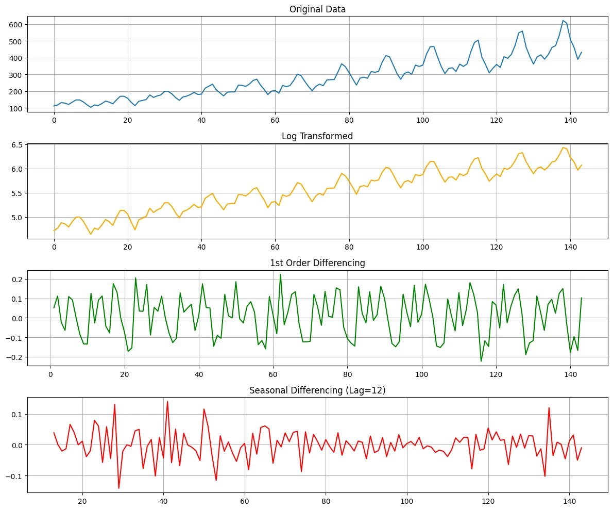

# 정상성과 단위근 검정

시계열 데이터의 기본적인 특징은 특정 시점의 값 $X_t$가 다른 시점의 값과 어떤 방식으로든 연관되어 있다는 것이다. 값들이 서로 완전히 독립이 아니며, 시계열 분석은 이 관계를 파악하는 일이다.

통계적 시계열 분석에서는 시계열이 어떤 [확률 과정](01-stochastic-process-and-random-walk.md)을 따른다고 가정하고, 그 과정에서 나온 표본 하나로 과정 자체를 알아내려 한다. 표본 하나로 과정을 정확히 알아내는 것은 매우 어렵기 때문에 강한 가정을 깔아야 하는데, 정상성(stationarity)이 그런 가정 가운데 하나다. 이 글에서는 정상성의 정의와 그 정의를 읽으며 가졌던 의문, 정상성을 판단하는 방법(눈으로 보기, 단위근 검정), 비정상 시계열을 정상 시계열로 바꾸는 방법을 정리한다.

## 정상성의 개념

정상 과정(stationary process)은 확률 변수들의 확률 분포가 시간과 상관없이 일정한 확률 과정이다. 분포가 시간에 의존하지 않으므로 기댓값이나 분산 같은 값도 시간에 의존하지 않는다.

여기서 처음 든 의문은 이것이었다. 시계열은 시간에 따라 값이 변하고, 이전 값의 영향을 받아 계속 출렁인다. 이것은 정상성과 어긋나지 않는가?

어긋나지 않는다. 정상성은 관측값이 변하지 않는다는 뜻이 아니라, 값을 만들어 내는 분포의 성질이 시점에 따라 달라지지 않는다는 뜻이다. 이전 값의 영향을 받는다는 사실만으로는 정상성이 깨지지 않는다.

- AR(1) $X_t = \phi X_{t-1} + \epsilon_t$, $\lvert \phi \rvert < 1$: 관측값은 계속 흔들리지만 평균과 분산은 고정되어 있다. 정상 과정이다.
- Random walk $X_t = X_{t-1} + \epsilon_t$: 값이 흔들릴 뿐 아니라 점점 멀어진다. 분산이 계속 커지므로 비정상이다.

관측값이 변하더라도 그 바탕의 평균과 분산이 변하지 않으면 정상 과정이고, 평균이나 분산이 계속 변하면 비정상 과정이다. "분산이 커진다"고 할 때의 분산은 과정이 내놓는 값 $X_t$의 분산을 말한다. 반대로 추세나 계절성이 있으면 시점에 따라 평균이 달라지므로 정상이 아니다. 이 점은 아래 "눈으로 판단하기"에서 다시 본다.

### 강정상성

강정상성(strong, strict stationarity)은 임의의 시점 묶음 $(X_t, \dots, X_{t+k})$의 결합 분포가, 그 묶음을 시간 축에서 얼마만큼 옮기든 똑같은 것을 말한다. 쉽게 말해 바탕이 되는 확률 분포(underlying distribution)가 언제나 같다. 따라서 분포의 모든 적률(moment)도, 존재하기만 한다면 시간과 무관하게 일정하다.

적률은 확률 변수의 분포 특성을 수치로 나타내는 개념이다.

- $n$차 적률: $\mu'_n = \mathbb{E}[X^n]$. $X$를 $n$제곱한 것의 평균이다.
- $n$차 중심 적률: $\mu_n = \mathbb{E}[(X - \mathbb{E}[X])^n]$. 평균을 뺀 뒤 $n$제곱한 것의 평균이다.

1차 적률이 평균, 2차 중심 적률이 분산이다.

강정상성은 현실에서 만나기 어렵다. 우리가 다루는 데이터에는 항상 잡음이 있고 여러 원인이 서로 영향을 주고받기 때문에, 처음부터 끝까지 같은 확률 분포를 유지하는 시계열은 드물다. 그래서 실제 분석에서는 조건을 완화한 약정상성을 쓴다.

### 약정상성

약정상성(weak, second-order stationarity)은 2차 적률까지만 요구한다. 다음 세 조건을 만족하는 시계열이다.

1. 임의의 $t$에 대해 $\mathbb{E}[X_t] = \mu$
2. 임의의 $t$에 대해 $\mathrm{Var}(X_t) = \sigma^2 < \infty$
3. 임의의 $t, h$에 대해 $\mathrm{Cov}(X_{t+h}, X_t) = \gamma(h)$

세 번째 조건은 공분산이 시점 $t$가 아니라 시차(lag) $h$에만 의존한다는 뜻이다. $\gamma(h)$를 자기공분산 함수(autocovariance function)라고 한다.

풀어 쓰면 다음과 같다.

1. 어느 시점을 뽑아도 평균이 같다.
2. 어느 시점의 분산을 보아도 같고, 발산하지 않는다.
3. 두 시점 사이의 공분산은 두 시점이 얼마나 떨어져 있는지에만 의존한다.

세 번째 조건이 성립하면 시계열 전체의 자기공분산 구조를 함수 하나로 표현할 수 있고, 이것을 바탕으로 자기상관 함수(ACF)나 ARMA 모델을 정의할 수 있다. 이 조건이 깨지면 시계열 전체를 하나의 통계적 구조로 설명하기 어렵고 모델링이 매우 복잡해진다.

### 조건을 읽으며 가진 세 가지 의문

조건을 처음 읽었을 때는 "데이터 포인트 하나를 뽑아서 그 값이 평균과 같을 가능성은 거의 없는데, 평균이 일정하다는 것을 어떻게 말할 수 있는가"가 이해되지 않았다. 조건마다 같은 종류의 의문이 생겨 하나씩 답을 정리했다.

**1. $X_t$의 값과 $\mu$가 다를 수 있는데, 어떻게 평균이 일정하다고 말하는가?**

당연히 다를 수 있다. 평균은 기댓값이다. 같은 과정을 여러 번 시뮬레이션했을 때 시점 $t$에서 나오는 값들의 평균적인 경향을 말하는 것이지, 한 번의 관측값이 늘 평균과 같다는 뜻이 아니다. $\mathbb{E}[X_t] = \mu$는 확률 변수 $X_t$의 이론적 평균이 어느 시점에서나 같다는 말이다.

**2. 데이터 포인트마다 값이 다른데, 분산이 일정하다는 것은 무슨 의미인가?**

1번과 같다. $\mathrm{Var}(X_t) = \sigma^2$은 확률 변수 $X_t$가 가진 이론적 분산이다. 데이터 포인트 하나로 평가하는 값이 아니며, 실제로는 슬라이딩 윈도우나 시계열 전체의 평균과 제곱 편차를 써서 추정한다.

**3. 공분산도 데이터 포인트 두 개만으로는 계산할 수 없지 않은가?**

맞다. 공분산은 한 쌍이 아니라 여러 쌍으로 추정해야 하는 통계량이다. 현실에서는 시차가 $h$인 쌍을 많이 모아 공분산을 추정하고, 그 값이 시간이 지나도 일정해 보이면 조건이 만족된다고 본다. 확인하는 방법으로는 두 가지를 적어 두었다.

- 슬라이딩 윈도우 추정: 시계열을 일정한 크기의 윈도우로 나누고, 윈도우마다 시차 $h$인 쌍의 공분산을 계산해 비교한다.
- 검정으로 간접 확인: 자기공분산이 시간에 따라 일정한가는 결국 정상성의 문제이므로, ADF 검정 같은 통계적 검정으로 비정상 여부를 판단한다.

세 답은 같은 이야기다. 정의에 나오는 평균, 분산, 공분산은 [1편](01-stochastic-process-and-random-walk.md)에서 본 "가능한 여러 실현"에 걸친 이론적인 값이고, 우리 손에는 실현이 하나뿐이므로 시간 축을 따라 모은 값으로 그것을 추정한다. 이 추정이 말이 되는 것도 정상성 덕분이다.

## 눈으로 판단하기

참고한 블로그는 Hyndman과 Athanasopoulos의 "Forecasting: Principles and Practice"에 나오는 아홉 개의 시계열 그림을 인용해, 어느 것이 정상 시계열인지 고르게 한다. 그림은 원문에 있으므로 여기서는 판단 결과만 표로 옮긴다.

| 그림 | 시계열 | 추세 | 계절성 | 판단 |
|---|---|---|---|---|
| a | 200 거래일 동안의 구글 주가 | 있음 | | 비정상 |
| b | 구글 주가의 일일 변동 | | | 정상에 가깝다 |
| c | 미국의 연간 파업 수 | 있음 | | 비정상 |
| d | 미국 신규 단독 주택의 월별 판매액 | | 있음 | 비정상 |
| e | 미국 계란 12개의 연간 가격 | 있음 | | 비정상 |
| f | 호주 빅토리아 주의 월별 돼지 도축 수 | 있음 | | 비정상 |
| g | 캐나다 맥킨지 강 지역의 연간 스라소니 포획 수 | | | 정상에 가깝다 |
| h | 호주의 월별 맥주 생산량 | | 있음 | 비정상 |
| i | 호주의 월별 전기 생산량 | 있음 | 있음 | 비정상 |

판단 기준은 세 가지다.

- 추세가 있는 시계열은 정상이 아니다. 관측 시점에 따라 평균이 달라진다.
- 계절성이 있는 시계열도 정상이 아니다. 역시 관측 시점에 따라 특성이 달라진다.
- 분산이 커지거나 작아지는 시계열도 정상으로 볼 수 없다.

남는 것은 b와 g다. 다만 b는 변동 폭이 고르지 않은 구간이 있어서, 직접 보기에는 정상이 아닐 수도 있겠다는 생각이 들었다.

## 검정으로 판단하기

눈으로 보는 판단은 주관적이므로 통계적 검정을 함께 쓴다. 대부분의 정상성 검정은 단위근(unit root) 검정이다.

수학에서 단위근은 어떤 양의 정수 $n$에 대해 $x^n = 1$을 만족하는 복소수를 말하며, 이런 수는 모두 복소평면의 단위원 위에 있다. 시계열에서 말하는 단위근은 정의가 조금 다르다. 모델의 특성 방정식이 단위원 위의 근, 대표적으로 1을 근으로 갖는 것을 뜻하고, 이것은 비정상성의 원인 가운데 하나다. [Random walk](01-stochastic-process-and-random-walk.md)가 바로 단위근을 가진 과정이다. 특성 방정식과 근의 조건은 [8편](08-lag-operator-and-arma.md)에서 다룬다.

단위근 검정은 시계열에 확률적 추세가 있는지를 검정하는 것이고, 단위근이 있으면 그 시계열은 비정상이다. 자주 쓰는 두 검정은 귀무가설의 방향이 서로 반대다.

| 검정 | 귀무가설 | 대립가설 |
|---|---|---|
| ADF (Augmented Dickey-Fuller) | 시계열에 단위근이 있다 | 시계열이 정상성을 만족한다 |
| KPSS (Kwiatkowski-Phillips-Schmidt-Shin) | 시계열 과정이 정상적이다 | 시계열 과정이 비정상적이다 |

ADF는 p-value가 작을 때 "단위근이 있다"는 가설을 기각하고, KPSS는 p-value가 작을 때 "정상이다"라는 가설을 기각한다. 방향이 반대이므로 두 검정을 함께 써서 서로 보완한다.

### p-value의 해석

검정 결과는 p-value(유의확률)를 중심으로 해석한다. p-value는 귀무가설이 관찰된 통계량과 얼마나 양립할 수 있는지를 0과 1 사이의 수로 나타낸 것이다. 0에 가까울수록 관찰된 통계량이 귀무가설과 양립하기 어렵다. 보통 유의수준 0.05나 0.01을 기준으로 삼는다.

두 가지를 주의해야 한다.

- ADF 통계량은 음의 방향으로 클수록 단위근이 없다고 판단할 근거가 강해진다. 통계량이 양수로 나올 수도 있으며, 아래 실습의 원본 데이터가 그런 경우다.
- p-value가 0.05보다 크다는 것은 귀무가설을 기각하지 못했다는 뜻이다. ADF에서 이것은 "단위근이 없다고 말할 근거가 부족하다"는 말이고, 단위근이 있다는 것이 증명됐다는 말은 아니다.

## 시계열의 정상화

통계적 시계열 모델은 대부분 정상 시계열을 대상으로 한다. 그런데 현실의 데이터는 대개 정상이 아니다. 해결 방법은 단순하다. 비정상 시계열을 정상 시계열로 바꾼 뒤에 모델을 적용한다.

비정상 시계열은 대부분 추세가 있거나, 계절성이 있거나, 분산이 변한다. 따라서 추세를 제거하고(detrending), 계절성을 제거하고(deseasoning), 분산을 일정하게 만들면 정상성을 띠게 된다.

### 분산을 일정하게 만들기

대표적인 방법은 로그 변환(log transformation)이다. 값이 커질수록 변동 폭도 함께 커지는 시계열에 적용한다.

### 추세와 계절성 제거하기

1. **회귀 분석**: 추세와 계절성을 회귀로 적합하고, 남은 나머지(residual)를 추세와 계절성이 제거된 시계열로 쓴다.
2. **평활법(smoothing)**: 평활한 값을 빼고 남은 나머지를 쓴다.
3. **차분(differencing)**: 이어진 값들의 차이 $y_t - y_{t-1}$을 구한다.

대부분의 시계열은 1차 차분만으로 정상 시계열이 된다. 2차 이상으로 차분하면 잃는 데이터가 늘고, 그 데이터에 맞춘 모델의 설명력도 낮아진다.

계절성은 계절 차분(seasonal differencing)으로 제거한다.

$$
y^*_t = y_t - y_{t-m}
$$

$m$은 계절 주기의 길이다. 12개 시점마다 같은 모양이 반복되면 $m = 12$다.

차분이 정상 시계열을 만들어 주는 이유는 다음과 같이 이해했다. 많은 비정상 시계열은 누적 과정(integrated process)이다. 정상적인 변화량이 계속 쌓여서 비정상 시계열을 이룬 것이다. 그러므로 쌓인 것을 차분하면 그 밑에 있던 정상 과정이 드러난다. Random walk를 한 번 차분하면 white noise $\epsilon_t$만 남는 것이 가장 단순한 예다.

## 실습: 항공 승객 수 데이터

월별 항공 승객 수 데이터(AirPassengers, 144개월)로 위 과정을 직접 따라 해 보았다. 이 데이터는 추세(평균의 변화), 계절성, 분산의 증가가 모두 뚜렷하다.

원본에 ADF 검정을 적용한 결과는 다음과 같다.

| | ADF 통계량 | p-value |
|---|---|---|
| 원본 | 0.8154 | 0.9919 |

p-value가 0.99 수준이므로 단위근이 있다는 귀무가설을 기각할 수 없다. 정상 시계열로 볼 수 없다.

이어서 로그 변환, 1차 차분, 주기 12의 계절 차분을 차례로 적용했다.

*위에서부터 원본, 로그 변환, 1차 차분, 계절 차분(lag 12)을 차례로 적용한 결과.*

로그 변환으로 뒤로 갈수록 커지던 진폭이 고르게 되고, 1차 차분으로 추세가 사라지고, 계절 차분으로 12개월마다 반복되던 모양이 사라진다. 다만 마지막 단계까지 가도 눈으로 보기에 완전한 정상 시계열이 되지는 않은 것 같았다.

마지막 단계의 시계열에 다시 ADF 검정을 적용했다.

| | ADF 통계량 | p-value |
|---|---|---|
| 로그 변환 + 1차 차분 + 계절 차분 | -4.4433 | 0.0002 |

p-value가 0.0002 수준이므로 단위근이 있다는 귀무가설을 기각할 수 있다. 같은 데이터에서 변환 방법을 바꿔 가며 ADF 결과와 AR 모델의 예측 성능을 비교한 실험은 [AirPassengers 정상화와 AR 차수 선택](../../research/sailab/06-ar-order-selection.md)에 따로 정리했다.

## 정리

- 정상성은 값이 변하지 않는다는 뜻이 아니라, 값을 만들어 내는 분포의 성질이 시점에 따라 달라지지 않는다는 뜻이다.
- 약정상성은 평균이 일정하고, 분산이 유한하며 일정하고, 공분산이 시차에만 의존한다는 세 조건이다. 세 조건의 평균, 분산, 공분산은 모두 이론적인 값이며 실제로는 여러 시점의 값으로 추정한다.
- ADF의 귀무가설은 "단위근이 있다", KPSS의 귀무가설은 "정상이다"로 서로 반대다.
- 로그 변환으로 분산을, 차분으로 추세를, 계절 차분으로 계절성을 다룬다.

## 참고 자료

- 모두의연구소 블로그, "시계열 정상성 (Stationarity), 들어봤니? - 알아보자 시계열 분석 Episode 2". <https://modulabs.co.kr/blog/time-series-stationarity>
- R. J. Hyndman, G. Athanasopoulos, "Forecasting: Principles and Practice" 2판, 8.1 Stationarity and differencing. 아홉 개 시계열 그림의 출처다. <https://otexts.com/fpp2/stationarity.html>
- A. Mikusheva, MIT OpenCourseWare 14.384 "Time Series Analysis" (Fall 2013), Lecture 1. 강정상성 정의의 출처다. <https://ocw.mit.edu/courses/14-384-time-series-analysis-fall-2013/>
