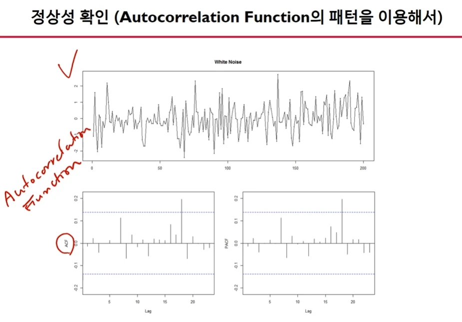
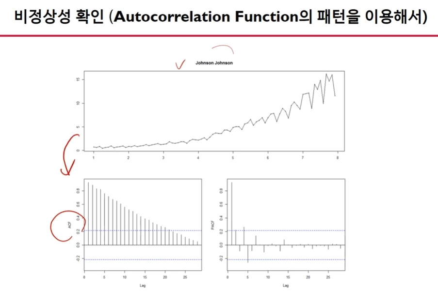
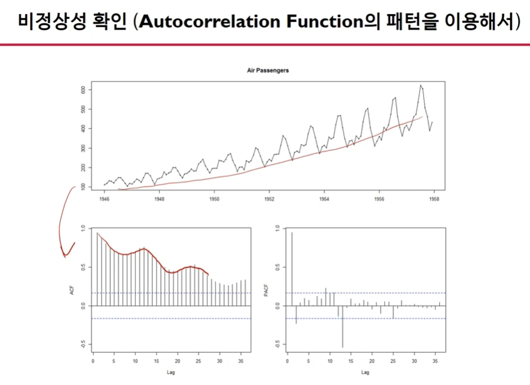
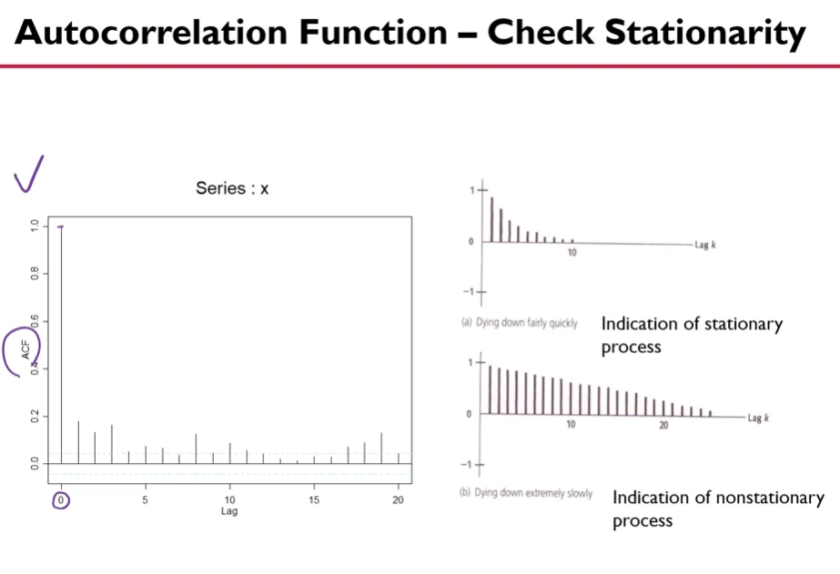
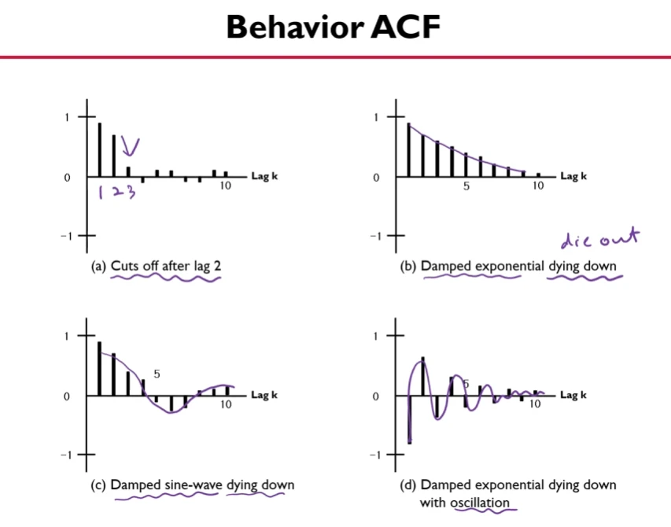
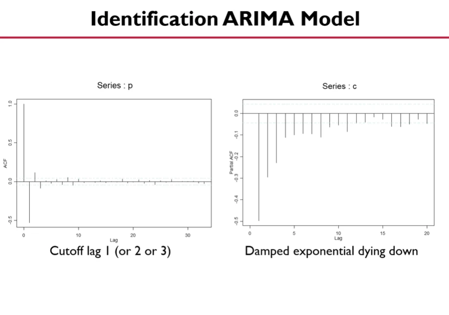
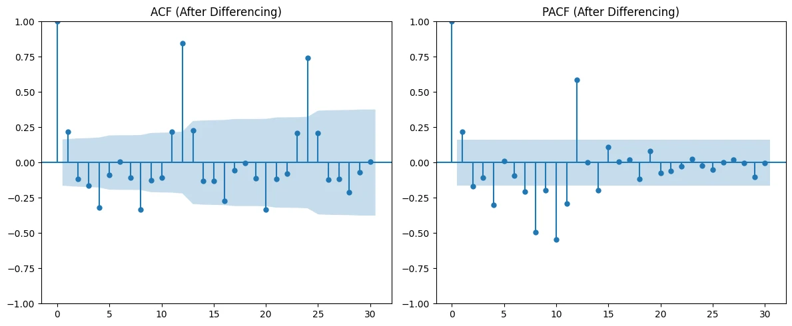

# 자기공분산, ACF, 교차상관, PACF

작성일 2025-04-03 · 최종 수정일 2025-06-10
{ .post-date }

"현재 관측치가 과거 관측치와 상관이 있다"는 말은 시계열 모델 설명에 빠지지 않고 나오지만, 정확히 무엇을 계산한 값인지는 따로 정리해야 했다. 이 글에서는 공분산에서 출발해 자기공분산, 자기상관(ACF), 교차공분산과 교차상관, 편자기상관(PACF)까지를 식과 함께 정리한다. 마지막에는 ACF, PACF 그래프에 그려지는 띠 $\pm 1.96/\sqrt{N}$이 어디에서 나오는지 따져 본다. [약정상성](02-stationarity-and-unit-root-test.md)을 전제로 한다.

## 한눈에 보기

| 이름 | 무엇을 보는가 |
|---|---|
| 공분산 (covariance) | 서로 다른 두 변수의 선형 관계 |
| 상관계수 (correlation) | 공분산을 정규화한 값 |
| 자기공분산 (autocovariance) | 한 시계열과, 그 시계열을 시차 $h$만큼 민 것 사이의 선형 관계 |
| 자기상관 (autocorrelation, ACF) | 자기공분산을 정규화한 값 |
| 교차공분산 (cross-covariance) | 서로 다른 두 시계열을 시차 $h$만큼 어긋나게 놓았을 때의 선형 관계 |
| 교차상관 (cross-correlation) | 교차공분산을 정규화한 값 |
| 편자기상관 (partial autocorrelation, PACF) | 시점 $t$와 $t-h$ 사이에 있는 값들의 영향을 걷어 낸 뒤 남는 상관 |

스칼라 시계열(univariate)이면 시차마다 값이 하나 나오고, $d$차원 벡터 시계열(multivariate)이면 변수 쌍마다 값이 나오므로 $d \times d$ 행렬이 된다. 상관계수도 마찬가지다.

## 공분산과 자기공분산

### 공분산

공분산은 두 스칼라 확률 변수 $X, Y$가 함께 움직이는 정도를 본다.

$$
\mathrm{Cov}(X, Y) = \mathbb{E}\big[(X - \mathbb{E}[X])(Y - \mathbb{E}[Y])\big] = \mathbb{E}[XY] - \mathbb{E}[X]\mathbb{E}[Y]
$$

두 번째 등호는 괄호를 풀면 나온다. $\mu_X = \mathbb{E}[X]$, $\mu_Y = \mathbb{E}[Y]$로 두면 다음과 같다.

$$
\begin{aligned}
\mathbb{E}[(X - \mu_X)(Y - \mu_Y)] &= \mathbb{E}[XY - X\mu_Y - Y\mu_X + \mu_X\mu_Y] \\
&= \mathbb{E}[XY] - \mu_X\mu_Y - \mu_Y\mu_X + \mu_X\mu_Y \\
&= \mathbb{E}[XY] - \mathbb{E}[X]\mathbb{E}[Y]
\end{aligned}
$$

$Y = X$로 두면 분산의 식 $\mathrm{Var}(X) = \mathbb{E}[X^2] - \mathbb{E}[X]^2$이 된다.

관측값 $N$개로 계산하는 표본 공분산은 다음과 같다.

$$
\mathrm{Cov}(X, Y) = \frac{1}{N-1}\sum_{t=1}^{N}(X_t - \mu_X)(Y_t - \mu_Y)
$$

$X_t, Y_t$가 벡터이면 뒤쪽을 전치해 곱한다.

$$
\mathrm{Cov}(X, Y) = \frac{1}{N-1}\sum_{t=1}^{N}(X_t - \mu_X)(Y_t - \mu_Y)^{\top}
$$

- 모집단 전체로 계산할 때는 $N$으로, 표본으로 추정할 때는 $N-1$로 나눈다.
- 공분산과 상관계수는 같은 시점끼리 짝을 지어 계산하므로 두 시계열의 길이가 같아야 한다.
- 벡터가 $d$차원이면 결과는 $d \times d$ 행렬이고, 평균도 스칼라가 아니라 $d \times 1$ 벡터다.

### 공분산 행렬

확률 변수 $X$가 벡터이면, 즉 원소 하나하나가 스칼라 확률 변수이면 자기 자신과의 공분산은 행렬이 된다.

$$
\mathrm{Cov}(X, X) = \mathbb{E}\big[(X - \mathbb{E}[X])(X - \mathbb{E}[X])^{\top}\big] = \mathbb{E}[XX^{\top}] - \mathbb{E}[X]\mathbb{E}[X]^{\top}
$$

$$
\mathrm{Cov}(X, X) =
\begin{bmatrix}
\mathrm{Var}(X_1) & \mathrm{Cov}(X_1, X_2) & \cdots & \mathrm{Cov}(X_1, X_n) \\
\mathrm{Cov}(X_2, X_1) & \mathrm{Var}(X_2) & \cdots & \mathrm{Cov}(X_2, X_n) \\
\vdots & \vdots & \ddots & \vdots \\
\mathrm{Cov}(X_n, X_1) & \mathrm{Cov}(X_n, X_2) & \cdots & \mathrm{Var}(X_n)
\end{bmatrix}
$$

- 대각 원소는 각 원소의 분산이다.
- 대칭 행렬이고 정방 행렬이다.
- 벡터의 원소들이 서로 어떤 관계를 갖는지 보려고, 짝지을 수 있는 모든 조합의 공분산을 계산해 행렬로 늘어놓은 것이다.

### 자기공분산

자기공분산은 같은 시계열 안에서 시차 $h$만큼 떨어진 값들 사이의 공분산이다.

$$
\gamma(h) = \mathrm{Cov}(X_t, X_{t+h}) = \mathbb{E}[(X_t - \mu)(X_{t+h} - \mu)]
$$

표본에서는 시차가 $h$인 쌍을 모두 모아 평균을 낸다.

$$
\hat{\gamma}(h) = \frac{1}{N-h}\sum_{t=1}^{N-h}(x_t - \bar{x})(x_{t+h} - \bar{x})
$$

벡터 시계열이면 곱을 $(X_t - \mu)(X_{t+h} - \mu)^{\top}$로 바꾸어 시차 $h$의 자기공분산 행렬 $\Gamma(h)$를 얻는다.

### 공분산의 해석과 한계

- 공분산이 0보다 크면 양의 상관이, 0보다 작으면 음의 상관이 있다.
- 공분산이 0이면 선형적인 상관이 없다.

공분산이 보는 것은 선형 관계다. 두 변수가 비선형적인 관계를 가지면 공분산으로는 알아낼 수 없다. 그래서 두 변수가 독립이면 $\mathbb{E}[XY] = \mathbb{E}[X]\mathbb{E}[Y]$이므로 공분산이 0이지만, 공분산이 0이라고 해서 독립인 것은 아니다.

또 하나의 한계는 단위다. 두 변수의 측정 단위가 다르면 스케일이 큰 쪽의 영향이 커져 공분산 값만으로는 관계의 세기를 해석하기 어렵다. 스케일을 고려해 값을 조정한 것이 상관계수다.

## 상관계수와 자기상관

### 상관계수

상관계수는 공분산을 두 변수의 표준편차로 나눈 값이다.

$$
\rho_{XY} = \frac{\mathrm{Cov}(X, Y)}{\sigma_X \sigma_Y} = \frac{\mathrm{Cov}(X, Y)}{\sqrt{\mathrm{Var}(X)}\sqrt{\mathrm{Var}(Y)}}
$$

변수의 절대적인 크기에서 오는 영향이 없어지고, 값은 $-1$에서 $1$ 사이에 놓인다. 벡터이면 원소 쌍 $(i, j)$마다 같은 식을 적용해 상관계수 행렬을 만든다.

$$
\mathrm{Corr}(X_t, Y_t)_{ij} = \frac{\mathrm{Cov}(X_t^{(i)}, Y_t^{(j)})}{\sqrt{\mathrm{Var}(X_t^{(i)})}\sqrt{\mathrm{Var}(Y_t^{(j)})}}
$$

- 두 변수가 독립이면 상관계수는 0이다.
- 상관계수가 0이면 두 변수 사이에 선형 상관이 없다. 독립이라는 뜻은 아니다.

### 자기상관 (ACF)

자기상관은 시차 $h$의 자기공분산을 분산으로 나눈 값이다. 시차마다 상대적인 관계의 세기를 비교할 수 있다.

$$
\rho(h) = \frac{\gamma(h)}{\gamma(0)} = \frac{\mathrm{Cov}(X_t, X_{t+h})}{\mathrm{Var}(X_t)}
$$

약정상성 아래에서는 공분산이 $t$가 아니라 시차 $h$에만 의존하고 분산도 일정하므로, $\rho(h)$도 시점과 무관하게 정해진다. 시차 $h$를 가로축에 두고 $\rho(h)$를 그린 것이 ACF 그래프다.

벡터 시계열에서는 $\Gamma(0)$의 대각 성분, 즉 각 변수의 분산만 남긴 대각 행렬 $D$를 써서 정규화한다.

$$
\mathrm{Corr}_X(h) = D^{-\frac{1}{2}}\,\Gamma(h)\,D^{-\frac{1}{2}}, \qquad
\Gamma(0) =
\begin{bmatrix}
\mathrm{Var}(X^{(1)}) & \mathrm{Cov}(X^{(1)}, X^{(2)}) & \cdots \\
\mathrm{Cov}(X^{(2)}, X^{(1)}) & \mathrm{Var}(X^{(2)}) & \cdots \\
\vdots & \vdots & \ddots
\end{bmatrix}
$$

$\Gamma(0)$을 계산하면 비대각 원소에 변수 사이의 공분산이 나오지만, 정규화에 필요한 것은 각 변수의 표준편차뿐이다. 그래서 대각 성분만 남기고 나머지는 버린다.

노트에는 $\mathrm{Corr}_X(h) = \Gamma(h)\Gamma(0)^{-1}$이라는 식도 함께 적어 두었고, 둘의 차이는 모르겠다고 써 두었다. 다시 확인해 보면 두 식은 스칼라일 때만 같은 값 $\gamma(h)/\gamma(0)$이 된다. 벡터에서는 $\Gamma(h)\Gamma(0)^{-1}$이 원소별로 정규화한 상관 행렬이 아니라, 한 시점의 벡터로 $h$만큼 떨어진 시점의 벡터를 선형 예측할 때의 계수 행렬에 해당한다. 상관 행렬의 정의로는 첫 번째 식을 쓴다.

## 교차공분산과 교차상관

서로 다른 두 시계열 $X_t, Y_t$를 시차 $h$만큼 어긋나게 놓고 관계를 본 것이다.

$$
\gamma_{XY}(h) = \mathrm{Cov}(X_t, Y_{t+h}) = \mathbb{E}[(X_t - \mu_X)(Y_{t+h} - \mu_Y)]
$$

$$
\rho_{XY}(h) = \frac{\gamma_{XY}(h)}{\sqrt{\gamma_X(0)\,\gamma_Y(0)}}
$$

$\gamma_X(0), \gamma_Y(0)$은 각 시계열의 분산이다. 어느 쪽 시계열을 미는지는 자료마다 표기가 다르므로($Y_{t+h}$로 쓰기도, $Y_{t-h}$로 쓰기도 한다) 부호를 확인하고 읽어야 한다.

교차상관은 두 시계열 가운데 어느 쪽이 먼저 움직이는지, 즉 선후 관계를 살펴볼 때 쓴다. 한쪽의 과거가 다른 쪽의 예측에 도움이 되는지를 검정으로 따지는 방법은 [Granger 인과](07-granger-causality.md)에서 다룬다.

## 편자기상관 (PACF)

ACF는 사이에 낀 시차들의 영향이 모두 누적된 결과다. $X_t$와 $X_{t-2}$의 상관에는 $X_{t-1}$을 거쳐 전달된 영향이 섞여 있어서, 직접적인 영향과 간접적인 영향을 구분할 수 없다. PACF는 중간 시차들의 영향을 걷어 낸 상태에서 $X_t$와 $X_{t-h}$ 사이에 남는 상관만 잰다.

$$
\mathrm{PACF}(h) = \mathrm{Corr}\big(X_t - \hat{X}_t,\ X_{t-h} - \hat{X}_{t-h}\big)
$$

두 잔차 사이의 상관이다.

1. $\hat{X}_t$는 사이에 있는 값 $X_{t-1}, \dots, X_{t-h+1}$로 $X_t$를 회귀해 예측한 값이다. $X_t - \hat{X}_t$는 중간 값들로 설명되지 않고 남은 부분이다.
2. $\hat{X}_{t-h}$는 같은 값 $X_{t-1}, \dots, X_{t-h+1}$로 $X_{t-h}$를 회귀한 값이다.

2번이 처음에는 이상해 보였다. 미래의 값으로 과거의 값을 예측하는 셈이기 때문이다. 하지만 이것은 예측을 하려는 것이 아니라 통제를 하려는 것이다. 양쪽에서 공통으로 설명되는 부분을 빼내기 위해 같은 조건으로 회귀하는 것이고, 그렇게 얻은 두 잔차가 서로 상관을 갖는지 보는 것이 목적이다.

실제 계산에는 Yule-Walker 방정식이나 OLS 회귀를 쓴다. OLS로 구할 때는 $X_t$를 $X_{t-1}, \dots, X_{t-h}$ 전부에 회귀해 얻은 마지막 계수, 즉 $X_{t-h}$에 붙는 계수가 시차 $h$의 편자기상관이다. 다른 시차를 모두 함께 넣었을 때 $X_{t-h}$가 추가로 설명하는 몫이므로 위의 정의와 같은 것을 잰다.

## ACF, PACF 그래프 읽기

식으로 정의한 ACF와 PACF는 실제로는 그래프로 그려서 쓴다. 가로축에 시차를, 세로축에 그 시차의 계수를 막대로 그린 것이다. 이 그래프로 하는 일은 두 가지다. 시계열이 정상인지 확인하는 것과, 모델의 차수를 짐작하는 것이다. 아래 그림은 2024년 12월에 ARIMA 강의를 들으며 정리해 둔 강의 슬라이드다.

### ACF로 정상성 확인하기

복잡한 데이터는 시계열 그래프만 보아서는 정상인지 아닌지 가리기 어렵다. 이때 ACF 그래프를 그려 보면 쉽게 확인할 수 있다. 먼저 정상 시계열의 대표인 white noise다.

*위가 white noise 시계열, 아래 왼쪽이 ACF, 오른쪽이 PACF다. 막대가 뚜렷한 모양 없이 흩어져 있고 거의 모두 점선(유의 경계) 안에 있다. 출처: 강의 슬라이드.*

자기상관이 특정한 모양 없이 무작위로 나타나면 정상 시계열이라고 말할 수 있다. 비정상 시계열은 다르게 보인다.

*계속 오르는 추세가 있는 시계열(위)의 ACF(아래 왼쪽)는 시차가 늘어도 아주 천천히, 일정하게 줄어든다. 출처: 강의 슬라이드.*

추세가 있으면 가까운 시점끼리는 물론이고 꽤 떨어진 시점끼리도 값의 수준이 비슷하다. 그래서 시차를 늘려도 자기상관이 좀처럼 떨어지지 않는다. 추세에 계절성까지 있는 항공 승객 수 데이터에서는 천천히 줄어드는 모양 위에 물결이 겹친다.

*항공 승객 수 데이터(위)의 ACF(아래 왼쪽). 천천히 줄어드는 것은 추세 때문이고, 일정한 간격으로 다시 솟는 것은 계절성 때문이다. 출처: 강의 슬라이드.*

판단 기준을 한 장으로 줄이면 다음 그림의 오른쪽과 같다.

*오른쪽 위 (a)처럼 ACF가 빠르게 0으로 떨어지면 정상, 아래 (b)처럼 아주 천천히 줄어들면 비정상의 신호다. 왼쪽은 강의에서 예제로 쓴 데이터의 ACF다. 출처: 강의 슬라이드.*

정리하면, 시차가 늘어도 ACF가 아주 천천히 줄어들면 비정상 시계열로 의심하고, 빠르게 떨어지거나 뚜렷한 모양 없이 흩어지면 정상에 가깝다고 본다. 비정상으로 보이면 [차분](02-stationarity-and-unit-root-test.md)을 한 뒤 ACF를 다시 그려 확인한다.

### ACF와 PACF로 차수 짐작하기

정상 시계열을 얻었다면 다음은 어떤 모델을 몇 차로 쓸지 정할 차례다. PACF는 AR 모델의 차수를 정할 때, ACF는 MA 모델의 차수를 정할 때 본다. 강의에서 적어 둔 기준은 다음과 같다. AR, MA 모델 자체는 [4편](04-ar-and-var.md)과 [8편](08-lag-operator-and-arma.md)에서 다룬다.

| 모델 | ACF | PACF |
|---|---|---|
| AR($p$) | 지수적으로 감소하거나, 진폭이 줄어드는 사인파 모양으로 서서히 사라진다 | 시차 $p$ 이후 0으로 끊긴다 |
| MA($q$) | 시차 $q$ 이후 0으로 끊긴다 | 지수적으로 감소하거나, 진폭이 줄어드는 사인파 모양으로 서서히 사라진다 |
| ARMA | 서서히 사라진다 | 서서히 사라진다 |

표에 나오는 말은 두 가지뿐이다. 어느 시차 뒤로 막대가 갑자기 없어지는 "끊긴다(cut off)"와, 막대가 조금씩 작아지는 "서서히 사라진다(die out)"다. 그래프에서는 다음과 같이 보인다.

*(a)는 시차 2 뒤에 끊기는 모양이다. (b), (c), (d)는 모두 서서히 사라지는 모양으로, 차례로 지수적 감소, 진폭이 줄어드는 사인파, 부호가 번갈아 바뀌며 줄어드는 경우다. 출처: 강의 슬라이드.*

읽는 방법은 "어느 쪽 그래프가 끊기는가"를 찾는 것이다. PACF가 시차 $p$에서 끊기고 ACF가 서서히 사라지면 AR($p$), ACF가 시차 $q$에서 끊기고 PACF가 서서히 사라지면 MA($q$)를 후보로 삼는다. PACF는 중간 시차의 영향을 걷어 낸 직접적인 상관이므로, AR($p$)에서는 $p$보다 먼 시차의 직접적인 상관이 없어 PACF가 끊긴다고 이해하면 된다.

강의의 예제에서는 차분한 시계열의 ACF와 PACF가 다음과 같았다.

*왼쪽 ACF는 시차 1 뒤에 끊기고, 오른쪽 PACF는 지수적으로 서서히 줄어든다. 표의 MA 줄에 해당하므로 MA(1)을 먼저 시험해 볼 수 있다. 출처: 강의 슬라이드.*

두 가지를 덧붙여 둔다.

- 이런 판독은 주관적이고, 실제 데이터에서는 표처럼 깔끔하게 나오지 않는 경우가 많다.
- PACF는 AR 같은 단변량 모델에서는 잘 동작하지만, VAR 같은 다변량 모델에서는 변수와 시차 사이의 교차 의존이 너무 많아 차수를 정하는 데 쓰기 어렵다. 그때는 AIC, BIC, HQIC 같은 [정보 기준](05-aic-and-bic.md)을 쓴다.

## ACF, PACF 그래프의 신뢰구간

ACF, PACF 그래프에는 0을 중심으로 띠가 함께 그려진다. 위의 강의 슬라이드에서는 점선이었고, 아래처럼 statsmodels로 그리면 색이 칠해진 띠로 나온다. 각 시차의 계수가 통계적으로 유의한지 판단하기 위한 95% 구간이다.

*항공 승객 수 데이터를 Box-Cox 변환한 뒤 1차 차분한 시계열($N = 143$)의 ACF(왼쪽)와 PACF(오른쪽). 하늘색 띠가 95% 구간이다. 띠 밖으로 나간 막대, 예를 들어 시차 12의 막대가 유의한 시차다.*

막대가 띠 안에 있으면 "상관이 0인데 우연히 이 정도 값이 나왔다"고 보아도 무리가 없고, 띠 밖으로 나가면 우연으로 보기 어렵다는 뜻이다. 이 띠가 어디에서 나오는지 정리한다.

### 구간의 식

시계열이 white noise일 때, 표본 자기상관 $r_k$는 근사적으로 다음 분포를 따른다. $N$은 시계열의 길이다.

$$
r_k \sim N\!\left(0, \frac{1}{N}\right)
$$

분산이 $1/N$이므로 표준편차는 $1/\sqrt{N}$이다. 표준정규분포에서는 $\pm 1.96$ 사이에 전체 확률의 95%가 들어 있다.

$$
P(\lvert Z \rvert \le 1.96) \approx 0.95, \qquad Z \sim N(0, 1)
$$

따라서 95% 구간은 다음과 같다.

$$
\pm \frac{1.96}{\sqrt{N}}
$$

예를 들어 $N = 143$이면 약 $\pm 0.16$이다. 위 그림의 PACF에서 띠의 위아래 경계가 바로 이 값이다. 계수가 이 범위를 벗어나면 "이 시차의 상관이 0"이라는 가정 아래에서는 나오기 어려운 값이므로 유의한 시차로 해석한다.

여기서 $r_k$는 ACF에서는 시차 $k$의 자기상관계수이고, PACF에서는 $X_t$와 $X_{t-k}$ 사이의 직접적인 상관이다. PACF의 구간도 같은 식으로 구한다.

### 왜 정규분포인가

표본 자기상관은 다음과 같이 계산한다.

$$
r_k = \frac{\dfrac{1}{T-k}\displaystyle\sum_{t=1}^{T-k}(X_t - \bar{X})(X_{t+k} - \bar{X})}{\dfrac{1}{T}\displaystyle\sum_{t=1}^{T}(X_t - \bar{X})^2}
$$

- 분자는 여러 시점의 $(X_t - \bar{X})(X_{t+k} - \bar{X})$를 더해 평균 낸 것이다. 시계열이 충분히 길면 아주 많은 항의 평균이 되므로, 중심극한정리(CLT)에 따라 정규분포에 가까워진다.
- 분모는 표본 분산이다. 약정상성 아래에서는 $T$가 커질수록 일정한 값으로 수렴하므로 상수처럼 취급할 수 있다.

분모를 상수로 보면 $r_k$의 분포는 분자가 결정하고, 그래서 정규분포로 근사할 수 있다. 이 논리는 시계열이 white noise이거나 약정상일 때 성립한다.

### 왜 분산이 1/N인가

Bartlett의 근사 공식에 따르면 표본 자기상관의 분산은 다음과 같다.

$$
\mathrm{Var}(r_k) \approx \frac{1}{N}\left(1 + 2\sum_{j=1}^{k-1} r_j^2\right)
$$

노트를 쓸 때는 "white noise라면 $r_j \approx 0$"이라는 대목이 잘 이해되지 않았다. 다시 보면 이것은 white noise의 정의에서 바로 나온다. White noise는 서로 다른 시점 사이에 자기상관이 없는 과정이므로 시차 1 이상의 자기상관이 모두 0이다. 그러면 괄호 안의 합이 사라지고 $\mathrm{Var}(r_k) \approx 1/N$만 남는다.

거꾸로 앞 시차들의 자기상관이 0이 아니면 합이 살아남아 분산이 커진다. 이 절 처음의 그림에서 왼쪽 ACF의 띠가 시차가 커질수록 넓어지는 것은 statsmodels가 이 공식을 그대로 적용하기 때문이다. 시차 12에서 큰 자기상관이 나온 직후에 띠가 한 단계 넓어지는 것도 같은 이유다. 오른쪽 PACF의 띠는 모든 시차에서 $\pm 1.96/\sqrt{N}$으로 폭이 같다. 이 그림은 [AirPassengers 실험](../../research/sailab/06-ar-order-selection.md)에서 가져온 것이고, 그 글에 다른 변환을 적용한 경우의 ACF, PACF 그림도 있다.

## 정리

- 공분산은 선형 관계만 본다. 독립이면 공분산이 0이지만 그 역은 성립하지 않는다.
- 자기상관은 자기공분산을 분산으로 나눈 값 $\gamma(h)/\gamma(0)$이고, 약정상성 아래에서는 시차에만 의존한다.
- PACF는 중간 시차의 영향을 회귀로 걷어 낸 뒤 남은 잔차끼리의 상관이다.
- AR 차수는 PACF가 끊기는 시차로, MA 차수는 ACF가 끊기는 시차로 짐작한다.
- 그래프의 띠는 white noise일 때 $r_k$가 근사적으로 $N(0, 1/N)$을 따른다는 데서 나온 $\pm 1.96/\sqrt{N}$이다.

## 참고 자료

- "ARIMA 모델 개요 - Part 1" (YouTube 강의 영상). ACF와 PACF로 모델을 식별하는 기준의 출처다. <https://www.youtube.com/watch?v=ma_L2YRWMHI>
- A. Mikusheva, MIT OpenCourseWare 14.384 "Time Series Analysis" (Fall 2013), Lecture 1. 분산, 공분산, 자기공분산 정의의 출처다. <https://ocw.mit.edu/courses/14-384-time-series-analysis-fall-2013/>
