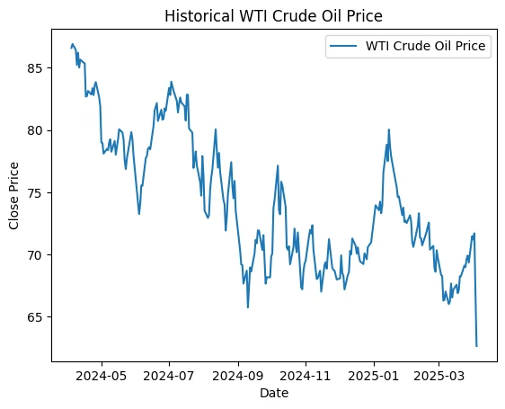
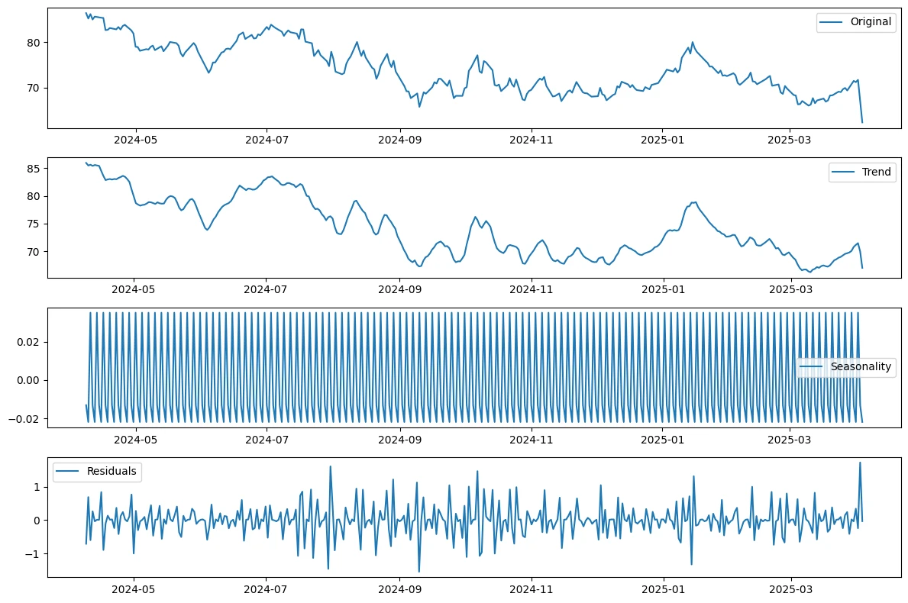
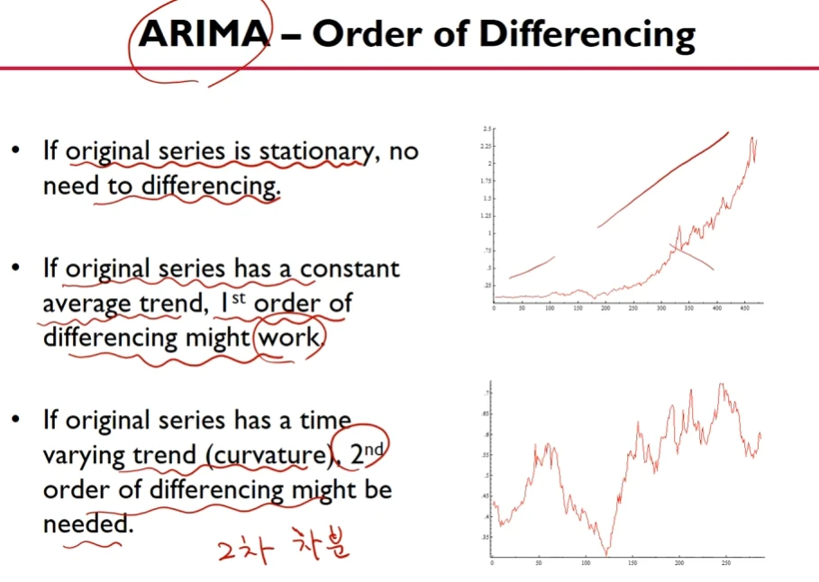
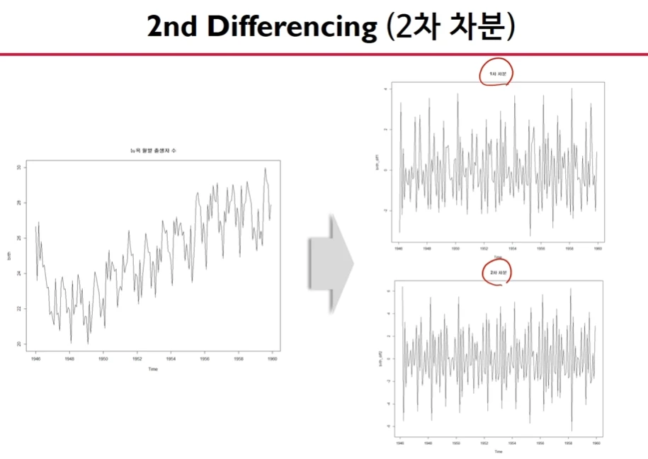
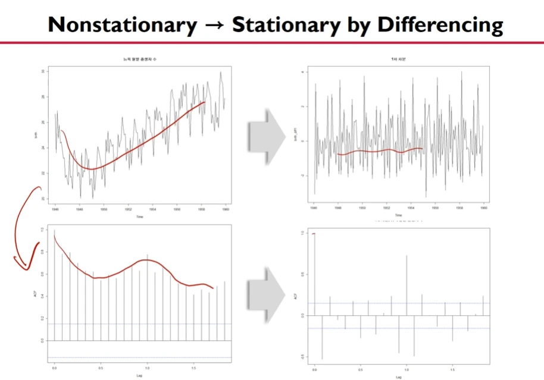
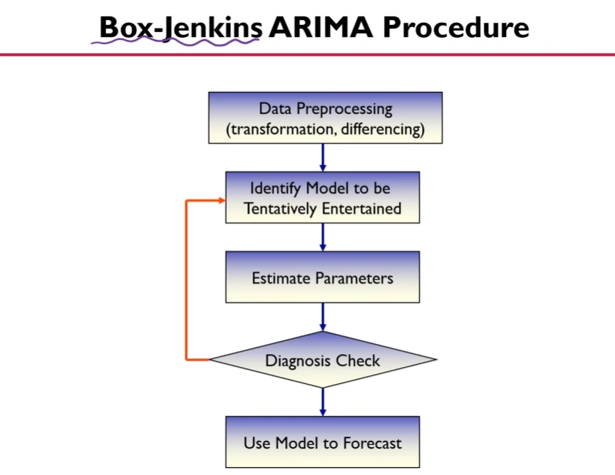
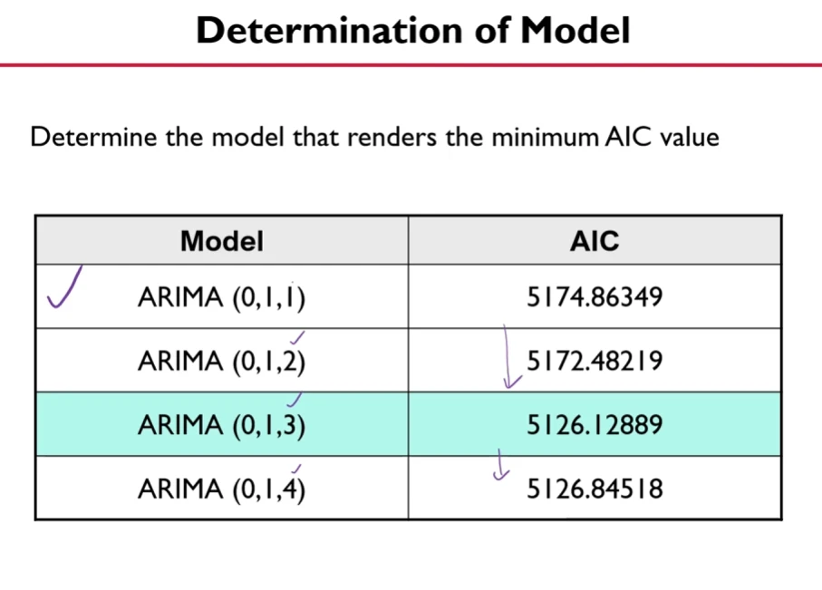
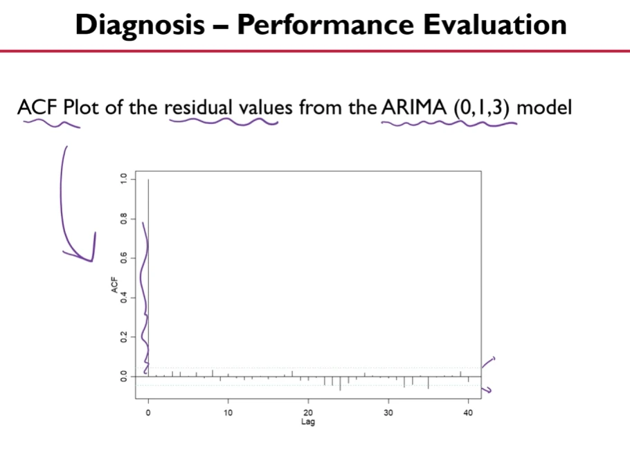

# AR과 VAR

작성일 2025-03-18 · 최종 수정일 2025-04-05
{ .post-date }

Autoregressive(AR) 모델은 시계열 예측의 기초가 되는 모델이고, Vector Autoregressive(VAR) 모델은 그것을 여러 변수로 확장한 것이다. 이 글에서는 두 모델의 목적과 식, 계수를 추정하는 방법, 공부하며 가졌던 질문을 정리한다. 유가 데이터로 AR 모델링 절차를 따라가 본 기록과, 2024년 12월에 ARIMA 강의를 들으며 적은 메모도 함께 묶었다. [정상성](02-stationarity-and-unit-root-test.md)과 [ACF, PACF](03-autocovariance-acf-pacf.md)를 전제로 한다.

## AR 모델

### 목적과 식

AR 모델은 하나의 시계열에서 현재 시점의 값을 과거 시점의 값들로 예측한다. 시계열이 자기 자신의 과거와 얼마나 강하게 연관되는지를 파악해 미래 값을 예측하거나, 그 구조를 이해하는 데 쓴다. 이름 그대로 어떤 변수의 회귀(regression)를 그 변수 자신의 과거 값으로 수행하는 것이다.

모델의 가정은 시계열 $\{y_t\}$의 현재 값이 과거 값들의 선형 결합으로 표현된다는 것이다. $p$차 모델 AR($p$)는 다음과 같다.

$$
y_t = c + \phi_1 y_{t-1} + \phi_2 y_{t-2} + \cdots + \phi_p y_{t-p} + \epsilon_t
$$

- $c$: 상수항
- $\phi_i$: 시차 $i$의 계수
- $\epsilon_t$: 과거 값으로 설명되지 않는 잡음. 보통 평균이 0이고 분산이 일정한 [white noise](01-stochastic-process-and-random-walk.md)로 둔다.

과거 값이 현재 값에 선형적인 영향을 미칠 때, 다시 말해 현재 관측치가 과거 관측치와 상관이 있을 때 잘 들어맞는다. 이 "상관"이 [3편](03-autocovariance-acf-pacf.md)의 자기상관이다.

### 세 가지 특징

1. **자기상관을 모델링한다.** 시계열이 자기 자신의 과거 값과 얼마나 상관이 있는지를 식으로 옮긴 것이다.
2. **차수 $p$를 정해야 한다.** 과거 값을 몇 시점까지 볼지 정해야 한다. PACF를 보거나, AIC, BIC 같은 [정보 기준](05-aic-and-bic.md)으로 고른다.
3. **정상성이 필요하다.** AR($p$) 모델은 시계열이 정상성을 만족한다고 가정한다. 이 조건은 보통 "특성 방정식의 근이 단위원 밖에 있어야 한다"로 표현한다.

세 번째 항목에서 질문이 하나 생겼다. 그렇다면 실제로 분석할 때도 ADF 같은 단위근 검정이 아니라 특성 방정식의 근을 구해서 확인하는가?

그렇지 않다. 근의 조건은 모델의 계수에 대한 수학적 정의다. 데이터를 받아 든 시점에는 계수를 모르기 때문에, 실제로는 ADF 검정 등으로 시계열의 정상성을 먼저 확인한다. 근을 직접 따져 볼 수 있는 것은 모델을 적합해 계수를 추정한 다음이다. 근의 조건이 왜 그런 모양인지는 [8편](08-lag-operator-and-arma.md)에서 다룬다.

### 계수는 어떻게 추정하는가

AR을 공부하며 스스로 던진 질문과 답을 옮긴다.

**AR 모델은 univariate인가? 계수는 스칼라인가?**

그렇다. 한 변수의 한 시점 값을 예측하는 단변량 모델이고, 계수 $\phi_i$는 하나하나가 스칼라다.

**계수는 어떻게 학습하는가?**

과거 시계열 데이터로 학습하며, 기본적으로 선형 회귀 문제다. 몇 번째 시차까지 반영할지 정했다면 그 시차의 값들을 묶어 입력 벡터 하나로 만들 수 있고, 계수도 벡터 하나로 묶을 수 있다.

$$
y_t = \phi^{\top}\mathbf{x}_t + c + \epsilon_t, \qquad
\mathbf{x}_t = [y_{t-1}, y_{t-2}, \dots, y_{t-p}]^{\top}, \quad
\phi = [\phi_1, \phi_2, \dots, \phi_p]^{\top}
$$

이 선형 회귀를 푸는 방법은 여러 가지다.

1. 최소제곱법(OLS, Ordinary Least Squares)
2. Yule-Walker 방정식: 자기상관 함수를 이용해 해석적으로 계수를 구한다. 시계열 이론에서 자주 쓰이고, 정상성 가정이 있을 때 쓰기 좋다.
3. 최대가능도추정(MLE)
4. 정규화 회귀(Ridge, Lasso)

OLS와 MLE가 어떤 조건에서 같은 답을 주는지는 [5편](05-aic-and-bic.md)에서 다룬다.

## AR 모델링 절차 따라가기

Medium의 AR 모델 소개 글을 따라 WTI 원유 선물의 최근 1년 일별 종가로 절차를 밟아 보았다. 거래가 없는 날은 일 단위로 다시 표본화한 뒤 선형 보간으로 채웠다. 절차는 "정상인지 확인한다 → 정상이 아니면 정상으로 만든다 → 차수를 정한다"의 세 단계다.

{ width="560" }

*1년 동안의 WTI 종가. 85달러 근처에서 시작해 오르내리면서 전체적으로 내려간다. 한 수준 주변에서 흔들리는 모양이 아니다.*

### 1. 정상성 확인

AR 모델은 정상성을 가정한다. 위 그림만 보아도 수준이 계속 바뀌어 정상으로 보이지 않지만, 눈으로 본 판단을 ADF 검정으로 확인했다. ADF 검정의 귀무가설은 "시계열에 단위근이 있다", 즉 비정상이라는 것이다.

| | ADF 통계량 | p-value |
|---|---|---|
| WTI 종가 | -2.153144 | 0.223688 |

p-value가 0.05보다 크므로 귀무가설을 기각하지 못한다. 이 상태로는 AR 모델을 적용할 수 없다.

### 2. 정상 시계열로 만들기

참고한 글은 시계열을 추세(trend), 계절성(seasonality), 나머지(residual)로 분해한 뒤 나머지를 분석한다. 주기를 3으로 두고 분해한 결과는 다음과 같다.

*위에서부터 원본, 추세, 계절성, 나머지. 주기는 3으로 두었다.*

둘째 칸의 추세가 원본의 큰 흐름을 거의 그대로 가져가고, 셋째 칸의 계절성은 3일마다 같은 모양이 되풀이되는 아주 작은 진동이다(세로축이 -0.02에서 0.03 정도다). 이 둘을 빼고 남은 맨 아래 칸의 나머지는 0을 중심으로 고르게 흔들린다. 원본에서 정상성을 깨던 "수준의 변화"가 추세 쪽으로 빠져나갔기 때문이다.

처음에는 이 결과를 STL 분해라고 적어 두었다. 그런데 코드에서 쓴 statsmodels의 `seasonal_decompose`는 classical seasonal decomposition이고, LOESS를 쓰는 STL과는 다른 방법이다. 두 방법의 차이는 [6편](06-time-series-decomposition.md)에 정리했다.

나머지 성분에 ADF 검정을 다시 적용했다.

| | ADF 통계량 | p-value |
|---|---|---|
| 나머지 성분 | -7.670805 | 0.000000 |

단위근이 있다는 가설을 기각할 수 있을 만큼 충분히 정상적이다.

### 3. 차수 정하기

정상 시계열을 얻었으니 다음은 PACF를 보고 차수를 정하는 단계다. 유가 데이터로는 여기까지만 진행했다. 차수를 정하고 예측 성능까지 비교하는 과정은 항공 승객 수 데이터로 따로 실험했고, [AirPassengers 정상화와 AR 차수 선택](../../research/sailab/06-ar-order-selection.md)에 정리했다.

## MA, ARMA, ARIMA와의 관계

AR 옆에는 이름이 비슷한 모델이 여럿 있다. ARIMA 강의를 들으며 적은 메모에서 관계만 간단히 옮긴다.

| 모델 | 무엇으로 현재 값을 설명하는가 |
|---|---|
| AR($p$) | 자기 자신의 과거 값 $p$개 |
| MA($q$) | 현재와 과거의 오차 $\epsilon_t, \epsilon_{t-1}, \dots, \epsilon_{t-q}$ |
| ARMA($p$, $q$) | 과거 값과 과거 오차를 함께 |
| ARIMA($p$, $d$, $q$) | 차분을 $d$번 적용한 시계열에 ARMA($p$, $q$)를 적용 |

AR, MA, ARMA는 정상 시계열에만 적용할 수 있다. 그런데 일상에서 만나는 데이터는 대부분 비정상이다. ARIMA는 차분으로 정상성을 확보하는 단계를 모델 안에 넣은 것이고, 가운데 글자 I(integrated)가 그 차분을 가리킨다.

### 차분은 몇 번 하는가

차분은 시계열에 남아 있는 추세를 없애려고 한다. 그래서 몇 번 할지는 추세의 모양을 보고 정한다.

*원 시계열이 이미 정상이면 차분이 필요 없고, 일정하게 오르거나 내리는 추세가 있으면 1차 차분, 추세의 기울기 자체가 시간에 따라 바뀌면(곡선) 2차 차분을 생각한다. 출처: 강의 슬라이드.*

꾸준히 오르거나 내리는 추세는 1차 차분으로 대개 해결된다. 아래 그림은 같은 시계열에 1차 차분과 2차 차분을 각각 적용한 것이다.

*왼쪽이 원 시계열, 오른쪽 위가 1차 차분, 오른쪽 아래가 2차 차분이다. 1차 차분만으로 추세가 사라져 0 주변에서 흔들리는 시계열이 되었고, 2차 차분을 해도 모양이 크게 달라지지 않는다. 출처: 강의 슬라이드.*

이렇게 1차 차분으로 충분히 정상 시계열이 되면 2차 차분까지 갈 필요가 없다. 2차 차분은 실제로 거의 쓰지 않고, 3차 이상은 쓰지 않는다.

차분이 제대로 되었는지는 [3편](03-autocovariance-acf-pacf.md)에서 본 대로 ACF로 확인한다.

*왼쪽 열이 차분 전, 오른쪽 열이 1차 차분 뒤다. 차분 전의 ACF(왼쪽 아래)는 시차가 늘어도 높은 값에서 천천히 내려오지만, 차분 뒤의 ACF(오른쪽 아래)는 뚜렷한 모양 없이 흩어진다. 출처: 강의 슬라이드.*

계절성까지 다루려면 계절 주기 $s$에 대한 차수 $(P, D, Q)_s$를 더한 SARIMA를 쓴다. 월별 계절성은 $s = 12$, 분기별 계절성은 $s = 4$다.

### Box-Jenkins 절차

Box와 Jenkins가 제안한 ARIMA 모델링 절차는 다음 그림과 같다. 한 번에 끝나는 일직선이 아니라, 진단에서 떨어지면 모델을 다시 고르는 되돌이 구조라는 점이 핵심이다.

{ width="560" }

*위에서 아래로 진행하고, 마름모(진단)에서 왼쪽으로 나간 주황색 화살표가 모델 식별 단계로 되돌아간다. 출처: 강의 슬라이드.*

1. 데이터 전처리: 변환이나 차분으로 정상 시계열로 만든다.
2. 모델 식별: 시험해 볼 모델을 고른다. ACF와 PACF의 모양을 본다.
3. 파라미터 추정
4. 진단: 결과가 좋지 않으면 2번으로 돌아간다.
5. 예측

강의는 예제 데이터 하나로 이 절차를 끝까지 따라간다. 원 시계열의 ACF가 천천히 줄어들어 1차 차분을 했고, 차분한 시계열의 ACF가 시차 1 뒤에 끊기고 PACF가 서서히 줄어들어 MA(1)을 후보로 골랐다([3편](03-autocovariance-acf-pacf.md)의 마지막 강의 슬라이드가 이 단계다). 차분 1번에 MA(1)이므로 ARIMA(0, 1, 1)이다.

그런데 2번에서 ACF, PACF 그래프를 눈으로 보고 차수를 정하는 것은 주관적이다. 강의에서도 MA의 차수를 1에서 4까지 바꿔 가며 AIC를 비교해 보니 눈으로 고른 모델이 가장 좋은 모델은 아니었다.

{ width="640" }

*AIC는 작을수록 좋다. 그래프를 보고 고른 ARIMA(0, 1, 1)보다 색이 칠해진 ARIMA(0, 1, 3)의 AIC가 더 작다. 출처: 강의 슬라이드.*

그래서 실제로는 $d$를 1이나 2로 정해 두고, $p$와 $q$를 일정 범위에서 바꿔 가며 AIC나 예측 정확도로 비교하는 방법을 많이 쓴다.

고른 모델은 4번 진단 단계에서 잔차로 확인한다. 모델이 시계열의 구조를 다 담았다면 예측하고 남은 잔차에는 자기상관이 남아 있지 않아야 한다.

{ width="640" }

*ARIMA(0, 1, 3)의 잔차로 그린 ACF. 시차 0을 뺀 막대가 대부분 점선 경계 안에 있으므로 모델이 적절하다고 판단한다. 출처: 강의 슬라이드.*

## VAR 모델

### 목적과 식

VAR 모델은 여러 시계열이 서로 영향을 주고받는 구조를 하나의 모형으로 묶어 추정한다. 이것으로 미래를 예측하거나, 변수 사이의 인과 관계와 충격 반응을 분석한다.

VAR은 여러 변수를 벡터로 묶어 동시에 다룬다. 각 변수가 자기 자신의 과거뿐 아니라 다른 변수들의 과거 값까지 포함한 선형 결합으로 표현된다고 가정한다. $k$차원 벡터 시계열 $Y_t = (y_{1t}, y_{2t}, \dots, y_{kt})^{\top}$에 대한 $p$차 모델 VAR($p$)는 다음과 같다.

$$
Y_t = c + \Phi_1 Y_{t-1} + \Phi_2 Y_{t-2} + \cdots + \Phi_p Y_{t-p} + \epsilon_t
$$

- $c$: $k \times 1$ 상수 벡터
- $\Phi_i$: $k \times k$ 계수 행렬
- $\epsilon_t$: $k \times 1$ white noise 벡터

AR에서는 계수가 스칼라였지만, VAR에서는 변수들이 서로 영향을 준다고 보기 때문에 계수가 행렬이다. 2차원 VAR(1)을 풀어 쓰면 구조가 잘 보인다.

$$
\begin{bmatrix} x_{1,t} \\ x_{2,t} \end{bmatrix}
=
\begin{bmatrix} c_1 \\ c_2 \end{bmatrix}
+
\begin{bmatrix} a_{11} & a_{12} \\ a_{21} & a_{22} \end{bmatrix}
\begin{bmatrix} x_{1,t-1} \\ x_{2,t-1} \end{bmatrix}
+
\begin{bmatrix} \epsilon_{1,t} \\ \epsilon_{2,t} \end{bmatrix}
$$

$x_{1,t}$는 $x_{1,t-1}$과 $x_{2,t-1}$을 모두 써서 예측하고, $x_{2,t}$도 마찬가지다. 비대각 원소 $a_{12}$, $a_{21}$이 한 변수의 과거가 다른 변수에 미치는 영향을 담는다.

VAR은 독립 변수 여러 개로 종속 변수 하나를 예측하는 다중 회귀(multiple regression)와는 다르다. 모든 변수가 서로의 설명 변수이면서 동시에 예측 대상이다.

### 특징

1. **모든 변수의 과거를 쓴다.** 위의 2변수 예처럼 식마다 모든 변수의 과거 값이 들어간다.
2. **동적 상호작용을 담는다.** AR로는 변수 사이의 영향을 설명할 수 없지만, VAR은 각 변수의 과거가 다른 변수에 어떻게 영향을 미치는지까지 반영한다. 그래서 [Granger 인과](07-granger-causality.md) 분석의 바탕이 된다.
3. **정상성과 차수.** AR과 마찬가지로 안정적이려면 특성 다항식의 근이 단위원 밖에 있어야 한다. 차수 $p$는 AIC, BIC 등으로 정한다.

### VAR로 할 수 있는 분석

- **충격 반응 함수(Impulse Response Function, IRF)**: VAR을 추정한 뒤, 한 변수에 가해진 충격이 시차를 두고 다른 변수에 어떤 효과를 미치는지 본다.
- **분산 분해(Variance Decomposition)**: 예측 오차의 분산이 변수별로 얼마씩 기여해 만들어졌는지 나누어 본다.
- **Granger 인과 검정**: VAR의 핵심 응용 가운데 하나다. 시계열 하나로는 인과를 논하기 어렵다. 여러 변수가 있을 때 한 변수의 과거 정보가 다른 변수의 예측력을 높이는지 확인하는 데 VAR을 쓴다.

## 남았던 질문과 답

AR과 VAR을 처음 정리하면서 풀지 못하고 남겨 둔 질문들이다. 글을 정리하면서 답을 찾아 덧붙였다. 앞의 네 개는 이 시리즈의 다른 글에서 자세히 다루었으므로 여기에는 요점만 적는다.

**Q. Granger 인과 검정은 정확히 무엇을 검증하는가? 오차의 분산이 커지고 작아진다는 것은 무슨 의미인가?**

$X$를 자기 과거로만 예측하는 회귀와, 거기에 $Y$의 과거를 더한 회귀를 비교한다. 귀무가설은 "$Y$의 과거에 붙은 계수가 모두 0이다"이고, F-검정으로 기각 여부를 본다. 오차의 분산은 예측에 남은 불확실성이다. $Y$의 과거를 넣었을 때 그 분산이 우연으로 보기 어려울 만큼 줄어들면 $Y$가 $X$를 Granger-cause한다고 말한다. 검증하는 것은 예측력이지 원인과 결과가 아니다. 자세한 내용은 [7편](07-granger-causality.md)에 있다.

**Q. AIC, BIC는 무엇인가?**

모델이 데이터에 맞는 정도와 모델의 복잡도를 함께 재는 기준이다. $\hat{L}$이 최대화된 가능도, $k$가 파라미터의 수, $N$이 관측치의 수일 때 다음과 같고, 값이 작은 모델을 고른다.

$$
\mathrm{AIC} = -2\log\hat{L} + 2k, \qquad \mathrm{BIC} = -2\log\hat{L} + k\log N
$$

첫 항은 차수를 늘릴수록 작아지고 둘째 항은 커진다. $\log N > 2$, 곧 $N \ge 8$이면 BIC의 penalty가 더 크므로 BIC가 더 작은 차수를 고르는 경향이 있다. 유도는 [5편](05-aic-and-bic.md)에 있다.

**Q. 단위근과 정상성은 어떤 관계인가?**

AR(1) $y_t = \rho y_{t-1} + \epsilon_t$로 보면 된다. 특성 방정식 $1 - \rho z = 0$의 근은 $z = 1/\rho$이므로, 근이 단위원 밖에 있다는 것은 $\lvert\rho\rvert < 1$과 같고 이때 과정은 정상이다. $\rho = 1$이면 근이 정확히 1, 곧 단위근이고 과정은 random walk가 된다. 이때 $\mathrm{Var}(y_t) = t\sigma^2$로 분산이 시간에 따라 커지므로 정상이 아니다. 단위근이 있는 시계열은 차분하면 $y_t - y_{t-1} = \epsilon_t$로 정상이 된다. ADF 검정의 귀무가설이 "단위근이 있다"인 것도 이 때문이다. [2편](02-stationarity-and-unit-root-test.md)과 [8편](08-lag-operator-and-arma.md)에서 다루었다.

**Q. Granger 인과가 아닌, 시계열에서의 인과는 무엇인가?**

한 변수를 바꾸었을 때 다른 변수가 실제로 달라지는 관계다. 이를 말하려면 원인이 결과보다 먼저 일어나야 하고, 영향이 실제로 있어야 하며, 둘 모두에 영향을 주는 제3의 변수가 통제되어야 한다. Granger 인과는 이 가운데 시간적 선후만 이용해 예측력으로 관계를 정의하므로, 나머지 두 조건은 보장하지 않는다. [7편](07-granger-causality.md)의 앞부분에 정리했다.

**Q. 충격 반응 함수와 분산 분해는 무엇인가?**

안정적인 VAR(1) $Y_t = c + \Phi Y_{t-1} + \epsilon_t$를 과거의 오차로 풀어 쓰면 $Y_t = \mu + \sum_{h=0}^{\infty} \Phi^h \epsilon_{t-h}$다. $\Phi^h$의 $(i, j)$ 원소는 변수 $j$의 오차가 1만큼 커졌을 때 $h$ 시점 뒤에 변수 $i$가 얼마나 달라지는지를 나타내고, 이것을 $h$의 함수로 본 것이 충격 반응 함수다. 예를 들어

$$
\Phi = \begin{bmatrix} 0.5 & 0.2 \\ 0 & 0.5 \end{bmatrix}, \qquad
\Phi^2 = \begin{bmatrix} 0.25 & 0.2 \\ 0 & 0.25 \end{bmatrix}
$$

이면 변수 2에 가해진 충격은 1시점 뒤와 2시점 뒤에 변수 1을 0.2씩 움직이고, 변수 1에 가해진 충격은 변수 2에 끝내 영향을 주지 않는다. 오차끼리 상관이 있으면 "한 변수에만 가해진 충격"이 분명하지 않으므로, 보통 공분산 행렬을 $\Sigma = PP^{\top}$(Cholesky 분해)로 나누어 서로 무관한 충격에 대한 반응 $\Theta_h = \Phi^h P$를 본다. 이 결과는 변수를 놓는 순서에 따라 달라진다. 분산 분해는 같은 $\Theta_h$로 계산한다. 변수 $i$의 $h$시점 앞 예측 오차의 분산 가운데 충격 $j$에서 온 비율은 다음과 같다.

$$
\omega_{ij}(h) = \frac{\sum_{s=0}^{h-1} (\Theta_s)_{ij}^2}{\sum_{s=0}^{h-1} \sum_{k} (\Theta_s)_{ik}^2}
$$

**Q. VAR의 모형 진단은 무엇을 보는가?**

추정한 뒤에 모형의 가정이 지켜지는지를 본다. 첫째는 안정성으로, 특성 다항식의 근이 모두 단위원 밖에 있는지(같은 말로, 계수로 만든 companion 행렬의 고유값이 모두 단위원 안에 있는지)를 확인한다. 둘째는 잔차의 자기상관이다. 잔차는 white noise여야 하며, Portmanteau 검정이나 Breusch-Godfrey LM 검정에서 자기상관이 남아 있으면 차수 $p$가 모자란 것이다. 셋째는 잔차의 정규성(다변량 Jarque-Bera 검정)과 등분산성(ARCH-LM 검정)으로, 검정과 예측 구간이 믿을 만한지를 좌우한다. 넷째는 계수가 표본 기간 내내 일정한지, 곧 구조 변화가 없는지다. Granger 인과 검정이나 충격 반응 함수는 이 진단을 통과한 모형에서 해석해야 한다.

**Q. AR과 VAR이 잘 맞는 경우와 맞지 않는 경우는 언제인가?**

잘 맞는 것은 시계열이 정상이고, 과거와의 관계가 선형이며, 그 관계가 가까운 시차 몇 개로 설명될 때다. 정상 과정은 일반적으로 과거 오차의 무한 합(MA($\infty$))으로 쓸 수 있고 그것이 다시 AR($\infty$)로 바뀌므로([8편](08-lag-operator-and-arma.md)), 차수가 충분한 AR은 넓은 범위의 정상 과정을 근사한다. 맞지 않는 경우는 가정이 깨질 때다. 추세나 단위근이 있으면 먼저 차분해야 하고, 계수가 중간에 바뀌는 구조 변화나 비선형 관계는 고정된 선형 계수로 담지 못한다. 분산이 시기에 따라 달라지면 평균 예측은 되어도 예측 구간이 틀린다. 계절성처럼 먼 시차의 의존성은 차수를 크게 잡아야만 담긴다. VAR에는 문제가 하나 더 있다. 변수가 $k$개이면 계수가 $k^2 p + k$개여서, 변수가 늘면 표본에 비해 추정할 것이 너무 많아진다. AR에 대해서는 AirPassengers 실험에서 정상화와 차수 선택이 결과를 크게 바꾸는 것을 직접 보았다.

### 아직 남은 질문

- VAR이 실제 데이터에서 잘 맞는 경우와 맞지 않는 경우는 직접 확인하지 못했다. 다변량 데이터에 VAR을 적합하고 위의 진단과 충격 반응 함수를 계산해 보아야 한다.

## 참고 자료

- "Unlocking the Secrets of Financial Time Series: A Deep Dive into Autoregressive Models (AR)" (Medium, @Alidotab). <https://medium.com/@Alidotab/unlocking-the-secrets-of-financial-time-series-a-deep-dive-into-autoregressive-models-ar-b2e58428928e>
- "ARIMA 모델 개요 - Part 1" (YouTube 강의 영상). <https://www.youtube.com/watch?v=ma_L2YRWMHI>
- VAR 소개 영상 (YouTube). <https://www.youtube.com/watch?v=zY0kPKks7D8>
