# Seq2Seq와 Attention으로 보는 기계 번역 과정

작성일 2023-11-23
{ .post-date }

2023년 11월, PatchTST 프로젝트를 준비하면서 Transformer를 처음 공부할 때 쓴 노트다. Transformer를 이해하려면 그 앞 단계인 Seq2Seq와 attention을 먼저 알아야 해서, "[딥러닝 기계번역] 시퀀스 투 시퀀스 + 어텐션 모델" 강의를 보고 번역이 이루어지는 과정을 순서대로 정리했다. 강의는 "Neural Machine Translation by Jointly Learning to Align and Translate" 논문의 내용을 "I love you"를 "난 널 사랑해"로 번역하는 예제로 풀어 설명한다.

## 단어별 번역의 한계

번역할 문장은 아래 하나다. 이 문장을 번역하는 가장 좋은 방법이 무엇인지에서 강의가 시작한다.

글 전체에서 쓰는 예제다. 영어 세 단어를 우리말 세 단어로 옮긴다. 출처: 강의 화면

가장 단순한 방법은 단어를 하나씩 번역하는 것이다.

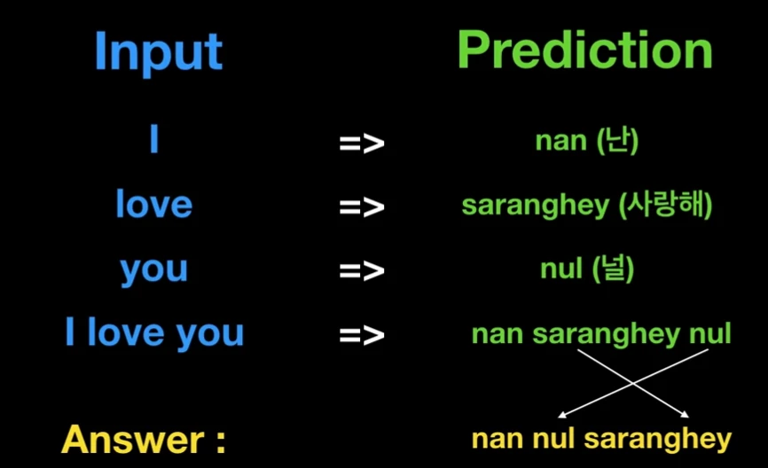

아래 두 줄을 보면 된다. 단어별로 옮긴 "난 사랑해 널"과 정답 "난 널 사랑해"는 뒤의 두 단어가 서로 엇갈린다. 출처: 강의 화면

I는 "난", love는 "사랑해", you는 "널"로 하나씩은 맞게 옮겼지만, 영어의 어순을 그대로 따르기 때문에 우리말의 어순과 맞지 않는다.

문제는 하나 더 있다.

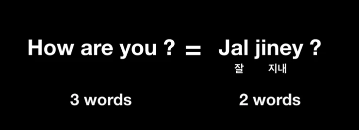

영어는 3단어인데 우리말은 2단어다. 출처: 강의 화면

"How are you?"는 "잘 지내?"가 되어 단어 수가 줄어든다. 입력과 출력의 단어 수가 달라질 수 있으므로 이것을 표현하는 방법도 필요하다.

정리하면, 단어별로 번역하면 어색한 문장이 될 가능성이 높다. 단어별 번역은 좋은 방법이 아니다.

## RNN을 이용한 번역

### Encoder-Decoder 구조

단어를 따로따로 옮기지 않고, 문장 전체를 먼저 읽어서 하나의 vector로 요약한 다음 그 요약에서 번역문을 만들어 내는 방법이다.

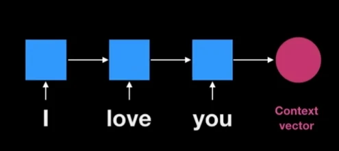

파란 상자가 RNN cell이고, 오른쪽 끝의 붉은 원이 문장 전체를 요약한 vector다. 출처: 강의 화면

RNN cell에 I, love, you를 순서대로 넣으면, 마지막 RNN cell의 state는 "I love you"라는 문장 전체의 정보를 함축하게 된다. 이 vector를 **context vector**라고 한다.

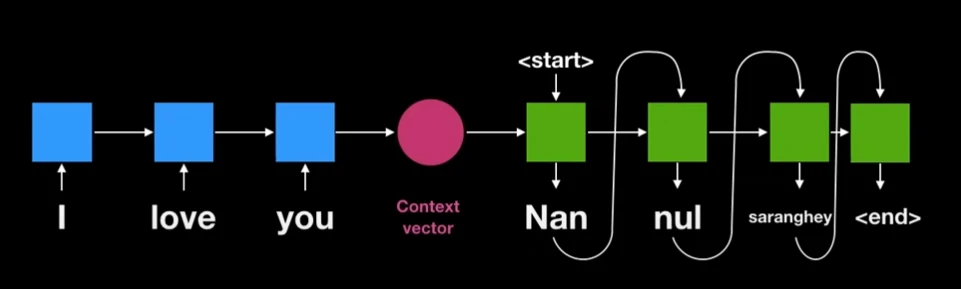

초록 상자가 번역문을 만드는 RNN cell이다. 각 cell의 출력이 굽은 화살표를 따라 다음 cell의 입력으로 들어간다. 출처: 강의 화면

번역은 context vector에서 출발한다. 먼저 `<start>` 신호를 넣으면 "난"이 나오고, 방금 나온 단어를 다음 cell의 입력으로 넣으면 "널", 그다음에는 "사랑해"가 나온다. 이 과정을 `<end>`가 나올 때까지 반복한다. 이런 결과가 나오도록 모델을 학습시키면 주어-동사-목적어(SVO) 순서의 언어를 주어-목적어-동사(SOV) 순서의 언어로 바꿀 수 있다.

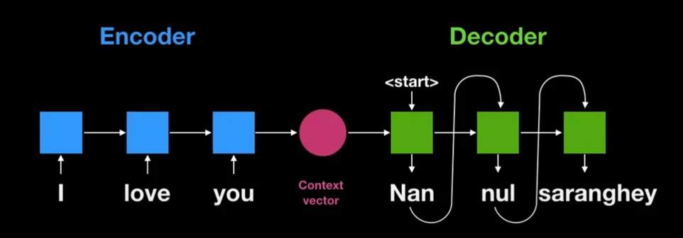

파란 쪽이 encoder, 초록 쪽이 decoder이고, 둘을 잇는 것은 가운데의 context vector 하나뿐이다. 출처: 강의 화면

이 구조를 **Encoder-Decoder architecture**라고 하고, **Seq2Seq model**이라고도 부른다.

- **Encoder**: 각 단어를 순차적으로 받아 최종적으로 context vector를 만든다.
- **Decoder**: encoder가 만든 context vector에서 출발해 번역 결과를 한 단어씩 만든다.

### 고정된 크기의 context vector

이 방법에도 문제가 있다. 위 그림에서 encoder와 decoder를 잇는 통로는 context vector 하나인데, 이 vector의 크기가 고정되어 있다.

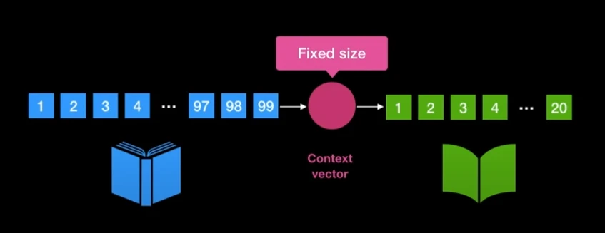

왼쪽의 99개 단어가 모두 가운데의 원 하나("Fixed size")를 지나야 오른쪽 번역문이 된다. 출처: 강의 화면

문장이 길어지면 context vector의 크기가 충분하지 않아 모든 정보를 담을 수 없다. 책 한 권을 같은 크기의 vector 하나에 담으려는 것과 같다. 논문에서도 번역을 하다 보면 정보가 충분하지 않아 불완전한 번역이 이루어진다고 말한다. 이 문제를 해결하는 방법이 attention이다.

## Attention 도입

Attention의 생각은 간단하다. 마지막 state 하나만 넘기지 말고, encoder가 단어마다 만들어 낸 state를 모두 남겨 두었다가 decoder가 필요할 때마다 꺼내 보게 하는 것이다.

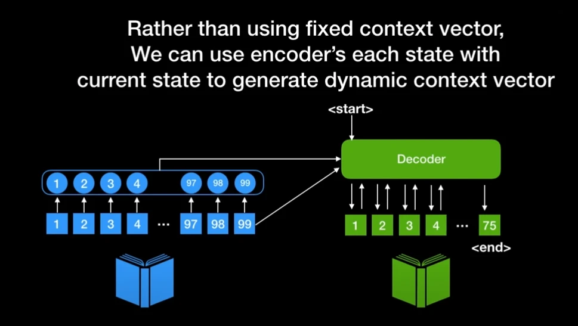

앞의 그림과 달라진 곳은 왼쪽이다. 파란 원(단어마다 나온 state)이 모두 묶여 decoder로 들어간다. 출처: 강의 화면

이전 구조에서는 encoder에서 나온 state들을 모두 활용하지 않았다. 마지막에 나온 state 하나를 context vector라고 부르고, 그 하나에서 번역이 이루어졌다.

논문이 제안하는 것은 encoder의 모든 RNN cell에서 나온 state를 활용하는 것이다. Decoder는 단어를 하나 만들 때마다 encoder의 state 전체와 자신의 현재 state를 이용해 context vector를 새로 만든다. 그림 위의 문장대로, 고정된 context vector 대신 동적인(dynamic) context vector를 쓰는 것이다.

이렇게 하면 두 가지를 얻는다.

- 고정된 크기에서 나온 문제를 해결할 수 있다.
- Encoder의 모든 state 가운데 집중해야 할 단어에만 집중하는 mechanism을 설계할 수 있다.

## 예제로 따라가는 계산

"I love you"를 넣었을 때 encoder의 RNN cell에서 나온 state를 순서대로 $h_1$, $h_2$, $h_3$이라고 하자. Decoder가 단어 하나를 만들 때마다 같은 일이 세 단계로 반복된다. (1) encoder의 state마다 점수를 매기고, (2) 점수를 확률로 바꾸고, (3) 그 확률로 state를 섞어 context vector를 만든다.

### 첫 번째 단어

**점수 매기기.** Attention에는 fully connected network가 하나 있다.

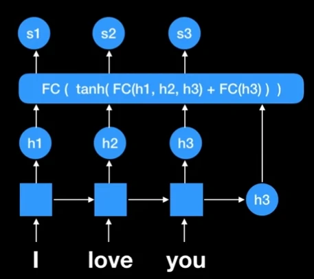

가운데의 긴 파란 상자가 fully connected network다. 아래에서 $h_1$, $h_2$, $h_3$이 들어가고, 오른쪽에서 $h_3$이 한 번 더 들어간다. 출처: 강의 화면

이 network는 이전 구조와 달리 $h_1$, $h_2$, $h_3$을 모두 입력으로 받고, 여기에 decoder의 현재 state를 함께 받는다. 첫 단계에서는 decoder에서 나온 값이 아직 하나도 없으므로 encoder의 마지막 state인 $h_3$을 대신 넣는다. 그림의 상자에 적힌 식은 다음과 같다.

$$
(s_1, s_2, s_3) = \mathrm{FC}\big(\tanh(\mathrm{FC}(h_1, h_2, h_3) + \mathrm{FC}(h_3))\big)
$$

이 network에서 나온 값 $s_1$, $s_2$, $s_3$은 encoder의 각 RNN cell에 대한 score다.

**확률로 바꾸기.** Score들을 softmax에 넣으면 합이 1인 확률값이 된다.

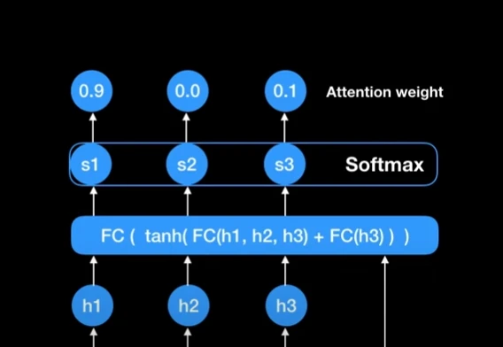

맨 윗줄의 0.9, 0.0, 0.1이 attention weight다. I에 0.9, love에 0.0, you에 0.1이 주어졌다. 출처: 강의 화면

이 값이 **attention weight**이고, 지금 어디에 focus할 것인지를 나타낸다.

**Context vector 만들기.** 이제 첫 번째 context vector $cv_1$을 만든다.

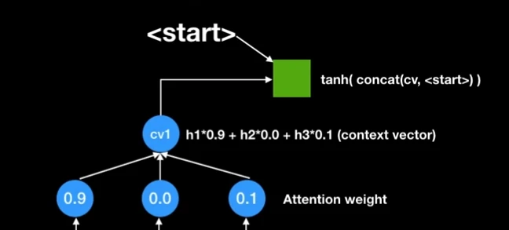

세 attention weight가 $cv_1$으로 모이고, $cv_1$과 `<start>`가 함께 초록 decoder cell로 들어간다. 출처: 강의 화면

Context vector는 encoder의 state에 attention weight를 곱해 더한 값이다. $t$번째 단어를 만들 때의 attention weight를 $a_{t,i}$라고 하면 다음과 같다.

$$
cv_t = \sum_{i=1}^{3} a_{t,i}\, h_i, \qquad cv_1 = 0.9\, h_1 + 0.0\, h_2 + 0.1\, h_3
$$

즉, 첫 번째 context vector는 I에 90%, you에 10% focus한다. 이 값을 decoder의 첫 번째 RNN cell에 넣는다. 지금까지 번역한 것이 없으므로 `<start>` 신호를 함께 넣는다. 그림에는 cell 안의 계산이 `tanh(concat(cv, <start>))`로 적혀 있다.

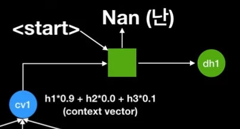

Decoder cell에서 위로는 출력 "난"이, 오른쪽으로는 다음 단계에 쓸 state $dh_1$이 나온다. 출처: 강의 화면

"난"이 출력되고, decoder의 state $dh_1$이 만들어진다. 여기까지가 첫 번째 step이다.

### 두 번째 단어

두 번째 step은 같은 과정을 되풀이하되, 점수를 매길 때 $h_3$ 대신 방금 만들어진 $dh_1$을 쓴다.

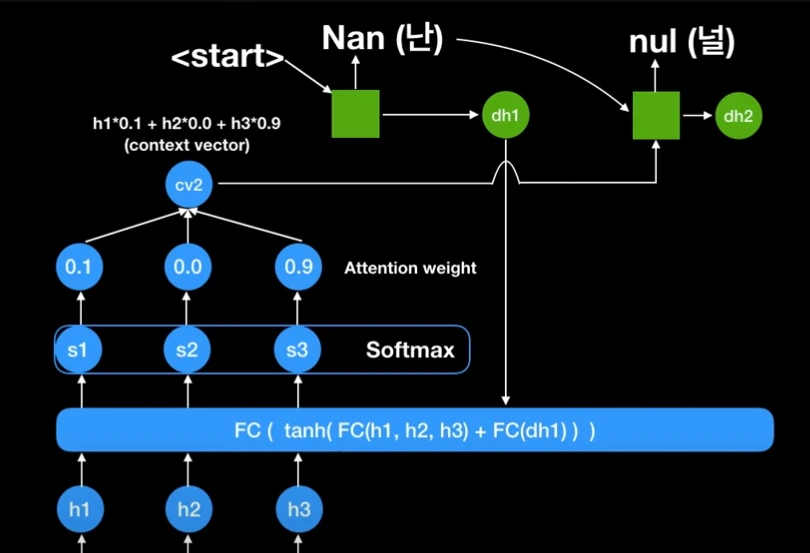

$dh_1$에서 내려오는 화살표가 fully connected network로 들어가는 것, 그리고 attention weight가 0.1, 0.0, 0.9로 바뀐 것을 보면 된다. 출처: 강의 화면

Decoder의 현재 state인 $dh_1$이 fully connected network에 들어간다. 중요한 점은 $h_1$, $h_2$, $h_3$이 항상 함께 쓰인다는 것이다. 어디에 집중할지를 계산하려면 encoder의 RNN cell 값이 매번 필요하기 때문이다.

새로 구한 score를 softmax에 넣으면 새로운 확률이 나오고, 이번에는 you에 90%, I에 10% focus한다는 결과가 나온다. 이 결과로 두 번째 context vector를 계산한다.

$$
cv_2 = 0.1\, h_1 + 0.0\, h_2 + 0.9\, h_3
$$

$cv_2$가 앞에서 나온 단어 "난"과 함께 두 번째 decoder cell의 입력으로 들어가고, 결과로 "널"이 나온다.

### 세 번째 단어

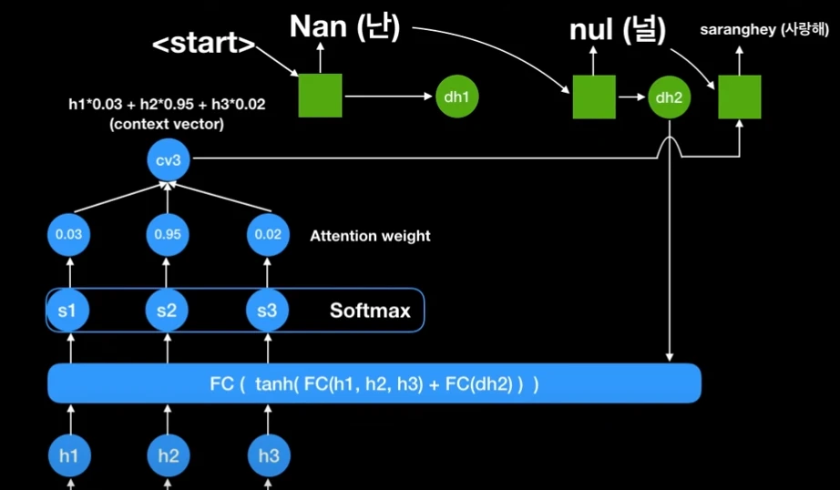

이번에는 $dh_2$가 fully connected network로 들어가고, 가운데 단어 love의 weight가 0.95로 가장 크다. 출처: 강의 화면

두 번째 decoder cell을 거쳐 나온 $dh_2$를 다시 fully connected network에 넣어 새 attention weight를 구하고 $cv_3$을 계산한다. 이번에는 love가 95%의 focus를 갖는다.

$$
cv_3 = 0.03\, h_1 + 0.95\, h_2 + 0.02\, h_3
$$

이 값을 세 번째 decoder cell에 넣으면 "사랑해"가 나온다.

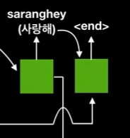

"사랑해" 다음 cell의 출력이 `<end>`다. 출처: 강의 화면

마지막으로 `<end>` 신호가 나오면서 번역이 끝난다.

세 step을 한 표로 모으면 다음과 같다. 출력할 단어가 "난", "널", "사랑해"로 바뀔 때마다 가장 큰 weight가 I, you, love로 옮겨 간다.

| step | score 계산에 넣는 state | I ($h_1$) | love ($h_2$) | you ($h_3$) | 출력 |
|---|---|---|---|---|---|
| 1 | $h_3$ (decoder state가 아직 없음) | 0.9 | 0.0 | 0.1 | 난 |
| 2 | $dh_1$ | 0.1 | 0.0 | 0.9 | 널 |
| 3 | $dh_2$ | 0.03 | 0.95 | 0.02 | 사랑해 |

Context vector 하나만 쓰던 과거의 Seq2Seq 모델보다, context vector를 매번 새로 만드는 Seq2Seq + attention 쪽이 더 많은 정보를 효율적으로 담을 수 있다는 것을 알 수 있다.

## Attention weight가 주는 것

이 과정에서 중요한 것은 attention weight다.

1. Decoder는 항상 encoder의 state를 주목하고, attention weight를 통해 어디에 focus할지를 정한다.
2. Context vector가 고정되어 있지 않고, 단어를 하나 decoding할 때마다 달라진다.

## 성능 비교

강의의 마지막은 논문의 Figure 2다.

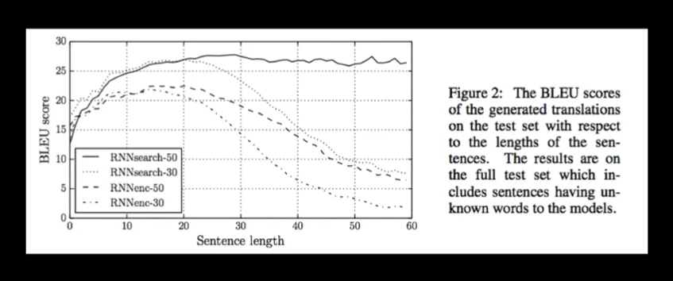

가로축이 문장 길이, 세로축이 BLEU score다. 실선(RNNsearch-50)만 오른쪽 끝까지 높이를 유지한다. 출처: 논문 Figure 2

Attention을 쓰지 않는 모델(RNNenc)은 문장이 길어질수록 점수가 떨어지고, attention을 쓰는 모델 가운데 길이 50까지의 문장으로 학습한 RNNsearch-50은 긴 문장에서도 점수가 유지된다. 고정된 크기의 context vector가 긴 문장을 담지 못한다는 앞의 설명이 그래프로 확인된다.

## 이어지는 글

Attention을 더한 Seq2Seq도 RNN을 쓰기 때문에 단어를 순서대로 하나씩 처리해야 한다. RNN을 아예 없애고 attention만으로 구성한 모델이 Transformer다.

- [Transformer 강의 정리 1](02-transformer-lecture-notes-1.md): Seq2Seq의 한계에서 출발해 Transformer의 구조와 Multi-Head Attention의 계산 과정까지
- [Transformer 강의 정리 2](04-transformer-lecture-notes-2.md): 병렬 처리의 관점에서 본 Transformer
- [Attention Is All You Need 리뷰](../../papers/2025-01-06-attention-is-all-you-need.md): 나중에 원 논문을 다시 읽고 정리한 글

## 참고 자료

- "[딥러닝 기계번역] 시퀀스 투 시퀀스 + 어텐션 모델" (YouTube). <https://www.youtube.com/watch?v=WsQLdu2JMgI>
- D. Bahdanau, K. Cho, Y. Bengio, "Neural Machine Translation by Jointly Learning to Align and Translate", ICLR 2015. <https://arxiv.org/abs/1409.0473>
