# Transformer 강의 정리 1: Seq2Seq의 한계에서 Multi-Head Attention까지

작성일 2023-11-23
{ .post-date }

2023년 11월, PatchTST 프로젝트를 준비하면서 Transformer를 처음 공부할 때 쓴 노트다. 나동빈 님의 "[딥러닝 기계 번역] Transformer: Attention Is All You Need (꼼꼼한 딥러닝 논문 리뷰와 코드 실습)" 강의를 보며 정리했다. 강의는 Seq2Seq의 한계에서 출발해 attention, Transformer의 구조, Multi-Head Attention의 계산 과정을 차례로 설명한다. 공부하면서 생긴 질문은 글 끝에 모아 답을 달았다.

## 딥러닝 기반 기계 번역의 발전 과정

1986년쯤 RNN이 제안되었고, 10년 정도 뒤에 LSTM이 등장했다. LSTM을 쓰면 다양한 sequential data를 모델링할 수 있다. 주가 예측이나 주기 함수 예측 같은 것이 가능하다. 이 LSTM을 활용해 2014년에 딥러닝 기반 번역 기술인 Seq2Seq가 등장했다.

Seq2Seq는 LSTM과 고정된 크기의 context vector로 번역을 수행하는 방법이다. 다만 source 문장 전체를 고정된 크기의 vector 하나에 압축해야 한다는 점에서 성능에 한계가 있었다.

이후 attention 기법이 등장하면서 성능이 올라갔고, Transformer 논문은 RNN을 쓰지 않고 오로지 attention에만 의존하는 architecture를 설계해 성능을 훨씬 더 끌어올렸다.

Attention mechanism이 등장한 뒤로는 입력 sequence 전체에서 정보를 추출하는 방향으로 발전해 왔다고 할 수 있다. 이후에도 RNN을 활용하는 architecture는 많이 나왔지만, 기본적으로는 attention을 기반으로 하는 모델이 많이 연구되고 있다. Transformer는 attention을 적극적으로 활용한 모델이다.

- GPT: Transformer의 decoder architecture를 활용한다.
- BERT: Transformer의 encoder architecture를 활용한다.

## Seq2Seq 모델

한쪽의 sequence를 입력으로 받아 다른 쪽의 sequence를 만들어 출력한다는 의미에서 Seq2Seq 모델이라고 부른다. 강의는 독일어 "guten abend"를 영어 "good evening"으로 번역하는 예로 설명한다.

### Encoder와 Decoder

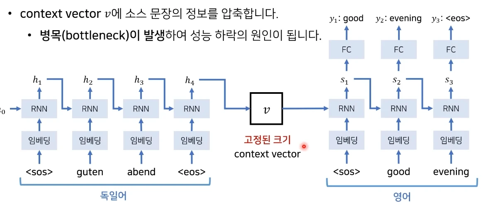

왼쪽 RNN 네 개가 encoder, 오른쪽 RNN 세 개가 decoder다. 둘을 잇는 것은 가운데의 상자 $v$ 하나뿐이다. 출처: 강의 슬라이드

**Encoder.** 그림 왼쪽에서 단어가 하나 들어올 때마다 hidden state가 $h_1$, $h_2$, $h_3$, $h_4$로 갱신된다. 이전까지 입력된 단어들의 정보를 담고 있는 hidden state를 받아서, 새 단어를 반영해 hidden state를 새로 만드는 것이다. 따라서 hidden state는 그때까지 입력된 단어들에 대한 정보를 갖고 있다. 마지막 단어까지 넣고 얻은 $h_4$는 문장 전체에 대한 정보를 갖고 있으므로 context vector $v$의 역할을 한다. 이 context vector가 source 문장 전체의 문맥 정보를 담고 있다고 볼 수 있다.

**Decoder.** 그림 오른쪽의 decoder는 context vector에서 출발한다. 출력 단어가 하나 들어올 때마다 hidden state($s_1$, $s_2$, $s_3$)를 만들고 출력을 내보낸다. 그다음에는 이전에 출력한 정보를 담고 있는 hidden state를 다음 cell에 넘겨 활용하고, 이 과정을 `<eos>`가 나올 때까지 반복한다.

그림에서 단어와 RNN 사이에 있는 "임베딩" 상자는, 자연어 처리에서 사람이 쓰는 자연어를 기계가 이해할 수 있도록 숫자 형태인 vector로 바꾸는 과정 또는 그 전체 과정을 뜻한다.

### 한계: 고정된 크기의 context vector

위 그림에서 encoder의 정보가 decoder로 넘어가는 길은 $v$ 하나다. Seq2Seq는 이 context vector $v$에 source 문장의 정보를 압축한다. 전체 문장의 정보를 고정된 크기의 vector 하나에 압축하므로 병목(bottleneck)이 생기고, 이것이 성능 하락의 원인이 된다. Source 문장은 짧을 수도 길 수도 있는데, 그 모든 경우를 고정된 크기의 context vector 하나로 대표하려고 하면 다양한 문장을 감당할 수 없다.

### Decoder가 context vector를 매번 참고하는 방법

이 문제를 줄이려고, decoder의 RNN cell이 매번 context vector를 참고하게 만드는 방법이 있다.

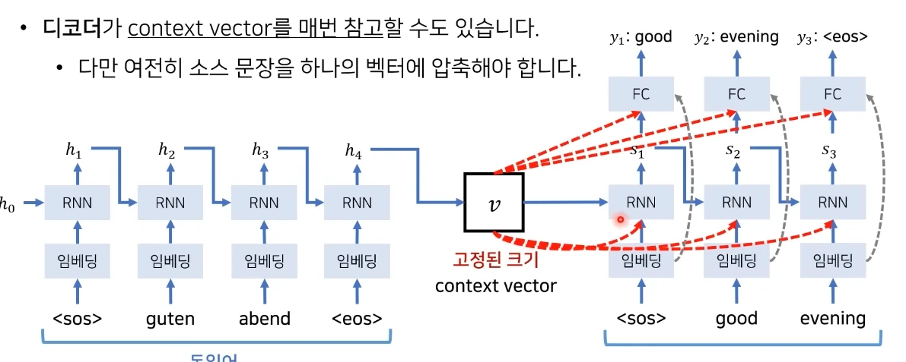

붉은 점선이 새로 생긴 연결이다. $v$가 첫 번째 RNN에만 들어가지 않고 decoder의 모든 단계로 다시 들어간다. 출처: 강의 슬라이드

이렇게 하면 decoder의 RNN cell을 거치면서 정보가 손실되는 것을 어느 정도 막을 수 있다. 출력 문장이 길어져도 context vector의 정보를 각 RNN cell에 다시 넣어 주므로 성능이 일부 개선된다.

다만 그림에서도 $v$는 여전히 하나다. Source 문장을 context vector 하나에 압축해야 한다는 점은 그대로여서, 근본적인 해결은 아니다.

### 해결 방향

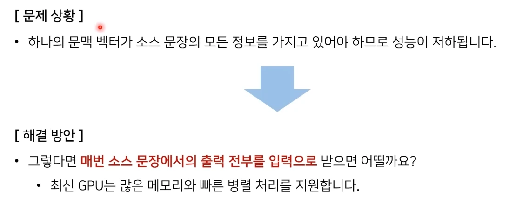

문제는 vector 하나가 모든 정보를 가져야 한다는 것이고, 해결 방안은 source 문장에서 나온 출력 전부를 매번 입력으로 받는 것이다. 출처: 강의 슬라이드

하나의 문맥 vector가 source 문장의 모든 정보를 가져야 한다는 것이 문제다. 그렇다면 고정된 크기의 context vector 하나에 담지 말고, source 문장에서 나온 출력값 전부를 매번 입력으로 받아서 출력 단어를 만들게 하면 성능이 좋아질 수 있다. 최신 GPU는 많은 메모리와 빠른 병렬 처리를 지원하므로 이런 방식이 가능하다.

## Seq2Seq with Attention

Attention mechanism을 쓰면 decoder는 encoder의 모든 출력을 참고할 수 있다.

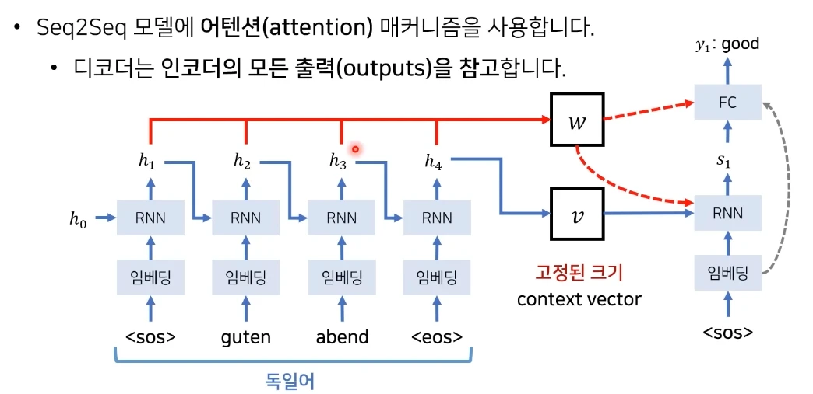

붉은 실선이 $h_1$부터 $h_4$까지를 모두 모아 상자 $w$로 보낸다. 앞의 구조에는 $v$만 있었는데, 여기에 $w$가 더해져 decoder의 RNN과 FC로 들어간다. 출처: 강의 슬라이드

$w$는 encoder의 hidden state들을 가중치에 따라 더한 값(weighted sum)이다. 이 값을 어떻게 구하는지가 이 절의 내용이다. PyTorch에서는 RNN이나 LSTM을 만들면 전체 sequence 길이에 맞는 출력값들이 따로 나오므로, 이것을 이용해 attention mechanism을 쉽게 구현할 수 있다.

### Encoder의 출력을 모두 보관한다

Encoder는 단어가 들어와 hidden state가 나올 때마다 그 값을 별도의 배열에 기록해 둔다. 위 그림에서 $h_1$, $h_2$, $h_3$, $h_4$에서 위로 뻗은 붉은 선이 이것이다. 단어마다의 hidden state를 전부 가지고 있다가, decoder의 각 cell이 출력 단어를 만들 때마다 이 값들을 전부 참고하게 하려는 것이다.

### Energy와 가중치

Decoder가 단어 하나를 만들 때 하는 일은 "지금 이 단어를 만들려면 source 문장의 어느 단어를 봐야 하는가"를 숫자로 계산하는 것이다. 이 숫자를 구하는 과정이 energy, 가중치, weighted sum의 세 단계다.

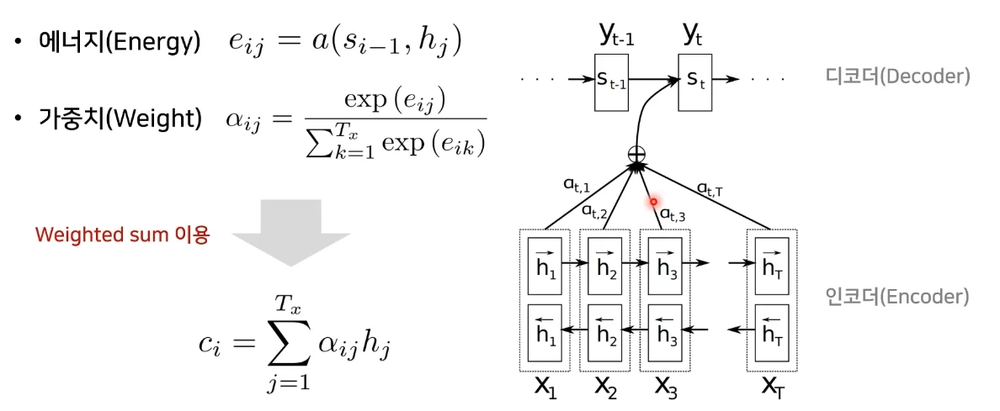

오른쪽 그림을 보면 된다. 아래 encoder의 $h_1, \ldots, h_T$가 각각 가중치 $a_{t,1}, \ldots, a_{t,T}$를 달고 위로 올라가 ⊕에서 하나로 더해지고, 그 값이 decoder의 $s_t$를 만드는 데 들어간다. 출처: 강의 슬라이드

**Energy.** Decoder는 매번 hidden state를 갱신한다. 현재 단계의 hidden state를 만들 때, 바로 이전의 decoder hidden state와 source 문장 쪽의 hidden state들을 묶어 계산해서 **energy** 값을 얻는다. Decoder cell 하나가 가진 hidden state를, 전달받은 encoder의 모든 hidden state와 각각 짝지어 energy를 구하는 것이다. Energy는 지금 어떤 값을 출력하기 위해 source 문장의 어떤 단어에 초점을 둘 필요가 있는지를 수치로 표현한 값이다.

$$
e_{ij} = a(s_{i-1}, h_j)
$$

- $i$: decoder가 현재 처리 중인 index
- $j$: encoder 출력 각각의 index
- $s_{i-1}$: decoder가 이전에 만든 hidden state. 현재 단계의 hidden state는 아직 갱신되지 않았으므로 $i-1$번째 값을 쓴다. 그림에서 $s_t$ 왼쪽의 $s_{t-1}$이다.
- $h_j$: encoder의 $j$번째 hidden state

Decoder는 출력 단어를 하나 만들 때마다 모든 $j$, 즉 encoder의 모든 출력을 고려한다.

**가중치.** 이 energy에 softmax를 취해 확률값을 구한다. 이 값이 <strong>가중치(weight)</strong>이고, source 문장의 hidden state 가운데 어떤 vector를 더 많이 참고할지를 나타낸다. 그림에서 화살표마다 붙어 있는 $a_{t,1}$, $a_{t,2}$, $a_{t,3}$이 이 값이다.

$$
\alpha_{ij} = \frac{\exp(e_{ij})}{\sum_{k=1}^{T_x} \exp(e_{ik})}
$$

**Weighted sum.** 마지막으로 encoder의 hidden state에 가중치를 곱해 모두 더한다. 이 weighted sum이 그 단계의 새로운 context vector가 되고, 출력에 반영된다. 그림의 ⊕가 이 덧셈이다.

$$
c_i = \sum_{j=1}^{T_x} \alpha_{ij} h_j
$$

정리하면 decoder가 단어 하나를 만드는 과정은 다음과 같다.

1. 현재의 hidden state $s_i$를 만들기 위해, 이전 hidden state $s_{i-1}$과 encoder의 모든 hidden state로 energy를 구한다.
2. Energy에 softmax를 취해 가중치를 만든다.
3. 가중치와 encoder hidden state를 곱한 값들의 총합(weighted sum)으로 새 context vector를 만들고, 이를 출력에 활용한다.

고정된 context vector 하나만 참고하는 것이 아니라, source 문장에서 나온 모든 state를 반영해서 source 문장의 어떤 단어에 주의를 집중할지를 모델이 고려하게 만드는 것이다.

### 가중치의 시각화

Decoder가 단어를 출력할 때마다 encoder의 모든 hidden state에 대한 가중치를 구하므로, 각 출력 단어가 입력의 어떤 단어를 얼마나 참고했는지 알 수 있다.

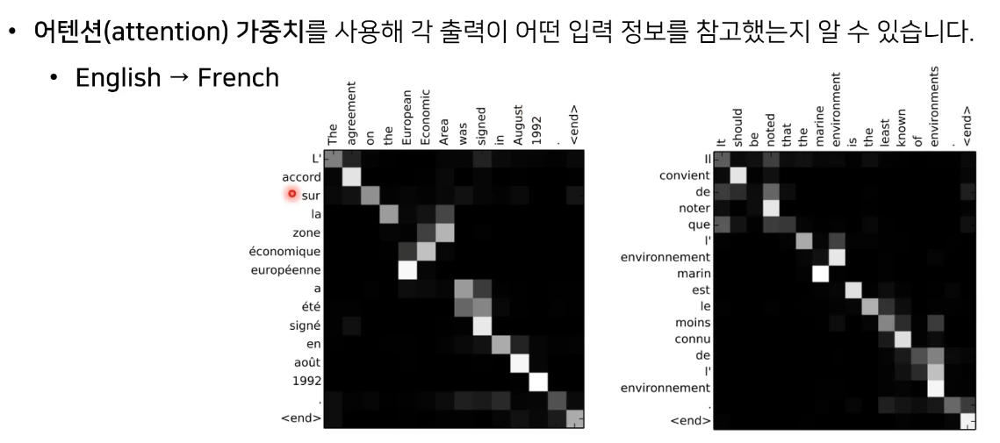

가로가 입력(영어) 단어, 세로가 출력(프랑스어) 단어이고, 칸이 밝을수록 가중치가 크다. 밝은 칸이 대체로 대각선을 따라가다가, 어순이 뒤바뀌는 "European Economic Area"와 "zone économique européenne"에서는 대각선의 방향이 반대로 꺾인다. 출처: 강의 슬라이드 (Bahdanau 외 논문의 그림)

## Transformer: Attention Is All You Need

Transformer는 RNN이나 CNN을 전혀 필요로 하지 않는다.

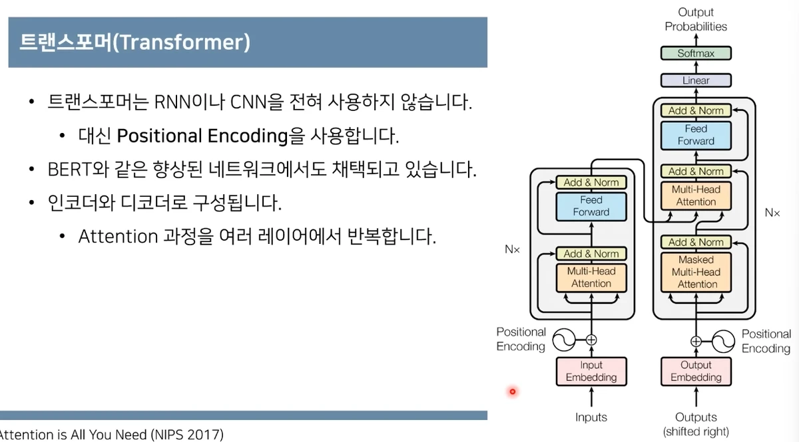

오른쪽 구조도에서 왼쪽 기둥이 encoder, 오른쪽 기둥이 decoder다. 두 기둥 모두 아래에서 입력이 들어가 위로 올라가고, 옆에 적힌 "N×"는 그 상자를 N번 쌓는다는 뜻이다. 출처: 강의 슬라이드 (구조도는 논문 Figure 1)

- RNN이나 CNN을 쓰지 않으면 문장 안 단어들의 순서를 파악하기 어렵다. 그래서 각 단어의 순서를 알려 주는 **positional encoding**을 사용한다. 구조도 아래쪽의 물결 모양 기호가 이것이다.
- BERT와 같은 향상된 네트워크에서도 채택되고 있다.
- RNN을 쓰지 않지만 encoder와 decoder로 구성된다.
- Attention 과정을 여러 layer에서 반복한다. Encoder와 decoder 모두 layer를 여러 개 쌓아서 사용한다.

아래에서는 이 구조도를 아래에서 위로, 입력부터 한 조각씩 따라간다.

## 입력: Embedding과 Positional Encoding

### Embedding

입력값을 임베딩하는 layer다. Transformer 이전의 전통적인 임베딩도 같은 방식이다.

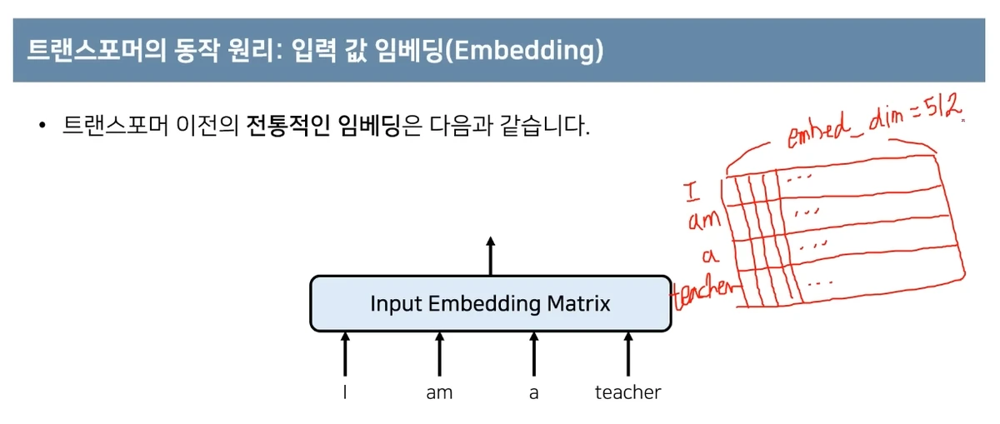

오른쪽의 붉은 손그림이 임베딩 행렬이다. 행은 단어(I, am, a, teacher)이고, 열은 임베딩 차원(embed_dim = 512)이다. 출처: 강의 슬라이드

입력 차원은 그 언어에 존재할 수 있는 단어의 개수와 같다. 단어가 one-hot encoding으로 표현되기 때문이다. 이것을 그대로 쓰지 않고, 네트워크에 넣을 때는 더 적은 차원의 연속적인 실수 값으로 표현한다.

예를 들어 "I am a teacher"라는 문장이 들어오면 입력 임베딩 행렬은 그림처럼 단어 수만큼 네 개의 행을 갖고, 열은 임베딩 차원의 크기만큼 만들어진다. 임베딩 차원의 크기는 architecture를 구성하는 사람이 정한다. 논문에서는 512다.

### Positional Encoding

RNN을 쓴다면 단어가 순서대로 RNN에 들어가므로 hidden state가 자동으로 순서 정보를 갖게 된다. Transformer는 그렇지 않으므로, 위치 정보를 가진 임베딩을 따로 써야 한다.

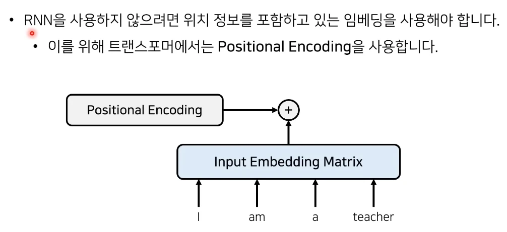

임베딩 행렬에서 올라온 값에 positional encoding이 ⊕로 더해진다. 출처: 강의 슬라이드

위치 정보를 담은 positional encoding을 입력 임베딩 행렬에 element-wise로 더해서, 네트워크가 단어의 순서를 알 수 있게 한다. 이렇게 위치 정보까지 포함한 입력값을 attention에 넣는다.

## Encoder

### Self-Attention

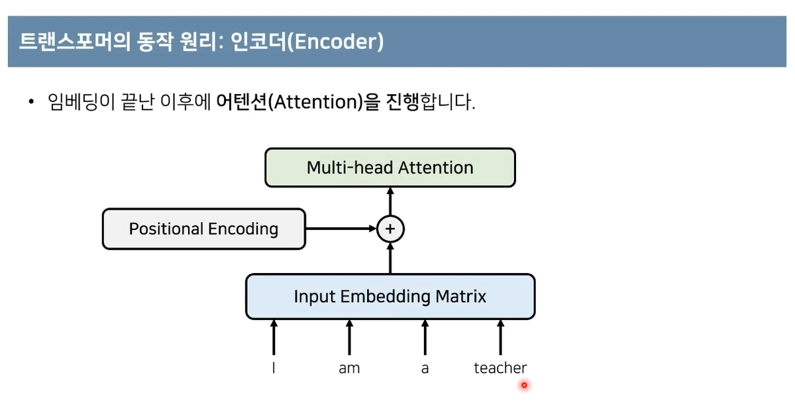

앞의 그림 위에 Multi-head Attention 상자가 하나 올라갔다. 출처: 강의 슬라이드

임베딩이 끝나면 attention을 수행한다. Encoder에서 수행하는 attention을 **self-attention**이라고 한다. Self-attention은 입력의 각 단어가 서로 어떤 연관성을 갖는지 구하는 데 쓰인다.

예를 들어 "I am a teacher"라는 문장에서 각 단어가 다른 단어와 얼마나 연관되는지 알기 위해, 각 단어가 서로에 대해 attention score를 구한다. 이렇게 해서 어떤 단어와 높은 연관성을 갖는지 학습한다. Attention을 이용해 모델이 문맥에 대한 정보를 학습하게 되는 것이다.

### Residual Learning

성능을 높이기 위해 잔여 학습(residual learning)을 사용한다.

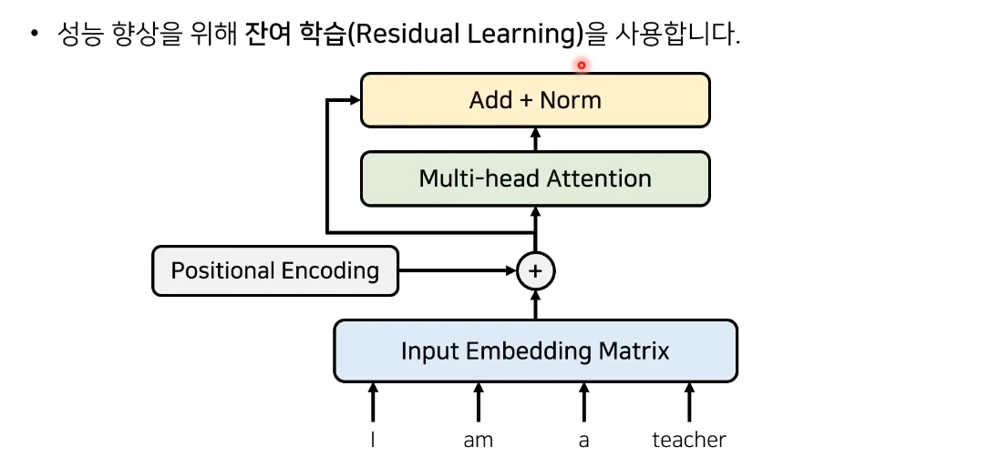

왼쪽으로 돌아 올라가는 화살표를 보면 된다. Attention에 들어가기 전의 값이 attention을 건너뛰어 Add + Norm으로 곧장 들어간다. 출처: 강의 슬라이드

Residual learning은 이미지 분류 네트워크인 ResNet에서 쓰이는 기법으로, 값을 layer를 거치며 단순히 반복해서 갱신하는 것이 아니라, 특정 layer를 건너뛰어 복사한 값을 그대로 더해 주는 기법이다($x + F(x)$). 이렇게 layer를 건너뛰어 값을 그대로 전달하는 연결을 residual connection이라고 하고, 그림의 돌아가는 화살표가 그것이다.

이렇게 하면 네트워크는 기존 정보를 그대로 받으면서 잔여 부분만 학습하면 되므로 전반적인 학습 난이도가 낮아진다. 그래서 초기 수렴 속도가 빨라지고, global optimum을 찾을 가능성이 높아진다.

Encoder의 동작은 결국, attention을 수행해 얻은 값과 residual connection으로 건너온 값을 함께 받아 normalization을 수행하고 그 결과를 내보내는 것이다. 그림의 Add + Norm 상자가 이 일을 한다.

Residual connection이 왜 학습을 쉽게 하는지는 따로 강의를 찾아보고 [Skip Connection 정리](03-skip-connection.md)에 적었다.

### Layer 하나의 구성과 반복

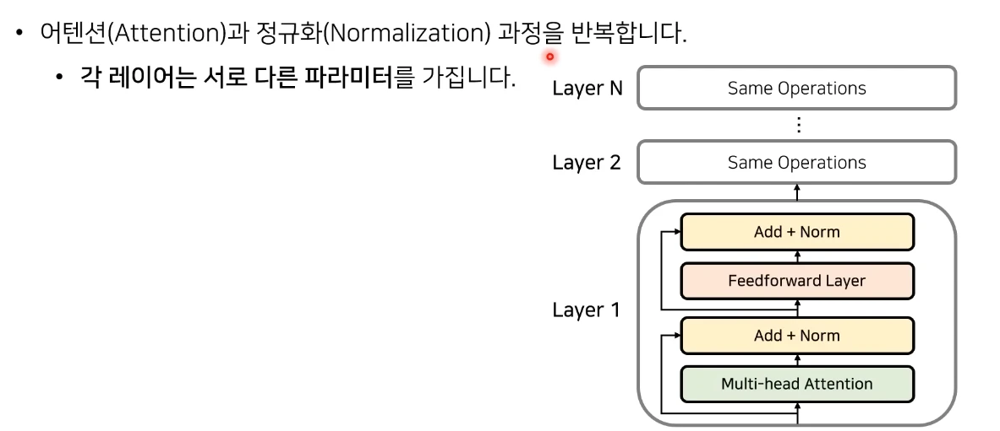

둥근 테두리 안이 layer 하나다. 아래에서 위로 상자 네 개가 쌓여 있고, 그 위의 Layer 2부터 Layer N까지는 같은 연산을 반복한다. 출처: 강의 슬라이드

입력값이 한 layer에 들어오면 그림의 아래에서 위로 다음 순서로 처리된다.

1. Self-attention
2. Residual connection과 normalization (Add + Norm)
3. Feedforward layer
4. Residual connection과 normalization (Add + Norm)

Attention과 normalization 과정을 여러 layer에서 반복한다. 그림에는 "Same Operations"라고 적혀 있지만, 연산의 종류가 같다는 뜻이고 **각 layer는 서로 다른 parameter를 가진다**. 예를 들어 1번 layer와 2번 layer의 attention과 feedforward에 쓰이는 parameter는 서로 다르다. 그리고 layer를 중첩해서 쓸 수 있도록, 한 layer의 입력과 출력은 차원의 크기가 같다.

Feedforward layer는 신경망 기반 딥러닝에서 쓰는 가장 기본적인 구조인 feedforward network다.

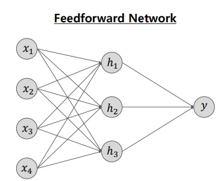

입력 $x_1 \sim x_4$가 hidden layer $h_1 \sim h_3$을 거쳐 출력 $y$로 한 방향으로만 흐른다.

## Encoder와 Decoder의 연결

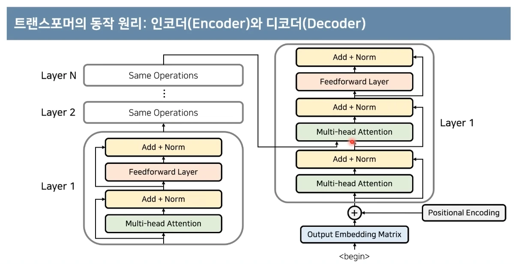

왼쪽이 encoder, 오른쪽이 decoder의 layer 하나다. Encoder의 Layer N 위에서 나온 선이 decoder 가운데의 Multi-head Attention으로 들어가는 것을 보면 된다. 출처: 강의 슬라이드

여러 layer를 거쳐 마지막 encoder layer에서 나온 출력값이 decoder에 들어간다. Seq2Seq with attention에서와 마찬가지로, decoder가 출력할 때마다 source 문장의 어떤 단어에 가장 큰 초점을 두어야 하는지 알아내기 위해서다.

### Decoder layer의 구성

Decoder도 단어 정보를 받고, 각 단어의 상대적인 위치를 알려 주기 위해 positional encoding을 더한다(그림 오른쪽 아래). Encoder layer에는 attention이 하나였는데, 위 그림의 decoder layer에는 Multi-head Attention 상자가 두 개 있다.

1. 아래쪽 첫 번째는 **self-attention**이다. Encoder와 마찬가지로 각 단어가 서로에게 어떤 가중치를 갖는지 구해서, 출력되고 있는 문장에 대한 전반적인 표현을 학습한다.
2. 위쪽 두 번째는 encoder의 정보에 attention하는 것이다. 각 출력 단어가 encoder의 출력 정보를 받아 와서, source 문장의 어떤 단어와 연관이 있는지 구한다. 그래서 **encoder-decoder attention**이라고 부른다. Encoder에서 건너온 선이 들어가는 곳이 여기다.

예를 들어 입력 문장이 "I am a teacher"이면 출력은 "나는 선생님이다"가 순서대로 나온다. 이때 출력되고 있는 단어 "선생님"이 I, am, a, teacher 가운데 어떤 단어와 가장 높은 연관성을 갖는지 구하는 것이 encoder-decoder attention이다.

Decoder layer도 여러 번 중첩해서 쓸 수 있다.

### 마지막 encoder layer의 출력이 모든 decoder layer로

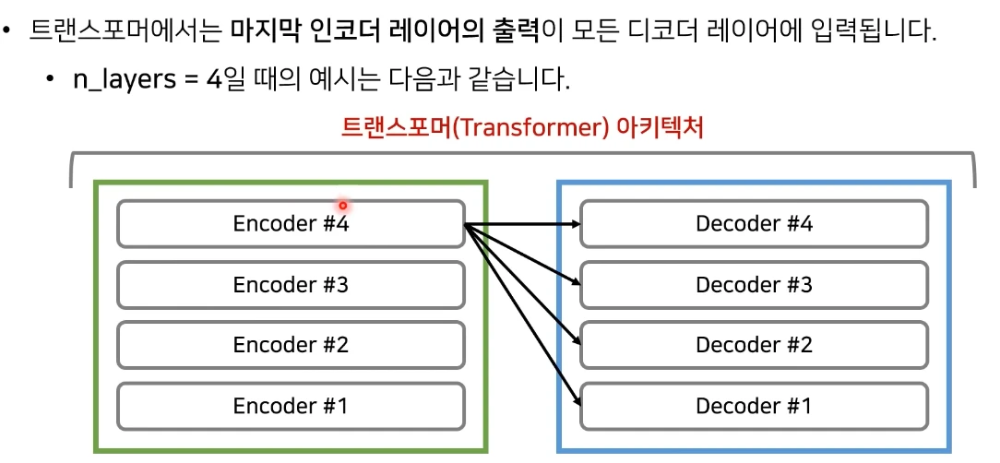

화살표가 모두 Encoder #4에서 출발한다. Encoder #1, #2, #3에서 decoder로 가는 화살표는 없다. 출처: 강의 슬라이드

Decoder도 여러 layer로 구성되고, 마지막 layer에서 나온 값이 번역 결과가 된다. 이때 **마지막 encoder layer의 출력이 모든 decoder layer에 입력된다**. 그림은 layer가 4개일 때의 예다. 각 decoder layer의 두 번째 attention에서 입력 문장의 어떤 단어와 연관이 높은지를 구할 때 이 값을 쓴다. 일반적으로 encoder와 decoder의 layer 개수는 같게 맞춘다. Encoder의 마지막 layer가 아닌 다른 layer에서도 값을 받는 방식이 있기는 하지만, 기본은 마지막 layer의 출력만 받는 것이다.

### RNN과 다른 점

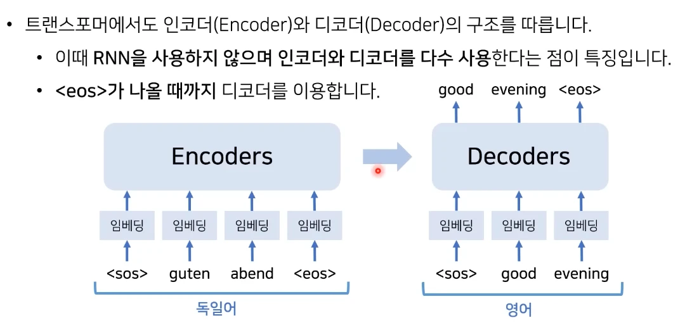

글 처음의 Seq2Seq 그림과 비교하면, 단어마다 하나씩 있던 RNN 상자가 사라지고 문장 전체가 Encoders 한 덩어리에 한꺼번에 들어간다. 출처: 강의 슬라이드

LSTM이나 RNN은 입력 단어의 개수만큼 cell을 반복해서 거치며 매번 hidden state를 만들었다. Transformer는 입력 단어 전체가 하나로 연결되어 한 번에 입력되고, 그에 대한 attention 값도 한 번에 구한다. 위치 정보를 함께 넣어 주므로 encoder를 한 번 거칠 때마다 모든 단어의 출력값을 병렬로 구할 수 있고, 그래서 계산 복잡도가 일반적으로 낮다.

학습할 때도 입력값 전부를 한 번에 넣을 수 있으므로 RNN 없이 학습할 수 있다. 문장을 단어 하나씩이 아니라 문장 단위로 한꺼번에 넣는다는 뜻으로 이해했다. 다만 모델이 실제로 출력을 내보낼 때는 `<eos>`가 나올 때까지 decoder를 여러 번 사용해서 출력값을 구한다.

중간에 context vector를 구하는 과정이 완전히 빠져 있으므로, 네트워크에 LSTM 같은 RNN 구조를 쓸 필요가 없다.

## Multi-Head Attention

Transformer에서 쓰이는 attention은 여러 개의 head를 가진다고 해서 multi-head attention이라고 한다. 각 head 안에서는 **scaled dot-product attention**이 쓰인다.

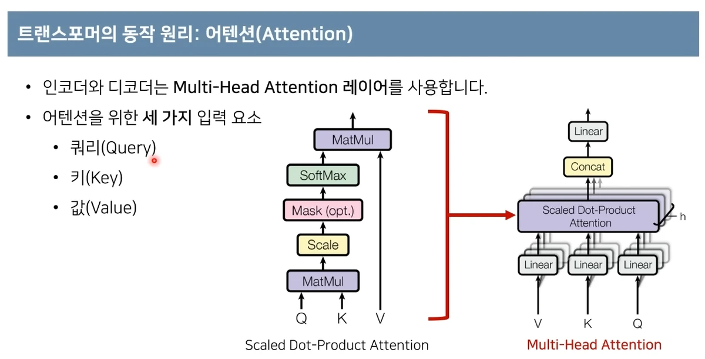

오른쪽이 multi-head attention이고, 그 가운데의 보라색 상자(Scaled Dot-Product Attention) 하나를 펼친 것이 왼쪽이다. 두 그림 모두 아래에서 Q, K, V가 들어가 위로 올라간다. 출처: 강의 슬라이드 (구조도는 논문 Figure 2)

### Query, Key, Value

그림의 맨 아래에 있는 세 입력 Q, K, V가 query, key, value다. Attention mechanism은 어떤 단어가 어떤 단어와 연관성을 갖는지 구하는 것이다. 이때 물어보는 주체가 **query**이고, 물어보는 대상이 **key**다.

"I am a teacher"라는 문장에서 self-attention을 수행한다고 하자. I라는 단어가 I, am, a, teacher 각각과 얼마나 연관이 있는지 구한다면, I가 query이고 I, am, a, teacher 각각이 key다. 하나의 query가 각 key에 대해 attention score를 구하고, 그 score를 **value**에 곱해서 attention value를 구한다.

### Scaled Dot-Product Attention

위 그림의 왼쪽을 아래에서 위로 읽으면 scaled dot-product attention의 계산 순서가 된다.

1. MatMul: query와 key의 행렬곱
2. Scale: 간단한 scaling
3. Mask (opt.): mask 적용 (선택)
4. SoftMax: 어떤 단어와 가장 높은 연관을 갖는지 확률로 바꾼다.
5. MatMul: 구한 확률값과 value를 곱해, 가중치가 적용된 attention value를 구한다. 그림에서 V가 아래 단계들을 거치지 않고 맨 위의 MatMul로 곧장 올라가는 이유다.

$$
\mathrm{Attention}(Q, K, V) = \mathrm{softmax}\!\left(\frac{QK^T}{\sqrt{d_k}}\right) V
$$

Scale factor로 $\sqrt{d_k}$를 쓰고, $d_k$는 key의 차원이다. Softmax는 입력이 0 근처일 때는 gradient가 크지만, 입력값이 0에서 멀어지면 gradient가 매우 작아진다. 이 gradient vanishing 문제를 줄이기 위해 scale factor로 나눈다고 논문은 설명한다.

### 여러 개의 head

위 그림의 오른쪽에서 상자들이 여러 장 겹쳐 그려진 것이 head다. 겹친 장수가 $h$이고, $h$는 head의 개수다.

입력값이 들어오면 value, key, query 세 갈래로 복제되어 들어간다. 각각은 서로 다른 linear layer(행렬곱)를 거쳐 $h$개로 나뉜다. 그래서 $h$개의 서로 다른 (query, key, value) 쌍이 만들어지고, head마다 자기 쌍을 받아 attention을 수행한다.

이렇게 하는 이유는 서로 다른 attention 개념을 학습하게 해서, 더 구분되는 다양한 특징을 학습하도록 유도하기 위해서다. Attention score를 시각화하면 head의 수만큼 그림이 나온다.

Attention의 입력과 출력은 차원이 같아야 한다. 그래서 각 head에서 나온 attention 값들을 일렬로 이어 붙이고(그림의 Concat), linear layer를 한 번 더 거쳐 출력한다. Multi-head attention을 수행한 뒤에도 차원이 줄어들지 않는다.

$$
\mathrm{head}_i = \mathrm{Attention}(Q W_i^Q,\; K W_i^K,\; V W_i^V)
$$

$$
\mathrm{MultiHead}(Q, K, V) = \mathrm{Concat}(\mathrm{head}_1, \ldots, \mathrm{head}_h)\, W^O
$$

모델 전체에서 multi-head attention은 같은 함수로 쓰인다. 동작 방식은 같고, 달라지는 것은 쓰이는 위치와 query, key, value에 무엇을 넣느냐다. 예를 들어 encoder-decoder attention에서는 decoder의 출력 단어가 query가 되고, 그 단어를 만들기 위해 encoder 쪽의 어떤 단어를 참고하면 좋은지 구하기 위해 key와 value로 encoder의 출력값을 쓴다. 내보낼 단어를 만들기 위해 무엇을 참고해야 하는지 질의하는 것이다.

## 계산 과정을 예제로 따라가기

강의는 임베딩 차원이 4이고 head가 2개인 작은 예로 계산 과정을 보여 준다. 그림마다 작은 칸의 개수가 vector와 행렬의 크기를 나타내므로, 칸 수를 세면서 보면 된다.

### Query, Key, Value 만들기

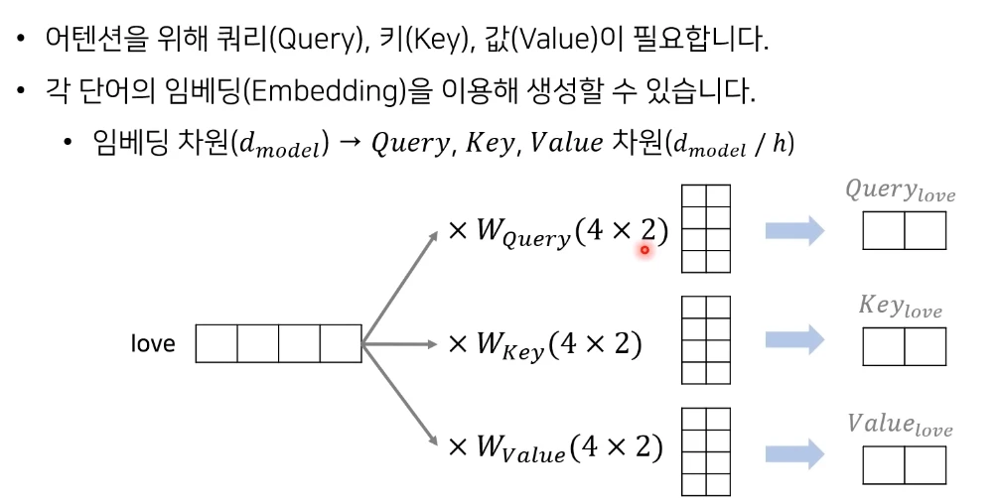

왼쪽의 네 칸짜리 vector(love의 임베딩)가 세 갈래로 나뉘어 각각 $4 \times 2$ 행렬과 곱해지고, 오른쪽에 두 칸짜리 vector 세 개가 나온다. 출처: 강의 슬라이드

Attention을 하려면 query, key, value가 필요하다. 단어 하나가 임베딩 차원으로 표현된 상태에서, linear layer를 거쳐 query, key, value를 각각 만든다.

임베딩 차원을 $d_{model}$이라고 하고, 논문에서는 512다. Head가 8개이면 query, key, value의 차원은 512를 8로 나눈 64가 된다. 즉 $d_{model} / h$다.

예제에서는 임베딩이 4차원이고 head가 2개이므로, 4차원 데이터를 2차원으로 보내는 $4 \times 2$ 크기의 $W_{Query}$, $W_{Key}$, $W_{Value}$를 만든다. 단어 love의 임베딩($1 \times 4$)에 이 행렬들을 곱하면 $1 \times 2$ 크기의 $\mathrm{Query}_{love}$, $\mathrm{Key}_{love}$, $\mathrm{Value}_{love}$가 나온다.

### 단어 하나의 attention value

"I love you"라는 문장에서 I의 attention value를 구하는 과정이다.

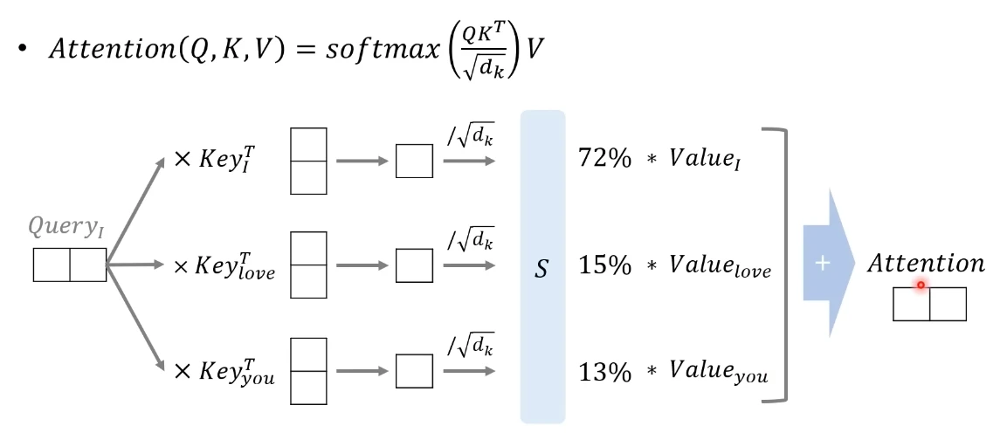

왼쪽에서 오른쪽으로 읽는다. $\mathrm{Query}_I$ 하나가 세 key와 각각 곱해져 숫자 하나씩이 되고, 가운데의 긴 상자 S(softmax)를 지나면 72%, 15%, 13%가 된다. 출처: 강의 슬라이드

1. $\mathrm{Query}_I$를 I, love, you 각각의 key와 곱해서 **attention energy**를 구한다. 두 칸짜리 vector끼리 곱했으므로 결과는 그림처럼 한 칸, 즉 숫자 하나다.
2. Softmax에 들어가는 값의 크기를 normalization하기 위해 $\sqrt{d_k}$로 나눈다.
3. Softmax에 넣어 가중치를 얻는다. 이 값이 query 단어가 각 key 단어에 대해 갖는 연관성이다. 예제에서 I는 I와 72%, love와 15%, you와 13%의 연관성을 갖는다.
4. 각 가중치에 value를 곱하고 모두 더하면 **attention value**가 된다. 결과는 다시 두 칸짜리 vector다.

$$
\mathrm{Attention}_I = 0.72\, \mathrm{Value}_I + 0.15\, \mathrm{Value}_{love} + 0.13\, \mathrm{Value}_{you}
$$

Weighted sum을 구하는 이 과정이 attention이다.

### 행렬로 한 번에 계산하기

실제로는 단어마다 따로 계산하지 않고 행렬곱으로 한 번에 계산한다. 단어가 3개이고 임베딩이 4차원이므로 입력은 $3 \times 4$ 행렬이다.

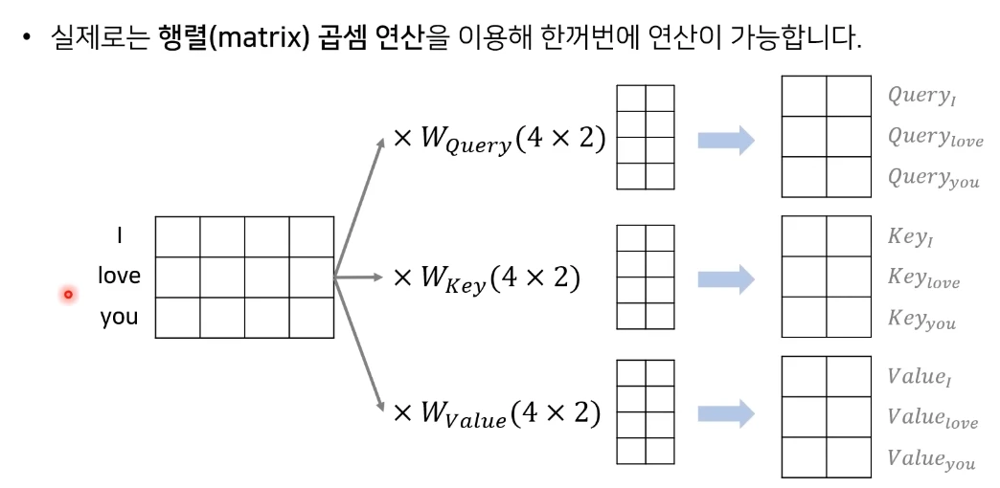

앞에서는 love 한 줄이었던 입력이 I, love, you 세 줄이 되었다. 결과로 나오는 query, key, value도 각각 세 줄($3 \times 2$)이다. 출처: 강의 슬라이드

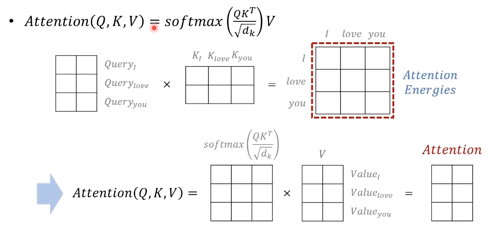

윗줄이 $QK^T$, 아랫줄이 softmax 결과에 $V$를 곱하는 단계다. 붉은 점선으로 둘러싼 $3 \times 3$ 행렬이 attention energy다. 출처: 강의 슬라이드

| 단계 | 연산 | 결과 크기 |
|---|---|---|
| Query, Key, Value 만들기 | $(3 \times 4) \cdot (4 \times 2)$ | 각각 $3 \times 2$ |
| Attention energy | $Q K^T$: $(3 \times 2) \cdot (2 \times 3)$ | $3 \times 3$ |
| Scaling, softmax | 행마다 적용 | $3 \times 3$ |
| Attention value | $(3 \times 3) \cdot (3 \times 2)$ | $3 \times 2$ |

Attention energy 행렬은 그림에서 보듯 행이 query(I, love, you), 열이 key(I, love, you)인 $3 \times 3$ 행렬이고, 각 원소는 한 단어(query)가 다른 단어(key)와 얼마나 높은 연관을 갖는지를 나타낸다. 행렬의 크기는 단어의 개수로 정해진다. 행렬곱 한 번으로 입력 문장의 모든 단어 쌍에 대한 attention energy를 구할 수 있다.

여기에 softmax의 gradient vanishing을 막기 위한 scaling을 하고 softmax에 넣으면, 각 query가 각 key와 갖는 연관이 나온다. 이것을 value 행렬과 곱하면 attention value 행렬이 된다. Head 하나의 attention value는 query, key, value와 같은 $3 \times 2$ 크기다.

### Mask matrix

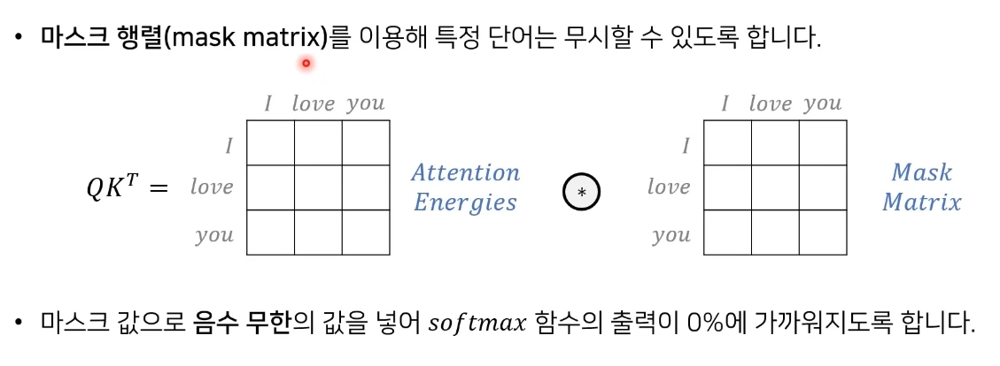

왼쪽의 attention energy 행렬과 오른쪽의 mask 행렬은 크기가 같고($3 \times 3$), 같은 자리의 칸끼리 짝지어진다. 출처: 강의 슬라이드

Mask 행렬을 쓰면 특정 단어를 무시하게 할 수 있다. Attention energy 행렬($QK^T$)과 같은 크기의 mask 행렬을 element-wise로 적용해서, 어떤 단어는 참고하지 않게 만든다. 가릴 위치에 음수 무한대 값을 넣으면 softmax의 출력이 0%에 가까워진다.

### Head를 이어 붙이기

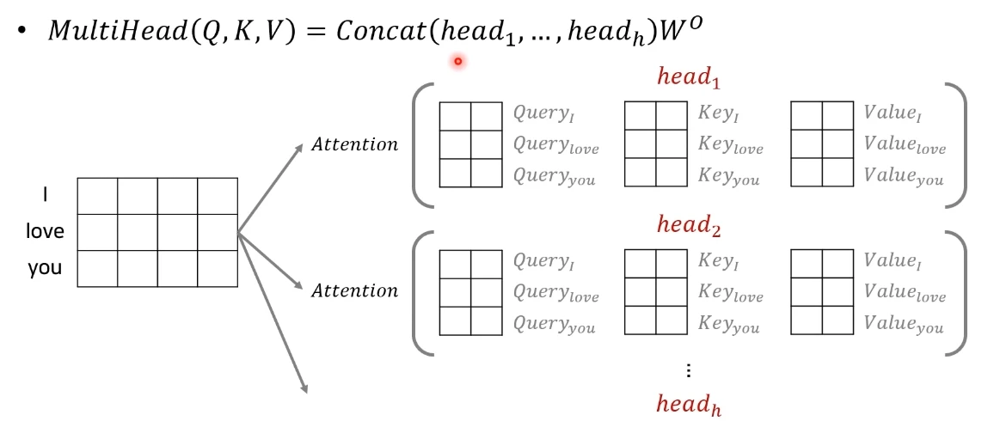

같은 입력 행렬에서 head 1, head 2, …, head $h$가 각자의 query, key, value 묶음을 만들고 따로 attention을 수행한다. 출처: 강의 슬라이드

Head마다 query, key, value와 같은 차원의 결과가 나오므로, head 1부터 head $h$까지의 attention 값을 일렬로 이어 붙인다.

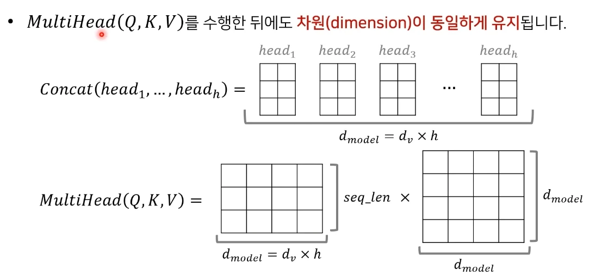

윗줄에서 두 칸 폭의 head 결과들이 옆으로 나란히 붙어 폭이 $d_{model} = d_v \times h$가 되고, 아랫줄에서 여기에 $d_{model} \times d_{model}$ 행렬을 곱한다. 출처: 강의 슬라이드

이어 붙이면 열의 개수가 원래 입력의 임베딩 차원과 같아진다($d_{model} = d_v \times h$). 예제에서는 head가 2개다. Head 하나의 attention value가 $3 \times 2$이므로 둘을 concat하면 $3 \times 4$가 되어 입력 임베딩과 크기가 같아진다.

마지막으로 $d_{model} \times d_{model}$ 크기의 weight matrix $W^O$를 곱해서 multi-head attention의 최종 값을 구한다. 결과는 여전히 (단어 수) $\times$ $d_{model}$이다. Multi-head attention을 수행한 뒤에도 차원이 유지되므로 다음 layer에 그대로 넣을 수 있다.

## Attention의 세 종류

Transformer에서 쓰이는 attention은 모두 multi-head attention이고, 쓰이는 위치에 따라 종류가 나뉜다.

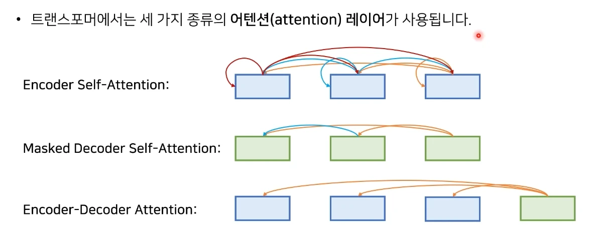

파란 상자가 encoder의 단어, 초록 상자가 decoder의 단어다. 줄마다 화살표가 어디까지 닿는지를 비교하면 된다. 첫 줄은 모든 단어가 서로를, 둘째 줄은 자기보다 앞쪽 단어만을, 셋째 줄은 decoder의 단어가 encoder의 단어들을 가리킨다. 출처: 강의 슬라이드

**Encoder self-attention.** Encoder에 넣은 임베딩의 각 단어가 서로에게 얼마나 연관되는지를 attention으로 구하고, 문장 전체에 대한 표현을 학습한다.

**Masked decoder self-attention.** 각 출력 단어가 모든 출력 단어를 참고하는 것이 아니라, 앞쪽에 등장한 단어들만 참고하게 한다. 출력 문장이 "나는 축구를 했다"일 때 "축구를"을 출력하면서 뒤에 나올 "했다"를 참고하게 하면 일종의 cheating이 되어 모델이 정상적으로 학습되기 어렵다. 그래서 decoder에서 self-attention을 수행할 때는 앞쪽 단어만 참고하게 만든다.

**Encoder-decoder attention.** Query가 decoder에 있고, key와 value가 encoder에 있는 경우다. "I like you"가 입력되고 "난 널 좋아해"가 출력된다면, 각 출력 단어가 입력 단어들 가운데 어떤 정보에 더 많은 가중치를 두는지 구할 수 있어야 한다. Decoder 쪽의 query가 encoder 쪽의 key와 value를 참조한다고 해서 encoder-decoder attention이라고 부른다. 공부하면서, decoder에 출력 단어의 임베딩을 넣어 주는 것은 정답을 주는 과정이라고 생각할 수 있겠다고 적어 두었다.

### Self-Attention의 시각화

Self-attention은 encoder와 decoder 모두에서 쓰이고, attention score로 나온 값을 그림으로 그려 볼 수 있다. 입력 문장에서 각 단어가 다른 어떤 단어와 연관성이 높은지를 매번 계산할 수 있다.

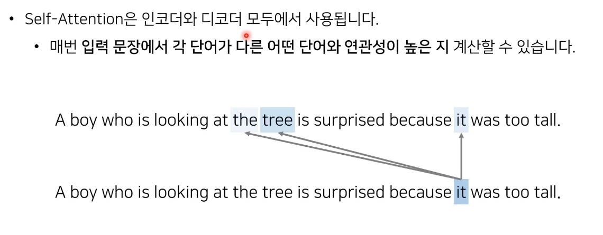

아랫줄의 it에서 나온 화살표가 윗줄의 the, tree, it을 가리키고, 색이 진할수록 attention score가 높다. 출처: 강의 슬라이드

> A boy who is looking at the tree is surprised because it was too tall.

이 문장에서 it의 의미는 앞에 있는 tree와 비슷할 것이다. 그래서 it의 attention score를 출력해 보면 the, tree, it에 높은 값이 나올 가능성이 크다.

## 전체 요약

"Transformer: Attention Is All You Need" 절에서 본 전체 구조도로 돌아가면, 이제 상자 하나하나가 무엇인지 읽을 수 있다.

- **Encoder**: 입력값에 위치 정보를 반영해 첫 번째 layer에 넣고, layer를 $N$번 반복한다. 마지막 layer에서 나온 출력값이 각 decoder layer에 들어간다.
- **Decoder**: Decoder layer도 $N$번 중첩되고, 마지막에 나온 출력값에 linear layer와 softmax를 적용해 출력 단어를 만든다.

## Positional Encoding의 수식

논문은 각 단어의 위치 정보를 모델에게 알려 주기 위해 주기 함수를 사용한다.

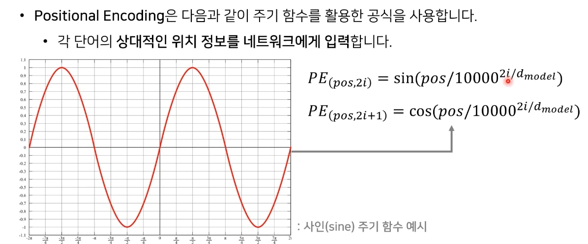

왼쪽은 sine 함수의 예시 그래프이고, 오른쪽의 식이 이 주기 함수를 써서 positional encoding의 값을 정한다. 출처: 강의 슬라이드

$$
PE_{(pos,\, 2i)} = \sin\!\left(\frac{pos}{10000^{2i/d_{model}}}\right), \qquad
PE_{(pos,\, 2i+1)} = \cos\!\left(\frac{pos}{10000^{2i/d_{model}}}\right)
$$

- $PE$는 positional encoding, $pos$는 각 단어의 번호, $i$는 그 단어의 임베딩 안에서의 위치를 가리킨다.
- Sine과 같은 주기 함수를 쓰는 것은, 네트워크가 입력 문장 안 단어들의 상대적인 위치 정보를 알 수 있게 하기 위해서다. 이 주기성을 학습할 수 있기만 하면 어떤 함수를 써도 된다.
- 주기 함수를 쓰지 않고 위치에 대한 임베딩 값을 학습시켜 네트워크에 넣을 수도 있다. 이렇게 해도 성능 차이는 거의 없었다고 한다.

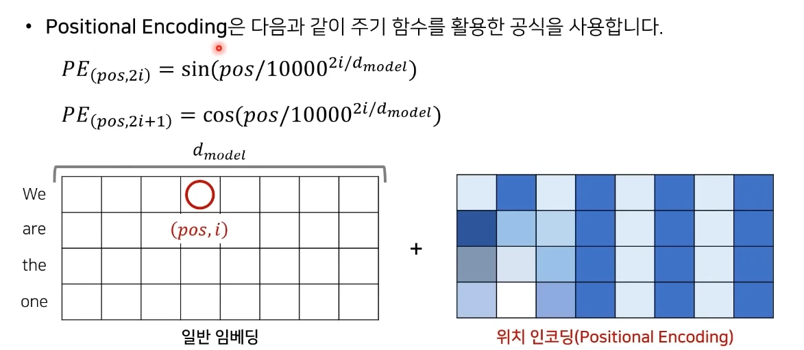

왼쪽이 일반 임베딩, 오른쪽이 positional encoding이고 두 행렬의 크기가 같다. 왼쪽의 붉은 원이 $(pos, i)$ 한 칸이다. 출처: 강의 슬라이드

Positional encoding은 입력 임베딩과 같은 크기의 행렬이다. 행은 단어(그림에서는 We, are, the, one), 열은 $d_{model}$개의 임베딩 차원이고, $(pos, i)$ 위치마다 위 식으로 값을 채운다. 그림에서 원을 친 칸은 0번 단어의 3번 위치, 즉 $(0, 3)$이다. 이 행렬을 입력 임베딩 행렬에 element-wise로 더한 것이 encoder와 decoder의 실제 입력값이다.

## 남았던 질문과 답

공부할 당시에는 풀지 못하고 남겨 둔 질문들이다. 글을 정리하면서 답을 찾아 덧붙였다.

**Q. Seq2Seq의 decoder에서 "출력 단어가 들어온다"는 것은 무슨 뜻인가.**

Decoder의 각 step에 입력으로 들어가는 것은 바로 앞 step에서 내보낸 단어다. 첫 step에는 문장의 시작을 알리는 `<sos>`가 들어가고, 그 출력이 "good"이면 다음 step에는 "good"이 입력으로 들어가 "evening"을 만든다. 학습할 때는 보통 모델이 내보낸 단어 대신 정답 문장의 앞 단어를 넣는다.

**Q. Context vector 하나에 담지 않는다는 것은, source 문장 전체를 그대로 넣어 준다는 뜻인가.**

Source 문장 자체가 아니라, encoder가 단어마다 만들어 낸 hidden state $h_1, \ldots, h_{T_x}$ 전부를 넘겨 준다는 뜻이다. 노트의 바로 다음 절(Seq2Seq with Attention)에서 확인했다. Decoder는 이 hidden state들의 가중합을 단어마다 새로 계산해서 context vector로 쓴다.

**Q. Attention의 가중치는 따로 존재하는 값인가. Weighted sum을 구할 때 쓰는 가중치가 parameter인가.**

가중치 $\alpha_{ij}$는 따로 저장된 parameter가 아니다. 단어를 하나 만들 때마다 energy에 softmax를 취해서 새로 계산하는 값이다. 학습되는 parameter는 energy를 계산하는 함수 $a$ 안에 있다. Bahdanau의 논문에서 $a$는 작은 feedforward network이고, 번역 모델의 나머지 부분과 함께 학습된다.

**Q. Positional encoding의 크기는 (1, Embedding_Size)인가.**

단어 하나에 대해서는 그렇다. 단어마다 $d_{model}$ 길이의 vector가 하나씩 있고, 문장 전체로는 (단어 수) $\times$ $d_{model}$ 행렬이어서 입력 임베딩 행렬과 크기가 같다. 그래서 element-wise로 더할 수 있다. 노트 뒷부분의 positional encoding 절에서 확인했다.

**Q. Residual learning에서 parameter는 결국 어떤 역할을 하는가.**

Residual connection 자체에는 parameter가 없다. Parameter는 건너뛰는 대상인 attention과 feedforward layer 안에 있다. 이 parameter들은 출력을 통째로 새로 만드는 것이 아니라, 입력 $x$에 더해질 변화량 $F(x)$를 만드는 역할을 한다. 이 질문 때문에 따로 찾아본 내용을 [Skip Connection 정리](03-skip-connection.md)에 적었다.

**Q. Layer가 $N$개라는 것은 입력 임베딩의 길이를 말하는가.**

아니다. $N$은 같은 구조의 layer를 몇 번 쌓는지를 뜻하고, 입력 문장의 길이나 임베딩 차원과는 관계가 없다. 논문에서는 encoder와 decoder 모두 $N = 6$이다.

**Q. Decoder는 출력을 만드는 쪽인데, 무엇이 나올지 모르는 상태에서 어떻게 positional encoding을 더하는가.**

Decoder에 입력으로 들어가는 것은 앞으로 나올 단어가 아니라 지금까지 나온 단어들이다. 논문의 구조 그림에도 decoder의 입력이 "Outputs (shifted right)"로 표시되어 있다. 학습할 때는 정답 문장을 오른쪽으로 한 칸 민 것을 넣고, 실제로 번역할 때는 직전까지 생성한 단어들을 넣는다. 이 단어들은 몇 번째인지가 정해져 있으므로 positional encoding을 더할 수 있다. 노트에 적어 둔 "출력 단어의 임베딩을 주는 것은 정답을 주는 과정"이라는 생각은 학습할 때에 해당한다. 정답을 넣어 주는 대신, 뒤쪽 단어를 미리 보지 못하게 mask로 가린다.

**Q. Attention score는 행렬곱으로 구한 energy에 softmax를 취한 값인가.**

이 강의의 용어로는 그렇다. $QK^T / \sqrt{d_k}$가 energy이고, 여기에 softmax를 취한 값이 각 key에 대한 가중치다. 논문은 이 값들에 따로 이름을 붙이지 않고 수식으로만 쓴다. 용어는 자료마다 달라서, [두 번째 강의 정리](04-transformer-lecture-notes-2.md)의 강의에서는 softmax를 취하기 전의 query와 key의 곱을 attention score라고 부른다.

**Q. $h$는 무엇을 뜻하는가. Head의 수는 hyper-parameter인가.**

$h$는 head의 개수이고 hyper-parameter다. 논문은 $h = 8$, $d_{model} = 512$를 쓰고, head 하나의 차원은 $d_k = d_v = d_{model} / h = 64$다.

**Q. Query, key, value를 만드는 linear 가중치 행렬은 모두 parameter인가. 한 layer 안에 head의 수만큼 있고, 그 값들은 서로 다른가.**

그렇다. Head $i$마다 $W_i^Q$, $W_i^K$, $W_i^V$가 따로 있고 모두 학습되는 parameter다. Head들을 이어 붙인 뒤에 곱하는 $W^O$도 parameter다. 이 행렬들은 layer마다도 따로 있다.

**Q. Decoder가 뒤쪽 단어를 참고하지 못하게 하는 것은 masking으로 구현하는가.**

그렇다. 이름이 masked decoder self-attention인 이유다. 노트의 mask matrix 절에서 본 것처럼, 자기보다 뒤에 있는 위치의 attention energy를 음수 무한대로 바꿔서 softmax를 지난 가중치가 0이 되게 한다.

## 참고 자료

- 동빈나, "[딥러닝 기계 번역] Transformer: Attention Is All You Need (꼼꼼한 딥러닝 논문 리뷰와 코드 실습)" (YouTube). <https://www.youtube.com/watch?v=AA621UofTUA>
- A. Vaswani, N. Shazeer, N. Parmar, J. Uszkoreit, L. Jones, A. N. Gomez, Ł. Kaiser, I. Polosukhin, "Attention Is All You Need", NeurIPS 2017. <https://arxiv.org/abs/1706.03762>
- D. Bahdanau, K. Cho, Y. Bengio, "Neural Machine Translation by Jointly Learning to Align and Translate", ICLR 2015. <https://arxiv.org/abs/1409.0473>
- 같은 시기에 정리한 글: [Seq2Seq와 Attention으로 보는 기계 번역 과정](01-seq2seq-attention.md), [Transformer 강의 정리 2](04-transformer-lecture-notes-2.md)
- 나중에 원 논문을 다시 읽고 정리한 글: [Attention Is All You Need 리뷰](../../papers/2025-01-06-attention-is-all-you-need.md)
