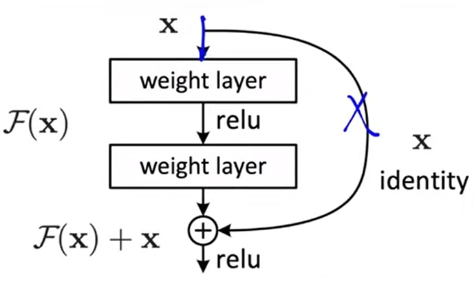

# Skip Connection: 왜 x + F(x)가 학습하기 쉬운가

작성일 2023-11-23
{ .post-date }

2023년 11월, PatchTST 프로젝트를 준비하면서 Transformer를 처음 공부할 때 쓴 노트다. [Transformer 강의](02-transformer-lecture-notes-1.md)를 듣다가 encoder에 residual connection이 쓰인다는 설명에서 "그래서 parameter는 무슨 역할을 하는가"라는 질문이 생겨, "[Legend 13] ResNet의 Skip-connection 제대로 이해하기!" 강의를 따로 보고 정리했다.

## Skip connection

Layer에 $x$가 들어와서 $F(x)$가 나가던 것을, $x + F(x)$가 나가도록 연결해 주는 것이 skip connection이다.

입력 $x$가 가는 길이 둘이다. 가운데로 내려가는 길은 weight layer 두 개를 지나 $F(x)$가 되고, 오른쪽으로 돌아가는 길(identity)은 아무것도 거치지 않은 $x$ 그대로다. 두 길이 아래의 ⊕에서 만나 $F(x) + x$가 된다. 출처: 강의 화면 (ResNet 논문 Figure 2에 강의자가 표시를 더한 것)

오른쪽으로 돌아가는 선이 skip connection이다. 가운데 길, 즉 weight layer 두 개와 그 사이의 ReLU가 하는 계산을 식으로 쓰면 다음과 같다.

$$
F(x) = \sigma(x W_1)\, W_2
$$

## 두 가지 방법의 비교

Layer에 들어온 $x$를 받아서 만들고 싶은 이상적인 출력을 $H(x)$라고 하자. 다음 두 방법을 비교한다.

- $H(x)$를 $F(x)$로 만들기
- $H(x)$를 $x + F(x)$로 만들기

비교해 보면 $H(x)$를 $x + F(x)$로 만드는 쪽이 더 쉽다. 왜 그런지를 보기 위해 $x$와 $H(x)$가 매우 비슷한 값이라고 가정한다. ResNet은 ReLU를 쓰므로 둘 다 양수라고 본다.

**Skip connection이 없을 때.** 위 그림에서 오른쪽으로 돌아가는 선을 지운 경우다. 가운데 길만으로 $x$에서 $H(x) \approx x$를 만들어야 하므로, weight matrix $W_1$, $W_2$가 둘 다 identity가 되어야 한다.

**Skip connection이 있을 때.** 돌아가는 선으로 이미 $x$가 더해지므로, 가운데 길의 $F(x)$는 0이 되어야 한다. 즉 weight matrix가 영행렬이 되면 된다.

여기서 중요한 것은 weight의 초깃값이다. Xavier, He, LeCun 가운데 어떤 초기화를 쓰든 평균이 0이고 표준편차가 매우 작다. 다시 말해 weight는 0에 가까운 값에서 출발한다. 그렇다면 skip connection 없이 weight matrix를 학습으로 identity에 가깝게 만드는 것보다, skip connection을 써서 0에 가까운 weight matrix를 그대로 쓰는 쪽이 훨씬 유리하다.

## 왜 H(x)가 x와 비슷하다고 보는가

여기서 질문이 하나 남는다. 만들고 싶은 것이 왜 $H(x) \approx x$인가.

- ResNet처럼 매우 깊은 네트워크라면, 입력에서부터 값을 차근차근 조금씩 바꿔 나가는 것이 이상적이다.
- 학습 데이터에 맞춰 값을 매우 빠르게 바꿔 나가는 layer가 있다면, 그것은 overfitting이 될 가능성이 있다. 일반화 성능이 부족할 수 있다.
- 그래서 ResNet은 잘 학습된 모델이라면 특정 layer의 입력과 출력이 크게 다르지 않을 것이라고 가정한다. 즉 $H(x)$는 $x$와 비슷하다고 가정한다.

그러므로 skip connection을 연결해 준다는 것은, 값의 변화가 그렇게 크지 않을 테니 layer 하나에서 모든 것을 하려고 하지 말고 값을 조금씩만 바꿔 나가라고 모델에게 귀띔해 주는 것이다. 여러 layer가 조금씩 힘을 합쳐 값을 바꿔 나가자는 의미가 된다. 강의에서는 이것을 ResNet의 저자 Kaiming He의 의도로 설명한다.

ResNet 논문도 layer 출력의 표준편차를 분석해, skip connection이 있는 네트워크는 layer의 출력이 작고 네트워크가 깊어질수록 더 작아진다는 것을 실험으로 보였다. 값을 계속 천천히 바꿔 나간다는 뜻이다.

## Residual learning

이렇게 차이(residual)를 학습한다고 해서 residual learning이라고 한다. 출력 $x + F(x)$와 입력 $x$의 차이, 즉 변화량 $F(x)$만 학습하면 된다.

예를 들어 기존에는 3을 받아서 3.1을 만들어 내야 했다면, 이제는 3에서 3.1로 가기 위한 변화량 0.1만 만들어 내면 된다. Weight가 처음부터 0 근처에 있으므로, 0에 가까운 변화량을 만드는 것은 매우 쉽다.

Transformer의 encoder와 decoder에서 attention과 feed-forward layer마다 residual connection을 두는 것도 같은 이유다. 각 sublayer는 입력을 통째로 새로 만드는 대신 입력에 더해질 변화량을 학습한다.

## 남았던 질문과 답

공부할 당시에는 풀지 못하고 남겨 둔 질문들이다. 글을 정리하면서 답을 찾아 덧붙였다.

**Q. Skip connection이 없을 때 weight matrix가 "identity가 되어야 한다"는 것은 identity matrix(단위행렬)를 말하는가.**

그렇다. $F(x) = \sigma(x W_1) W_2$에서 $W_1$과 $W_2$가 모두 단위행렬이면 $F(x) = \sigma(x)$가 되고, $x$가 양수이므로 ReLU를 지나도 값이 그대로여서 $F(x) = x$가 된다. 입력을 그대로 내보내려면 두 weight matrix를 단위행렬에 가깝게 학습시켜야 한다는 뜻이다. 0 근처에서 출발하는 weight가 단위행렬까지 가는 것보다, skip connection을 두고 0 근처에 머무는 쪽이 쉽다는 것이 이 글의 요점이다.

## 참고 자료

- "[Legend 13] ResNet의 Skip-connection 제대로 이해하기!" (YouTube). <https://www.youtube.com/watch?v=Fypk0ec32BU>
- K. He, X. Zhang, S. Ren, J. Sun, "Deep Residual Learning for Image Recognition", CVPR 2016. <https://arxiv.org/abs/1512.03385>
- 1년 뒤 ResNet 논문 리뷰 영상을 보고 다시 정리한 글: [ResNet: 깊은 네트워크를 학습시키는 residual learning](../ai-fundamentals/01-resnet.md)
