# Transformer 강의 정리 2: 병렬 처리로 본 Self-Attention, Encoder, Decoder

작성일 2023-11-23
{ .post-date }

2023년 11월, PatchTST 프로젝트를 준비하면서 Transformer를 처음 공부할 때 쓴 노트다. [첫 번째 강의 정리](02-transformer-lecture-notes-1.md)에 이어, 같은 내용을 다른 설명으로 한 번 더 보려고 허민석 님의 "트랜스포머 (어텐션 이즈 올 유 니드)" 강의를 보고 정리했다. 이 강의는 "I study at school"을 "난 학교에서 공부해"로 번역하는 예제 하나로 전체 과정을 따라가고, self-attention의 계산을 숫자로 보여 준다.

## Transformer는 왜 빠른가

Transformer는 어떻게 다른 모델보다 번역 속도가 빠르고 결과도 더 좋을 수 있었을까. RNN을 사용하지 않기 때문이다.

Transformer를 한 단어로 표현하면 <strong>parallelization(병렬화)</strong>이다. Transformer는 모든 과정을 최대한 한 번에 처리한다. RNN이 첫 번째 입력 단어부터 마지막 단어까지 순차적으로 계산해서 입력을 encoding하는 반면, Transformer는 이 과정을 한 번에 처리한다.

## Transformer 이전의 모델

**RNN 기반 encoder-decoder.** 가장 전통적인 encoder-decoder 모델이다.

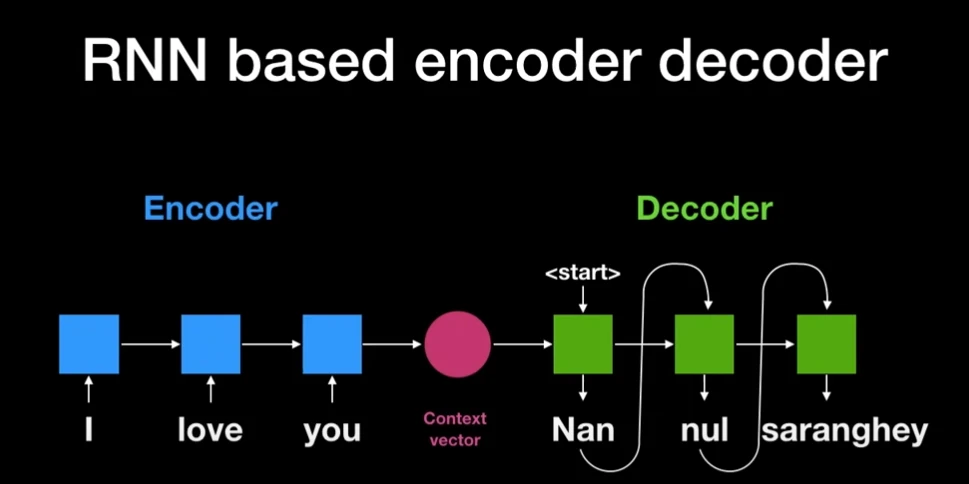

파란 encoder와 초록 decoder 사이를 붉은 원(context vector) 하나가 잇는다. 출처: 강의 화면

Encoder가 문장을 context vector 하나로 만들고 decoder가 여기서 번역을 시작한다. Context vector의 크기가 고정되어 있어서 긴 문장에는 적합하지 않다.

**Attention을 더한 RNN 기반 encoder-decoder.** 고정된 크기의 context vector를 쓰지 않고, 단어를 하나 번역할 때마다 encoder의 출력값에 attention mechanism을 적용해 동적으로 번역한다.

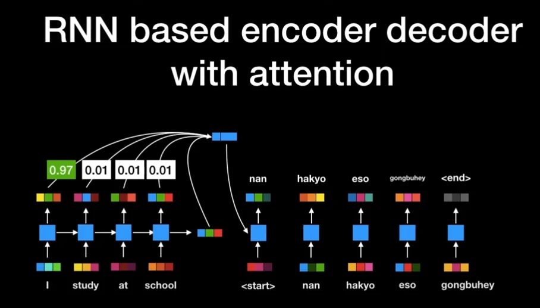

왼쪽 위의 숫자 네 개가 첫 단어 "nan(난)"을 만들 때 I, study, at, school의 state에 주어지는 가중치다. 네 state가 이 가중치로 합쳐져 decoder의 첫 cell로 들어간다. 출처: 강의 화면

그림의 예에서 첫 단어 "난"을 만들 때 encoder의 네 state에 주어지는 가중치는 0.97, 0.01, 0.01, 0.01이다. 고정된 context vector 대신 encoder의 모든 state를 활용하므로 긴 문장의 번역 성능이 좋아졌다. 이 과정은 [Seq2Seq + Attention 정리](01-seq2seq-attention.md)에 자세히 적었다.

하지만 이 모델도 그림 아래쪽의 파란 RNN cell들이 순차적으로 계산하므로 연산이 느리다는 단점이 남아 있었고, 성능을 높일 여지도 충분했다. 그래서 RNN을 대신할 빠르고 성능 좋은 방법을 찾게 되었고, "attention만으로도 입력에서 중요한 정보를 찾아 단어를 encoding할 수 있지 않을까"라는 생각에 이르렀다.

## Attention만으로 구성한 모델

Transformer는 RNN의 단점을 없애기 위해 encoder 층 자체를 attention으로 바꾼 형태다.

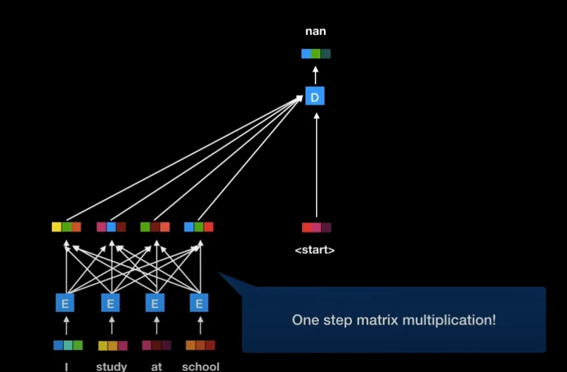

왼쪽 아래의 E가 encoder다. 앞 그림에서는 RNN cell이 옆으로 이어져 있었는데, 여기서는 네 단어가 서로 모두 화살표로 이어져 한꺼번에 계산된다("One step matrix multiplication!"). 출처: 강의 화면

입력을 처리하는 과정이 한 번의 행렬곱으로 끝난다. RNN처럼 단어를 하나씩 넘기는 것이 아니라, 한 번의 연산으로 모든 단어를 encoding한다.

Decoding은 위 그림에서 시작해 한 단어씩 진행된다. 위 그림이 첫 단계로, `<start>`가 들어가면 decoder(D)는 encoder의 출력 전체에 attention을 적용해 "난"을 출력한다.

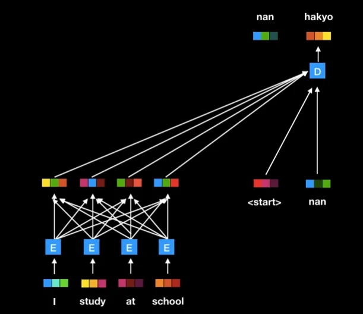

Decoder로 들어가는 화살표가 encoder의 출력 네 개와, 지금까지 나온 `<start>`, nan에서 온다. 출처: 강의 화면

두 번째 단계에서는 `<start>`, "난"이 들어가고, 지금까지 나온 단어들과 encoder의 출력에 attention을 적용해 "학교"를 출력한다.

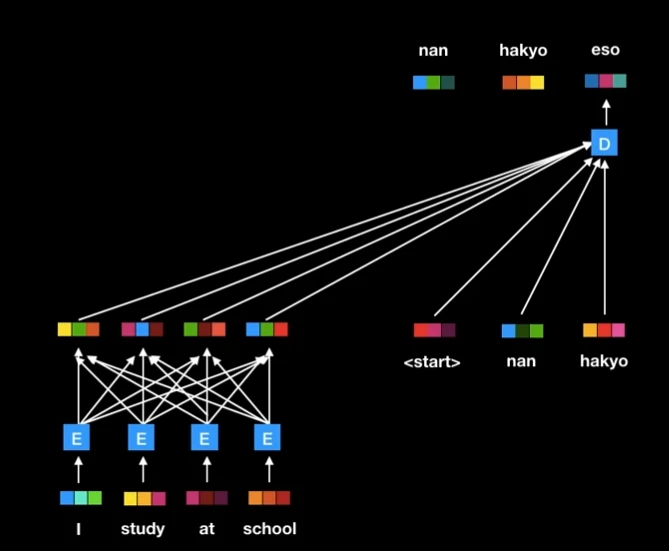

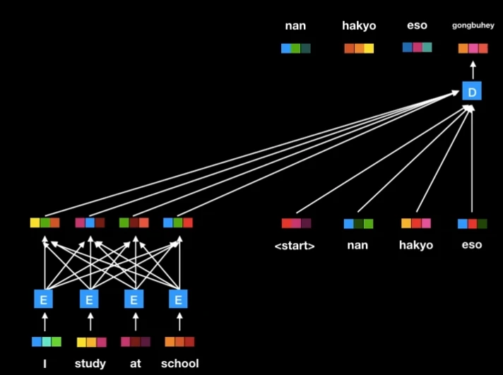

단계가 지날 때마다 decoder의 입력(오른쪽 아래)이 한 단어씩 늘어난다. Encoder 쪽(왼쪽)은 그대로다. 출처: 강의 화면

같은 방식으로 "에서", "공부해"를 차례로 출력한다.

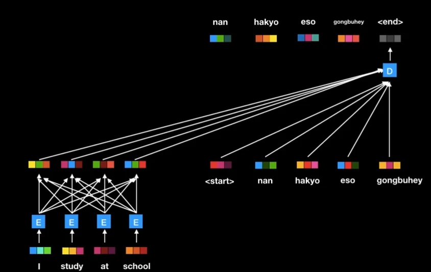

마지막 출력이 `<end>`다. 출처: 강의 화면

`<end>`가 나오면 끝난다.

이 과정을 보면 Transformer의 decoding이 attention 기반 encoder-decoder와 많이 닮아 있음을 알 수 있다. Transformer는 기존 encoder-decoder의 주요 개념을 간직하되, RNN을 없애서 학습 시간을 줄이고 attention 외에도 여러 기법을 더해 성능을 높인 모델이다.

## 순서 정보: Positional Encoding

RNN이 자연어 처리에 자주 쓰이는 이유는 단어의 위치와 순서 정보를 잘 활용하기 때문이다. RNN을 쓰지 않는 Transformer는 순서 정보를 어떻게 알 수 있을까.

Positional encoding은 encoder와 decoder의 입력값마다 상대적인 위치 정보를 더해 주는 기술이다.

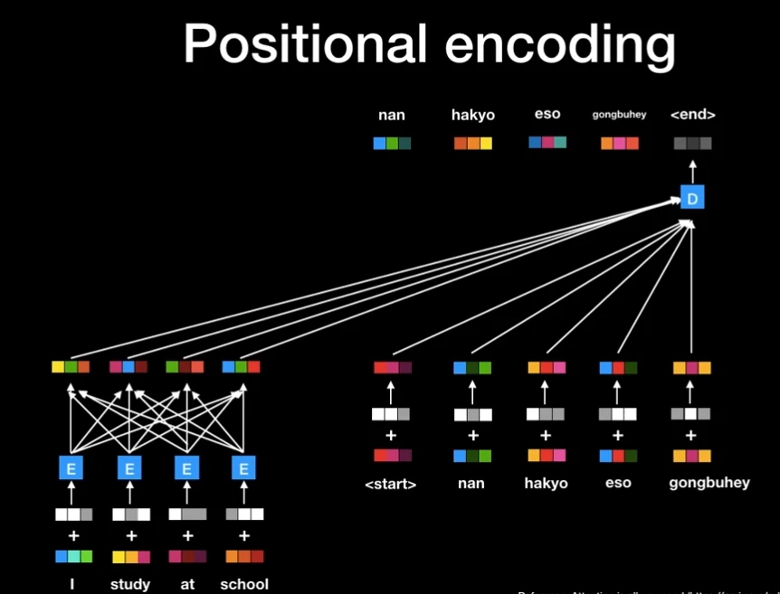

작은 상자 세 칸이 vector 하나다. 맨 아래의 색이 있는 상자가 단어의 embedding이고, 그 위에 "+"로 더해지는 흰색·회색 상자가 위치 정보다. 흰색·회색의 배열이 단어마다 다르다. 출처: 강의 화면

강의에서는 그림처럼 간단한 bit를 더하는 예를 든다. 첫 번째 단어 I에는 001, study에는 010, at에는 011, school에는 100을 더한다. 같은 방식으로 decoder의 입력(그림 오른쪽)에도 순서 정보를 넣는다.

이 예는 bit를 이용했지만, 실제 논문에서는 sine과 cosine 함수를 이용해 positional encoding을 만든다. 이 방식에는 두 가지 장점이 있다.

1. Encoding 값이 항상 -1과 1 사이에 있다.
2. 학습 데이터에서 가장 긴 문장보다 더 긴 문장이 들어와도 문제없이 positional encoding을 만들 수 있다.

## Self-Attention

Encoder에서 이루어지는 attention 연산을 **self-attention**이라고 한다. 앞의 그림들에서 encoder의 네 단어를 서로 잇던 화살표가 이것이다. 핵심 개념은 query, key, value 세 가지다.

### Query, Key, Value 만들기

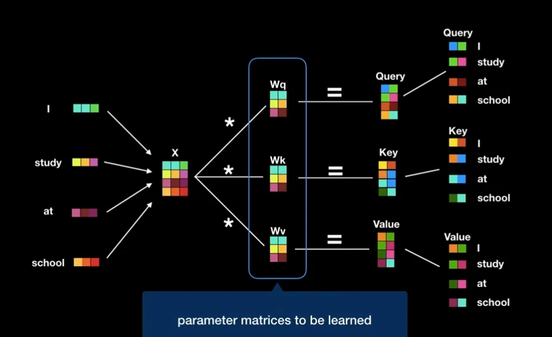

왼쪽에서 네 단어의 embedding이 한 행씩 쌓여 행렬 X가 되고, X에 가운데의 세 행렬을 각각 곱하면 오른쪽의 Query, Key, Value가 된다. 결과 행렬의 한 행이 단어 하나의 몫이다. 출처: 강의 화면

Query, key, value는 각각 행렬 $W_q$, $W_k$, $W_v$에 의해 만들어진다. 이 행렬들은 weight matrix이고, 그림 아래에 적힌 대로 학습 과정에서 최적화되는 parameter다. Word embedding 하나는 vector이고, 한 문장은 이 vector들을 쌓은 행렬 $X$다. 행렬은 행렬과 곱할 수 있으므로, 문장에 있는 모든 단어의 query, key, value를 한 번에 구할 수 있다.

$$
Q = X W_q, \qquad K = X W_k, \qquad V = X W_v
$$

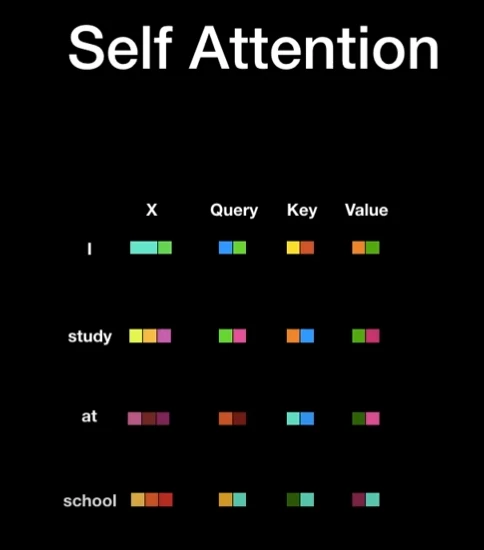

위 그림의 결과를 단어별로 다시 늘어놓은 것이다. 출처: 강의 화면

단어마다 query, key, value vector가 하나씩 있으면 self-attention을 수행할 수 있다.

### Attention score

지금부터는 단어 하나, "I"의 입장에서 계산을 따라간다.

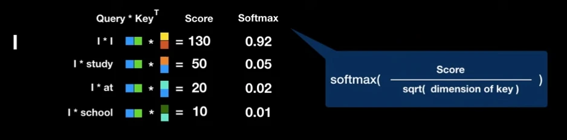

한 줄이 "I와 어떤 단어의 연관성"이다. I의 query(파랑·초록 두 칸)에 각 단어의 key를 곱한 값이 Score이고, 그것을 softmax로 바꾼 것이 오른쪽 열이다. 출처: 강의 화면

현재 단어가 query다. 어떤 단어와의 상관관계를 구할 때는 이 query를 그 단어의 key에 곱한다. Query와 key를 곱한 값을 **attention score**라고 한다. Query와 key는 둘 다 vector이므로 dot product로 곱하면 scalar가 나온다. 이 숫자가 클수록 단어와 단어 사이의 연관성이 크다. 그림에서 I · I는 130, I · study는 50, I · at은 20, I · school은 10이다.

Attention score에 softmax를 적용해 확률값으로 바꾼다. 논문에서는 softmax를 적용하기 전에 score를 key vector 차원의 제곱근으로 나눈다. Key vector의 차원이 커질수록 dot product의 값이 커지는 문제를 보완하기 위해서다.

$$
\mathrm{softmax}\!\left(\frac{\text{score}}{\sqrt{d_k}}\right)
$$

Softmax의 결과는 key에 해당하는 단어가 현재 단어와 어느 정도 연관이 있는지를 나타낸다. 그림의 값은 0.92, 0.05, 0.02, 0.01이고, I는 자기 자신과 92%의 연관을 갖는다.

### Value의 가중합

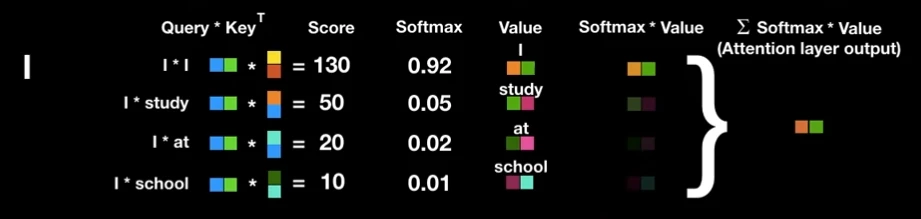

앞 그림의 오른쪽에 열이 세 개 더 붙었다. "Softmax * Value" 열에서 아래로 갈수록 색이 흐려지는 것과, 맨 오른쪽에 vector 하나만 남는 것을 보면 된다. 출처: 강의 화면

다음으로 각 확률값을 그 key에 해당하는 value에 곱한다. 연관성이 낮은 단어의 value는 값의 비중이 작아진다. 그림에서는 이것을 색이 흐려지는 것으로 표현한다. 0.92가 곱해진 I의 value는 색이 거의 그대로이고, 0.01이 곱해진 school의 value는 거의 보이지 않는다.

마지막으로 softmax × value의 값들을 모두 더한다. 이렇게 얻은 vector(그림 맨 오른쪽)는 더 이상 단어 I 하나가 아니라, 문장 전체에서 I가 가진 의미라고 볼 수 있다.

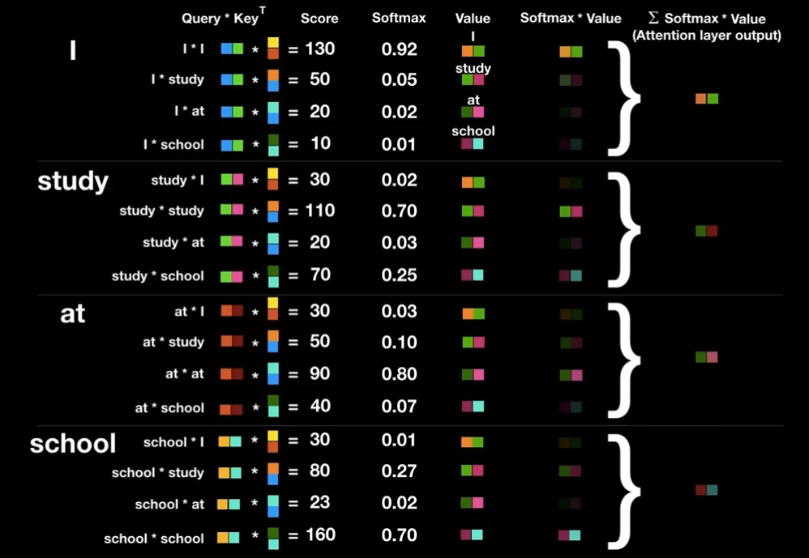

같은 계산이 네 단어 모두에 대해 이루어진다. 단어마다 가장 큰 softmax 값은 자기 자신에 주어져 있다(I 0.92, study 0.70, at 0.80, school 0.70). 출처: 강의 화면

이 계산은 study, at, school에 대해서도 똑같이 이루어지고, 행렬 연산이므로 모든 단어에 대한 self-attention을 한 번에 계산할 수 있다.

## Multi-Head Attention

Transformer는 병렬화를 더 적극적으로 활용한다. Attention layer 하나만 쓰는 것이 아니라 여러 개를 동시에 수행한다.

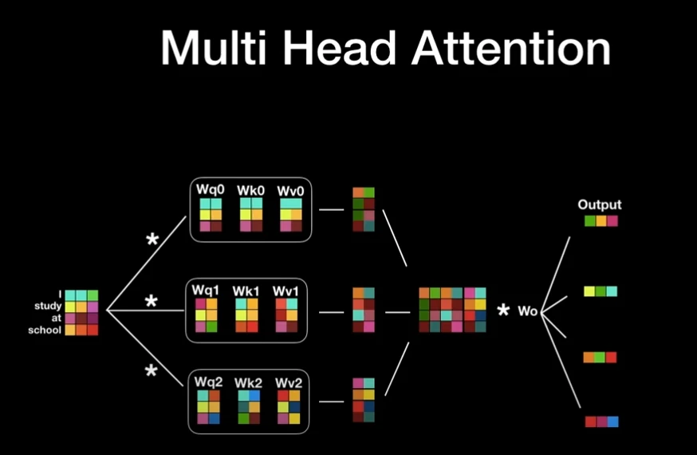

둥근 상자 하나가 attention layer 하나다. 같은 입력이 세 상자로 나뉘어 들어가고, 세 결과가 옆으로 이어 붙은 뒤 $W_o$가 곱해져 단어마다 vector 하나씩이 나온다. 출처: 강의 화면

그림은 세 개가 병렬로 처리되는 모습이지만 논문에서는 여덟 개를 쓴다. 상자마다 $W_{q0}, W_{k0}, W_{v0}$, $W_{q1}, W_{k1}, W_{v1}$처럼 번호가 다르게 붙어 있듯이, attention layer마다 $W_q$, $W_k$, $W_v$가 따로 있다. 이렇게 병렬로 처리되는 attention layer를 **multi-head attention**이라고 한다.

여러 개를 병렬로 두어서 얻는 이점은 무엇일까. 강의는 다음 문장을 예로 든다.

> The animal didn't cross the street because it was too tired.

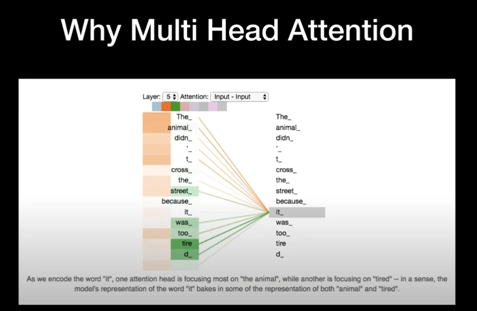

오른쪽의 it에서 왼쪽 단어들로 선이 뻗어 있다. 주황색 선과 초록색 선이 서로 다른 attention head이고, 선과 칸의 색이 진할수록 그 단어에 더 focus한다. 출처: 강의 화면

여기서 it은 무엇을 가리키는가. 문장이 모호할 때는 서로 다른 두 attention이 it과 연관성이 높은 서로 다른 단어에 focus한다. 그림에서는 주황색 attention이 "the animal"에, 초록색 attention이 "tired"에 focus하고 있다. 사람의 문장은 모호할 때가 많고, attention 하나로는 모호한 문장을 충분히 encoding하기 어렵다. Multi-head attention은 연관된 정보를 여러 관점에서 수집해 이 점을 보완한다.

## Encoder

지금까지 본 조각들을 이으면 encoder layer 하나가 된다.

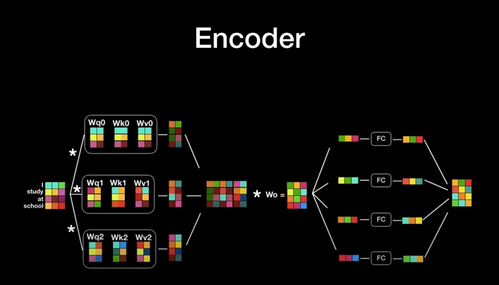

왼쪽 절반이 앞에서 본 multi-head attention이고, 오른쪽 절반에서 단어마다 FC(fully connected layer)를 하나씩 거친다. 맨 왼쪽의 입력 행렬과 맨 오른쪽의 출력 행렬의 크기가 같다. 출처: 강의 화면

1. 단어를 word embedding으로 바꾸고 positional encoding을 더한다.
2. Multi-head attention에 넣는다. 각 attention에서 나온 결과를 모두 이어 붙이고, 또 다른 행렬 $W_o$를 곱해서 처음의 word embedding과 같은 차원의 vector로 만든다.
3. 각 단어의 vector는 따로 fully connected layer를 거쳐, 입력과 같은 크기의 vector로 출력된다.

여기에 두 가지가 더 붙는다.

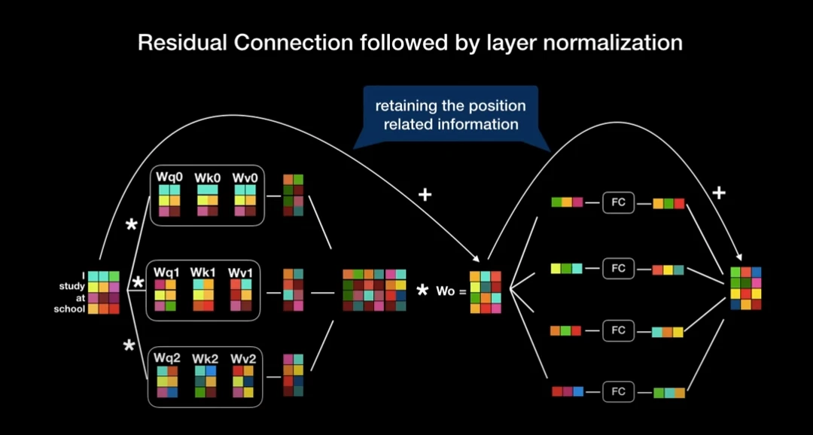

위쪽으로 돌아가는 곡선 두 개가 residual connection이다. 하나는 multi-head attention을, 다른 하나는 FC를 건너뛰어 입력을 그대로 더한다("+"). 출처: 강의 화면

- **Residual connection.** Word embedding에 positional encoding을 더해 주었는데, 이 위치 정보는 층을 거치며 학습하는 동안 손실될 수 있다. 이를 보완하기 위해 residual connection으로 입력값을 한 번 더 더해 준다. 그림의 말풍선("retaining the position related information")이 이 뜻이다. Residual connection은 multi-head attention과 fully connected layer에 각각 하나씩 있다. ([Skip Connection 정리](03-skip-connection.md))
- **Layer normalization.** Residual connection 뒤에 layer normalization을 적용해 학습의 효율을 높인다.

여기까지가 encoder layer 하나다. 무엇보다 중요한 것은 **encoder layer의 입력 vector와 출력 vector의 차원이 같다**는 점이다. 그래야 encoder layer를 여러 개 이어 붙일 수 있다.

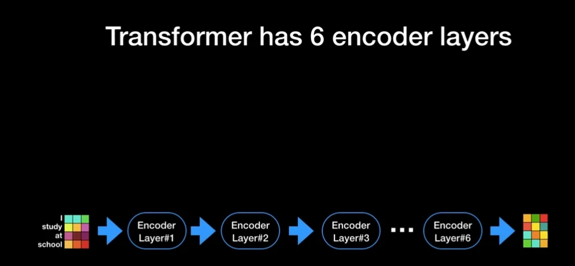

한 layer의 출력이 그대로 다음 layer의 입력이 된다. 출처: 강의 화면

Transformer는 실제로 encoder layer 여섯 개를 이어 붙인 구조다. 여섯 layer는 weight를 공유하지 않고, layer마다 고유한 weight를 갖는다.

## Decoder

Decoder는 encoder와 상당히 비슷하게 생겼고, encoder처럼 여섯 개의 layer로 이루어져 있다.

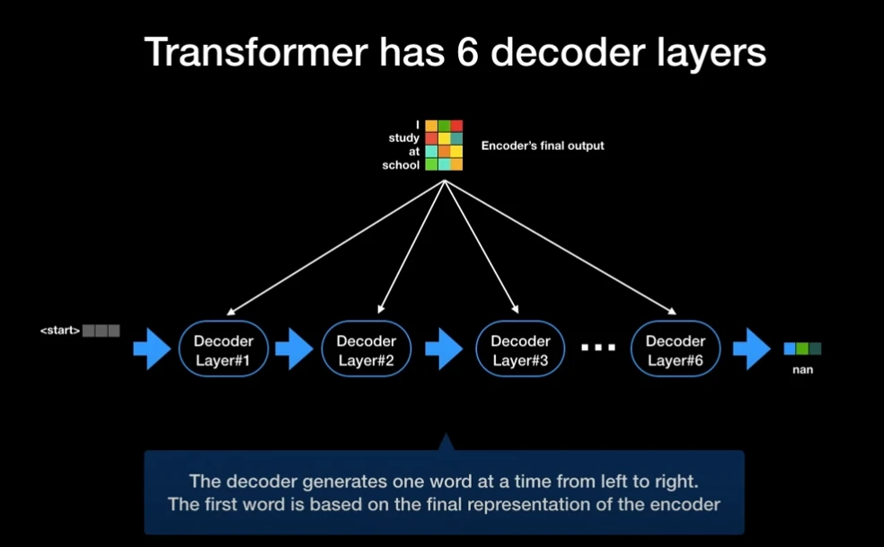

위의 행렬이 encoder의 최종 출력이고, 여기서 나온 화살표가 decoder layer마다 하나씩 들어간다. 왼쪽에서 `<start>`가 들어가 오른쪽에서 "nan"이 나온다. 출처: 강의 화면

기존 encoder-decoder와 같이 첫 단어부터 끝 단어까지 순차적으로 단어를 출력한다. Encoder의 최종 출력은 여섯 decoder layer 모두에 전달된다.

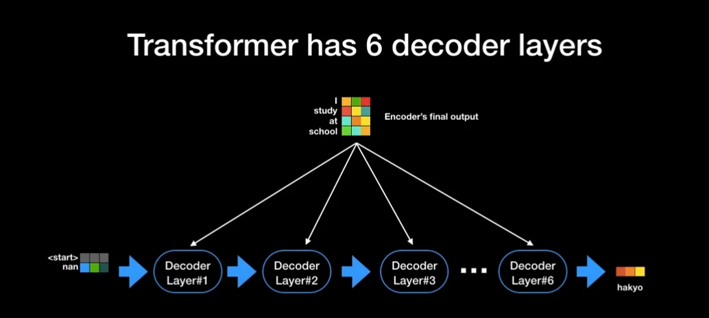

다음 단계에서는 입력이 `<start>`, nan 두 줄로 늘어나고 "hakyo"가 나온다. 출처: 강의 화면

Decoder도 attention의 병렬 처리를 적극적으로 활용한다. Decoder에서는 지금까지 출력된 값들에 attention이 적용되고, encoder의 최종 출력에도 attention이 적용된다.

Layer 하나의 안쪽을 encoder와 나란히 놓고 비교하면 차이가 보인다.

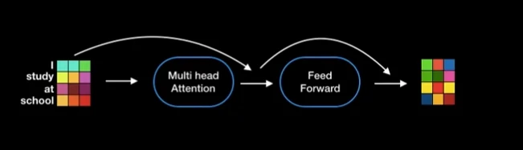

Encoder layer다. 상자가 둘이고, 상자마다 위로 돌아가는 residual connection이 하나씩 있다. 출처: 강의 화면

Encoder layer는 multi-head attention과 feed forward로 이루어지고 각각에 residual connection이 붙는다.

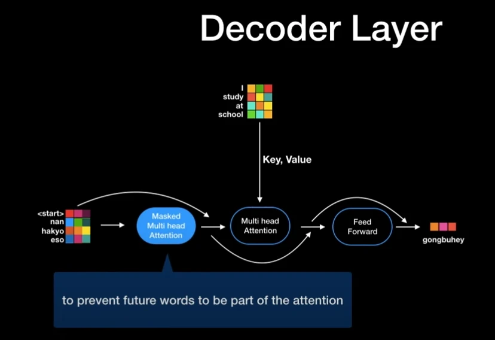

Decoder layer다. 상자가 셋으로 늘었고, 가운데 상자에는 위에서 encoder의 출력이 Key, Value로 들어온다. 파랗게 칠한 첫 번째 상자가 masked multi-head attention이다. 출처: 강의 화면

Decoder layer도 구조가 비슷하지만 다음 점이 다르다.

1. **Masked multi-head attention.** 첫 번째 층이다. Masked라는 이름이 붙은 이유는, 지금까지 출력된 값들에만 attention을 적용하기 위해서다. 그림의 말풍선대로 아직 나오지 않은 뒤쪽 단어가 attention에 포함되지 않도록 가린다.
2. **Multi-head attention.** 두 번째 층도 query, key, value 연산을 하지만, encoder의 multi-head attention과 달리 **decoder의 현재 입력값을 query로, encoder의 최종 출력값을 key와 value로** 사용한다. Decoder의 현재 상태를 query로 삼아 encoder에 질문하는 것이고, encoder의 출력에서 중요한 정보를 key와 value로 얻어 다음에 올 가장 적합한 단어를 출력하는 과정이다.
3. **Feed forward.** 마지막으로 feed forward layer를 거쳐 최종값을 vector로 출력한다.

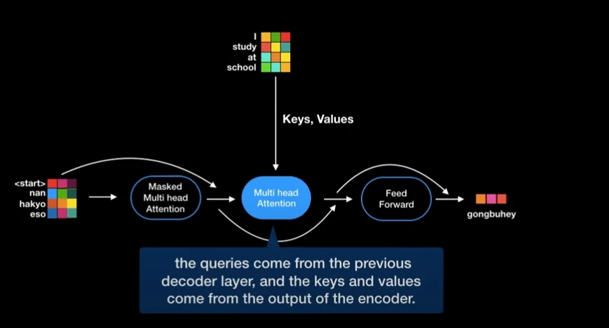

이번에는 가운데 상자가 칠해져 있다. 왼쪽에서 들어오는 화살표가 query이고, 위에서 내려오는 화살표가 encoder의 출력에서 온 key와 value다. 출처: 강의 화면

## 출력 vector를 단어로 바꾸기

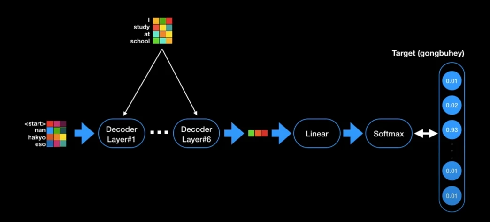

Decoder Layer#6에서 나온 vector가 Linear, Softmax를 차례로 지나고, 그 출력이 오른쪽의 목표값(Target, 여기서는 "gongbuhey")과 비교된다. 출처: 강의 화면

Decoder의 출력 vector를 단어로 바꾸기 위해 끝에 linear layer와 softmax layer가 있다.

- **Linear**: softmax에 들어갈 logit을 만든다.
- **Softmax**: 모델이 알고 있는 모든 단어에 대한 확률을 출력한다.

### Label smoothing

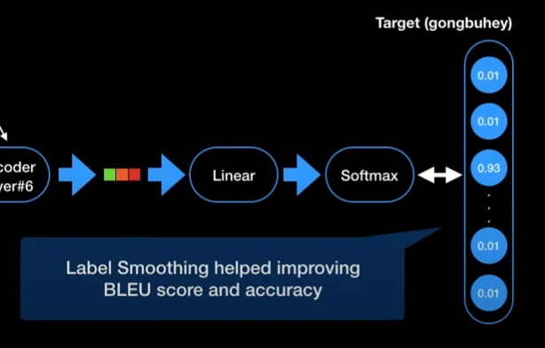

오른쪽 목표값의 원 안에 적힌 숫자를 보면 된다. 정답 단어의 자리가 1이 아니라 0.93이고, 나머지 자리도 0이 아니라 0.01이다. 출처: 강의 화면

Transformer는 학습할 때 label smoothing을 써서 성능을 끌어올린다. 보통 softmax로 학습할 때는 label을 one-hot encoding으로 바꾼다. Transformer는 정답 위치를 1, 나머지를 0으로 두지 않고, 정답에는 1에 가까운 값을, 나머지에는 0에 가까운 값을 준다. 그림에서는 정답 단어의 목표값이 0.93이고 나머지는 0.01, 0.02 같은 값이다. 모델이 학습 데이터에만 지나치게 맞춰지지 않도록 보완하는 기술이다.

Label smoothing이 어떻게 학습에 도움이 될까. 학습 데이터가 매우 깔끔하고 예측할 값이 확실한 경우에는 도움이 안 될 수도 있다. 하지만 label이 noisy한 경우, 즉 같은 입력에 대해 서로 다른 출력이 학습 데이터에 많은 경우에는 큰 도움이 된다.

학습은 결국 softmax의 출력과 vector로 바꾼 label의 차이를 줄이는 것이다. 같은 데이터에 서로 다른 정답이 one-hot encoding으로 존재하면, 모델의 parameter가 커졌다 작아졌다를 반복하면서 학습이 원활하지 않게 된다.

예를 들어 "Thank you"라는 문장 두 개가 학습 데이터에 있는데, 하나의 label은 "고마워요"이고 다른 하나의 label은 "감사합니다"일 수 있다. 두 데이터 모두 틀린 것이 아니다. 하지만 one-hot encoding을 적용하면 "고마워요"와 "감사합니다"는 완전히 다른 두 vector가 되고, "Thank you"에 대한 학습은 label이 서로 달라 잘 진행되지 않을 수 있다. Label smoothing을 적용하면 두 vector 사이의 차이가 조금 줄어들어 학습이 더 효율적으로 이루어진다.

## 남았던 질문과 답

공부할 당시에는 풀지 못하고 남겨 둔 질문들이다. 글을 정리하면서 답을 찾아 덧붙였다.

**Q. "Word embedding은 vector이고 한 문장은 행렬"이라는 말이 이해되지 않았다. 왜 문장이 행렬이고, 그래서 query, key, value를 한 번에 구할 수 있다는 것인가.**

단어 하나의 embedding은 길이가 $d_{model}$인 vector다. 단어가 $n$개인 문장은 이 vector를 한 행에 하나씩 쌓은 것이므로 $n \times d_{model}$ 크기의 행렬 $X$가 된다. 이 행렬에 $W_q$를 곱하면 결과의 $i$번째 행은 $i$번째 단어의 embedding에 $W_q$를 곱한 것, 즉 그 단어의 query다. 단어마다 따로 곱할 필요 없이 행렬곱 한 번으로 모든 단어의 query가 나오고, key와 value도 마찬가지다. 같은 내용을 [첫 번째 강의 정리](02-transformer-lecture-notes-1.md)에서는 단어 3개, embedding 4차원인 예로 크기를 하나씩 따져 보았다.

## 참고 자료

- Minsuk Heo 허민석, "트랜스포머 (어텐션 이즈 올 유 니드)" (YouTube). <https://www.youtube.com/watch?v=mxGCEWOxfe8>
- A. Vaswani, N. Shazeer, N. Parmar, J. Uszkoreit, L. Jones, A. N. Gomez, Ł. Kaiser, I. Polosukhin, "Attention Is All You Need", NeurIPS 2017. <https://arxiv.org/abs/1706.03762>
- 나중에 원 논문을 다시 읽고 정리한 글: [Attention Is All You Need 리뷰](../../papers/2025-01-06-attention-is-all-you-need.md)
