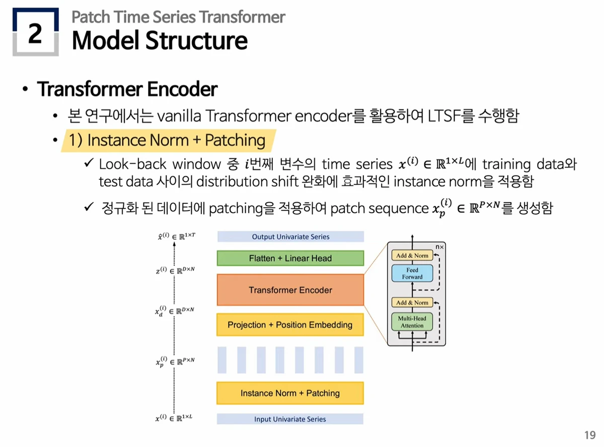
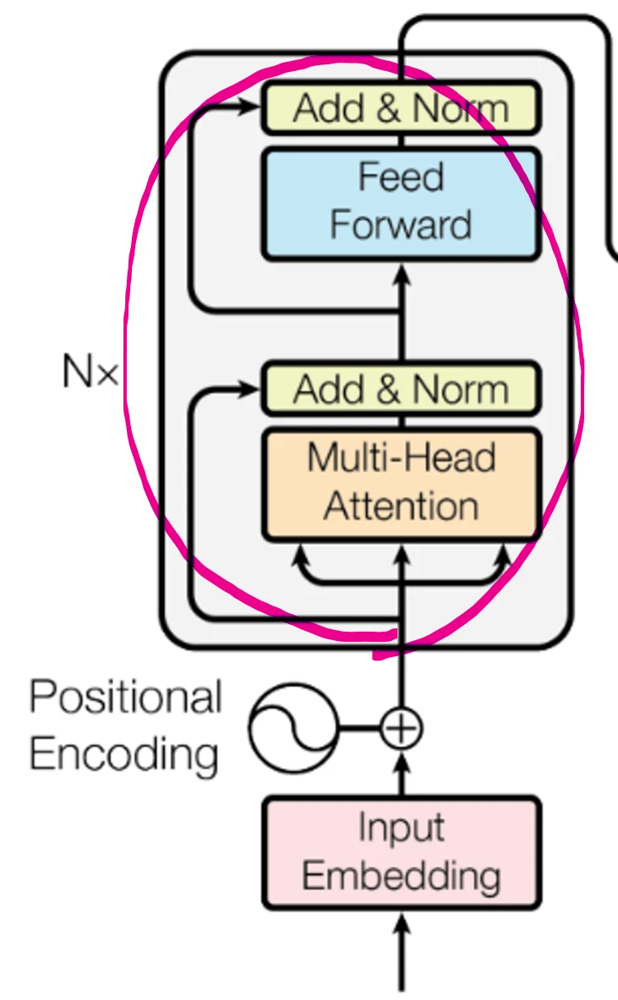
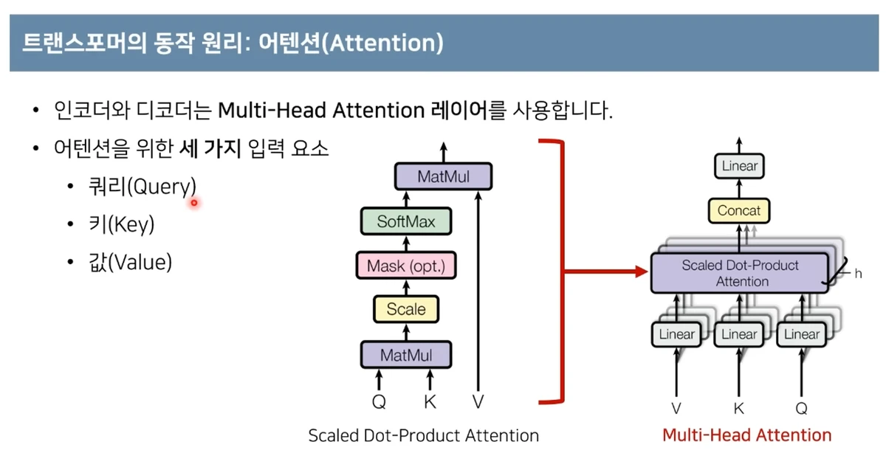

# PatchTST의 forward 과정 따라가기

작성일 2023-11-25
{ .post-date }

[PatchTST 공식 코드 분석](05-patchtst-code-analysis.md)에서 모델이 어떤 클래스들로 구성되는지를 읽은 뒤, 입력 하나가 모델 안에서 실제로 어떤 순서로 처리되는지를 `forward()` 호출을 따라가며 정리한 기록이다. 클래스가 여러 겹으로 감싸져 있어서, 어느 클래스의 `forward()`가 어느 클래스를 부르는지를 순서대로 적었다.

호출 순서를 먼저 요약하면 다음과 같다.

```
Model.forward
└─ PatchTST_backbone.forward        정규화, patching, 역정규화
   ├─ TSTiEncoder.forward           projection, 위치 encoding
   │  └─ TSTEncoder.forward         encoder layer 반복
   │     └─ TSTEncoderLayer.forward attention, feed-forward
   │        └─ _MultiheadAttention.forward
   │           └─ _ScaledDotProductAttention.forward
   └─ Flatten_Head.forward          예측 생성
```

## 시작점: Model 클래스

forward의 시작점은 `PatchTST.py`에 있는 `Model` 클래스의 `forward()`이다. 분해(decomposition) 옵션이 켜져 있으면 입력을 추세와 나머지로 나눠 `model_trend`와 `model_res`에 각각 넣고 두 결과를 더한다. 꺼져 있으면 `model` 하나에 입력을 그대로 넣는다.

여기서 모델 객체에 데이터를 넣는 것만으로 안쪽의 계산이 차례로 실행되는 이유는, `nn.Module`을 상속받은 클래스의 객체를 `model(x)`처럼 호출하면 그 클래스에 정의된 `forward()`가 실행되기 때문이다. 가장 바깥에서 `model(x)`를 호출하는 것은 `Model`의 `forward()`를 실행하는 것과 같고, 그 안에서 조건에 따라 다른 module의 `forward()`가 이어서 실행된다. 이 부분은 [PyTorch 기본](06-pytorch-nn-module.md)에 따로 정리했다.

## PatchTST_backbone

`PatchTST_backbone`의 `forward()`가 하는 일은 아래 구조도를 아래에서 위로 한 번 올라가는 것이다.



가운데 구조도의 맨 아래(Input Univariate Series)가 입력이고 맨 위(Output Univariate Series)가 예측이다. 그 사이의 상자들을 아래에서부터 차례로 지난다. 오른쪽의 회색 상자는 주황색 Transformer Encoder의 안쪽을 펼친 것이다. 출처: PatchTST를 소개하는 발표 슬라이드 (구조도는 PatchTST 논문 Figure 1)

코드로는 네 단계다.

1. **Instance normalization.** RevIN을 쓰도록 설정되어 있으면 입력을 정규화한다. 구조도의 노란 상자 "Instance Norm + Patching"의 앞 절반이다.
2. **Patching.** 설정한 patch 길이와 stride에 따라 실제 patch를 만든다. 같은 상자의 뒤 절반이고, 그 위의 세로 막대들이 만들어진 patch다.
3. **모델.** patch를 backbone인 `TSTiEncoder`에 넣고, 그 출력을 head에 넣는다. "Projection + Position Embedding"부터 "Flatten + Linear Head"까지다.
4. **Denormalization.** RevIN을 썼다면 출력을 원래 scale로 되돌린다.

아래 절들은 3번의 안쪽을 한 겹씩 들어간다.

## TSTiEncoder

구조도의 "Projection + Position Embedding" 상자에 해당한다. `TSTiEncoder`는 patch에 선형 projection(`W_P`)을 적용하고 위치 encoding(`W_pos`)을 더한 다음, dropout을 거쳐 encoder에 넣는다.

## TSTEncoder

encoder는 `TSTEncoder`이고, 실질적인 attention이 여기서 수행된다. 보관하고 있는 `TSTEncoderLayer` 객체들을 for 문으로 돌면서 하나씩 호출한다. `res_attention`을 쓰는 경우와 쓰지 않는 경우로 나뉘는데, 쓰는 경우에는 각 layer가 돌려준 attention score를 다음 layer에 넘겨준다.

## TSTEncoderLayer

`TSTEncoderLayer`는 Transformer encoder의 layer 하나이다.



분홍색 선으로 두른 부분이 `TSTEncoderLayer` 하나다. 아래에서 위로 Multi-Head Attention, Add & Norm, Feed Forward, Add & Norm 순서이고, 왼쪽으로 돌아 올라가는 화살표 두 개가 residual connection이다. 출처: "Attention Is All You Need" 논문 Figure 1의 일부에 직접 표시한 것

이 블록이 layer 수만큼(그림의 "N×") 만들어져 `TSTEncoder`에 보관되어 있다. `forward()`의 코드는 이 그림을 아래에서 위로 올라가는 순서 그대로이고, 아래쪽 절반(Multi-Head Attention과 Add & Norm)과 위쪽 절반(Feed Forward와 Add & Norm)의 두 sublayer로 나뉜다.

**Multi-Head Attention sublayer** (그림의 아래쪽 절반)

1. `if self.pre_norm:` 참이면 attention에 넣기 전에 `norm_attn`을 적용한다.
2. `if self.res_attention:` 참일 때와 거짓일 때 서로 다른 방식으로 `self_attn`을 호출한다. 참이면 이전 layer의 score를 함께 넘기고 이번 layer의 score를 돌려받는다. 여기까지가 Multi-Head Attention이다.
3. `if self.store_attn:` 참이면 attention 가중치를 저장해 둔다.
4. `src + self.dropout_attn(src2)`: 입력(residual connection)과 attention의 출력을 더한다. 그림의 Add & Norm에서 "Add"에 해당한다.
5. `if not self.pre_norm:` 앞에서 정규화하지 않았다면 여기서 `norm_attn`을 적용한다. "Norm"에 해당한다.

**Feed-forward sublayer** (그림의 위쪽 절반)

1. `if self.pre_norm:` 참이면 feed-forward에 넣기 전에 `norm_ffn`을 적용한다.
2. `self.ff(src)`: position-wise feed-forward를 진행한다.
3. `src + self.dropout_ffn(src2)`: 입력(residual connection)과 feed-forward의 출력을 더한다.
4. `if not self.pre_norm:` 앞에서 정규화하지 않았다면 여기서 `norm_ffn`을 적용한다.
5. `res_attention`을 쓰면 출력과 score를 함께 돌려주고, 아니면 출력만 돌려준다.

`pre_norm`은 정규화를 attention과 feed-forward의 앞에서 할지 뒤에서 할지를 정하는 옵션이다. 참이면 각 sublayer에 들어가기 전에 정규화하고, sublayer를 나온 뒤에는 정규화하지 않는다. 기본값은 거짓이어서, 그림처럼 residual을 더한 뒤에 정규화한다(Add & Norm).

## MultiheadAttention

입력으로부터 Query, Key, Value를 만들고 self-attention을 계산하는 부분이다. 위 그림의 주황색 Multi-Head Attention 상자 하나의 안쪽이고, 그 안쪽을 그린 것이 아래 그림이다.



오른쪽이 `_MultiheadAttention`, 왼쪽이 그 안에서 불리는 `_ScaledDotProductAttention`이다. 오른쪽 그림 아래의 Linear 세 개가 Query, Key, Value를 만들고, 위의 Concat과 Linear가 head들의 결과를 합친다. 출처: [첫 번째 Transformer 강의](02-transformer-lecture-notes-1.md)의 슬라이드 (구조도는 "Attention Is All You Need" 논문 Figure 2)

오른쪽 그림 아래의 Linear 세 개가 코드에서는 다음 세 줄이다.

```python
self.W_Q = nn.Linear(d_model, d_k * n_heads, bias=qkv_bias)
self.W_K = nn.Linear(d_model, d_k * n_heads, bias=qkv_bias)
self.W_V = nn.Linear(d_model, d_v * n_heads, bias=qkv_bias)
```

Query, Key, Value를 만드는 linear layer가 하나씩 있다. 각 layer의 출력 차원이 `d_k * n_heads`여서, 한 번의 행렬곱으로 모든 head의 Query(또는 Key, Value)를 한꺼번에 만든 다음 head 수만큼 잘라서 쓴다. 이렇게 만든 Query, Key, Value로 여러 head의 scaled dot-product attention을 수행한다. 이 계산은 `nn.Module`을 상속받은 `_ScaledDotProductAttention` 클래스가 맡는다.

## ScaledDotProductAttention

위 그림의 왼쪽을 아래에서 위로 올라가는 순서다. 괄호 안이 그림의 상자 이름이다.

1. 전달받은 Query와 Key를 행렬곱해 attention energy를 구한다. (MatMul)
2. 여기에 scale을 곱한다. softmax에 큰 값이 들어가 gradient가 사라지는 것을 막기 위한 것이다. (Scale)
3. 이전 layer의 attention score를 더하는 옵션이 있다. 이전 score가 전달되면 더해 준다. 그림에는 없는 단계다.
4. attention mask가 주어지면 score에 적용한다. (Mask)
5. softmax를 적용해 attention 가중치를 구하고, attention dropout을 적용한다. (SoftMax)
6. attention 가중치와 Value를 행렬곱해 attention value를 구한다. (맨 위의 MatMul)

3번은 `res_attention`이 켜져 있을 때 두 번째 layer부터 동작한다. 첫 layer에는 넘겨받을 이전 score가 없다. 4번의 mask는 기본 설정에서 주어지지 않으므로 쓰이지 않는다.

head별로 구해진 attention value를 이어 붙이면 입력과 같은 차원(`d_model`)이 된다. 마지막으로 linear layer를 한 번 더 거쳐 내보낸다. 그림 오른쪽 위의 Concat과 Linear다.

`d_model`이 embedding의 열 크기, 즉 patch 하나를 나타내는 벡터의 차원이라는 점을 기억해 두면 차원을 따라가기 쉽다.

## Flatten과 Head

encoder의 출력은 head로 들어간다. 처음에 본 PatchTST 구조도에서 Transformer Encoder 바로 위의 초록 상자 "Flatten + Linear Head"다. `pretrain_head`가 참이면 사전학습용 head를 쓰고, `head_type`이 `flatten`이면 `Flatten_Head`를 쓴다. 기본은 `flatten`이다. `Flatten_Head`는 Flatten, Linear, Dropout을 차례로 거쳐 최종 예측을 만든다.

## 남았던 질문과 답

공부할 당시에는 풀지 못하고 남겨 둔 것이다. 글을 정리하면서 답을 찾아 덧붙였다.

**Q. forward 과정에서 tensor의 shape은 어떻게 바뀌는가.**

당시에는 "이후에 shape을 확인해 봐야 한다"고만 적어 두었다. 공식 코드의 주석을 따라 정리하면 다음과 같다. `bs`는 batch 크기, `nvars`는 변수의 수이다.

| 위치 | 연산 | shape |
|---|---|---|
| `Model` | 입력 | `[bs, seq_len, nvars]` |
| `Model` | permute | `[bs, nvars, seq_len]` |
| `PatchTST_backbone` | RevIN 정규화 | `[bs, nvars, seq_len]` |
| `PatchTST_backbone` | padding | `[bs, nvars, seq_len + stride]` |
| `PatchTST_backbone` | unfold(patching) | `[bs, nvars, patch_num, patch_len]` |
| `TSTiEncoder` | `W_P`(projection) | `[bs, nvars, patch_num, d_model]` |
| `TSTiEncoder` | reshape | `[bs * nvars, patch_num, d_model]` |
| `TSTiEncoder` | `W_pos`를 더하고 dropout | `[bs * nvars, patch_num, d_model]` |
| `TSTEncoder` | encoder layer 반복 | `[bs * nvars, patch_num, d_model]` |
| `TSTiEncoder` | reshape, permute | `[bs, nvars, d_model, patch_num]` |
| `Flatten_Head` | flatten | `[bs, nvars, d_model * patch_num]` |
| `Flatten_Head` | linear | `[bs, nvars, pred_len]` |
| `PatchTST_backbone` | RevIN 역정규화 | `[bs, nvars, pred_len]` |
| `Model` | permute | `[bs, pred_len, nvars]` |

encoder에 들어가기 직전에 batch와 변수 차원을 하나로 합치는 reshape가 channel-independence에 해당한다. encoder 입장에서는 변수 하나하나가 서로 다른 sample이 되고, 같은 가중치가 모든 변수에 쓰인다.

attention 안에서는 Query와 Value가 `[bs * nvars, n_heads, patch_num, d_k]`, Key가 `[bs * nvars, n_heads, d_k, patch_num]`이 되고, Query와 Key를 곱한 score는 `[bs * nvars, n_heads, patch_num, patch_num]`이다. patch끼리의 연관성을 head마다 구한 것이다.

## 참고 자료

- Y. Nie, N. H. Nguyen, P. Sinthong, J. Kalagnanam, "A Time Series is Worth 64 Words: Long-term Forecasting with Transformers", ICLR 2023. <https://arxiv.org/abs/2211.14730>
- PatchTST 공식 구현. <https://github.com/yuqinie98/PatchTST>
- R. He, A. Ravula, B. Kanagal, J. Ainslie, "RealFormer: Transformer Likes Residual Attention", 2020. <https://arxiv.org/abs/2012.11747>
