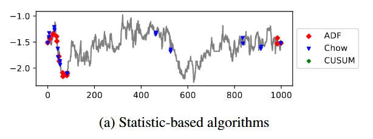
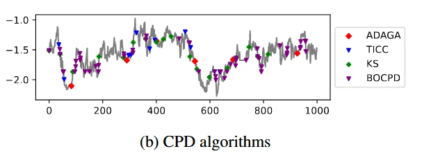
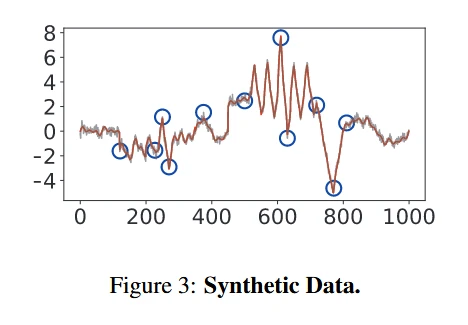
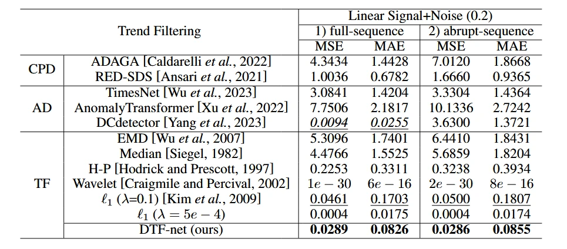
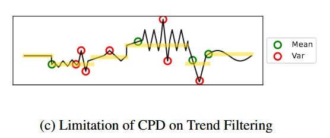
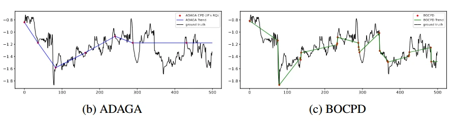
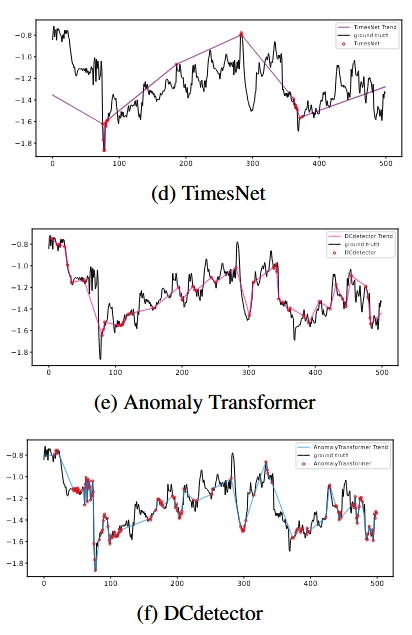

# Change point detection 개요

작성일 2025-02-18 · 최종 수정일 2025-03-19
{ .post-date }

DTF-net은 trend filtering 논문이지만, 추세가 급격히 변하는 지점을 찾는다는 점에서 change point detection(CPD)으로도 읽을 수 있다. 실제로 논문은 CPD 알고리즘들과 성능을 비교하고, 부록에서 관련 방법들을 정리한다. CPD에 대한 배경 지식이 전혀 없어 그 부분이 이해되지 않았기 때문에, change point가 무엇이고 어떤 방법들이 있는지를 정리했다.

이 글은 개별 알고리즘을 깊이 다루지 않는다. 대부분 DTF-net 논문의 관련 연구와 부록에 나온 설명을 따라가며 정리한 지도에 가깝다. 대표적인 방법인 BOCPD는 [논문 리뷰](../../papers/2025-02-25-bocpd.md)에서 따로 다뤘다.

## Change point란

Change point는 시계열에서 통계적 성질이 변하는 지점 또는 위치다. 통계적 성질에는 평균, 분산, 추세, 분포가 모두 포함된다. 바뀌는 대상에 따라 다음과 같이 나눌 수 있다.

| 종류 | 내용 |
|---|---|
| Mean shift | 데이터의 평균이 갑자기 오르거나 내린다 |
| Variance shift | 데이터가 퍼진 정도(variability)가 갑자기 바뀐다 |
| Distribution shift | 확률 분포 자체가 바뀐다. 평균이나 분산만이 아니라 분포의 모양, 즉 왜도(skewness), 첨도(kurtosis), 최빈값, 확률 밀도의 변화까지 포함한다. KL divergence 등으로 확인한다 |

따라서 CPD 알고리즘은 distribution shift를 잡아내는 데 집중한다. 데이터를 만드는 분포(underlying distribution)가 바뀌지 않는다면, 즉 정상(stationary)이라면 앞으로의 값을 다루기 쉽다. 그러나 현실의 데이터가 정상인 경우는 거의 없고, 그래서 분포가 바뀌는 지점을 찾는 일이 필요해진다. 경제학에서는 이 문제를 회귀 모형에 적용한 structural break가 오래 연구되어 왔다. Structural break는 대체로 mean shift나 variance shift를 가리키는 말로 쓰인다.

### 변화가 일어나는 방식에 따른 구분

Change point를 변화가 일어나는 속도와 지속 기간으로 나누는 설명도 있다.

| 종류 | 변화가 일어나는 방식 | 변화 뒤 |
|---|---|---|
| Structural break | 갑자기 | 오래 지속된다 |
| Abrupt change | 갑자기 | 짧게 지속되고 원래의 통계적 특성으로 돌아온다 |
| Gradual change | 점진적으로 | 오래 지속된다 |

이 구분은 [2편](02-extreme-value-and-abrupt-change.md)에서 정리한 DTF-net 논문의 abrupt change와 뜻이 다르다. 논문의 abrupt change는 기울기가 바뀐 뒤 그 방향이 이어지는 지점이었는데, 이 표에서는 짧게 지속되고 돌아오는 변화다. 같은 말이 자료마다 다르게 쓰인다는 것을 이때 처음 알았고, 용어 사이의 관계는 [4편](04-change-point-terms.md)에서 다시 정리했다.

### Abrupt change와 change point

DTF-net 논문은 abrupt change를 추세의 기울기가 급격히 변하는 지점으로 정의한다. 그렇다면 trend는 기울기에 가까운 말인가 하는 생각이 들었다. "추세"라는 말 자체가 얼마나 오르고 내리는가를 뜻하므로 그렇게 볼 수 있다. 이 관점에서 abrupt change를 찾는다는 것은 기울기에 변화가 생기는 지점을 찾는 것이다.

Change point를 통계적 성질이 변하는 지점이라고 하면, abrupt change도 change point다. 다만 abrupt change는 급격한 변화만을 가리키고, change point는 완만한 변화까지 포함해 통계적 성질이 변하는 모든 지점을 가리킨다. 그래서 change point가 abrupt change를 포함하는 개념이라고 정리했다.

## Offline과 online

CPD 방법은 데이터를 어떻게 쓰느냐에 따라 둘로 나뉜다.

- **Offline**: 전체 데이터가 이미 주어진 상태에서 분석한다. 과거부터 현재까지의 모든 데이터를 한 번에 사용해 변화 지점을 찾는다.
- **Online**: 데이터가 순차적으로 들어오는 상황에서, 지금까지의 데이터만으로 분석한다. 새 데이터가 도착할 때마다 모델을 갱신하며 실시간으로 변화를 감지한다. 빠른 적응과 낮은 지연이 필요하다. 연산 비용은 낮지만 정확도가 떨어질 수 있다.

정리하다가 든 의문은 "online 방식도 과거 데이터를 가지고 있는데, 왜 전체 데이터를 쓰지 않는다고 하는가"였다. 찾은 답은 다음과 같다.

1. **계산량**: 새 데이터가 들어올 때마다 전체 데이터를 다시 계산하면 연산 비용이 빠르게 커진다. 그래서 최근 데이터만 참고하거나 압축된 정보만 유지하면서 갱신한다.
2. **메모리**: 실시간 시스템에서는 모든 데이터를 저장해 두고 매번 다시 분석하기 어렵다. 최근 데이터나 중요한 통계량만 유지한다.
3. **목표의 차이**: offline은 모든 데이터를 보고 가장 정확한 결과를 내는 것이 목표이고, online은 가능한 한 빨리 변화를 감지하는 것이 목표다.

## 방법의 분류

DTF-net 논문이 다루는 방법들을 계열별로 정리했다. 한계는 논문이 지적한 내용이다.

| 계열 | 방법 | 방식 | 한계 |
|---|---|---|---|
| 통계적 검정 | Chow, ADF, CUSUM | 통계량(F-value)을 기준으로 그 지점이 structural break인지 판정한다 | 입력 길이에 민감하고, 임계값을 경험적으로 정해야 한다 |
| 확률적 (Bayesian) | BOCPD | change point 발생에 대한 확률 분포를 유지하면서 새 데이터가 들어올 때마다 갱신한다 | 표본 사이의 시간적 상관을 고려하지 않는다. hyperparameter에 민감하다 |
| Segmentation | KS test 기반 segmentation | 두 표본 집합이 같은 누적 분포에서 나왔는지 검정한다 | offline 탐지만 가능하다 |
| Segmentation | RED-SDS | switching behavior로 시계열의 동역학을 이해하려는 지도 학습 방법이다 | 올바른 change point에 대한 label이 필요하다 |
| Clustering | TICC | 군집으로 묶인 구간마다 sparse한 Gaussian inverse covariance 행렬을 만든다 | 군집의 수를 hyperparameter로 미리 정해야 한다. 사전 지식이 필요하고 정해진 수의 change point만 찾는다 |
| GP, Bayesian | ADAGA | Gaussian process의 kernel로 평균과 공분산 구조를 정한다 | kernel의 종류에 민감하다. 이것도 사전 지식이다 |

표만으로는 각 방법이 실제로 어떤 지점을 고르는지 감이 오지 않는다. 논문은 같은 시계열에 여러 방법을 돌려 고른 지점을 그림으로 보여 준다. 먼저 통계적 검정이다.

*회색 선이 시계열이고, 표식이 세 검정(ADF 빨강, Chow 파랑, CUSUM 초록)이 고른 지점이다. 지점이 앞쪽 100 이전에 몰려 있고 나머지는 띄엄띄엄 흩어져 있다. 출처: DTF-net 논문 Figure 6(a)*

논문은 이 방법들이 offline 방식이라는 점을 한계로 든다. 시점을 옮겨 가며 앞뒤 두 구간을 비교하는데, 알고리즘마다 자기 규칙에 따라 지점을 고르기 때문에 위 그림처럼 불규칙한 지점들이 나온다. 한곳에 몰린 점과 드문드문 떨어진 점을 이어서는 회색 선의 굴곡을 따라가는 추세를 만들기 어렵다. 각 검정의 내용은 [4편](04-change-point-terms.md)에 정리했다.

다음은 CPD 알고리즘들이다.

*같은 시계열에 ADAGA(빨강), TICC(파랑), KS(초록), BOCPD(보라)를 적용한 결과다. 통계적 검정보다 지점이 고르게 퍼져 있지만, 방법마다 고르는 위치와 개수가 다르다. 출처: DTF-net 논문 Figure 6(b)*

논문에 따르면 이 그림은 ETTh1 데이터셋에서 CPD 알고리즘들이 탐지한 지점을 보여 주며, 이들이 주로 잡는 것은 평균이 바뀌는 지점(mean shift)이다. 이 점이 왜 문제가 되는지는 아래의 "CPD는 왜 trend filtering을 대신하지 못하는가"에서 다룬다.

계열별로 몇 가지 덧붙인다.

- **Segmentation**: 구간 단위로 나누는 방법은 구간 안에 있는 중요한 change point를 놓칠 수 있다. 구간 안은 모두 같은 분포라고 보기 때문일 것이라고 이해했다.
- **GP 기반 방법**: Gaussian process는 mean-square differentiable한 함수로 매끄러움을 근사하기 때문에, 매끄럽지 않은 변화(non-smoothness)를 잡아내는 데 한계가 있다.

노트에는 CPD를 접근 방식에 따라 둘로 나눈 정리도 남아 있다. 출처는 적어 두지 않았다.

- **통계적(Bayesian) 추론**: change point의 확률을 계산한다. BOCPD는 run length를 이용해 change point를 순차적으로 찾는다. 통계적 오차 한계(error bound)를 주지 않고 hyperparameter에 민감하다는 한계가 있다.
- **가설 검정**: 통계적 검정으로 change point의 존재를 판정하고 오류 확률을 준다. maximum mean discrepancy로 대표되는 two-sample test, kernel Fisher discriminant ratio, CUSUM 같은 likelihood ratio test가 있다.

### KS test

Segmentation에서 쓰이는 Kolmogorov-Smirnov(KS) test는 두 표본이 같은 분포에서 나왔는지를 판단하는 비모수적 검정이다.

- 귀무가설: 두 표본은 같은 분포에서 나왔다.
- 대립가설: 두 표본은 서로 다른 분포에서 나왔다.

검정은 누적 분포 함수(CDF)를 비교한다. CDF는 확률 변수 $X$가 특정 값 이하일 확률이다.

$$
F(x) = P(X \le x)
$$

CDF는 확률 밀도 함수를 적분한 것이므로, $x$가 커질수록 1에 가까워지고 $x$가 작아질수록 0에 가까워진다. KS test는 두 표본의 CDF $F_X$, $F_Y$가 가장 크게 벌어지는 정도를 통계량으로 삼는다.

$$
D = \sup_x \lvert F_X(x) - F_Y(x) \rvert
$$

$D$가 기준값보다 크면 귀무가설을 기각해 두 표본이 다른 분포에서 나왔다고 판단하고, 작으면 같은 분포에서 나왔다고 본다.

## CPD는 왜 trend filtering을 대신하지 못하는가

DTF-net 논문은 합성 데이터 실험에서 CPD와 anomaly detection(AD) 알고리즘을 trend filtering 방법들과 함께 비교하고, 두 계열이 trend filtering에는 적합하지 않다고 결론 내린다.

먼저 실험이 무엇을 재는지부터 본다. Trend filtering 방법을 정량적으로 비교하기는 어렵다. 실제 데이터에서는 진짜 추세가 무엇인지 알 수 없고, 어디가 abrupt change인지 label을 붙이기도 어렵기 때문이다. 그래서 논문은 정답을 아는 합성 신호를 직접 만든다.

{ width="460" }

*점 1,000개로 된 합성 신호. 파란 원 11개가 일부러 넣은 abrupt change다. 100과 800 부근에서 값이 -2, -5 근처로 급락하고, 500에서 700 사이에서는 평균이 0에서 4로 옮겨 가며 분산이 커지고, 800부터 1000까지는 sine 한 주기가 이어진다. 여기에 표준편차 0.2의 Gaussian 노이즈를 더했다. 출처: DTF-net 논문 Figure 3*

각 방법이 뽑은 추세가 이 신호에 얼마나 가까운지를 MSE와 MAE로 잰다. 시퀀스 전체(full-sequence)에서 한 번, abrupt change가 있는 구간(abrupt-sequence)만 떼어서 한 번 잰다.

*행은 방법으로, 위에서부터 CPD, AD, trend filtering(TF) 계열이다. 왼쪽 두 열이 전체 시퀀스, 오른쪽 두 열이 abrupt change 구간의 오차다. CPD 계열의 MSE가 1.0에서 7.0 사이인 반면 맨 아래 DTF-net은 0.03 안팎이라는 점, 그리고 DCdetector의 MSE가 전체 시퀀스에서는 0.0094로 작지만 abrupt 구간에서는 3.63으로 커진다는 점을 보면 된다. 출처: DTF-net 논문 Table 1*

표에서 CPD 계열(ADAGA, RED-SDS)의 오차는 HP filter(MSE 0.23 안팎)나 DTF-net보다 훨씬 크다. AD 계열도 DCdetector의 전체 시퀀스 값을 빼면 마찬가지다. 즉 이 방법들이 고른 지점으로 만든 추세는 원본에서 멀다. TF 계열 안에서도 차이가 있다. EMD와 Median은 추세가 과도하게 매끄러워 오차가 크고, Wavelet과 $\lambda$가 작은 $\ell_1$은 오차가 0에 가깝지만 이는 노이즈까지 따라간(overfit) 결과다.

CPD와 AD의 결과는 처음에는 납득되지 않았다.

> CPD는 abrupt change, structural break, gradual change를 모두 포함하는 change point를 찾는 방법이다. 그렇다면 abrupt change를 찾아 추세를 만드는 일에서도 어느 정도는 성능이 나와야 하지 않는가?

논문의 설명을 따라가며 정리한 답은 다음과 같다.

**CPD가 찾는 지점.** 핵심은 아래 그림 한 장에 담겨 있다. 한 시계열 안에는 성격이 다른 두 종류의 지점이 있다.

{ width="520" }

*노란 띠가 구간별 평균 수준이다. 초록 원(Mean)은 평균 수준이 한 띠에서 다음 띠로 넘어가는 길목, 곧 변화의 중간 지점(midpoint)이다. 빨간 원(Var)은 값이 뾰족하게 솟거나 꺼지는 꼭짓점(vertex)이다. 출처: DTF-net 논문 Figure 6(c)*

확률 기반 CPD 알고리즘은 평균이 바뀌는 구간에서 주로 초록 원, 곧 변화의 중간 지점을 찾는다. 급격한 변화가 시작되는 빨간 원은 평균이 아니라 분산의 흔들림(variance perturbation)으로 드러나는 지점인데, 확률 기반 알고리즘은 이를 잘 감지하지 못한다. extreme value는 outlier로 취급해 버린다.

**그 결과.** 추세를 원본에 가깝게 그리려면 선이 꺾여야 하는 곳은 빨간 원이다. CPD가 찾은 초록 원들만 선형 보간해 추세를 만들면 꼭짓점이 빠져 있으므로 추세가 과도하게 매끄러워진다. 논문은 BOCPD와 ADAGA가 실제로 mean shift의 중간 지점을 중심으로 잡는다는 것을 아래 그림으로 보인다.

*검은 선이 원본, 빨간 점이 알고리즘이 고른 지점, 색 선이 그 점들을 직선으로 이은 추세다. 왼쪽 ADAGA는 고른 점이 적어 300 이후가 수평선 하나로 뭉개진다. 오른쪽 BOCPD는 점이 더 많지만 280 부근의 봉우리와 370 부근의 골처럼 뾰족한 곳을 선이 가로질러 지나간다. 출처: DTF-net 논문 Figure 7(b), (c)*

**AD가 찾는 지점.** Anomaly detection은 extreme value를 잡아낸다는 점에서 DTF-net의 목표와 닮은 면이 있다. 그러나 이상한 점을 지나치게 많이 골라내고, distribution shift의 중간 지점은 잡지 못한다. 논문이 비교한 방법은 TimesNet, Anomaly Transformer, DCdetector다.

{ width="520" }

*위에서부터 논문의 (d) TimesNet, (e) Anomaly Transformer, (f) DCdetector 패널이다. 맨 위는 극단적인 점 몇 개만 골라 추세가 원본과 크게 벌어지고, 아래 두 패널은 빨간 점을 훨씬 촘촘하게 고른다. 가운데 패널의 선은 80 부근의 깊은 골과 280 부근의 봉우리를 지나친다. 논문 그림에서 (e)와 (f)는 패널 제목과 범례의 이름이 서로 엇갈려 있다. 출처: DTF-net 논문 Figure 7(d), (e), (f)*

TimesNet은 복잡한 패턴에 집중하는 탓에 지나치게 극단적인 이상치만 골라낸다. Anomaly Transformer는 Gaussian kernel의 매끄러움 때문에 abrupt change를 제대로 잡지 못한다. DCdetector는 위 표에서 본 것처럼 전체 시퀀스 기준으로는 잘 동작하지만 abrupt change가 있는 구간만 놓고 평가하면 성능이 낮다.

논문은 이를 한 문장으로 정리한다.

> In summary, while anomaly detection algorithms often miss crucial mid-points of changes, CPD algorithms may overlook essential change points in variance shifts.

이 설명을 읽고 정리한 생각은 두 가지다.

첫째, change point를 찾는 것과 추세를 만드는 것은 같은 일이 아니다. CPD도 변화 지점을 찾지만, 그 지점들을 이었을 때 원본에 가까운 추세가 된다는 보장은 없다. Trend filtering에서는 원본과의 근접성이 먼저 지켜져야 하고, 논문의 합성 데이터 실험도 이 근접성을 기준으로 방법들을 비교한 것이다.

둘째, 국소적으로 보면 extreme value 안에는 노이즈와 abrupt change가 섞여 있다. DCdetector 같은 방법은 그 구분 없이 극단값을 모두 걸러내므로, abrupt change가 있는 구간에서 성능이 낮게 나온다.

그러면 abrupt change는 variance shift에 가까운 것인가 하는 질문도 생겼다. 오르내리는 폭이 커졌다가 다시 돌아오는 것이 abrupt change의 모습이라면, variance shift에 의해 유도된다고 보는 것이 맞겠다고 생각했다.

## 남았던 질문과 답

공부할 당시에는 풀지 못하고 남겨 둔 질문들이다. 글을 정리하면서 답을 찾아 덧붙였다.

**Q. BOCPD는 change point가 일어났을 확률을 내놓을 뿐, 지점을 확정해서 알려 주지는 않는다. 다른 방법과 비교할 때는 어떤 기준으로 지점을 정하는가?**

BOCPD가 매 시점 내놓는 것은 run length의 posterior $P(r_t \mid x_{1:t})$이고, 여기서 지점을 뽑는 규칙은 쓰는 사람이 정한다. 먼저 알아 둘 점은 "지금 막 change point가 일어났을 확률" $P(r_t = 0 \mid x_{1:t})$에 임계값을 거는 방법은 쓸 수 없다는 것이다. Hazard가 상수 $H$이면 이 값은 데이터와 무관하게 항상 $H$다. 재귀식에서 $r_t = 0$으로 가는 항은 모든 $r_{t-1}$에 대해 $P(r_{t-1}, x_{1:t-1})\,\pi_t\,H$를 더한 것이고 evidence는 같은 것을 $H$ 없이 더한 것이어서, 나누면 $H$만 남는다. 새 관측 하나만으로는 run이 방금 끊겼는지 알 수 없다는 뜻이다. 그래서 흔히 쓰는 규칙은 두 가지다.

- **MAP run length.** $\hat{r}_t = \arg\max_r P(r_t = r \mid x_{1:t})$를 따라간다. 변화가 없으면 $\hat{r}_t$가 매 시점 1씩 늘고, 변화가 있으면 몇 시점 뒤에 작은 값으로 떨어진다. 떨어진 시점에서 $t - \hat{r}_t$를 change point의 위치로 삼는다.
- **지연을 둔 임계값.** 작은 $k \ge 1$을 정해 $P(r_t = k \mid x_{1:t})$, 곧 "$k$시점 전에 change point가 있었을 확률"이 임계값을 넘는 시점을 찾는다.

이렇게 정한 지점을 다른 방법의 결과나 정답과 비교할 때는 허용 오차 범위 안에 들어오면 맞힌 것으로 세어 precision, recall, F1을 계산하는 방식이 일반적이다. 어느 규칙과 임계값을 썼는지에 따라 결과가 달라지므로 비교할 때는 이를 함께 밝혀야 한다. DTF-net 논문의 경우 합성 데이터의 수치 비교(Table 1)에 들어간 CPD 방법은 ADAGA와 RED-SDS이고, BOCPD는 부록의 그림에서만 비교된다. 그 그림에서 지점을 정한 기준은 논문에서 찾지 못했다.

**Q. 가설 검정을 Gaussian process와 결합한 CPD는 어떤 방식인가?**

기본 구조는 두 가설의 비교다. 관측 구간에 대해 "하나의 GP에서 나왔다"(변화 없음)와 "어느 시점을 경계로 평균이나 공분산 구조가 다른 GP에서 나왔다"(변화 있음)를 세우고, 각 가설 아래에서 데이터의 가능도를 GP의 marginal likelihood로 계산해 그 비율을 검정 통계량으로 쓴다. 통계량이 임계값을 넘으면 변화가 있다고 판정하며, 임계값은 허용할 오탐 확률에 맞춰 정한다. GP를 쓰는 이유는 표본 사이의 시간적 상관을 kernel로 모델에 넣을 수 있기 때문이다. 표본이 독립이라고 가정하는 검정은 상관이 있는 시계열에서 변화가 없어도 변화로 판정하기 쉽다. 그 대가로 kernel을 정해야 하고 결과가 그 선택에 좌우된다. 본문의 표에서 ADAGA의 한계로 적은 것이 이것이다. ADAGA 논문은 자신의 방법을 가설 검정에 바탕을 둔 GP 기반 방법으로, 평균과 공분산 구조의 변화 모두에 적응하는 것으로 소개한다.

**Q. CUSUM은 구체적으로 무엇을 계산하는가?**

이름 그대로 누적 합이다. 평균이 $\mu_0$에서 위로 옮겨 가는 변화를 찾는 기본형은 다음과 같다.

$$
S_0 = 0, \qquad S_t = \max\big(0,\; S_{t-1} + (x_t - \mu_0 - k)\big), \qquad S_t > h \text{이면 변화로 판정}
$$

$k$는 이 정도의 초과는 무시하겠다는 여유분이고 $h$는 임계값이다. 평균이 그대로이면 괄호 안이 평균적으로 음수라 $S_t$가 0 근처에 머물고, 평균이 올라가면 초과분이 쌓여 $S_t$가 계속 커진다. $\mu_0 = 0$, $k = 0.5$, $h = 2$로 두고 $x = (0.2,\ -0.3,\ 0.1,\ 1.4,\ 1.6,\ 1.2)$를 넣어 손으로 계산하면 $S = (0,\ 0,\ 0,\ 0.9,\ 2.0,\ 2.7)$이다. 여섯 번째 시점에서 임계값을 넘고, $S_t$가 마지막으로 0이었던 세 번째 시점 다음, 곧 네 번째 시점을 변화의 시작으로 추정한다. 변화가 일어난 뒤 판정까지 두 시점이 더 걸린 것이 탐지 지연이다. [4편](04-change-point-terms.md)에서 structural break 검정으로 다루는 CUSUM은 같은 생각을 회귀에 적용한 것이다. 관측값 대신 회귀의 잔차를 누적하고, 계수가 일정하면 누적 합이 0 주변의 경계 안에 머문다는 것을 이용한다.

### 아직 남은 질문

- CUSUM을 비롯한 검정 기반 방법을 실제 데이터에 돌려 보지는 못했다. 위의 계산은 손으로 만든 예시다.
- ADAGA가 쓰는 검정 통계량과 구간을 조정하는 규칙의 세부는 논문을 직접 읽어 확인해야 한다. 위의 설명은 GP 기반 검정의 일반적인 구조다.

## 참고 자료

- "Towards Dynamic Trend Filtering through Trend Point Detection with Reinforcement Learning", IJCAI 2024. 관련 연구와 부록 A. <https://arxiv.org/abs/2406.03665>
- R. P. Adams, D. J. C. MacKay, "Bayesian Online Changepoint Detection", 2007. <https://arxiv.org/abs/0710.3742>
- Change point의 종류를 설명한 블로그 글: <https://direction-f.tistory.com/117>
- E. Caldarelli, P. Wenk, S. Bauer, A. Krause, "Adaptive Gaussian Process Change Point Detection", ICML 2022. (ADAGA)
- A. F. Ansari 외, "Deep Explicit Duration Switching Models for Time Series", NeurIPS 2021. (RED-SDS)
