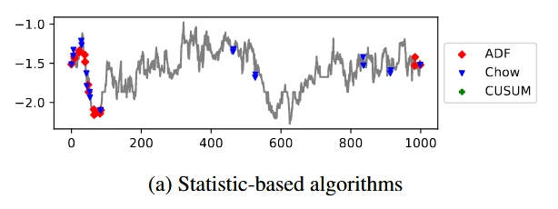
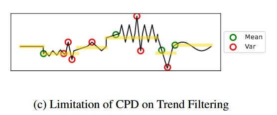

# Structural break, regime change, change point, abrupt change

작성일 2025-03-18 · 최종 수정일 2025-03-23
{ .post-date }

시계열에서 "무언가 바뀌는 지점"을 가리키는 말은 여러 개다. DTF-net 논문만 해도 structural break point, change point, abrupt change를 함께 쓴다. [3편](03-change-point-detection-overview.md)까지 공부하면서도 이 말들이 같은 것을 가리키는지, 다르다면 어떻게 다른지가 계속 헷갈렸다. 이 글은 네 용어의 정의를 하나씩 정리하고, structural break를 검정하는 고전적인 방법들을 정리한 뒤, 마지막으로 trend filtering이 말하는 abrupt change와 change point detection이 말하는 abrupt change가 어떻게 다른지를 정리한 노트다.

## 네 용어의 정의

먼저 결론부터 적는다. 공부한 뒤 정리한 정의는 다음과 같다.

| 용어 | 정의 | 바뀌는 대상 |
|---|---|---|
| Structural break | 시계열에서 예상치 못한 변화가 생기는 지점. 특히 회귀 모형의 계수가 급격히 바뀌는 지점 | 회귀 계수 |
| Change point | 시계열의 통계적 특성, 즉 데이터를 sampling하는 parameter에 변화가 생기는 지점 | 분포의 parameter |
| Regime change | 특정 시점이나 구간을 기준으로 데이터의 생성 메커니즘이 바뀌는 현상 | 생성 메커니즘 |
| Abrupt change | 시계열의 추세에서 급격한 변화가 생기는 경우 | 추세의 기울기 |

다만 이 말들은 문헌마다 조금씩 다르게 쓰인다. [3편](03-change-point-detection-overview.md)에서 본 것처럼 abrupt change를 "짧게 지속되고 원래 상태로 돌아오는 변화"로 설명하는 자료도 있다. 아래의 정의는 여러 자료를 읽고 내가 정리한 것이다.

## Structural break

Structural break는 회귀 모형에서 시간에 따라 생기는, 예상치 못한 parameter의 변화다. 데이터가 추가되면서 회귀 계수가 갑자기 달라지는 경우다. 계수가 바뀌면 예측이 크게 틀어지므로, 모형의 구조적 안정성을 점검할 필요가 있다.

검정 방법은 무엇을 알고 있고 무엇을 모르는지에 따라 달라진다.

| 상황 | 검정 |
|---|---|
| break가 하나이고 시점을 안다 (평균의 변화) | Chow test |
| 계수가 일정한지 확인한다 | CUSUM, CUSUM-sq, bounds test |
| break의 수와 시점을 모른다 | sup-Wald, sup-LM, sup-LR |
| break가 여러 개다 | Bai-Perron (2003) |
| 평균과 분산의 break를 함께 본다 (시점을 안다) | MZ test (2010) |
| 평균과 분산의 break를 함께 본다 (시점을 모른다) | sup-MZ test (2016) |
| 공적분 모형에서의 break | Gregory-Hansen (1996), Hatemi-J (2006), Maki (2012) |

### Chow test

선형 회귀를 바탕으로 한 지점에서의 break를 검정한다. 전체 기간 $[1, T]$ 안의 시점 $K$를 기준으로 데이터를 $[1, \dots, K]$와 $[K+1, \dots, T]$로 나누고, 두 구간에서 추정한 회귀 계수가 같은지를 검정한다.

Chow test는 break가 어디서 생겼는지를 미리 알고 있어야 쓸 수 있다. 다음 경우에는 적용할 수 없다.

1. 평균이 변하는 횟수는 알지만 시점은 모르는 경우
2. 평균이 변하는 횟수도 시점도 모르는 경우
3. 분산이 변하는 경우

3번은 Chow test가 회귀 계수, 즉 평균적인 관계의 변화에만 집중하기 때문이다. 분산이 바뀌는 경우에는 Markov chain Monte Carlo 추론을 쓰는 Bayesian 방법으로 대처할 수 있다고 한다.

### CUSUM, CUSUM-sq

모형의 계수가 일정한지(coefficient constancy)를 검사하는 방법이다. 누적 합(cumulative sum)을 이용한다. 같은 목적으로 bounds test도 쓰일 수 있다. Bounds test는 원래 ARDL(Auto-Regressive Distributed Lag) 모형에서 시계열 변수 사이의 공적분 관계, 즉 장기적인 균형 관계가 있는지를 검정하는 방법이다.

### sup-Wald, sup-LM, sup-LR

위의 1번과 2번 경우, 즉 break의 수와 시점을 모를 때 parameter가 불안정한지를 확인하는 데 쓴다. CUSUM보다 검정력(statistical power)이 높다.

한계도 있다. 이 검정들은 일반적으로 점근적(asymptotic)이다. 표본 크기 $n \to \infty$일 때의 임계값을 쓴다는 뜻이다. 또 break 전후의 등분산성(homoskedasticity)을 가정한다. 다만 sup-Wald 검정은 회귀 변수의 수가 고정되어 있고 오차가 i.i.d. 정규분포라는 조건에서는 정확 검정(exact test)의 형태로 쓸 수 있다.

!!! note "정확 검정과 근사 검정"
    정확 검정(exact test)은 귀무가설 아래에서 검정통계량의 분포를 유한한 표본에서도 정확히 알 수 있어, 표본 크기와 무관하게 유의수준이 정확히 지켜지는 검정이다. 분포 가정이 필요 없다는 뜻은 아니다. Fisher's exact test, exact Wilcoxon test처럼 분포 가정 없이 정확한 검정도 있지만, Chow 검정의 F 통계량처럼 오차가 i.i.d. 정규분포라는 가정이 있어야 정확한 검정도 있다. 근사 검정(asymptotic test)은 표본이 클 때 정규분포 같은 분포로 근사해 검정한다. 분포 가정을 덜어 낼 수 있는 대신 표본이 클 때만 믿을 수 있다. Z-test, $\chi^2$ 검정이 그 예다.

### 여러 개의 break와 공적분 모형

- Bai와 Perron(2003)의 방법은 데이터에서 여러 개의 structural break를 탐지할 수 있다.
- MZ test(2010)는 알려진 시점에서 평균과 분산의 break를 하나 이상 찾아낼 수 있다. sup-MZ test(2016)는 이를 일반화해 시점을 모를 때도 쓸 수 있다.
- 공적분 모형(cointegration model)에서는 Gregory-Hansen test(1996)가 시점을 모르는 break 하나를, Hatemi-J test(2006)가 둘을, Maki test(2012)가 여러 개를 찾아낸다.

### 배경: 선형 회귀의 가정

sup-Wald 계열의 한계로 등분산성이 나와서, 선형 회귀의 기본 가정을 함께 정리했다.

| 가정 | 내용 | 확인 방법 | 깨졌을 때 |
|---|---|---|---|
| 선형성 | 독립 변수와 종속 변수의 관계가 선형이다 | | |
| 독립성 | 오차끼리 독립이다. 시간에 따른 자기상관이 없다 | Durbin-Watson test | 표준 오차가 과소 추정되어 계수의 신뢰성이 낮아진다. ARIMA, GARCH 같은 시계열 모형이나 차분을 쓴다 |
| 정규성 | 오차가 평균 0의 정규분포를 따른다 | QQ-plot, Shapiro-Wilk test, Kolmogorov-Smirnov test | 신뢰 구간과 p-value가 부정확해진다. log 변환, Box-Cox 변환을 쓴다 |
| 등분산성 | 독립 변수의 값과 무관하게 오차의 분산이 일정하다 | | 분산이 일정하지 않은 경우를 이분산성(heteroskedasticity)이라고 한다 |
| 다중공선성 없음 | 독립 변수끼리 강한 상관이 없다 | VIF (10 이상이면 문제) | 계수가 불안정해지고 해석이 어려워진다. 변수 제거, PCA, ridge regression을 쓴다 |

### DTF-net 논문에서의 structural break

DTF-net 논문은 structural break point를 시계열에서 나타나는 예상치 못한 변화로 설명하고, Chow, Augmented Dickey-Fuller(ADF), CUSUM 같은 통계적 검정으로 찾을 수 있다고 한다. 이 검정들은 F-value를 기준으로 그 지점이 structural break인지를 판정한다.

논문은 세 검정을 실제 시계열에 적용한 결과를 그림으로 보여 준다.

*회색 선이 시계열이고 표식이 세 검정(ADF 빨강, Chow 파랑, CUSUM 초록)이 structural break로 판정한 지점이다. 지점이 앞쪽에 몰려 있고 나머지 구간에는 드문드문 찍혀 있다. 출처: DTF-net 논문 Figure 6(a)*

논문이 지적하는 문제는 이 방법들이 offline 방식이라는 점이다. 시점을 옮겨 가며 두 구간을 비교하는데, 검정마다 자기 규칙으로 지점을 고르므로 그림처럼 불규칙한 지점들이 나온다. 회색 선은 전 구간에서 오르내리는데 표식은 일부에만 몰려 있으니, 이 지점들을 이어서는 추세가 되지 않는다. 입력 길이에 민감하고, 임계값도 경험적으로 정해야 한다.

처음 이 부분을 읽을 때는 "추세에 쓰기 어려운 불규칙한 지점"이라는 표현 때문에 structural break가 anomaly를 뜻하는 것인지 헷갈렸다. 위의 정의를 정리한 뒤에야, 회귀 계수가 바뀌는 지점을 검정으로 찾는다는 뜻으로 이해했다.

### Structural break를 고려한 모델링

Structural break를 무시하면 모형의 예측력이 떨어지므로 다음과 같은 조정이 쓰인다고 한다.

- **구간별 회귀(piecewise regression)**: break가 생긴 시점을 기준으로 데이터를 나누고 구간마다 다른 회귀 모형을 적용한다.
- **Regime switching model**: Markov switching model처럼 여러 상태(regime) 사이의 전환을 모형에 넣는다.
- **더미 변수**: 특정 시점 이후의 구조 변화를 더미 변수로 반영한다.

뒤의 두 가지는 이름만 적어 두었고 내용은 공부하지 못했다.

## Regime change

Regime change는 특정 시점이나 구간을 기준으로 데이터의 생성 메커니즘이 바뀌는 현상이다. 쉽게 말해 시간에 따라 데이터의 패턴이나 통계적 특성이 바뀌는 경우다.

- 평균이 바뀐다.
- 분산이 바뀐다.
- 자기상관이 바뀐다. 경기 순환의 주기가 길어졌다가 짧아지는 경우, 특정 주기로 움직이던 데이터가 다른 주기로 바뀌는 경우다.
- 모형의 구조가 바뀐다. 예를 들어 AR(1)에서 AR(2)로 바뀐다.

탐지하는 방법으로는 다음이 있다.

- **Change point detection**: CUSUM, Bayesian change point detection, Pettitt test
- **Hidden Markov Model**: 상태 전이 모형으로 서로 다른 regime을 구별한다.
- **Switching regression model**: Markov switching model이 대표적이며 금융 데이터에서 많이 쓴다.
- **시계열 군집화**: K-means, DBSCAN 등

## 용어 사이의 관계

### Structural break와 change point

Structural break는 회귀 계수가 급격히 달라지는 지점이고, change point는 데이터의 통계적 특성이 변하는 지점이다. 후자는 근본적으로 데이터를 sampling하는 분포에 변화가 생기는 것이라고 생각했다.

두 말이 비슷한 뜻이라고 볼 수 있을까? 접근법이 다를 뿐 해석은 어느 정도 비슷하다고 생각했다. 회귀 계수가 전체 데이터에서 안정적이라면 그 데이터는 하나의 회귀식으로 표현된다. 그렇다면 데이터가 하나의 분포로 표현될 수 있다는 뜻이고, 분포의 변화가 없었다고 해석할 수도 있다. 이 추론에 비약이 있는지는 확신하지 못했다.

### Change point와 regime change

Change point는 특정 시점에서 평균, 분산, 자기상관의 변화가 생기는 지점이다. Regime change는 하나의 데이터 생성 과정이 어떤 패턴을 가지다가 다른 패턴으로 전환되는 것이다. 그래서 change point는 지점을 가리키는 미시적인 개념이고, regime change는 생성 과정 전체를 가리키는 거시적인 개념이라고 정리했다.

## Trend filtering의 abrupt change와 CPD의 abrupt change

[실험 글](../../research/sailab/04-hp-vs-l1-trend-filtering.md)에서 남긴 질문이 있었다. L1 trend filtering은 change point를 탐지하는 방법이라고 보아야 하는가? BOCPD까지 공부한 뒤 정리한 답은 "찾는 지점이 겹칠 수는 있지만 보는 관점이 다르다"이다.

### Trend filtering이 찾는 것

L1 trend filtering은 이차 차분으로 smoothness를 조절한다. 이차 차분은 이차 미분과 뜻이 통한다. 이 값이 0이면 그 주변에서 데이터가 거의 직선이라는 뜻이고, 0이 아니면 기울기가 바뀌는 지점에 가깝다는 뜻이다.

- L1 trend filtering은 이차 차분을 최소화한다. 이는 기울기가 바뀌는 지점의 개수를 줄이려는 것과 같고, "추세가 최대한 덜 굽었으면 좋겠다"고 말하는 것이다.
- L1 norm은 sparsity를 유도하므로 대부분의 이차 차분을 0으로 만든다. 그래서 정확히 굽는 지점만 살아남는다.
- 기울기의 변화가 작은 부분은 변화가 없는 직선으로 만들고, 기울기의 변화가 큰 부분은 0이 되지 않으므로 그 지점에서 추세를 꺾는다. 그 결과가 직선을 이어 붙인 piecewise linear 추세다.

노트에서는 이 지점을 "변곡점"이라고 불렀다. 엄밀히 말하면 변곡점은 이차 미분이 0이고 그 좌우에서 부호가 바뀌는 점이다. 볼록한 방향이 바뀌는 점이지, 단순히 기울기가 바뀌는 점은 아니다. 이차 차분은 연속 함수의 곡률과도 뜻이 조금 다르다. 연속 함수에서는 곡선이 얼마나 굽었는지를 보지만, 이차 차분은 "값의 기울기가 얼마나 변했는가"를 본다. 그래서 L1 trend filtering이 찾는 지점은 변곡점보다는 기울기가 꺾이는 점(kink)이라고 부르는 편이 정확하다.

DTF-net이 말하는 abrupt change도 이 관점이다. 시계열에서 곡률이 크게 변하는 곳, 즉 기울기가 급격하게 변하는 지점이다. 그리고 trend filtering의 과제는 그 꺾임이 노이즈 때문에 나타난 것인지, 실제 데이터의 패턴인지를 가려내는 것이다.

DTF-net이 지적하는 constant smoothness도 이렇게 이해했다. HP filter와 L1 trend filter는 제곱합으로 된 fidelity 항을 똑같이 쓰고, 제곱합이 분포의 꼬리를 깎는다는 문제도 똑같이 가진다. L1 trend filter는 이차 차분에 L1 norm을 써서 piecewise linearity를 얻고 abrupt change도 잡으려 하지만, 그 penalty가 전 구간에 똑같이 적용된다는 점에서 constant smoothness 문제에 해당한다. 그래서 전 구간에서 노이즈를 잘 구분해 abrupt change를 찾고, 나머지 지점에서는 smoothness를 유지하는 dynamic한 방법이 필요하다는 것이 DTF-net의 동기다.

### CPD가 찾는 것

Change point detection이 찾는 것은 generative parameter의 변화다. 데이터를 sampling하는 어떤 모수가 있다고 보고, 그 모수가 변하는 지점을 찾는다. BOCPD 논문의 표현으로는 "generative parameter의 abrupt change"다.

- 분산의 abrupt change: 분산이 급격히 변하는 지점
- 평균의 abrupt change: 평균이 급격히 변하는 지점

즉 CPD에서 abrupt change는 그 자체가 찾으려는 대상이 아니라, 모수가 변하는 방식을 꾸미는 말이다. BOCPD는 change point가 일어날 사전 확률과 모수에 대한 prior를 두고, 새 데이터가 들어올 때마다 Bayesian 추론으로 change point의 발생 확률을 갱신한다. 찾아낸 변화는 mean shift일 수도, variance shift일 수도 있다.

### 비교

두 관점이 실제로 서로 다른 지점을 고른다는 것은 DTF-net 논문의 그림 하나로 볼 수 있다. [3편](03-change-point-detection-overview.md)에서도 쓴 그림이다.

{ width="520" }

*노란 띠가 구간별 평균 수준이다. 초록 원(Mean)은 평균 수준이 바뀌는 길목이고, 빨간 원(Var)은 값이 뾰족하게 꺾이는 꼭짓점이다. 출처: DTF-net 논문 Figure 6(c)*

분포의 parameter를 보는 CPD는 평균 수준이 달라지는 초록 원을 주로 찾는다. 관측값의 모양을 보는 trend filtering에서 추세가 꺾여야 하는 곳은 빨간 원이다. 그림에서 두 종류의 원은 대부분 서로 다른 자리에 찍혀 있다. 표로 정리하면 다음과 같다.

| | Trend filtering (L1, DTF-net) | Change point detection (BOCPD) |
|---|---|---|
| abrupt change의 뜻 | 추세의 기울기(곡률)가 급격히 변하는 지점 | 평균, 분산 같은 generative parameter가 급격히 변하는 지점 |
| 보는 대상 | 관측값의 모양 | 관측값을 만든 분포 |
| 필요한 가정 | L1의 경우 추세가 조각별 직선이라는 가정 | 데이터를 만든 분포의 형태와 prior |
| 결과물 | 원본에 가까운 추세 | change point의 위치 또는 확률 |

DTF-net이 다루는 abrupt change는 기울기의 관점이지만, 실제로 잡아내는 지점은 change point의 관점까지 아우른다고 생각했다. 같은 지점이 두 관점 모두에서 abrupt change일 수 있다. 다만 무엇을 보려 하는가가 다르다.

BOCPD와 비교하면서 눈에 들어온 차이는 가정이다. BOCPD는 데이터가 어떤 분포에서 나온다는 것과 그 분포의 prior를 정해 두어야 한다. 이런 사전 가정의 부담을 줄이려면 데이터에서 직접 배우는 방법이 필요하고, DTF-net이 강화학습을 쓴 것도 이 맥락으로 이해했다. 다만 강화학습이 데이터의 그런 구조를 왜 잡아낼 수 있는지는 이때까지 설명하지 못했다.

## 남았던 질문과 답

공부할 당시에는 풀지 못하고 남겨 둔 질문들이다. 글을 정리하면서 답을 찾아 덧붙였다.

**Q. "회귀 계수가 안정적이면 분포의 변화가 없다"는 추론은 맞는가? structural break와 change point를 같은 것으로 보아도 되는 조건은 무엇인가?**

일반적으로는 맞지 않다. 회귀 $y_t = x_t^{\top}\beta + \varepsilon_t$에서 계수 $\beta$가 정하는 것은 조건부 평균 $\mathbb{E}[y_t \mid x_t]$뿐이다. 계수가 그대로여도 분포가 바뀌는 경우가 적어도 둘 있다. 하나는 오차의 분산이 바뀌는 경우다. $\beta$는 같은데 $\mathrm{Var}(\varepsilon_t)$가 어느 시점부터 커지면 $y_t$의 분포는 달라진다. 본문의 표에서 평균의 break와 분산의 break를 보는 검정이 따로 있는 것이 이 때문이다. 다른 하나는 설명 변수 $x_t$의 분포가 바뀌는 경우로, 관계는 그대로여도 $y_t$의 분포는 바뀐다. 반대 방향은 성립한다. 계수가 바뀌면 조건부 분포가 바뀌므로, 계수의 break는 change point의 한 종류다. 두 말을 같은 것으로 보아도 되는 것은 "바뀔 수 있는 것은 $\beta$뿐이고 오차의 분포와 $x_t$의 분포는 고정"이라고 모델을 제한했을 때다. 가장 단순한 예가 $y_t = \mu + \varepsilon_t$로, 여기서는 계수 $\mu$의 break가 곧 mean shift다.

**Q. Regime switching model과 더미 변수를 이용한 조정은 구체적으로 어떻게 하는가?**

더미 변수는 break의 시점 $\tau$를 알 때 쓴다. $D_t = 1$($t > \tau$), $D_t = 0$($t \le \tau$)인 변수를 만들어 회귀에 넣는다.

$$
y_t = \alpha + \beta x_t + \delta D_t + \gamma D_t x_t + \varepsilon_t
$$

$\tau$ 이전의 절편과 기울기는 $(\alpha, \beta)$, 이후는 $(\alpha + \delta,\ \beta + \gamma)$가 된다. 전체 데이터로 한 번에 추정하면서 구간별 계수를 따로 얻는 것이고, $\delta = \gamma = 0$을 F-검정하는 것은 오차의 분산이 같다는 조건에서 Chow test와 같다.

Regime switching model은 시점을 모를 때, 그리고 상태가 오가며 반복될 때 쓴다. 관측되지 않는 상태 $s_t \in \{1, \dots, K\}$가 있고 상태마다 parameter가 다르다고 둔다.

$$
y_t = \mu_{s_t} + \varepsilon_t, \quad \varepsilon_t \sim \mathcal{N}(0, \sigma_{s_t}^2), \qquad P(s_t = j \mid s_{t-1} = i) = p_{ij}
$$

상태는 전이 확률 $p_{ij}$를 따르는 Markov chain이다(Markov switching model, Hamilton 1989). 상태마다의 parameter와 전이 확률은 최대가능도나 EM으로 추정하고, 그 결과로 각 시점이 어느 상태에 속하는지의 확률 $P(s_t = j \mid y_{1:T})$를 얻는다. 이 확률을 앞에서부터 갱신해 가는 계산은 hidden Markov model의 forward 알고리즘과 같다. 더미 변수가 "이 시점부터 바뀌었다"를 사람이 지정하는 방식이라면, regime switching은 어느 구간이 어느 상태인지까지 데이터에서 추정하는 방식이다.

### 아직 남은 질문

- 강화학습으로 고른 지점이 change point와 겹친다면, 그 이유를 어떻게 설명할 수 있는가. [주식 거래 실험](../../research/sailab/05-ddpg-stock-trading.md)의 8절에 내 생각을 정리해 두었지만 실험으로 확인하지 못했다. Change point의 위치를 아는 합성 데이터에서 agent가 고른 지점과의 일치율을 재고, state에 과거 구간을 넣었을 때와 뺐을 때를 비교해야 한다.

## 참고 자료

- Wikipedia, "Structural break". <https://en.wikipedia.org/wiki/Structural_break>
- "Towards Dynamic Trend Filtering through Trend Point Detection with Reinforcement Learning", IJCAI 2024. <https://arxiv.org/abs/2406.03665>
- R. P. Adams, D. J. C. MacKay, "Bayesian Online Changepoint Detection", 2007. <https://arxiv.org/abs/0710.3742>
- S.-J. Kim, K. Koh, S. Boyd, D. Gorinevsky, "$\ell_1$ Trend Filtering", SIAM Review, 51(2), 2009. <https://doi.org/10.1137/070690274>
- J. D. Hamilton, "A New Approach to the Economic Analysis of Nonstationary Time Series and the Business Cycle", Econometrica, 57(2), 1989. (Markov switching model) <https://doi.org/10.2307/1912559>
