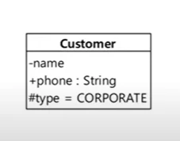
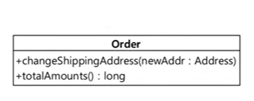
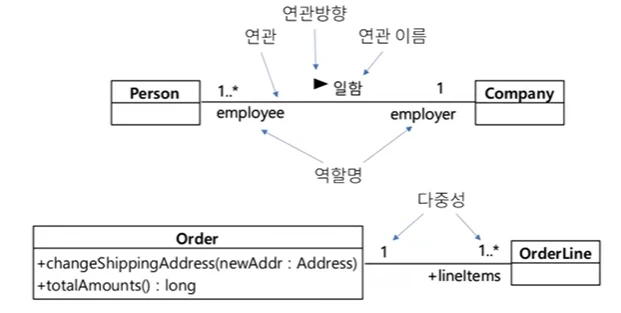
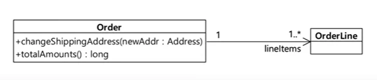
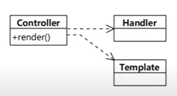
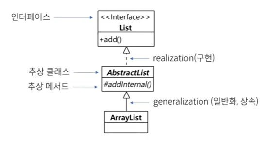
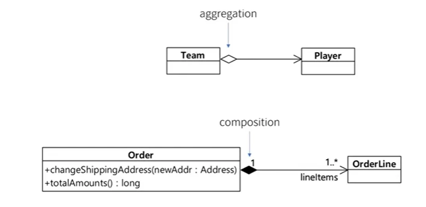

# Class Diagram (유튜브 강의 정리)

작성일 2023-09-21
{ .post-date }

## UML이란?

- Unified Modeling Language

그래픽 표기법으로서, 여러 다이어그램을 정의할 수 있는 방식이다.

소프트웨어 시스템을 표현하거나 설계하는데 좋고, 의사소통 도구로 활용하기에 좋다.

---

## Class Diagram

### 구성요소

Class는 **Name**, **Attribute**(Property), **Operation**(Method)로 구성된다.

- **속성 표기법**(가시성) 

    default value를 표시하는 방법(=)

    - \+ : public
    - \- : private
    - \# : protected
    - \~ : package

- **오퍼레이션 표기법**(가시성) 

    return type을 표시하는 방법(:)

- **연관**(association)

    클래스, 객 간의 관계를 표현한다. 실선으로 이어서 표현한다.

    

    UML에서도 객체 간의 다중성을 1..*과 같이 표현 가능하다.

    일반적으로 클래스에 있는 field(Property, Attribute)를 역할명으로 주로 사용한다.

    ex) Order 클래스에 lineItems라는 property가 있다고 해보자. 그 아이템의 타입이 OrderLine이라고 한다면, 연관(실선)에 lineItems가 붙는 것이다.

    - 연관 탐색(Navigation) : 실선에 화살표가 있다면, 해당 방향으로 탐색이 가능하다는 의미

    

    화살표로 방향을 지정하지 않는다면, 양방향 탐색이 가능하다는 의미이다.

- **의존**(dependency)

    A가 변할 때 A를 사용하는 B도 변할 때, B가 A에 의존한다는 뜻이다. (점선)

    

- Interface, Abstract Class

UML에서는 Interface를 &lt;&lt; … &gt;&gt; 로 표현하며, 이를 **Stereotype** 이라고 부른다. Interface를 Class에 붙여서 Class로 표현하는 것이다.

Interface를 특정 클래스가 구현하는 것을 표현할 때는 realization(구현)이라고 한다.  
⇒ 위의 예시에서는 AbstractList가 List Interface를 구현하고 있다고 말한다.

**추상 클래스**는 이탤릭체로 표현한다. ⇒ 메서드도 추상 메서드로 표현하며, 이탤릭체로 표현한다.

**상속**은 **generalization**(일반화, 상속)으로 표현한다.

- **aggregation**, **composition**

composition : 강력한 소유를 의미함. Order가 삭제되면 OrderLine이 같이 삭제되거나, 같이 생성되는 등 강력한 소유의 상황에 사용된다. (색깔이 칠해진 다이아몬드)

aggregation : 약한 소유를 의미함. (공유가 가능한 것.)

### 주요 사항

클래스 다이어그램은 정적인 구조를 표현

전달하고자 하는 내용 위주로 표시하는 것이기 때문에, 반드시 모든 것을 담아야 하는 것은 아니다.
