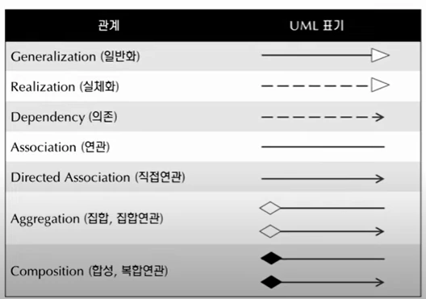
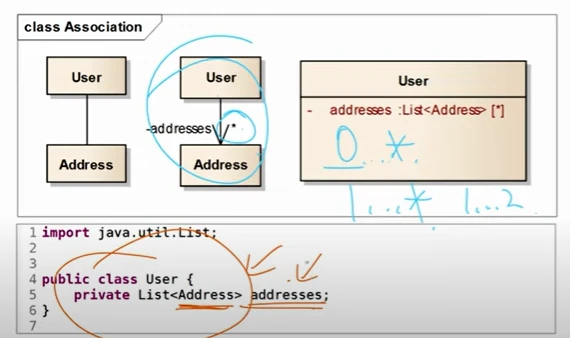

# 클래스 다이어그램 (널널한 개발자)

작성일 2023-09-21
{ .post-date }

## UML의 필요성

UML은 많은 분야에서 사용되며, 생산성 향상에 도움이 된다. 다만 개발자에게 유용하도록 특화된 부분이 있는데, 대표적으로 **클래스 다이어그램**과 **시퀀스 다이어그램**이다.

---

## Class Diagram

### Class Diagram 개요

- Class를 Diagram으로 표현하여 프로젝트의 구조를 나타내는 방식이다.

    - 접근 제어자(Access Modifier)

        - \+ : public
        - \- : private
        - \# : protected

    - Stereotype(클래스의 역할을 명시할 때, 고정관념처럼 확실하게 기술하는 것)

        - &lt;&lt; &gt;&gt; : stereotype을 표현할 때 쓰는 기호는 쌍꺾쇠가 아니라 “**길러맷**”이라는 기호이다.  
          Stereotype은 의존성을 표현하는데 사용된다.
        - 의존성 : 존립 + 행위 두 개로 나뉘어질 수 있다.

### Class간의 관계

- **Generalization**, **Realization** : **상속**을 나타냄. 점선은 interface나 abstract class를 나타내고, 실선은 상속 관계를 나타낸다. (상속은 화살표를 받는 쪽이 부모 클래스)
- **Dependency** : 클래스에서 중요한 것중 하나가 의존 관계이다. 의존 관계를 잘 만들어야 한다.  특히 의존관계 순환이 일어나지 않게 주의해야 함. 
- **Association**(연관)
- **Directed Association**(직접연관)

⇒ 서로 참조하고 접근하는 관계를 표현하는 방법. ERD에서 그리는 M:N 관계도 표현해야 한다. 

Class Diagram에서 Association은 보통 다른 객체의 참조를 가지는 필드를 의미한다. 위의 클래스 다이어그램은 두 가지형태의 Association을 나타낸다.

1) User는 Address를 Property로 가진다.

2) User는 Address와 직접연관 되어있다.

위와 같은 상황에서, User가 만들어졌다고 해서 address는 무조건 존재하지 않기 때문에, 연관 관계라고 표현할 수 있다.

- **Aggregation**(집합, 집합연관) : Shared Aggregation이라고도 하며, Composition과 함께 Association 관계를 조금 더 특수하게 나타낸 것이다. whole(전체)과 part(부분)의 관계를 나타낸다. **Association은 집합이라는 의미를 내포하고 있지 않지만**, Aggregation은 집합이라는 의미를 가지고 있다. (Association은 관계는 있지만, 포함된 관계인 집합의 의미까지는 아닌 것.)

- **Composition**(합성, 복합연관) : part를 가지는 whole 인스턴스가 part 인스턴스의 전체 수명을 책임진다. ⇒ 객체의 수명을 모두 책임지는 경우…

    ex) 자동차는 엔진, 바퀴, 트랜스미션 등을 가질 수 있다. 만약 자동차를 폐기할 때 엔진, 바퀴, 트랜스미션이 모두 폐기된다면 Composition이라고 할 수 있다. 하지만 실제로는 폐기할 때 엔진을 모두 버리지는 않는다. 이것이 내가 설정한 **세계관**이다. 세계관을 바탕으로 구성하면 된다.

⇒ Aggregation과 Composition에서 중요한 것은 Life Cycle 관점이다.

⇒ 객체 간의 관계를 나타낼 때, 그 중요도는 1) 상속, 2) 의존, 3) 집합이다.

---

## Sequence Diagram

- Class Diagram 상으로 적어도 Association 이상의 깊이를 갖는 관계에서 다루어지는, 각 클래스 간의 기능적인 흐름을 나타내는 Diagram이다.

    - 끝의 화살표가 채워져 있다면 Sync, 채워져 있지 않으면 Async로 간주한다.

    - 앨런 케이(OOP 개념의 창시자) : 내게 OOP란 다음 세 가지를 의미한다.

        - 메시지를 주고 받는 것. (동양인의 시각에서는 메시지를 주고 받는다는 의미가 잘 와닿지는 않지만, 서양인의 관점에서는 특정한 상호작용을 함으로써 의미있는 행위를 하는 것 자체를 나타내는 것으로 생각된다.)
        - 상태 처리가 로컬 범위 내에서만 다뤄지도록 유지, 상태 처리를 보호하고 숨김.
        - 모든 것에 대한 극단적인 Late Binding.
        - ⇒ 객체에게 데이터를 요구하지 말고 작업을 요청하라…

---

## 객체지향의 5원칙 (SOLID)

- 객체에게 데이터를 요구하지 말고 작업을 요청하라.

⇒ 객체를 만들 때, 처음에는 기능을 중심으로 객체화 하는 것이 좋다. 

⇒ 객체에게 데이터를 요구하는 것은 객체지향의 가치를 훼손하는 것과도 같다. (데이터는 최대한 감추자.)

⇒ 객체나 테이블의 이름은 복수를 사용하지 않고 단수를 사용한다.

- **SRP** (Single Responsibility Principle) : 단일 책임 원칙

    - 하나의 클래스는 하나의 책임만 가져야 한다.
    - 책임이란 기준이 모호하기 때문에, 변경을 책임의 기준으로 삼으면 설계에 용이할 수 있다.

    ⇒ Class 하나에 너무 많은 기능을 넣지 않는다.

    - 변화에 대응하는 것은 S/W에 주어진 숙명. 개발자들은 유지보수가 쉽고 성능이 좋은 프로그램을 짜야하며, 절대적인 우선적 가치는 **유지보수성**이다.
    - 의존성 순환의 관계를 만들어서는 안된다.

- **OCP** (Open-Closed Principle) : 개방 폐쇄 원칙

    - 높은 응집도

        - 모듈, 클래스가 하나의 책임 또는 관심사에만 집중되어 있다는 뜻이다. 같은 책임, 관심사를 기반으로 하나의 객체로 설계하기 때문에, 객체의 변경이 발생하더라도 다른 곳에 미치는 영향이 제한적이다.

    - 낮은 결합도

        - 책임과 관심사가 다른 객체 또는 모듈과는 **낮은 결합도를 유지**해야 한다. 이는 높은 응집도보다 더 민감한 원칙이라고 한다.

    - 결합도란?

        - 결합도란 하나의 오브젝트가 변경이 일어날 때 관계를 맺고 있는 다른 오브젝트에게 변화를 요구하는 정도로 설명한다.
        - 즉, 낮은 결합도란, 하나의 변경이 발생할 때 다른 모듈과 객체로 변경에 대한 요구가 전파되지 않는 상태라고 할 수 있다. 

- **LSP** (Liskov Substitution Principle) : 리스코프 치환 원칙

    - 객체는 프로그램의 정확성을 깨지 않으면서 하위 타입의 인스턴스로 바꿀 수 있어야 한다.
    - 하위 클래스는 인터페이스 규약을 지켜서 작성되어야 한다. **다형성**을 지원하기 위한 원칙, 인터페이스를 구현한 구현체를 믿고 사용하려면 LSP가 필요하다.
    - 인터페이스의 메소드를 사용한다고 하면, 어떤 구현체를 사용하든 호출부에서 기대하는대로 동작되어야 한다는 것이다.
    - 상속을 통한 재사용은 기반 클래스와 서브 클래스 아이에 IS-A 관계가 있을 경우로만 제한 되어야 한다.

- **ISP** (Interface Segregation Principle) : 인터페이스 분리 원칙

    - 범용 인터페이스 하나보다는 특정 클라이언트를 위한 여러 개의 인터페이스 분리가 더 좋다고 한다.
    - 쉽게 생각하면, parameter가 많은 함수를 없애야 한다. parameter가 많다는 것은 동작이 많다는 것. 즉, 인터페이스가 너무 범용이라는 것. 여러 개의 인터페이스로 분리하여 기능을 만드는 것이 좋다.

- **DIP** (Dependency Inversion Principle) : 의존관계 역전 원칙

    - 구체화가 아니라 추상화에 의존해야 한다. 즉, 구현 클래스(구현체)가 아니라 인터페이스(역할)에 의존하라는 이야기이다.

    - 의존성 뒤집기 원칙을 지키는 방법

        - 변수에 구상 클래스의 레퍼런스를 저장하지 말자.

            - 즉, 자식 클래스에서 부모 클래스를 참조하지 말자는 뜻이다.

        - 구상 클래스에서 유도된 클래스를 만들지 말자.

        - **베이스 클래스에 이미 구현되어 있는 메소드를 오버라이드 하지 말자.**

            - 이미 있는 기능을 다시 만들지 말라는 뜻이다.
