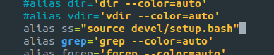
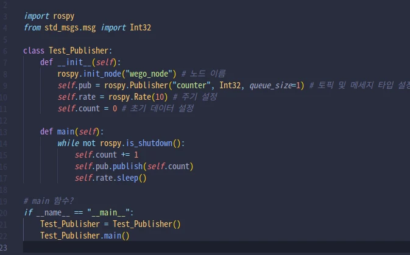
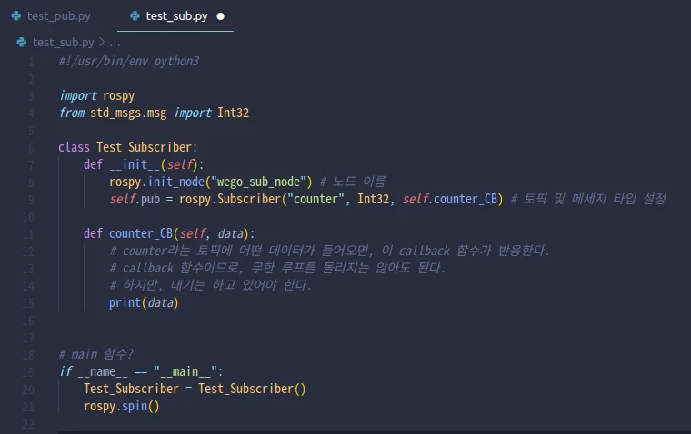
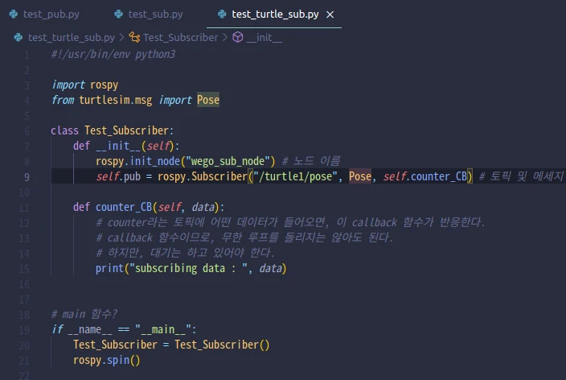
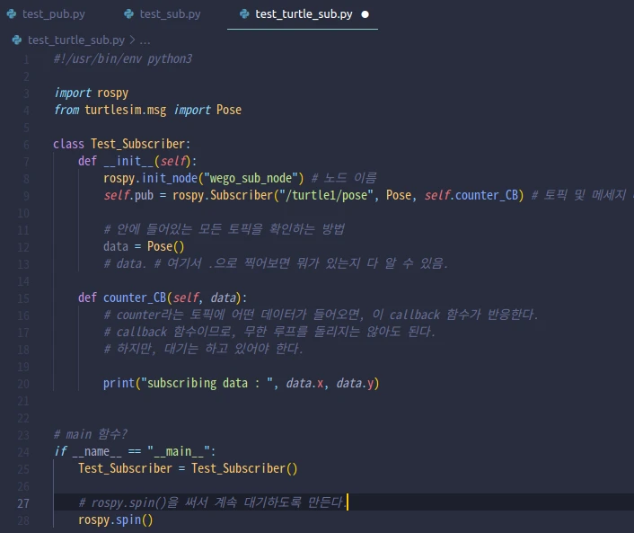
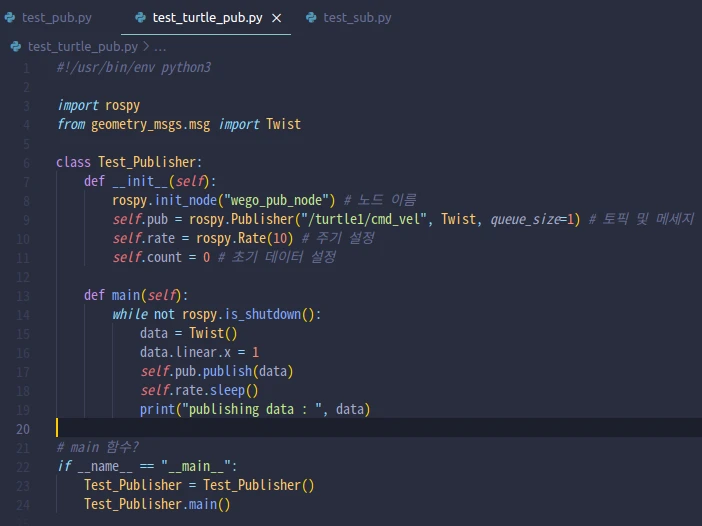
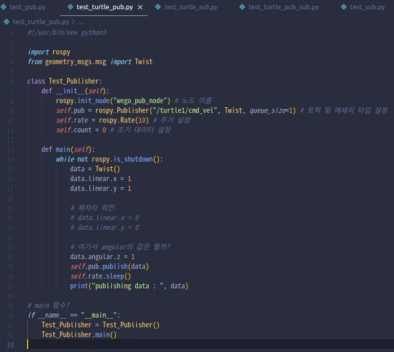

# ROS 3일차

Publisher ↔ Subscriber

같은 이름의 노드는 존재하지 못한다.

- 실행하는 방법

roscore

vsCode에서 켜는 법은 F5, 끄는 법은 Shift + F5

⇒ 이는 정식 실행 방법이 아니다.

⇒ 정식으로 실행하는 법, 터미널에서 네 개의 창을 켜야함.

1. roscore

2. rosrun package_name file_name

    rosrun test test_pub.py

    rosrun test test_sub.py

3. source

내 작업 공간에 있는 특정한 로봇의 정보를 가져오라는 뜻이다. 이걸 해줘야만 함.

source devel/setup.zsh : 이렇게 하면 rosrun을 쓸 수 있는 것으로 보인다. ⇒ 컴퓨터에 등록해두는 것.  
zsh가 적용되지 않은 상태에서는 bash로 지정한다. (로그아웃해야 변경된다.)  
이것은 workspace(ws)에서 source devel/setup.zsh라고 해서 현재 로봇을 알려주는 것.  
bash를 쓰는 경우에는 source devel/setup.bash로 대체한다.

catkin_make를 한 번 하고나면 source devel/setup.bash를 해줘야 함.

이것은 워크스페이스 내부에 있는 것을 사용하겠다는 것.

- 터미널은 터미널마다 개별로 동작한다.

새로운 터미널을 켰을 때 source devel/setup.zsh가 등록되어 있지 않는다면 각 터미널은 이것을 인식하지 못한다. 그래서 모든 터미널에서 이것을 등록해 주어야 한다.

그런데 이것이 너무 귀찮기 때문에, 이를 단축키로 만들어보자.

그런데 왜 개별일까? 이것이 좋은 점이 있다.

터미널마다 로봇을 하나씩 연결할 수 있다는 뜻이다.

- alias (단축키 지정)

bash를 쓰는 경우에는 sudo nano ~/.bashrc 로 지정한다. (재부팅 전에는 zsh가 적용되지 않는다.)

zsh를 쓰는 경우에는 sudo nano ~/.zshrc 로 지정한다.

그리고, “ss” 명령어를 쓰려면 초기에 source ~/.bashrc를 한 번 해줘야 함. (`반드시 ws 안에서!`)

zsh을 쓰려면 source ~/.zshrc 를 해주어야 한다.

oh-my-zsh가 설치 안돼서 문제가 생겼었음…

[[우분투] bash을 zsh으로 바꿔봅시다. 플러그인도 설치해봅시다.](https://velog.io/@taeha7b/bash-zsh)

⇒ 플러그인 설치 잘해야 코딩하기 편함…

> ss workspace 내부에 있는 package 들을 등록해주는 역할을 한다.

**.zsh 설치 후 ‘roscore’ 찾을 수 없는 문제**

위의 블로그에서 나온대로 zsh을 설치한 후 기본 터미널을 zsh로 바꾼 다음, 여러 플러그인들을 설치했다. 그런데, roscore를 찾을 수 없다는 에러가 발생했다.

ros 관련 명령어가 아무것도 동작되지 않아서, ros(현재 noetic)에 문제가 생겼나, 하고 찾아보고 있었는데, .zshrc 설정 중에 실수로 어떤걸 건드린 모양이다.

아래 블로그의 5번에 나온 대로 

\$ echo "source /opt/ros/noetic/setup.zsh" &gt;&gt; ~/.zshrc  
\$ source ~/.zshrc

를 수행했더니 다시 roscore가 인식되었다. 아마 바꾸는 과정에서 추가해주어야 하거나, 기존에 있던 것을 실수로 지웠던 듯 하다.

[Ubuntu ROS Noetic 설치](https://dulidungsil.tistory.com/entry/Ubuntu-ROS-Noetic-설치)

권한이 없음…

chmod 777 * 해줘야함. (test_pub.py, test_sub.py)

파일 만들면 권한이 하나도 없으므로 항상 권한을 주어야 함.

1. rostopic echo /counter

rostopic이라는 것 자체가 하나의 서브스크라이브 노드를 만드는 것.

rostopic list를 하면 현재 토픽의 리스트가 나오게 된다.

/counter는 subscriber, rostopic을 통해 하나의 노드를 만들어주는 것.

- test_pub.py

- test_sub.py

---

- chmod 777을 적용한 파일을 복사하면 그 파일도 권한이 그대로 유지된다.
- turtlesim에서 topic을 전달받기

rostopic list

Type: turtlesim/pose 라고 되어있음.

이에 맞게 코드를 변경한다.

⇒ 이걸로 turtlesim으로부터 데이터를 전달받을 수 있음.

rosrun test test_turtle_sub.py를 한다.

turtlesim은 ros에 자체적으로 내장되어 있는 것.

rqt-graph? topic 그래프 관계 볼 수 있음.

- test_turtle_sub.py에서 print하는 것을 data.x, data.y 등으로 바꾸면 출력할 수 있다.

그런데 데이터가 뭐가 들어오는지를 확인하려면, 일부러 터미널까지 들어가서 다 확인해봐야 하는데, 쉽게 알 수 있는 방법이 있다. Subscriber는 받는 애이고, 그 종류를 subscriber가 미리 알 수 있다.  
data = Pose() 추가

- test_turtle_pub.py 생성

Pose는 위치 데이터이고, command_velocity를 넘겨줘야 제어가 됨. (cmd_vel)  
topic info로 확인해보면, type이 다름. geometry_msgs임.

- turtlesim에 대한 publishing 확인.

    1. roscore
    2. rosrun turtlesim turtlesim_node
    3. rosrun test test_turtle_pub.py

(만약 turtle을 움직이고 싶다면)

1. rosrun turtlesim turtlesim_teleop_key (해당 터미널을 at, 선택한 채로 방향키)

data.angular.z = 1이라고 하면, 1 radian (약 57도)을 돌게 된다.

3.14 radian은 180도

- 과제 : turtle이 벽에 부딪히지 않게 하는 것

그걸 하기 위해서 받는 것과 보내는 것을 동시에 해보자.

- test_turtle_pub_sub.py

→ if문 사용해서 이동 제어하는 코드

- test_turtle_pub_sub_random.py

→ random import해서 random하게 이동하도록 만들고 이걸 바탕으로 제어하는 코드
