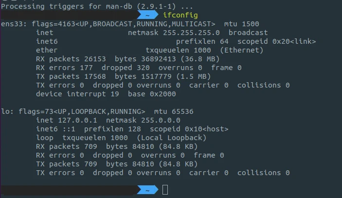
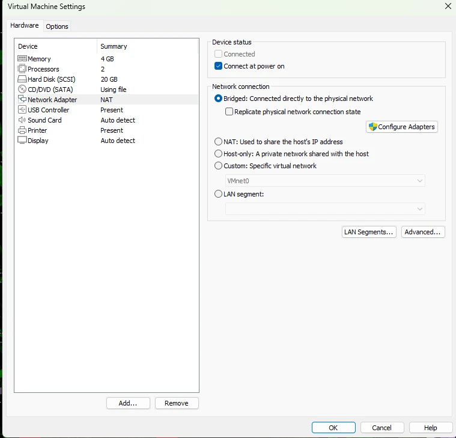
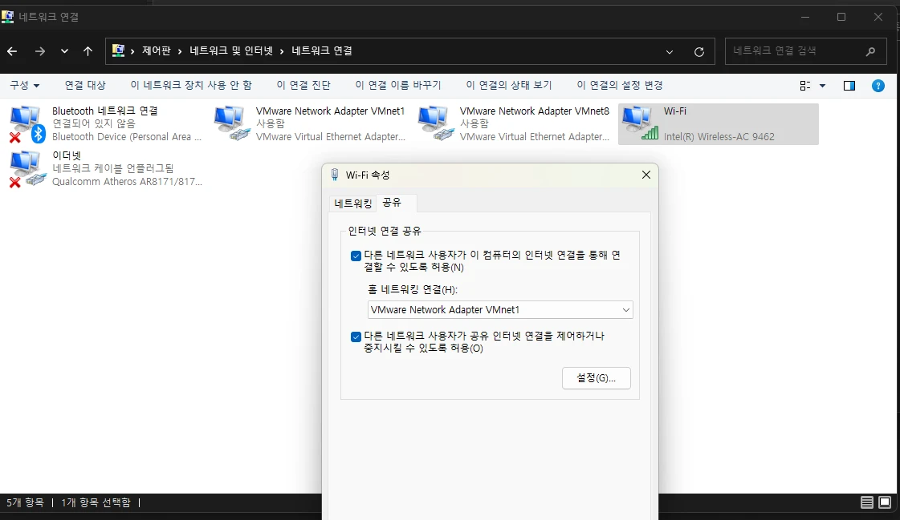
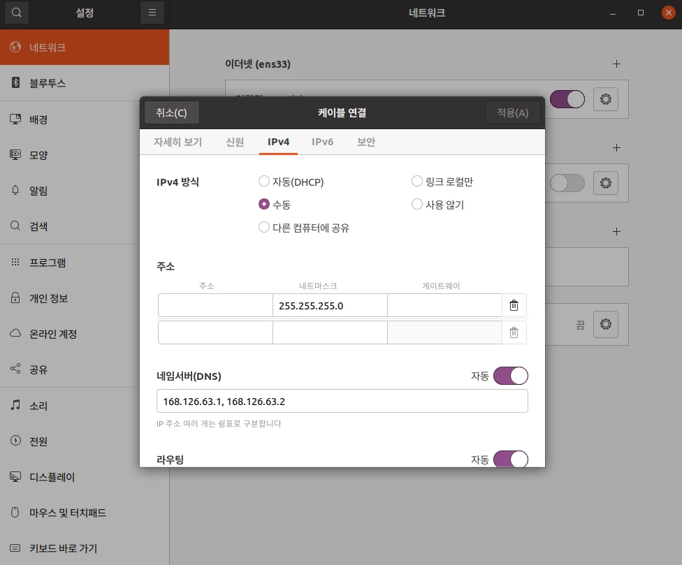
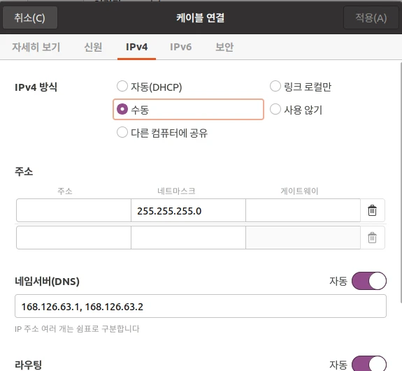

# ROS 4일차

작성일 2023-06-22 · 최종 수정일 2024-09-19
{ .post-date }

- 컴퓨터가 갖는 인터넷 세 가지

    - 무선 인터넷
    - 유선 인터넷

    - 루프백(Loopback, Localhost)

        - 117.0.0.1

- 우분투 터미널에서 ifconfig (sudo apt install net-tools)

    - lo가 loopback

- port 개념 : 데이터가 왔다갔다 하는 곳

    - port마다 역할이 정해져 있다. port는 정해진 역할이 있음.
    - ROS는 몇 번일까? ROS는 관습적으로 1311 포트를 사용한다.
    - IP라는 것은 주소이자 내 컴퓨터를 나타내는 ID 카드이다.
    - 주소를 바꿔서 접속을 시도해보자.

- 가상환경은 네트워크 설정을 net으로 하면 안되고 bridge로 해야 함. net으로 하면 사용되는 네트워크 계층이 달라지기 때문에 bridge로 설정해야 한다.

- 이렇게 설정한 뒤 네트워크가 연결되지 않는 경우가 있다.
- 와이파이 네트워크가 공유되지 않았기 때문이다. 설정에 들어가서 아래와 같이 공유한다.

- 연결이 되지 않는 경우에는 강제로 지정해서 연결을 해주어야 한다.

ROSIP : 초대해서 들어오는 사람들

ROS_MASTER_URI : 파티가 열리는 장소, 내가 열었다면 ROS_MASTER_URI와 ROSIP는 같을 것. 

export ROS_MASTER_URI=http://&lt;IP&gt;:11311 # your IP:port

export ROS_IP=&lt;IP&gt; # my IP

- 현재 내 정보

- ROS_MASTER_URI : &lt;IP&gt;

이 과정을 왜 하냐면, 우리가 동작시킬 리모에 연결하기 위해서이다.

---

- 리모 연결

리모가 Master가 되어서 roscore를 키면, 연결된 컴퓨터에서 publish해서 리모 조종

리모의 바퀴 모드

1. ackerman type : 일반적인 자동차처럼 이동한다.
2. differential type : 양 쪽의 바퀴 차를 이용해서 회전
3. : 좌, 우로 이동

/turtle1/cmd_vel geometry/twist 했던것처럼 publish를 하면 동작함

- 리모도 IP가 존재하며, bashrc가 존재한다. 이미 bashrc에 ROS_MASTER_URI가 입력이 되어 있을 것이고, 우리는 그곳에 접속하면 된다.
- NoMachine : 같은 와이파이 망에 연결되어 있으면 빠르게 연결이 가능하도록 해주는 프로그램

⇒ Linux 용으로 파이어폭스를 켜서 다운로드

다운로드 받고 /usr에 옮겨서 압축해제 후 install

rostopic pub /cmd_vel geometry_msgs/Twist …

- &lt;IP&gt; : 우리가 받은 리모 주소, ROS_MASTER_URI 주소임.
- 바탕화면에서 lidar_slam 디렉터리에 있는 limo_bringup_without_tf.desktop 이걸 켜야함.
- 이 다음에 shell package를 켜면 원하는 동작 가능.

---

- rqt_image_view를 통해 camera 확인 가능 (bringup과 dabai camera)
- /cmd_vel은 우리가 리모에 topic을 publish하는 것이었음.
- IMU, LIDAR topic을 봐보자.

- LIDAR는 /scan : rostopic echo /scan : 이렇게 하면 라이다 데이터를 모니터링 할 수 있음.

    - rviz로 볼 수도 있을 것.

- rqt_graph : 토픽간의 전달 관계를 도식화해서 볼 수 있는 
- rqt_image_view : 카메라에 관한 것
- rviz : 기계에서 측정되는 것
- /cmd_vel 에는 linear.x, linear.y, linear.z가 있었음. 그리고 angular.x, angular.y, angular.z가 있었음.

- /scan에는 angle_min, angle_max, angle_increment, time_increment, scan_time, range_min, range_max, range가 있음.

    - 라디안 1.57이면 90도. 이 라이다의 angle_min은 -1.57… 이고 angle_max는 +1.57… 이므로, 이 라이다는 180도를 보는 것이라는 걸 알 수 있음.
    - angle은 각도이고, angular는 각속도이다.
    - angle_increment는 각도의 간격임.
    - range_max : 12m까지 측정되는 것으로 보인다.

    - ranges :  측정된 값, 하나의 list, 행렬이다.

        - 이 값들은 increment마다, 그 지점에서 측정된 데이터를 갖고 있음.
        - 각 지점에 대한 거리를 의미하는 것으로 보인다. 0.0이 나오는 것은 라이다의 성능이 좋지 않기 때문이다.
        - 초기에 측정되는 것은 -90도에서 측정된 값임. 만약 -90도 ~ +90도를 측정하는데 ranges의 값이 1800개라면, increment는 0.1일 것.

    - 라이다가 좋지 않기 때문에 ranges의 크기가 달라질 수 있음. 이걸 길이에 따라 원하는 각도의 index를 찾아내서 값을 다룰 수 있어야 한다.
    - 0도는 길이가 L이라고 할 때 L/2 번째 index에 위치하고 있을 것. 이걸 찾아낼 수 있어야 한다.

- rostopic info를 하면 message type을 알 수 있음.

    - 이걸 바탕으로 from에서 어떤 것을 import할 지 알 수 있음.
    - 이번에는 sensor_msgs.msg에서 LaserScan을 import함.

- rostopic list를 하면 topic명이 나오기 때문에 그것을 rospy.init_node에서 Subscriber 안에 넣어주면 됨. topic명은 /scan이다.
