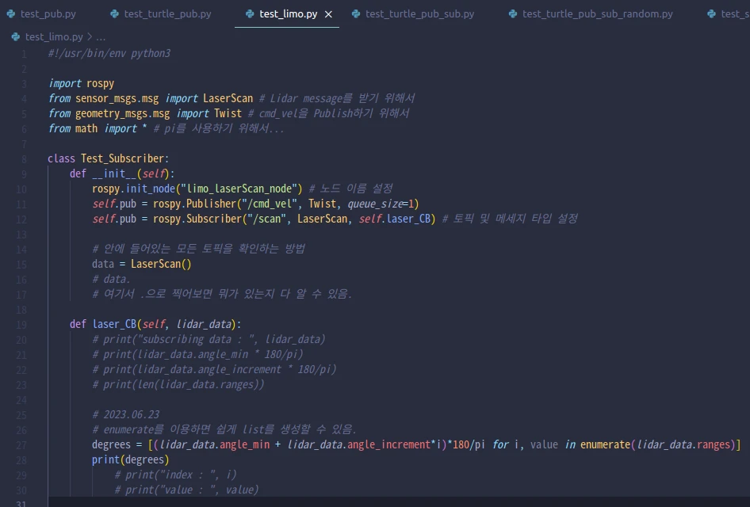
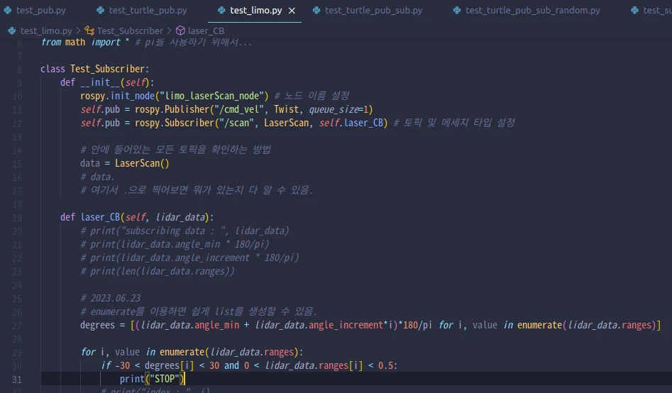
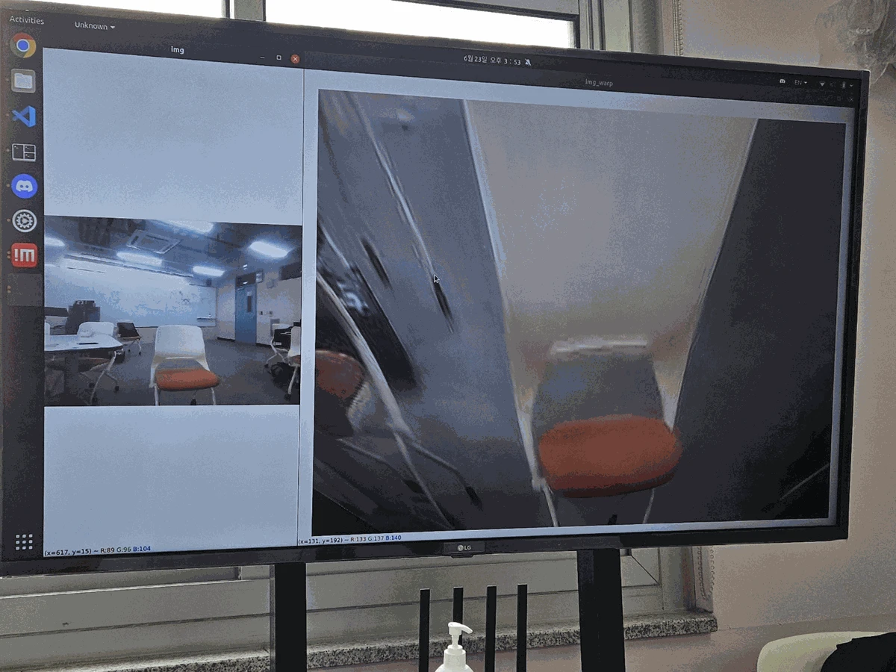

# ROS 5일차

작성일 2023-06-23 · 최종 수정일 2024-09-19
{ .post-date }

- ranges matrix에는 각각 거리값이 들어가 있음.

    - deg : -90 ~ +90
    - radian : -1.57 ~ +1.57

matrix의 index 0은 -90을 의미하고, index 1은 increment만큼 증가한 각도를 의미할 것이다. 이후에는 index가 1 증가할 때마다 angle_increment만큼 증가하게 되는 것이다.

우리는 ranges matrix에서 거리값을 구했으나, 각도가 있는 행렬을 구해내지 못했다. 즉 우리는 ranges와 매칭되는 angles 행렬이 없다. 현재 angle_min, angle_max, angle_increment를 갖고 있으므로 이를 바탕으로 for문을 돌려서 값을 구하면 된다.

python의 내장함수 enumerate를 사용하면 index와 value가 같이 나오게 된다. 

이렇게 만들어 낸 degrees는 ranges와 크기가 똑같다.

코드를 이렇게 작성하면 for문을 통해서 특정 각도 범위 안에서 일정 범위 안의 거리에 존재하는 장애물이 탐지되면 동작을 멈출 수 있지만 효율이 떨어지므로, 중간에 break를 추가해주어야 한다.

하지만 그렇게만 하면 우리는 장애물의 크기를 알 수 없다. 그러므로 STOP이 나오는 개수를 count하는 방식으로 장애물의 직경을 대략적으로 추측할 수 있다.

현재 우리가 사용하는 LIDAR는 정밀도가 다소 떨어지기 때문에 0.0 값이 나오기도 한다. 그렇기 때문에 count의 개수가 특정 개수 이상이 되어야만 반응하여 브레이크를 걸 수 있도록 민감도를 설정해 주도록 한다.

그리고 우리는 STOP(정지)말고 회피도 해야 한다. 그러려면 장애물의 위치도 알아야 한다. 장애물의 위치는 측정된 index. 즉, index에 매칭되는 degree를 파악하면 알 수 있다.

장애물을 회피하는 가장 간단한 방법은, 장애물이 있는 각도만큼 회전해서 이동하면 된다. 하지만 이는 하나의 장애물이 있을 때만 적용이 가능할 것이다. 만약 장애물이 양쪽에 존재한다면, 장애물 사이로 지나치거나 한 쪽 장애물을 완전히 넘어서 지나가야 할 것이다. 이를 판단할 수 있어야 한다.

STOP으로 판단되는 index에 매칭되는 degree를 가지고 있으므로, 물체를 바라보는 단면의 직경을 구할 수 있을 것이다. (호의 길이 r * theta)

---

직경을 구하기 위해서는 장애물이 처음 나타난 각도와 마지막으로 나타난 각도를 알아내야 한다. 그런데, 만약 서로 다른 장애물이 연속적으로 존재한다면 구분할 수 없게된다. 만약 장애물이 서로 다를 경우, obstacle 배열에 추가되는 각도 간의 간격이 커지는 부분이 존재하게 될 것이므로, 장애물을 구별해낼 수 있을 것이다.

현재 들어온 값이 과거에 들어온 값과 1도 이상 차이나면 count를 올리는 것으로 보인다.

- 위 내용은 test_limo.py로 구현한다.

---

- 이미지 분석을 통한 차선 인식

[WeGo-Robotics/limo_ws](https://github.com/WeGo-Robotics/limo_ws)

- 이미지 분석의 방법

    - Gray Scale
    - RGB
    - HSV

Gray Scale Image에서도 RGB에 따라 색상이 다르게 표현된다. Magenta Cyan Yellow(색의 3원색)

색은 더할수록 어두워진다. (감산혼합)

빛은 더할수록 밝아진다. (가산혼합)

RGB는 항상 상대적이어서, 한 쪽의 비율이 높다면 그 쪽 계열의 색깔을 띄게 된다. 이렇게 혼합을 할 때 임계값을 쉽게 정하는 방법이 HSV를 사용하는 것이다. → 이를 통해 색채를 각도로 표현한다.

- HSV(HSI 라고도 쓰인다.)

    - Hue : 색상
    - Saturation : 채도 
    - Value : 명도

⇒ HSV를 이용하면 색상에 대한 감을 잡을 수 있다.

검정색의 경우 H는 상관없고, S, V도 낮을 것이다.

흰색의 경우 H는 상관없고, S는 낮고 V는 높을 것이다.

OpenCV는 0~255를 표현할 수 있다. 그러므로 0~360도로 표현되는 Hue를 절반으로 줄여서 표현.

중요한 것은 Lane Detection을 할 때 색상을 뽑아내는 것.

- Perspective : 이미지를 변형하는 과정

소실점을 기준으로 줄어드는 Lane Line을 잡아당겨서 일직선으로 만들 수 있음. 우리는 이미지를 늘리거나 줄여서 원하는 모양으로 만들어 조작할 수 있다.

이를 통해 행렬의 값을 저장할 수 있다. 이 값을 통해서 연산을 할 수 있다. 이때 행렬에 만들어진 직선의 기울기에 따라 가야하는 방향을 결정할 수 있다. ⇒ 이 각도가 내가 steering을 얼마나 돌려야 하는지에 대한 각도이다.

이렇게 펴낸 이미지에서 노란색, 또는 하얀색 등 원하는 색상만 쉽게 뽑아낼 수 있다. (OpenCV)

⇒ 이때, OpenCV는 0~180을 다룬다.

- bitwise : 이미지에 대해서 bit 연산을 하는것. 즉, masking. 흰색은 255, 검정은 0.

⇒ masking을 통해서 원하는 부분만 색상을 뽑아낼 수 있는 것으로 보인다.

이걸 통해서 following도 가능하다. 특정 색깔을 추종하도록 만들 수 있음. 좌,우의 중앙. 평균을 구해서 그 각도를 following 하도록 만드는 것이라고 생각할 수 있다.

---

- ROS는 로봇을 만들기 위해 만들어진 것. ROS는 잘 짜여진 코드를 가져다가 잘 만들 수 있는 것이 중요하다는 것.
- SLAM(Simultaneous Localization and Mapping)

LIDAR로 거리를 측정할 수 있다면, MAP을 그릴 수 있다는 것. MAP을 그리면 이후에 MAP을 기반으로 운행할 수 있게 된다.
