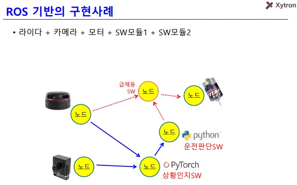
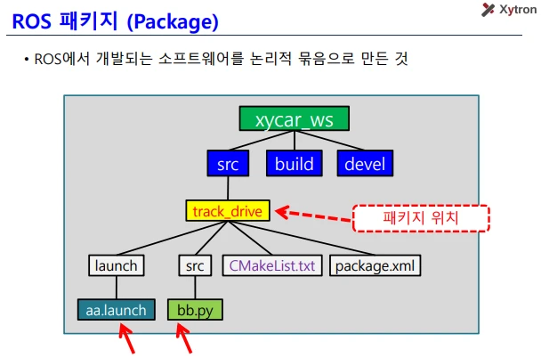
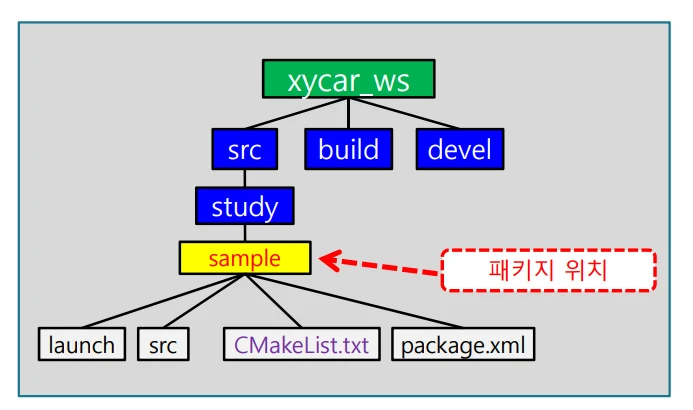
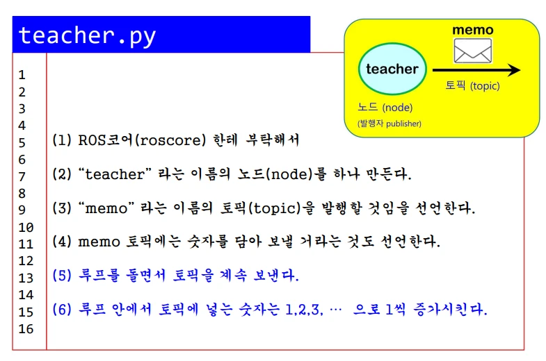
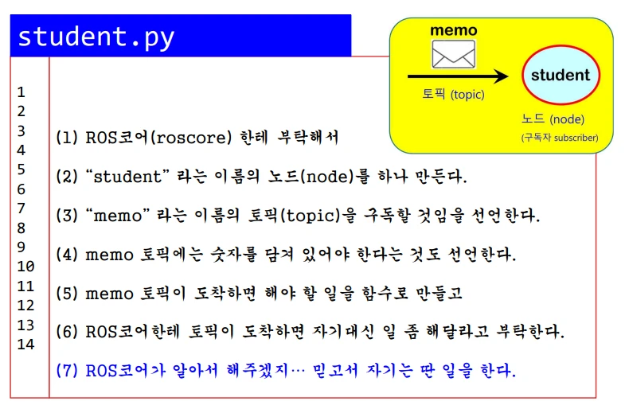
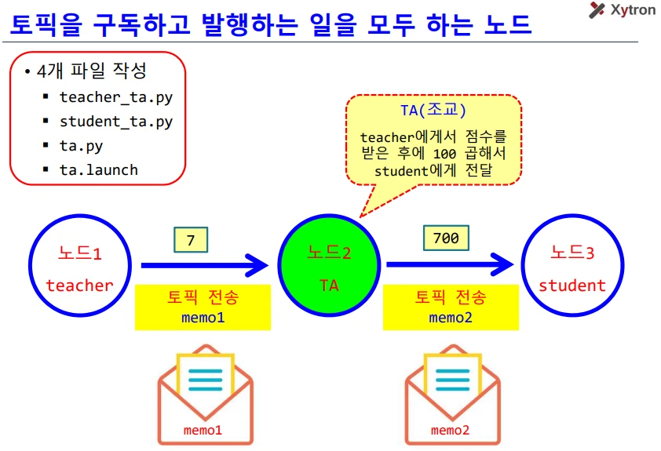
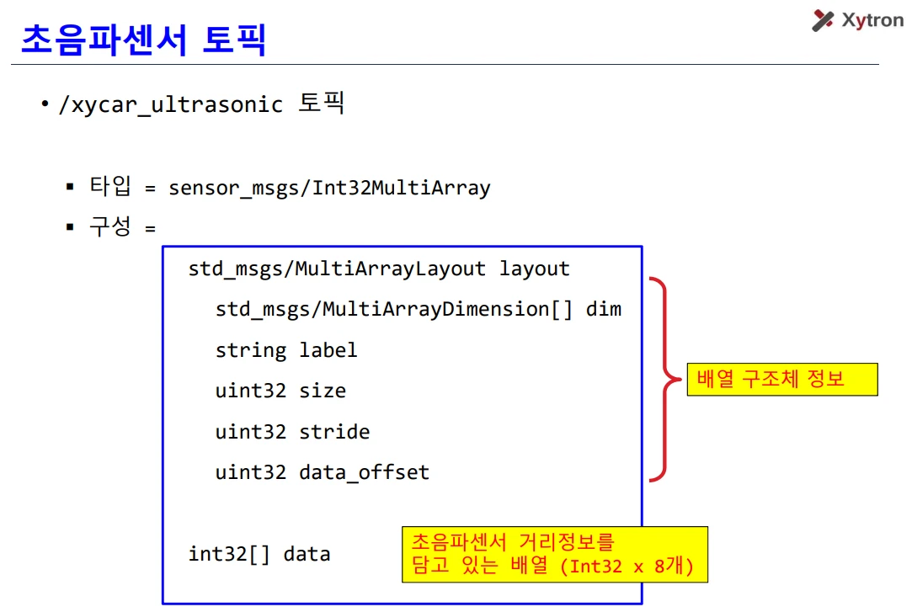

# 자이트론 교육

작성일 2023-07-26
{ .post-date }

- VNC Viewer 연결

    - 조이스틱 apk 설치(Galaxy) → 조작 확인

---

- ROS(Robot Operating System, Middleware)

    - ROS 패키지 : ROS에서 개발되는 소프트웨어를 논리적 묶음으로 만든 것. (일종의 Project)
    - Node : 발행자와 구독자(Publisher, Subscriber)
    - Topic : 노드 사이에서 주고받는 메시지를 의미함.

**Commands**

- ROS 실행 명령어

    - roslaunch : 패키지 노드를 여러 개 실행
    - roscore : master + rosout + parameter server
    - rosrun : 패키지 노드 실행

- ROS 정보 명령어

    - rostopic : 토픽 정보 확인(ex. rostopic list)
    - rosnode : 노드 정보 확인
    - rosbag : 메세지 기록, 재생
    - rosmsg : 메세지 정보 확인

- ROS catkin 명령어

    - catkin_create_pkg : 패키지 생성
    - catkin_make : 빌드

- ROS package 명령어

    - cm : alias로 지정해서 빌드





Package는 catkin 명령어를 이용해서 만들어야만 한다. 만들고 난 후에는 Build를 거쳐서 ROS Package를 사용할 수 있게 된다.

예를 들어, track_drive를 만들었다고 한다면, src라는 디렉터리가 만들어진다. 이 안에 내가 쓰고자 하는 코드를 만들면 된다. launch는 여러 소스 코드를 모아서 실행할 수 있는 파일을 의미한다.

- ROS kinetic : 2016년에 나온 버젼

    - 2년마다 LTS가 나옴. Noetic은 2025까지 정식지원

---

- catkin 명령어

catkin_create_pkg sample(package 이름) std_msgs rospy

(std_msgs와 rospy 두 개는 의존성 package이다. std_msgs는 기본적인 package이고, rospy는 우리가 python을 이용하기 때문에 사용하는 것)



- catkin package 생성 후, launch 디렉터리를 추가로 생성해 준다.

여기까지는 package를 생성한 것.

---

- topic을 보내는 teacher.py node를 만들어보자.



- roscore를 통해서
- teacher라는 이름의 node를 생성
- 이 때, memo라는 이름의 topic을 발행할 것임을 선언
- memo topic에 숫자를 담아 보낼 것이라고 선언
- 이때, 계속 보낼 것이라면 loop를 이용한다.

---

```python
#! /usr/bin/python3 
# Shebang 라인, 해당 파일이 어떤 인터프리터를 사용할 지 선언한다.

import rospy
from std_msgs.msg import Int32

rospy.init_node('teacher') # teacher라는 이름의 node를 생성한다.

# 전달할 topic을 담아 둘 queue의 size를 지정함.
pub = rospy.Publisher('memo', Int32, queue_size=10) 

# loop를 2Hz로 설정.
# 하나의 타임 슬롯을 0.5초로 지정하고, 만약 0.5초 안에 하나의 작업이 끝나면
# 남은 시간은 휴식했다가 0.5초가 지나면 다음 타임 슬롯을 진행하도록 한다.
rate = rospy.Rate(2) 
count = 1

while not rospy.is_shutdown():
    pub.publish(count)
    count = count + 1
    rate.sleep()
```

---

- subscriber



- roscore가 semaphore 처리를 해주는 듯 함.

```python
#! /usr/bin/python3
# SheBang Line은 Subscriber와 동일함.

import rospy

# ROS에 기본적으로 사용되는 std_msgs.msg에서 Int32 type을 import 한다.
from std_msgs.msg import Int32

# callback 함수 callback을 선언함.
def callbackMemo(_msg_memo):
    print(_msg_memo.data) # callback함수의 인자는 publish한 데이터임.

rospy.init_node('studnet')
sub = rospy.Subscriber('memo', Int32, callbackMemo)

while not rospy.is_shutdown():
    # 무한루프를 반복하면서, publish된 데이터가 들어올 때마다
    # 해당 데이터를 인자로 받는 callback 함수 callbackMemo가 수행된다.
    pass
```

---

- launch 파일 만들기

```xml
<launch>
    <!-- Teacher 노드 실행시키기 -->
    <node name="teacher" pkg="study" type="teacher.py"/>

    <!-- Student 노드 실행시키기 -->
    <node name="student" pkg="study" type="student.py" output="screen"/>
</launch>
```

launch 파일에는 node의 이름과 pkg의 이름, 그리고 file의 이름인 type을 작성한다. 이때, output으로 나가는 subscriber는 output을 작성해준다. output을 screen으로 지정하면 terminal로 화면에 값을 내보낼 수 있게 된다.

만들어낸 파일(.py)에 대해서 chmod 777 *.py를 통해서 권한을 주어야 한다.

이렇게 만든 파일들을 실행하기 위해서는 파일들을 build해야 한다. build는 xycar_ws 디렉터리 내에서

catkin_make 를 입력하면 된다.

**catkin_make VS source devel/setup.zsh**

catkin_make와 source devel/setup.bash는 ROS(로봇 운영체제) 개발 환경에서 중요한 개념입니다.

catkin_make:  
catkin_make는 ROS 패키지를 빌드하는 명령어입니다. ROS 패키지는 일반적으로 여러 개의 노드, 라이브러리, 메시지, 서비스 등을 포함하고 있습니다. catkin_make 명령어를 실행하면, 패키지 내의 소스 코드를 컴파일하여 실행 가능한 노드와 라이브러리로 빌드합니다. 이 명령어는 CMake와 같은 빌드 시스템을 사용하여 의존성을 해결하고, 빌드 과정에서 필요한 파일들을 생성합니다. catkin_make는 패키지의 CMakeLists.txt 파일을 읽어 필요한 설정과 빌드 지침을 확인하고, 컴파일을 수행합니다. catkin_make를 실행한 후에는 devel 디렉토리가 생성되며, 그 안에 패키지의 빌드된 파일들이 위치하게 됩니다.

source devel/setup.bash:  
source devel/setup.bash는 ROS 패키지를 사용하기 위해 현재 터미널 세션에 패키지의 환경 변수를 설정하는 명령어입니다. devel/setup.bash 스크립트는 catkin_make를 통해 빌드된 패키지의 실행 파일 및 라이브러리의 경로를 환경 변수에 추가합니다. 따라서, ROS 시스템은 해당 패키지의 실행 파일이나 라이브러리를 찾을 수 있게 됩니다. source devel/setup.bash 명령어를 실행한 후에는 ROS 패키지를 사용하는 데 필요한 환경 변수가 설정되어 있어야 합니다.

따라서, 일반적으로 ROS 패키지를 개발하고 빌드할 때는 catkin_make를 사용하여 패키지를 빌드한 후, source devel/setup.bash를 실행하여 개발한 패키지를 사용할 수 있는 환경을 설정합니다.

- ros를 사용하려면 원하는 패키지를 불러올 수 있어야 한다. 결국 이 패키지 자체를 빌드해 주어야 하는 것. catkin_make를 해서 빌드를 해야만 수행이 가능하다. source는 ros를 불러올 뿐임.

    매번 ros를 불러오기가 불편하다. source를 해야만 ros에 대한 정보를 해당 shell에 불러올 수 있으므로, 이걸 bashrc에서 자동화하면 된다.

    추가) std_msgs, rospy 정보는 CMake 파일에 들어가 있음.

    추가) source /home/pi/xycar_ws/devel/setup.bash 를 bashrc, zshrc에 추가해두면, 터미널이 켜질 때마다 항상 source가 자동으로 수행된다.

- roslaunch를 하지 않고 실행하는 다른 방법

roscore

python3 teacher.py

python3 student.py

⇒ 혹은 rosrun pkg_name file_name

- rostopic list : 현재 ROS에서 사용중인 topic을 list로 보여준다.
- rosnode list : 현재 ROS에서 사용중인 node를 list로 보여준다.
- rqt_graph : 현재 ROS에서 사용중인 node가 나오고, 그 노드에서 publish, subscribe하는 topic의 관계를 그래프로 나타내는 ROS Tool

---

- 과제1



다음과 같이 코드를 수정해보자. (teacher_ta.py, student_ta.py, ta.py, ta.launch를 생성한다.)

- teacher_ta.py

```python
#! /usr/bin/python3

import rospy
from std_msgs.msg import Int32

rospy.init_node('teacher_ta')

pub = rospy.Publisher('memo1', Int32, queue_size=10) 

rate = rospy.Rate(1) 
topic_memo = 1

while pub.get_num_connections() == 0:
    topic_memo = 1

while not rospy.is_shutdown():

    pub.publish(topic_memo) 
    topic_memo += 1
    rate.sleep()
```

- ta.py

```python
#! /usr/bin/python3

import rospy
from std_msgs.msg import Int32

rospy.init_node('ta')

value = 0

def callbackMemo(_msg_memo1):
    global value
    value = _msg_memo1.data

sub = rospy.Subscriber('memo1', Int32, callbackMemo)
pub = rospy.Publisher('memo2', Int32, queue_size=10) 

rate = rospy.Rate(1)

while not rospy.is_shutdown():

    # topic이 도착할 때까지 데이터를 기다리게 된다.
    rospy.wait_for_message("memo1", Int32)

    # 이 사이에서 callback이 먼저 수행되는 것으로 생각된다.
    
    pub.publish(value*100)
```

- student_ta.py

```python
#! /usr/bin/python3

import rospy
from std_msgs.msg import Int32

def callbackMemo2(_msg_memo2):
    print(_msg_memo2.data)

rospy.init_node('student_ta')
sub = rospy.Subscriber('memo2', Int32, callbackMemo2)

while not rospy.is_shutdown():
    rospy.wait_for_message("memo2", Int32)
```

**코딩 과정에서 생긴 Synchronization Problem**

분명히 teacher_ta.py에서 1을 publish함에도, 3에서 100이 print되지 않았다. (현재 코드는 ta에서 전달받은 것에 100을 곱해 pub하는 기능임.) 이유가 무엇일까 생각해봤는데, 결국 Synchronization 문제였다. ROS node를 가동할 때, ROS가 pub되고 sub되는 topic들간을 연결해주게 되는데, 이 과정에서 시간이 조금 소요된다. 하지만 Publisher는 이 연결을 기달리지 않고 publish를 해버리기 때문에 처음의 topic인 1이 pub되어도 Subscriber가 sub을 하지 못하는 것이었다. 그래서 publisher가 pub을 하기 전에, sub이 되었는지 확인해 주어야 한다.

teacher_ta.py를 보면, pub.get_num_connections() == 0: 을 통해 현재 연결 상태를 check 할 수 있다. 초기에 while condition으로 지정해줘서 block해주고, 이것이 끝나면 publishing infinity loop을 가동시키면 된다.

---

## 초음파센서 활용 주행



- launch file에서 &lt;node … /&gt;로 열지 않고 &lt;include … /&gt;로 만들게 되면, 기존에 있던 .launch 파일을 불러와서 실행할 수 있게 된다.

사전에 xycar 내에 ‘cm’으로 alias가 지정되어 있어서 cm을 하면 바로 수행할 수 있게 된다.

---

## 초음파센서 기반 미로주행 구현

- 초음파센서는 노이즈를 타기 때문에 필터링이 필요하다. 
- 자이카는 -가 왼쪽, +가 오른쪽이다. 최대 -100, +100까지만 꺾는 것이 좋다.

---

## OpenCV를 이용한 영상처리 기초

xycar는 가로x세로 640*480 크기로 영상(이미지)을 처리한다. 

1픽셀 표현을 위해 3채널 BGR, 3바이트인 3채널 구조를 갖는다.

각 픽셀의 데이터형은 `numpy.ndarray`

원점이 이미지의 좌 상단이 되며, x축은 → 방향이 +, y축은 **↓**

- 기본적인 도형 그리기

    - 선 

    line(img, start, end, color, thickness)  
    img = cv2.line(img, (0, 0), (511, 511), (255, 0, 0), 5)

    - 사각형

    rectangle(img, start, end, color, thickness)  
    img = cv2.rectangle(img, (100, 100), (300, 500), (0, 255, 0), 3)

    - 원

    circle(img, center, radius, color, thickness)  
    img = cv2.circle(img, (300, 400), 100, (0, 0, 255), 2)

    - 텍스트

    putText(img, text, org, font, fontScale, color)  
    cv2.putText(img, 'Test', (10, 50), cv2.FONT_HERSHEY_SIMPLEX, 4, (255, 255, 255))

⇒ colab에서 OpenCV 실습

- OpenCV : Browser에서 Python Code를 다루고 실행하는 것이 가능(Interpreter, Jupyter Notebook과 비슷한 기술. GPU가 없거나 저사양이라면 Colab을 사용하는 것을 추천)

colab은 90분이상 동작이 안되는 것으로 보이면 초기화하고, 하루에 최대 12시간만 이용이 가능하다.

그래서, 학습이 끊기는 것을 방지하기 위해 1분마다 자동으로 클릭을 해주는 javaScript 코드를 개발자 콘솔에 추가해주면 된다.

```javascript
function ClickConnect(){
console.log("코랩 연결 끊김 방지");
document.querySelector("colab-toolbar-button#connect").click()
}
setInterval(ClickConnect, 60 * 1000)
```

---

## Colab 코드

**codes**

Colab은 cv2를 처리하기 위해 추가적인 모듈이 필요함. 실제 파이썬을 돌릴 때는 사용하지 않음.

```python
import cv2
from google.colab.patches import cv2_imshow

img = cv2.imread('black.png', cv2.IMREAD_COLOR)

# rectangle의 좌표
img = cv2.rectangle(img, (100,100), (300,400), (0,255,0), 3)

cv2_imshow(img)
cv2.waitKey(10000) # 대기. 10000ms (10초)동안 기다린다는 뜻이다.
```

- imread : image를 읽어들이는 함수. 이때 flag가 하나 있는데, Grayscale로 읽냐, Color로 읽냐를 결정하는 역할을 한다.
- imshow : 적어들인 image를 display하는 함수
- imwrite : 이미지를 저장하는 함수

Lena 사진을 읽어와서 출력하는 간단한 예제

```python
import cv2
from google.colab.patches import cv2_imshow

img = cv2.imread('girl.png', cv2.IMREAD_COLOR)
cv2_imshow(img)
cv2.waitKey(10000)
cv2.destroyAllWindows()
```

Lena 사진을 흑백으로 읽어와서 출력하는 간단한 예제

```python
import cv2
from google.colab.patches import cv2_imshow

img = cv2.imread('girl.png', cv2.IMREAD_GRAYSCALE)
cv2_imshow(img)
cv2.waitKey(10000)
cv2.destroyAllWindows()
```

- waitKey(1)로 설정하면 Infinity Loop로 이미지를 계속 띄워둘 수 있다.

```python
import cv2
from google.colab.patches import cv2_imshow

img = cv2.imread('sample.png')
gray = cv2.cvtColor(img, cv2.COLOR_BGR2GRAY)

# 2D Convolution을 통해서 이미지를 블러처리, 중요한 데이터는 강조하고
# 불필요한 데이터는 약화시킴. 
blur = cv2.GaussianBlur(gray, (5, 5), 0)

cv2_imshow(gray)
cv2_imshow(blur)
cv2.waitKey(10000)
```

```python
import cv2
img = cv2.imread('spot.png', cv2.IMREAD_GRAYSCALE)

h = img.shape[0] # 세로 길이
w = img.shape[1] # 가로 길이

print("The image dimension is %d x %d" % (w, h))

for i in range(0, h - 1):
	for j in range(0, w - 1):
		if img[i, j] == 255: # 데이터가 흰색인 점만 찍어줌.
			print(i, j)

cv2.imshow('spot', img)
cv2.waitKey(10000)
```

- ROI(Region of Interest)

관심 영역 : 단순히 원하는 영역만 확인하기 위해 이미지를 Crop하는 것. (Slicing)

```python
import cv2
from google.colab.patches import cv2_imshow

img = cv2.imread('cars.png')
cv2_imshow(img[120:270, 270:460])
cv2_imshow(img)
cv2.waitKey(10000)
```

⇒ openCV는 세로, 가로의 순으로 저장하므로, img를 crop할 때도 이에 유의한다.

- HSV(Hue, Saturation, Value)

```python
import cv2
import numpy as np
img = cv2.imread('cars.png')

'''
	H (색상):
	0~255
	S (채도):
	0~255
	V (명도): 150~255
	사이에 드는 범위를 지정
'''

# img를 HSV로 변환
hsv = cv2.cvtColor(img, cv2.COLOR_BGR2HSV)

# H,S는 0~255 사이를 모두 사용하는 것이고,
# V는 150~255. 150미만인 것들은 모두 0으로 만들고,
# 150이상인 것들은 1로 만든다. 즉, 이진화로 coding하는 것.
mask = cv2.inRange(hsv, (0,0,150), (255,255,255))
cv2.imshow('hsv', mask)
cv2.waitKey(10000)
```

명도 조절을 통해서 Binary Image를 만들 수 있는데, 여기에 사용되는 Parameter를 잘 조절해야 한다.

Q. 주변 환경에 따라 조도가 달라지는데, 딥러닝을 사용하지 않고 조도에 영향을 받지 않고 Lane Detection을 문제없이 할 수 있을까? ⇒ 그러려면 굉장히 많은 예외를 처리하거나, 굉장히 많은 연산이 필요할 것이다.

cv2.inRange를 이용하면 특정 색상 영역을 Binary Image로 추출하는 기능을 할 수 있음.

```python
import cv2

img = cv2.imread('sample.png')
gray = cv2.cvtColor(img, cv2.COLOR_BGR2GRAY)
blur = cv2.GaussianBlur(gray, (5, 5), 0)
edge = cv2.Canny(blur, 30, 90)

cv2.imshow('original', img)
cv2.imshow('edge', edge)

'''
	lower/upper threshold 값을 인자로
	upper 값은 보통 lower 값의
	2~3배 정도가 적당
'''

cv2.waitKey(10000)
```

- cv2.countNonZero의 활용

```python
xx= 20
while True:
	area = img[430:450, xx:xx+15]
	if cv2.countNonZero(area) > 200:
		image = cv2.rectangle(image,(xx,430),(xx+15,450),(0,255,0),3)
	else:
		image = cv2.rectangle(image,(xx,430),(xx+15,450),(255,0,0),3)
		xx = xx+20
	if xx > 640:
		break

cv2.imshow('countNonZero', image)
cv2.waitKey(10000)
```

⇒ cv2.countNonZero는 화면에 표현되는 0이 아닌 픽셀들의 개수를 반환한다.

```python
import cv2

# 인자로 0을 넣으면 현재 연결된 카메라(웹캠 등)로부터 영상을 받아온다.
# capture = cv2.VideoCapture(0)
capture = cv2.VideoCapture('small.avi')

while True:
	ret, frame = capture.read()
	if not ret:
		break

	# frame = cv2.cvtColor(frame, cv2.COLOR_BGR2GRAY)
	cv2.imshow('video', frame)
	cv2.waitKey(10)

capture.release()
cv2.destroyAllWindows()
```

---

## USBCam 기반 카메라 주행

```xml
<launch>
	<node pkg="usb_cam" type="usb_cam_node" name="usb_cam" output="screen" >
		<param name="video_device" value="/dev/videoCAM" />
		<param name="autoexposure" value="false" />
		<param name="exposure" value="160" />
		<param name="image_width" value="640" />
		<param name="image_height" value="480" />
		<param name="pixel_format" value="yuyv" />
		<param name="io_method" value="mmap" />
		<param name="camera_name" value="usb_cam" />
		<param name="camera_frame_id" value="usb_cam" />
		<param name="camera_info_url"
			value="file://$(find usb_cam)/calibration/usb_cam.yaml"/>
	</node>
</launch>
```

- 이후에 USBCam을 사용할 때 아래와 같이 지정하면, 우클릭만 해도 이미지가 저장된다.

```xml
<launch>
	<include file="$(find usb_cam)/launch/xycar_cam.launch"/>
	<node pkg="image_view" respawn="false" type="image_view" name="image_view"
		output="screen" >
		<remap from="image" to="/usb_cam/image_raw" />
		<param name="autosize" value="true" />
		<param name="filename_format" value="/home/pi/Downloads/cam_image_%04d.jpg" />
	</node>
</launch>
```

---

- openCV의 fitLine() 함수를 쓰면 주어진 좌표들의 대표 직선을 얻어낼 수 있다.
- 빨간색 사각형은 화면의 중점. 파란색 사각형은 차선의 중점이다.
- 녹색 사각형은 각 차선의 중점이며, 빨간색 사각형과 파란색 사각형이 거의 일치하면서 주행이 될 때, 올바르게 주행한다고 생각할 수 있다.
