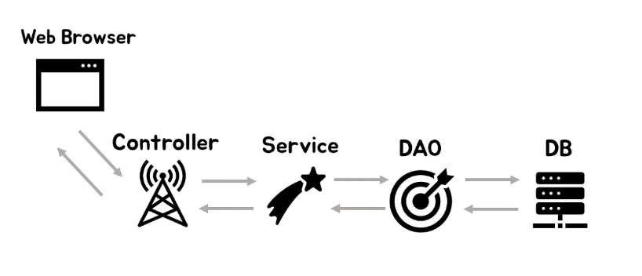
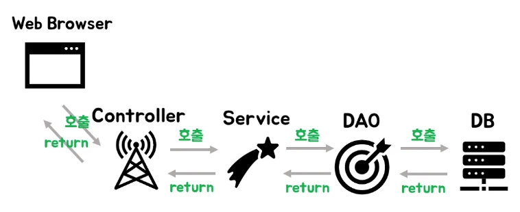
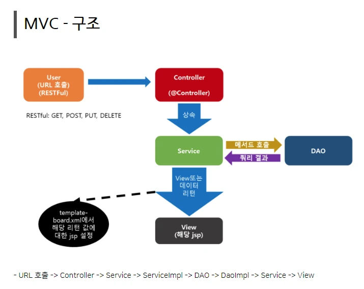

# Spring MVC 구조(Controller, Service, DAO, Mapper)

작성일 2023-01-31 · 최종 수정일 2024-09-19
{ .post-date }

**Spring boot - Controller, Service, DAO, Mapper**

Spring boot는 MVC 구조를 따른다. 다음 그림은 MVC 구조를 나타낸다.

## MVC(Model-View-Controller)

소프트웨어 공학에서 사용되는 소프트웨어 디자인 패턴이다. 이 패턴을 성공적으로 사용하면, 사용자 인터페이스로부터 비즈니스 로직을 분리하여 애플리케이션의 시각적 요소나 그 이면에서 실행되는 비즈니스 로직을 서로 영향없이 쉽게 고칠 수 있는 애플리케이션을 만들 수 있다. MVC에서 모델은 애플리케이션의 정보(데이터)를 나타내며, 뷰는 텍스트, 체크박스 항목 등과 같은 사용자 인터페이스 요소를 나타내고, 컨트롤러는 데이터와 비즈니스 로직 사이의 상호동작을 관리한다.





(실제 Spring Server가 동작되는 구조)

이런 흐름으로 Web Browser가 데이터를 요청하면 DB에서 데이터를 return하여 Web Browser가 데이터를 받을 수 있게 되는 것이다.

## Controller

- 웹 브라우저의 요청을 전담하여 처리한다. Controller가 Service를 호출한다.
- 클라이언트에서 요청이 들어올 때, 해당 요청을 수행할 비즈니스 로직(Business Logic)을 제어하는 객체이다. 스프링에서는 컨트롤러에서 세부적으로 서비스 레이어(Service Layer)를 만들어 해당 요청 사항을 객체 지향적인 방식으로 좀 더 세분화하여 관리한다.
- 비즈니스 로직 : 컴퓨터 프로그램에서 실세계의 규칙에 따라 데이터를 생성, 표시, 저장, 변경하는 부분을 일컫는다. 사용자에게 보여지지 않는 부분에서 데이터를 처리하는 코드라고 보면 된다.

## Service

- Service는 비즈니스 로직을 수행한다. 데이터베이스에 접근하는 DAO를 이용해서 결과값을 받아오는 역할을 한다.
- 서비스 레이어(Service Layer)단에서 세분화된 비즈니스 로직을 처리하는 객체이다. 서비스는 비즈니스 로직이 들어가는 부분이며, Controller가 Request를 받으면 적절한 Service에 전달하고, 전달 받은 Service는 비즈니스 로직을 처리한다.
- DAO로 데이터 베이스를 접근하고 DTO로 데이터를 전달받은 다음, 적절한 처리를 해 반환한다.

## DAO(Data Access Object)

- DB에서 알맞은 쿼리를 실행하고 결과값을 반환한다.
- DB를 사용해 데이터를 조회하거나 조작하는 기능을 전담하도록 만든 객체이다.
- 효율적인 커넥션 관리와 보안성 확보를 위해 DAO를 사용한다.
- Database의 data에 access하는 트랜잭션 객체이다.
- Domain Logic(비즈니스 로직이나 DB와 관련없는 코드들)을 persistence mechanism과 분리하기 위해 사용한다.

> 이렇게 따로 분리해놓는 이유는, HTTP Request를 Web Application이 받게 되면, Thread를 생성하게 되는데, 비즈니스 로직이 DB로부터 데이터를 얻어오기 위해 매번 Driver를 로드하고 Connection 객체를 생성하게 되면 엄청 많은 커넥션이 일어나므로 DAO를 하나 만들어 DB 전용 객체로만 사용하는 것이다. 이러면 부담이 줄어들게 된다.  
>   
> 이 개념은 DBCP(Database Connection Pool)로 부터 나왔다.  
>   
> WAS(Web Application Server)가 실행되면 일정량의 DB Connection 객체를 Pool에다 저장해두고, HTTP Request에 따라 필요할 때마다 Pool에서 Connection 객체를 가져다 쓰고 반환하는 것이다.

- 스프링에서 DAO는 @Repository Annotation으로 정의한다. class(클래스) 선언 시 바로 @Repository Annotation을 사용해도 되지만, 메서드 헤더만 정의한 interface를 정의하고 이것을 구현한 클래스에 annotation을 붙여 사용한다. 이유는 interface(인터페이스)로 구성하면 확장성과 유연성이 높아지기 때문이다.

## DTO

Data Transfer Object의 약자로, 각 계층이 데이터를 주고 받을 때 사용하는 객체를 말한다.  
(각 계층이란 View, Controller, Service, DAO, DB를 말한다.) ⇒ 일종의 Data Class이지만, Generic을 통해서 서버 통신용으로 사용되는 일종의 패킷으로 보인다.



## DTO 만들기

```java
package board.board.dto;

import lombok.Data;

@Data
public class BoardDto {

	private int boardIdx;
	private String title;
	private String contents;
	private int hitCnt;
	private String creatorId;
	private String createdDatetime;
	private String updaterId;
	private String updatedDatetime;
}
```

## Controller

웹 브라우저의 요청을 전담하여 처리하는 컨트롤러

```java
@Controller // 해당 클래스를 컨트롤러로 동작하게 한다.
public class BoardController {

	@Autowired
	private BoardService boardService;

	@RequestMapping("/apple") // 이 주소로 접속하면 이 메소드를 호출(매핑)한다.
	public ModelAndView openBoardList() throws Exception {
		ModelAndView mv = new ModelAndView("/apple/boardList");
		
		List<BoardDto> list = boardService.selectBoardList();
		mv.addObject("list", list);

		return mv;	
}
```

@Controller Annotation

이 클래스가 컨트롤러 클래스라는 것을 알려준다. 사용자 요청이 들어오면 이 컨트롤러가 호출됨

@RequestMapping(”/apple”) Annotation

baseurl/apple로 접속하게 되면 이 어노테이션을 가진 메소드로 매핑이 된다.

```java
List<BoardDto> list = boardService.selectBoardList();
```

이 부분이 Service를 호출하는 부분이다. Service의 반환값을 list에 저장하고 있다. 

그럼 Service를 호출하면 어떻게 동작되는가?

## Service

Service는 두 가지를 구현해야 한다.

1. Service Interface
2. Service Interface를 구현한 class 만들기 (Service Interface 구현체)

Service Interface를 만들어보자.

[BoardService.java]

```java
package board.board.service;
import board.board.dto.BoardDto;
import java.util.List;

public interface BoardService {
	List<BoardDto> selectBoardList() throws Exception;
}
```

Service Interface를 구현한 클래스를 만들어보자.

[BoardServiceImpl.java]

```java
package board.board.service;
import board.board.dto.BoardDto;
import org.springframework.beans.factory.annotation.Autowired;
import org.springframework.stereotype.Service;
import board.board.mapper.BoardMapper;

import java.util.List;

@Service
public class BoardServiceImpl implements BoardService {

	@Autowired
	private BoardMapper boardMapper;

	@Override
	public List<BoardDto> selectBoardList() throws Exception {
		return boardMapper.selectBoardList();
	}
}
```

@Service Annotation

이 클래스가 서비스 클래스라는 것을 알려준다. Mapper는 다음으로 구현할 것이다. ‘Service가 DAO를 호출한다’라고 했었는데, 우리는 DAO를 사용하지 않고 Mapper를 사용할 것이다. Service가 Mapper를 호출하는 부분은 이 부분이다.

```java
return boardMapper.selectBoardList();
```

다음으로 DAO를 설명하면서 더 자세히 알아보도록 하자.

## Mapper

마이바티스(Mybatis)는 Mapper 인터페이스를 제공한다. 우리는 DAO대신 매퍼를 사용할 것이다. 매퍼를 사용하면 일일이 DAO를 만들지 않고 인터페이스만을 이용해서 좀 더 편하게 개발할 수 있다. 마이바티스는 자바코드와 SQL문을 분리하여 편리하게 관리하도록 한다. SQL문은 *.xml 형식으로 저장한다. 매퍼 인터페이스와 XML을 만들어보자.

[BoardMapper.java]

```java
package board.board.mapper;
import java.util.List;
import org.apache.ibatis.annotations.Mapper;
import board.board.dto.BoardDto;

@Mapper
public interface BoardMapper {
	List<BoardDto> selectBoardList() throws Exception;
}
```

@Mapper Annotation

Mapper 인터페이스로 인식한다.

*.xml 형식의 파일을 만들어 원하는 SQL문을 작성한다.

[sql.xml]

```xml
<?xml version="1.0" encoding="UTF-8"?>
<!DOCTYPE mapper PUBLIC "-//mybatis.org//DTD Mapper 3.0//EN" 
   "http://mybatis.org/dtd/mybatis-3-mapper.dtd">
   
<mapper namespace="board.board.mapper.BoardMapper">
  <select id="selectBoardList" resultType="board.board.dto.BoardDto">
     <![CDATA[
     	SELECT
     		board_idx,
     		title,
     		hit_cnt,
     		created_datetime
     	FROM
     		t_board
     	WHERE
     		deleted_yn = 'N'
     	ORDER BY board_idx DESC
     ]]>
  </select>
</mapper>
```

XML 파일에서 중요한 것은

- namespace
- id
- resultType

의미는 다음과 같다.

namespace : Mapper의 전체 경로를 적는다.

id : Mapper Interface와 XML 파일을 매칭시키기 위해서 Mapper Interface의 method 명과 XML 파일의 id를 동일하게 작성해주어야 한다.

resultType : SQL문을 실행하고 결과값을 어떤 형식으로 반환할지를 나타낸다. 여기서는 BoardDto 객체로 반환한다.

아래는 Mapper Interface의 method 명과 XML의 id가 같은 값인 것을 알 수 있다.

```xml
@Mapper
public interface BoardMapper {
	List<BoardDto> selectBoardList() throws Exception;
}

[BoardMapper.java]
<select id="selectBoardList" resultType="board.board.dto.BoardDto">

[sql.xml]
```

## server

- @RequestMapping

특정 URL로 요청을 보내면 Controller에서 어떠한 방식으로 처리할지 정의를 한다. 이때 들어온 요청을 특정 메서드와 매핑하기 위해 사용하는 것이 @RequestMapping이다. @RequestMapping에서 가장 많이 사용하는 부분은 value와 method이다. 

value는 요청받을 URL을 설정하게 된다.

method는 어떤 요청으로 받을지 정의하게 된다. (REST)

- 예시 코드

```java
@RestController
public class HelloController {

    @RequestMapping(value = "/hello", method = RequestMethod.GET)
    public String helloGet(...) {
        ...
    }

    @RequestMapping(value = "/hello", method = RequestMethod.POST)
    public String helloPost(...) {
        ...
    }

    @RequestMapping(value = "/hello", method = RequestMethod.PUT)
    public String helloPut(...) {
        ...
    }

    @RequestMapping(value = "/hello", method = RequestMethod.DELETE)
    public String helloDelete(...) {
        ...
    }
}
```

그렇지만 공통적으로 겹치는 URL인 /hello가 있기 때문에 불편하다는 생각이 든다. 이에 따라 아래와 같이 수정할 수 있다.

```java
@RestController
@RequestMapping(value = "/hello")
public class HelloController {

    @GetMapping()
    public String helloGet(...) {
        ...
    }

    @PostMapping()
    public String helloPost(...) {
        ...
    }

    @PutMapping()
    public String helloPut(...) {
        ...
    }

    @DeleteMapping()
    public String helloDelete(...) {
        ...
    }
}
```

뒤에 추가적으로 URL을 붙이고 싶다면, 아래와 같이 작성하면 된다.

```java
@RestController
@RequestMapping(value = "/hello")
public class HelloController {    
    @GetMapping("/hi")
    public String helloGetHi(...) {
        ...
    }
}
```

## login API

- ajax(Asynchronous Javascript and XML)

아래의 예제는 data에 user에 대한 정보를 담아 유저를 생성하는 API를 호출하는 예제이다.

```javascript
let data = {
	userId: userId,
	userPw: userPw
};

data = JSON.stringify(data);

let url = "http://localhost:300/users";

/* 먼저, XMLHttpRequest를 생성한다. */
let xhr = new XMLHttpRequest();

/* 
open()을 통해 POST, GET, PUT, DELETE인지 정할 수 있다.
세 번째 인자로 true를 주면 async를 의미하고, false를 주면 sync를 의미한다.
 */
xhr.open('POST', url, true);
xhr.setRequestHeader('Content-Type', "application/json");

/* send()를 통해 data를 전송한다. */
xhr.send(data);

/* 
load 이벤트를 등록하여 서버로부터 response가 올 때의 행동을 구현할 수 있다.
xhr.status는 서버로부터 전송받은 status code를 의미한다. 상황에 맞게 처리 가능.
xhr.responseText는 서버로부터 받은 데이터를 의미하는데, String 형태로 받기 때문에
JSON 형태로 파싱하여 사용해야 한다.
 */
xhr.addEventListener('load', function() {
	let result = JSON.parse(xhr.responseText);

	switch(xhr.status) {
		case 200:
			// 성공 처리
			break;
		case 404:
			// 예외 처리
			break;
	}

	// console.log(xhr.responseText);
	// console.log(xhr.status);
	// console.log(result);
});
```
