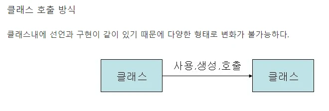
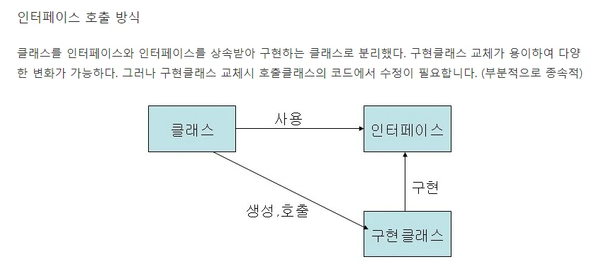
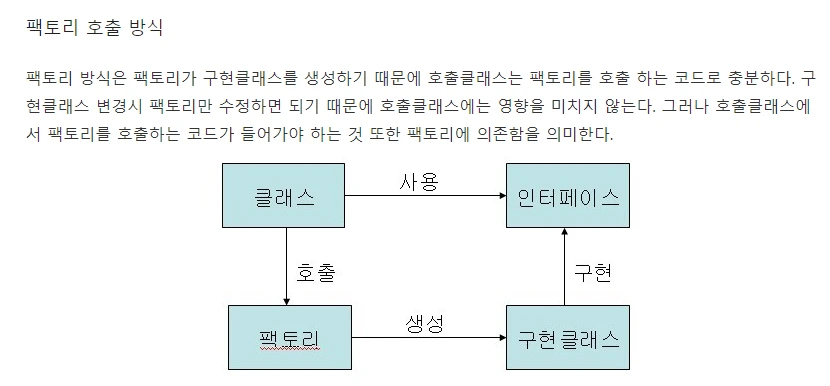
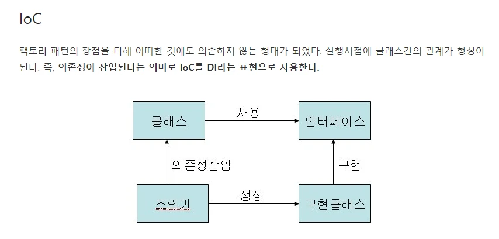
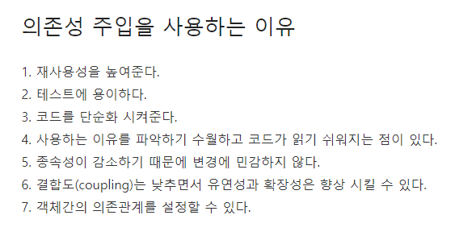

# 의존성 주입(DI), IoC 컨테이너, @Autowired, @Resource

## DI(Dependency Injection)

어떤 객체가 사용하는 의존 객체를 직접 만들어 사용하는게 아니라, 주입 받아서 사용하는 방법이다. (new 연산자를 이용해서 객체를 생성하는 것이라고 생각하면 된다.)

ex) 장난감들은 배터리가 있어야 움직일 수 있으므로, 배터리에 의존한다고 볼 수 있다. 장난감들에게 배터리를 넣어주는 것을 의존성 주입이라고 생각하면 좋다.

> 쉽게 생각하면, 클래스 내부에서 직접 사용하는 객체를 setter를 통해 외부로부터 변경받을 수 있는 것을 의존성 주입이라고 하는 것 같다.

```java
import org.springframework.stereotype.Service;

@Service
public class BookService {

	private BookRepository bookRepository;

	public BookService(BookRepository bookRepository) {
		this.bookRepository = bookRepository;
	}
}
```

```java
@Service
public class BookRepository {
	// DI test
}
```

위 코드를 보면 BookService 클래스가 만들어 지기 위해서는 BookRepository 클래스를 필요로 한다. 이것을 BookService 클래스는 BookRepository 클래스의 의존성을 가진다. 라고 할 수 있다. 위의 코드처럼 BookRepository라는 클래스를 직접 new를 사용하여 객체를 주입하는 것이 아니라 생성자를 통해 주입받는 것을 Inversion of Control이라고 한다.

## IoC 컨테이너

[[Spring] 스프링 의존성 주입(DI) 이란?](https://devlog-wjdrbs96.tistory.com/165)

가장 중요한 인터페이스는 BeanFactory, ApplicationContext이다.

애플리케이션 컴포넌트의 중앙 저장소이다.

빈 설정 소스로부터 빈 정의를 읽어들이고, 빈을 구성하고 제공한다.

빈들의 의존 관계를 설정해준다. (객체의 생성을 책임지고, 의존성을 관리한다.)

---

### POJO(Plain Old Java Object)

종속되지 않는다는 것은 코드를 간결히 할 수 있고, 객체지향 설계를 충실히 이행하고 있음을 보여준다. 스프링의 특징 중 POJO라는 것이 있는데, 과거에는 자바로 웹 어플리케이션을 개발하기 위해서는 Servlet 클래스를 상속받아서 사용했다. 이 Servlet 클래스는 POJO가 아닌 것이다. 즉, Servlet 클래스를 작성하지 않고 POJO만으로 웹 어플리케이션을 개발할 수 있다는 것이 스프링의 특징이다.

### IoC 사용 목적









IoC를 해석해보면, 하나의 클래스가 있을 때 그 클래스는 DI(의존성 주입)를 통해서 조립기를 갖게 된다. 이 조립기를 통해 구현 클래스를 생성할 수 있다. 이로서 서로 종속성을 가지지 않게 된다. 구현 클래스는 인터페이스를 implement받아 구현한다. 그리고 클래스는 인터페이스를 사용한다고 하는데, 이는 인터페이스를 통해서 클래스를 조작한다는 의미로 polymorphism을 의미하는 것으로 보인다. (up-casting)

---

### Spring 컨테이너

- BeanFactory : 스프링 빈 컨테이너에 접근하기 위한 최상위 인터페이스

Bean 객체를 생성하고 관리하는 인터페이스이다. 디자인 패턴의 일종인 팩토리 패턴을 구현한 것이다. BeanFactory 컨테이너는 구동될 때 Bean 객체를 생성하는 것이 아니라, 클라이언트의 요청이 있을 때 getBean() 객체를 생성한다.

- ApplicationContext

---

- Container 정리

스프링에서 컨테이너는 프로그래머가 작성한 코드의 처리과정을 위임받아 독립적으로 처리하는 존재이다. 지금까지 객체를 사용하기 위해서 위의 그림과 같이 new 생성자를 이용하거나 getter/setter 기능을 써야만 했다. 어플리케이션에는 이러한 객체가 무수히 많이 존재하고 서로 참조하고 있을 것이다. 서로 참조하고 있는 정도가 심할수록 의존성이 높다고 표현하며, 낮은 결합도와 높은 캡슐화로 대변되는 OOP에서 높은 의존성은 매우 지양된다.



---

### Bean이란 무엇인가?

- 스프링 IoC 컨테이너가 관리하는 객체
    - 스프링 IoC 컨테이너에 등록된 Bean들은 의존성 관리가 수월해진다.
    - 스프링 IoC 컨테이너에 등록된 Bean들은 싱글톤의 형태이다.

### Bean을 등록하는 방법

1. xml 설정파일을 통한 등록

```xml
<?xml version="1.0" encoding="UTF-8"?>
<beans xmlns="http://www.springframework.org/schema/beans"
       xmlns:xsi="http://www.w3.org/2001/XMLSchema-instance" xmlns:util="http://www.springframework.org/schema/util"
       xsi:schemaLocation="http://www.springframework.org/schema/beans http://www.springframework.org/schema/beans/spring-beans.xsd http://www.springframework.org/schema/util https://www.springframework.org/schema/util/spring-util.xsd">

    <bean id="bookService" class="com.example.demo.BookService">
        <property name="bookRepository" ref="bookRepository" />
    </bean>

    <bean id="bookRepository" class="com.example.demo.BookRepository">
    </bean>

</beans>
```

⇒ 예시 코드

위와 같은 xml 파일에서 bean을 하나하나 등록하여 사용. 예전에 쓰던 방식이다.

- ApplicationContext는 IoC 컨테이너를 담당하는 인터페이스인데, 이를 이용하면 등록된 Bean을 확인하는 것이 가능하다. 이렇게 하나하나 Bean으로 등록하는 방법은 굉장히 번거롭기 때문에 새로운 방법이 등장했는데 그것이 바로 component-scan이다.

## @Autowired

IoC 컨테이너에 빈으로 등록이 되어있어야 의존성 주입을 할 수 있다. @Autowired라는 어노테이션을 이용하면 의존성을 주입할 수 있다.

1. Autowired란?

필요한 의존 객체의 “타입”에 해당하는 빈을 찾아 주입한다.

- 생성자
- setter
- 필드

위의 3가지 경우에 Autowired를 사용할 수 있다. 그리고 Autowired는 기본값이 true이기 때문에 의존성 주입을 할 대상을 찾지 못한다면 애플리케이션 구동에 실패한다.

## @Resource

[@Resource 어노테이션이란? / @Resource @Autowired 차이점(@Resource vs @Autowired)-사좋배 공유](https://articles09.tistory.com/29)

@Annotation과 같은 역할을 한다고 보면된다.

@Resource 어노테이션은 빈의 이름을 이용해서 주입할 객체를 검색한다. @Resource 어노테이션을 사용하려면 앞서 @Autowired 어노테이션과 마찬가지로 다음의 두 가지만 조심하면 된다.

1. 자동 주입 대상에 @Resource 어노테이션 사용
2. XML 설정에 &lt;context: annotation-config/&gt; 설정 추가

@Resource 어노테이션은 빈의 이름을 사용해서 주입할 빈 객체를 찾기 때문에, @Resource 어노테이션의 값으로 빈 객체의 이름을 저장한다.

@Resource 어노테이션은 생성자에 적용할 수 없고 필드나 메서드에만 적용할 수 있다.
