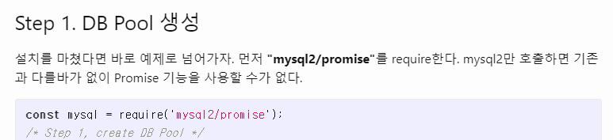

# async/await로 DB 쿼리하기

## API async/await 분석

기존에 만들었던 SQL query async/await을 좀 더 직관적으로 짜기 위해 방법을 알아보던 도중, 한 블로그에서 이런 내용을 만났다.



이 말대로면 현재는 require가 안되어 있기 때문에 제대로 동작하지 않는다는 것이다.

확실하진 않지만 아마도 현재는 강제적으로 Promise를 만드는 방식이기 때문에 동작이 가능한 것으로 보이고, 이를 mysql2/promise로 바꾸면 mysql 자체에서 promise를 return해줄 것으로 보인다. 현재는 getConnection 앞에다가 await을 붙이면 의미없는 await이라고 나오는데, 저 옵션을 enable 해주면 해결될 수도 있을 것으로 보임.

## async/await DB query in API

[Tip](http://tip.addrgo.com/CIUSER/index.php/Board_default/record_view/bbs_flag/etc/bbs31_num/29)

```javascript
const mysql = require('mysql2');

const connection = mysql.createConnection({
  host: 'host',
  user: 'user',
  password: 'password',
  database: 'database'
});

const queryData = async (query) => {
  return new Promise((resolve, reject) => {
    connection.query(query, (error, results) => {
      if (error) {
        reject(error);
      } else {
        resolve(results);
      }
    });
  });
};

const getData = async () => {
  const query = 'SELECT * FROM table';
  try {
    const results = await queryData(query);
    console.log(results);
  } catch (error) {
    console.error(error);
  }
};

getData();
```

In node.js, I want to make an API that uses a query to get data from SQL Data-base. It's URL is /getData and POST method is used. In this case, I want to make my query as async function and will be divide them into serveral files to imporve efficiency and readability. What's the best code to implement this? I'm not going to import mysql2/promise, but import mysql2.

```javascript
const express = require('express');
const bodyParser = require('body-parser');
const mysql = require('mysql2');

const app = express();
app.use(bodyParser.json());

const connection = mysql.createConnection({
  host: 'localhost',
  user: 'root',
  password: 'password',
  database: 'database_name'
});

app.post('/getData', async (req, res) => {
  try {
    const query = req.body.query;
    const [rows] = await connection.promise().query(query);
    res.json({
      data: rows
    });
  } catch (error) {
    console.error(error);
    res.status(500).json({
      error: 'An error occurred while retrieving data from the database'
    });
  }
});

const PORT = process.env.PORT || 3000;
app.listen(PORT, () => {
  console.log(`Server running on port ${PORT}`);
});
```

In this example, we use the `express` library to create a server and the `body-parser` library to parse the incoming JSON data in the request body. The `mysql2` library is used to create a connection to the database and execute the query.

In the `/getData` endpoint, we extract the query from the request body and execute it using the `connection.promise().query` method, which returns a Promise that resolves to the results of the query. If the query is successful, the results are sent back to the client in the response body. If an error occurs, a 500 error is returned to the client with an error message.

```javascript
try {
        const conn = await new Promise((resolve, reject) => {
            pool.getConnection((err, conn) => {
                if (err) reject(err);
                resolve(conn);
            });
        })
        const [rows] = await conn.promise().query(QUERY_STR);
        conn.release();
        res.json(1);
    } catch (error) {
        console.error(error);
        res.status(404).json({
            error: 'An error occurred while retrieving data from the DB'
        })
    }
```

```javascript
let conn;

    try {
        conn = await new Promise((resolve, reject) => {
            pool.getConnection((err, conn) => {
                if (err) reject(err);
                resolve(conn);
            });
        })
        const [rows] = await conn.promise().query(QUERY_STR);
        res.json(1);
    } catch (error) {
        console.error(error);
        res.status(404).json({
            error: 'An error occurred while retrieving data from the DB'
        })
    } finally {
        if (conn) {
            conn.release();
        }
    }
```

⇒ 여러 형태를 알아보면서 가장 이상적인 형태를 찾은 것 같다. `MySQL configuration`에서 `“Promise”: “Promise”`를 설정하면 callback에 의한 query뿐만 아니라 promise에 의한 query도 수행할 수 있다. 그러면 위에 처럼 conn.promise()를 통해 query를 수행할 수 있게 되며, promise이기 때문에 비동기적으로 결과를 전달받게 된다. 이 경우, catch phrase를 만들어서 에러가 발생할 경우 처리를 해주도록 하며, conn을 let으로 상단에 선언, finally를 이용해 try, catch 모두에서 conn을 release 해주도록 설정한다. 만약 단일 쿼리를 사용할 경우 이와 같은 형태를 활용하면 매우 좋을 것이다.

현재 만들어진 형태를 module화 한 다음, query와 pool까지 입력하는 형태로 만들어 준다면 굉장히 유용하게 사용할 수 있을 것이다.

## 다중 쿼리(multiple queries)

- async/await을 이용한 다중 쿼리 `(synchronous)`

```javascript
app.post('/getData', async (req, res) => {
  let conn;
  try {
    const query1 = req.body.query1;
    const query2 = req.body.query2;
    conn = await new Promise((resolve, reject) => {
      pool.getConnection((err, connection) => {
        if (err) reject(err);
        resolve(connection);
      });
    });
    const [rows1] = await conn.promise().query(query1);
    const [rows2] = await conn.promise().query(query2);
    res.json({
      data1: rows1,
      data2: rows2
    });
  } catch (error) {
    console.error(error);
    res.status(500).json({
      error: 'An error occurred while retrieving data from the database'
    });
  } finally {
    if (conn) {
      conn.release();
    }
  }
});
```

> Q.
>
> In this code, do queries are asynchronous? I mean, do they work simultaneously? If they're not, revise this code to the queries do work simultaneously.
>
> A.
>
> No, the queries in this code are not executed simultaneously. They are executed one after the other in the order they are written.
>
> If you want the queries to be executed simultaneously, you can use `Promise.all` to wrap the queries and run them in parallel:

- `Promise.all()`을 이용한 다중 쿼리
    (asynchronous, both queries are executed simultaneously…)

```javascript
app.post('/getData', async (req, res) => {
  let conn;
  try {
    const query1 = req.body.query1;
    const query2 = req.body.query2;
    conn = await new Promise((resolve, reject) => {
      pool.getConnection((err, connection) => {
        if (err) reject(err);
        resolve(connection);
      });
    });
    const [rows1, rows2] = await Promise.all([
      conn.promise().query(query1),
      conn.promise().query(query2)
    ]);
    res.json({
      data1: rows1,
      data2: rows2
    });
  } catch (error) {
    console.error(error);
    res.status(500).json({
      error: 'An error occurred while retrieving data from the database'
    });
  } finally {
    if (conn) {
      conn.release();
    }
  }
});
```

> With this modification, both queries will be executed simultaneously and their results will be stored in `rows1`  and `rows2`  respectively.
