# XAI의 최근 흐름: attribution의 한계와 모델 내부 들여다보기

작성일 2025-01-02
{ .post-date }

"XAI Tutorial 2023"의 강의 "Recent Trends in Explainable Artificial Intelligence"를 듣고 정리한 노트다. [앞 글](01-xai-overview.md)이 설명 방법의 종류를 훑었다면, 이 강의는 두 가지를 다룬다. 입력의 기여도를 구하는 attribution 방법들이 왜 서로 다른 결과를 내는가, 그리고 입력이 아니라 모델 내부의 unit을 직접 들여다보고 고칠 수 있는가다. 뒷부분은 생성 모델(GAN)의 내부를 분석한 연구들을 따라간다.

그림은 강의 슬라이드에서 가져왔다. 강의 링크는 글 끝에 있다.

## 1. 설명가능 AI가 답해야 하는 질문

XAI가 사용자에게 답해 주어야 하는 질문은 다음과 같이 정리된다.

- 왜 그렇게 했는가? (Why did you do that?)
- 왜 다른 것이 아닌가? (Why not something else?)
- 언제 성공하는가? (When do you succeed?)
- 언제 실패하는가? (When do you fail?)
- 언제 믿을 수 있는가? (When can I trust you?)
- 오류를 어떻게 고치는가? (How do I correct an error?)

AI는 사람의 기준으로 판단하지 않을 수 있다. 정지 표지판을 학습시켰을 때 모델은 표지판의 그림이 아니라 색을 학습할 수도 있고, 그러면 우리가 예상한 decision boundary를 벗어난다. 그래서 설명을 보고 "모델이 틀렸다"고 판단하더라도 그 판단이 맞는지 다시 확인해야 한다.

DARPA의 관점으로는 AI의 초점이 규칙을 만드는 것에서 고양이와 강아지를 구분하는 것으로 옮겨 왔고, 이제는 실생활에 적용하기 위한 설명가능 AI와 적은 데이터에도 잘 적응하는 기술이 중요해졌다. 자율주행차라면 AI가 지금 어디에 집중하고 있는지를 운전자에게 알려 주어야 한다. 그래야 앞의 위험을 AI가 인지했는지 운전자가 알 수 있고, 필요하면 수동으로 전환할 수 있다.

강의에서 든 적용 예는 다음과 같다.

- **이상 탐지**: 출장비가 갑자기 늘었다면 계절 효과인지 도난인지 판단해야 한다.
- **신용 평가의 counterfactual**: 입력을 조금씩 바꾸어 출력이 바뀌는 지점을 찾는다. 신용 평가가 나쁘게 나왔을 때 어떤 요소를 최소한으로 바꾸면 결과가 달라지는지 알려 주는 식이다. Counterfactual을 만드는 것 자체는 누구나 할 수 있으므로, 좋은 기술이라면 (1) counterfactual로 결과를 예측할 수 있어야 하고 (2) 여러 선택지 가운데 무엇이 가장 효율적인지 제시할 수 있어야 한다.
- **객체 탐지**: 대상 하나만 보는 것보다 주변의 다른 물체를 함께 볼 때 인식이 더 확실해진다. 아래 그림이 그 예다.
- **Visual Question Answering**: 언어 모델과 이미지, 표 데이터를 결합해 질문에 답하는 연구에서 Integrated Gradients 같은 attribution 알고리즘이 쓰인다.
- **에너지**: 전력망에서 수요가 많을 때와 적을 때를 예측하고 그 이유를 설명하는 것.

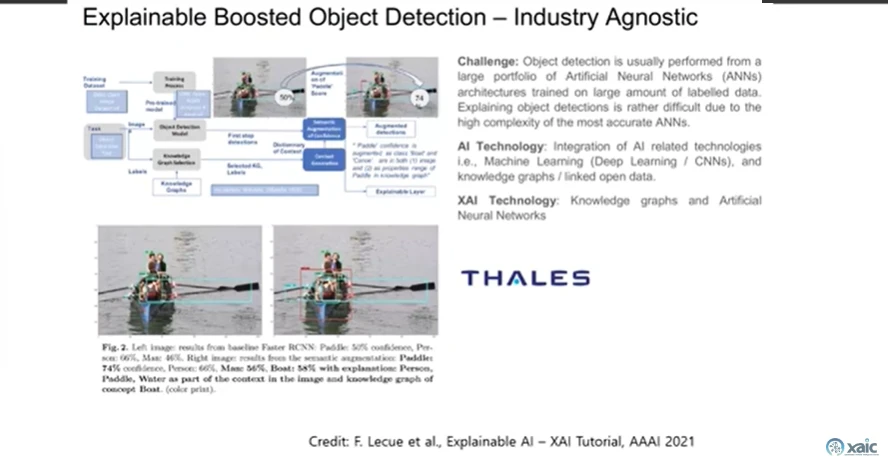

*아래쪽 두 사진이 같은 장면의 탐지 결과다. 왼쪽은 기본 detector, 오른쪽은 지식 그래프의 맥락을 더한 결과다. 출처: 강의 슬라이드(F. Lecue 외, XAI Tutorial, AAAI 2021의 그림)*

노를 젓는 사진에서 기본 detector는 패들을 50%의 confidence로 찾는다(왼쪽 사진). 지식 그래프에는 "패들은 보트, 카누와 함께 나타난다"는 관계가 들어 있고, 같은 사진에 사람과 물이 있다. 이 맥락을 반영하면 패들의 confidence가 74%로 오르고, 보트는 "사람, 패들, 물이 함께 있다"는 설명과 함께 58%로 탐지된다(오른쪽 사진). 노트에는 이 예를 "카누, 50%에서 70%"로 적어 두었는데, 슬라이드의 그림 설명에 적힌 수치는 패들의 50%에서 74%다. 이 부분을 들으며 여러 변수를 함께 보아야 하는 시계열 분야와 비슷하다고 느꼈다.

## 2. 방법론의 지형

XAI 연구는 한 번에 끝나지 않는다. 모델 하나를 만들어 돌리면 끝나는 일이 아니다. Rule-based 모델, 통계 모델, 물리 모델, 딥러닝, 베이지안 모델이 따로 있고 이들이 하나로 잘 통합되지 않는다. 입력 데이터 자체가 다르기 때문에, 어떤 모델을 가장 잘 설명하는 알고리즘은 그 모델의 원리를 알아야 만들 수 있는 경우가 많다.

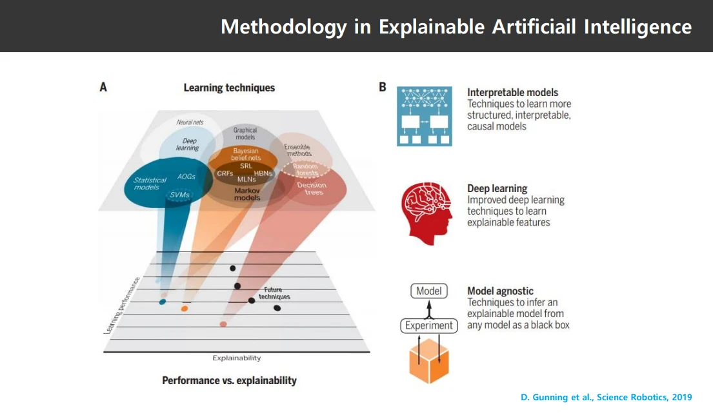

*왼쪽(A)은 학습 기법들을 성능과 설명 가능성 두 축 위에 내려놓은 그림이고, 오른쪽(B)은 설명 가능성을 얻는 세 가지 접근이다. 출처: 강의 슬라이드(D. Gunning 외, Science Robotics, 2019의 그림)*

그림 왼쪽의 위 판에는 신경망, 통계 모델, 그래프 모델, 앙상블, decision tree 같은 기법들이 서로 다른 덩어리로 흩어져 있다. 각 덩어리에서 아래 판으로 내려온 색 점이 그 기법의 자리다. 세로축이 학습 성능, 가로축이 설명 가능성이어서, 기법마다 성능과 설명 가능성의 자리가 다르다는 것을 한눈에 볼 수 있다. 검은 점은 앞으로 만들고자 하는 기법(future techniques)이다.

모델마다 잘 맞는 설명 알고리즘이 다르다면 사람이 하나하나 짝을 지어 주어야 하는가? 강의의 답은 그 일을 프로그램으로 자동화하는 방향이라는 것이다.

접근은 그림 오른쪽처럼 크게 세 갈래로 나뉜다.

| 갈래 | 내용 |
|---|---|
| Interpretable models | 처음부터 구조적이고 해석 가능한 모델을 학습한다. 학습이 끝난 뒤 시스템의 모든 기능을 도구로 전수조사할 수 있기를 바라는 방향이다 |
| Deep learning | 딥러닝 모델이 설명 가능한 feature를 배우도록 개선한다 |
| Model agnostic | 모델을 black box로 두고 바깥에서 설명 모델을 추론한다 |

## 3. attribution 방법마다 결과가 다른 이유

딥러닝에서 입력의 기여도를 정확히 구하는 문제는 아직 다 풀리지 않았다. 같은 모델이라도 설명 알고리즘에 따라 결과가 다르게 나온다. 강의에서 든 이유는 세 가지다.

**1. Pooling.** Max pooling을 거치면 설명은 선택된 값에 대해서만 만들어진다. 그러나 선택되지 않은 주변 픽셀도 결과에 영향을 줄 수 있으므로 이것을 어떻게 다룰지에 따라 결과가 달라진다.

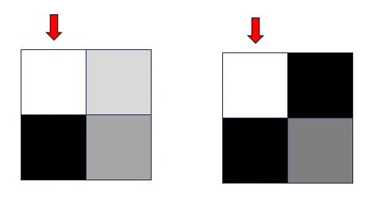{ width="380" }

*2×2 max pooling 창 두 개. 두 경우 모두 화살표가 가리키는 왼쪽 위 칸(가장 밝은 값)이 선택되지만, 나머지 세 칸의 값은 서로 다르다.*

위 그림의 두 창은 pooling을 지나면 같은 값이 된다. Pooling 뒤에서 만든 설명은 화살표가 가리키는 칸만 보게 되고, 두 창에서 서로 달랐던 나머지 세 칸은 설명에서 빠진다.

**2. 양의 기여와 음의 기여.** 대부분의 방법은 결과를 지분 나누듯 입력에 분배한다. 실제 모델에는 양의 기여와 음의 기여가 섞여 있는데, 이것을 나누는 방법에 정답이 없다.

**3. 기준점(base point).** 기여도를 구하더라도 그 영향을 정량화하려면 기준이 필요하다. 컵을 판별하는 기여도라면, 컵이 없는 이미지와 컵이 있는 이미지 사이를 interpolation해야 한다. 기준을 무엇으로 잡느냐에 따라 값이 달라진다.

그래서 딥러닝 모델의 설명은 아직 어려운 수준이고 Transformer도 마찬가지다.

Perturbation 기반 방법의 한계도 짚었다. 입력을 흔들었을 때 출력이 가장 많이 변하는 부분을 중요하다고 보는 것은 그 점에서의 기여(point-wise contribution)다. 그 점에서만 우연히 출력이 크게 흔들릴 수 있으므로 노이즈가 많고, 전체적으로는 틀릴 가능성이 높다. SHAP과 LIME 같은 model-agnostic 방법이 널리 쓰이지만 값을 보정하는 용도에 가깝고, 실제 적용에서는 문제에 맞추어 설계한 모델(tailored model)을 쓰는 편이라는 설명이었다. Tailored model은 특정 문제나 응용 분야에 맞추어 구조, 학습 방법, 출력 형식을 조정해 더 나은 설명을 내도록 설계한 모델이다.

### 압축하면 설명이 깨진다

모델을 압축하면 예측은 그대로인데 설명이 달라지는 경우가 있다.

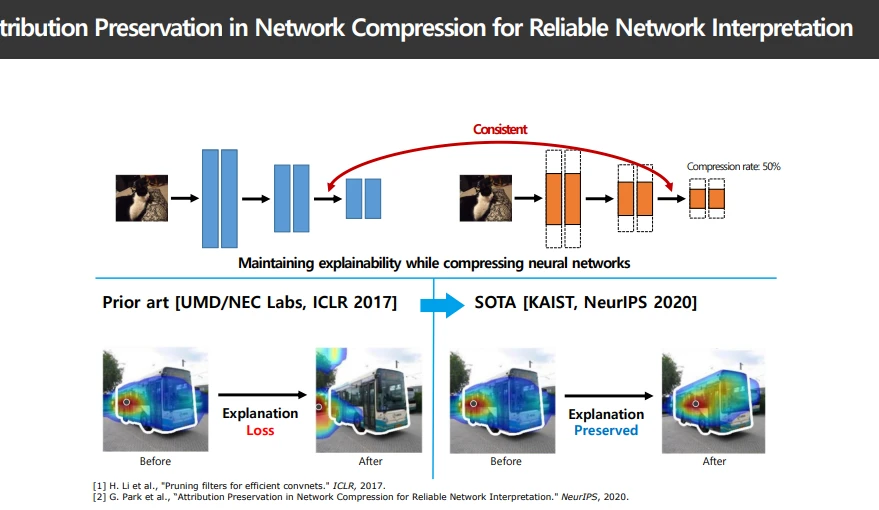

*아래 줄의 버스 사진에서 붉은 영역이 attribution이 높은 곳이다. 왼쪽 방법은 압축 뒤(After)에 붉은 영역이 버스를 벗어나고, 오른쪽 방법은 압축 뒤에도 버스 위에 남아 있다. 출처: 강의 슬라이드*

그림 왼쪽 아래가 기존의 압축 방법이다. 압축 전에는 버스를 잘 짚던 attribution이 압축 후에는 버스 바깥으로 옮겨 간다. 압축은 덜 중요한 파라미터를 없애는 과정인데, 설명에 중요한 것을 없애도 괜찮다고 판단하는 경우가 많기 때문이다. 강의에서는 이 문제를 다룬 연구로 "Attribution Preservation in Network Compression for Reliable Network Interpretation"을 소개했다. 그림 위쪽처럼 원래 네트워크와 압축한 네트워크(예시는 압축률 50%)의 attribution이 일치하도록(consistent) 만드는 것이 목표이고, 오른쪽 아래가 그 결과다.

## 4. 내부 unit의 역할을 찾을 수 있는가

강의의 뒷부분은 네 개의 질문으로 이어진다. 첫 번째 질문은 딥러닝 모델 내부 unit의 역할을 찾을 수 있는가다.

### Network Dissection과 Deep Dream

모델 내부에 자동차를 찾는 노드가 있을까? 있다면 어떻게 찾을까? 강의는 모델 내부를 분석한 선행 연구 네 가지를 한 장에 모아 보여 주었다.

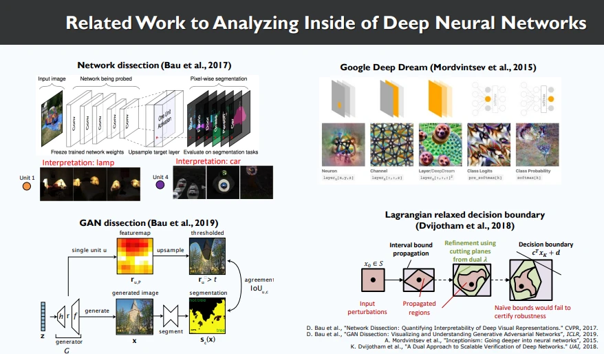

*왼쪽 위가 Network Dissection, 오른쪽 위가 Deep Dream, 왼쪽 아래가 GAN Dissection, 오른쪽 아래가 verification 연구다. 출처: 강의 슬라이드*

**Network Dissection**(왼쪽 위)은 semantic segmentation label이 있는 데이터를 쓴다. Label이 있으니 이미지에서 자동차가 어디에 있는지 안다. 자동차가 있는 이미지가 들어올 때마다 자주 활성화되는 노드가 어떤 채널에 있다면, 그 부분이 자동차를 판단하는 곳이라고 볼 수 있다. 그림 아래쪽의 작은 사진들이 그 결과다. Unit 1이 강하게 반응한 영역만 남기면 전등이 보이고(lamp), Unit 4는 자동차 바퀴 쪽에 반응한다(car).

**Deep Dream**(오른쪽 위)은 반대 방향이다. 노드 하나를 정하고 그 노드의 activation을 최대화하는 입력을 생성한다. 그림처럼 대상을 뉴런 하나, 채널, layer, class 출력으로 바꾸어 가며 입력을 만들 수 있고, 생성된 입력을 보면 그 채널과 노드의 역할을 간접적으로 알 수 있다.

왼쪽 아래의 GAN Dissection은 5절에서, 오른쪽 아래의 verification은 바로 다음에서 다룬다.

### Verification이 어려운 이유

Verification은 "입력을 조금 흔들었을 때 틀린 출력이 나오는 경우가 있는가"를 따지는 일이다. 입력을 흔들 수 있는 범위를 하나의 영역으로 잡고, 그 영역이 layer를 지나며 어떤 모양이 되는지를 따라간다.

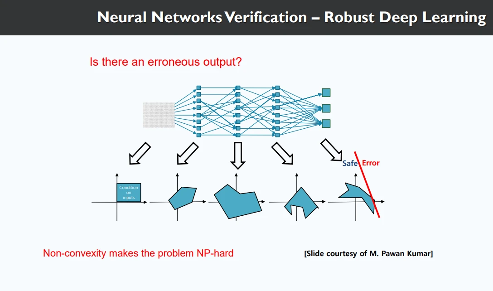

*아래 줄의 파란 도형이 layer마다의 영역이다. 맨 왼쪽의 네모(입력 조건)가 오른쪽으로 갈수록 찌그러지고 움푹 패인다. 맨 오른쪽의 빨간 선이 안전(Safe)과 오류(Error)를 가르는 경계다. 출처: 강의 슬라이드*

Affine transform은 선형 연산이라 입력 공간의 모양을 그대로 옮긴다. ReLU 같은 비선형 activation을 만나면 음수 값이 사라지면서 공간이 접히거나 구멍이 뚫린다. 그림에서 세 번째, 네 번째 도형이 움푹 패인 모양이 되는 것이 그 결과다. 그렇게 변형된 공간 안에서는 어떤 점이 빨간 경계를 넘었는지 판단하기 어렵고, 볼록하지 않은 이 공간을 정확히 다루는 것은 NP-hard 문제다.

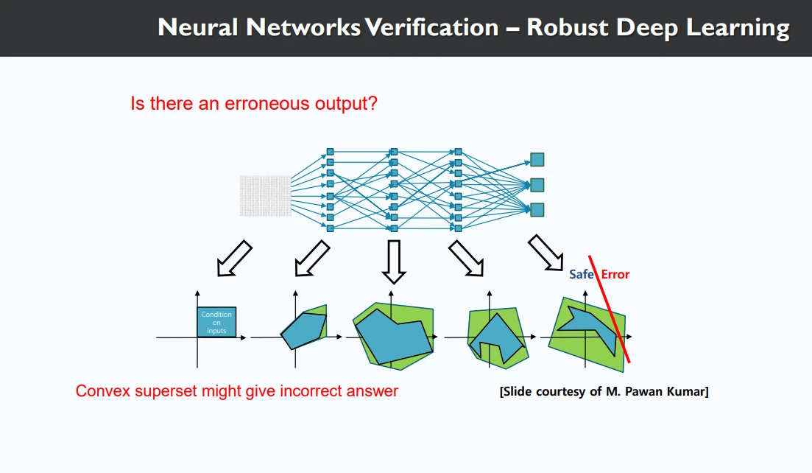

*초록 영역이 파란 영역을 감싼 볼록 집합이다. 실제 영역보다 넓어서, 마지막 단계에서 빨간 경계를 더 크게 넘는다. 출처: 강의 슬라이드*

그래서 볼록 다각형으로 감싸서 풀어 보려는 시도가 있다. 볼록한 모양은 다루기 쉽기 때문이다. 하지만 위 그림처럼 감싼 영역은 실제 영역보다 크므로, 감싼 영역을 기준으로 판단하면 실제 영역을 보았을 때와 다른, 틀린 답이 나올 수 있다. 여전히 어려운 문제다.

### Generative boundary

여기서부터는 GAN의 내부를 돋보기로 보듯 들여다보는 연구 "Explorative Generative Boundary Aware Sampling"(E-GBAS)이다. 하려는 일은 한 문장으로 말할 수 있다. 생성 모델의 어떤 layer에서 "같은 방식으로 만들어지는" 이미지들을 모아 보여 주는 것이다.

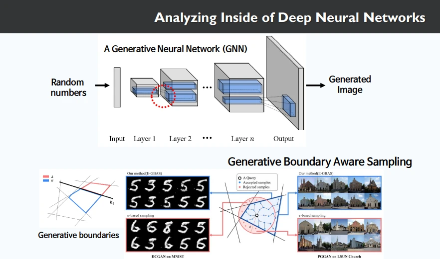

*위쪽은 난수에서 이미지를 만드는 생성 모델이고 빨간 점선 원이 들여다보려는 layer다. 아래쪽은 그 layer의 경계를 지키며 뽑은 표본(파란 테두리)과 거리만 보고 뽑은 표본(빨간 테두리)의 비교다. 출처: 강의 슬라이드*

그림 아래쪽의 숫자 예를 보면 차이가 드러난다. 경계를 지키며 뽑은 표본(위)은 대부분 5인데, 반경만 정해 놓고 뽑은 표본(아래)에는 6과 8이 여럿 섞여 있다. 오른쪽의 교회 사진도 같은 비교다. 이 "경계"와 "경계로 둘러싸인 영역"을 정의하는 것이 출발점이다.

딥러닝 모델은 layer별로 보면 선형 모델이다. 그래서 각 노드에 대해, 결정을 가르는 초평면의 어느 쪽에 있는지가 중요하다.

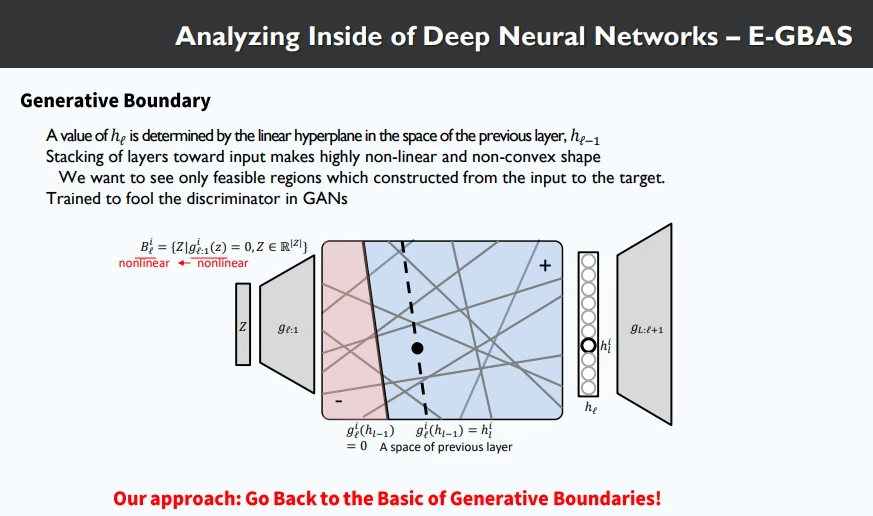

*가운데 네모가 직전 layer의 공간이고 그 안의 선 하나하나가 노드 하나의 경계다. 굵은 실선이 노드 $h_\ell^i$의 값이 0이 되는 경계이고, 그 오른쪽(파랑)에서는 이 노드가 양수, 왼쪽(분홍)에서는 음수다. 출처: 강의 슬라이드*

- **Generative boundary**: 어떤 layer의 노드 하나의 값이 0이 되는, 즉 양수와 음수가 갈리는 경계다. 이 값은 직전 layer의 공간에서 초평면 하나로 정해진다. 위 그림에서 선 하나가 노드 하나에 해당한다. 개념 자체는 단순하지만 이 연구에서 처음 정의했다. Layer를 입력 쪽으로 거슬러 쌓아 가면 이 경계들은 입력 공간에서 비선형이고 볼록하지 않은 모양이 된다.
- **Generative region**: 여러 generative boundary로 둘러싸인 영역이다. 같은 영역 안의 점들은 그 layer에서 노드들의 부호 패턴이 같다.

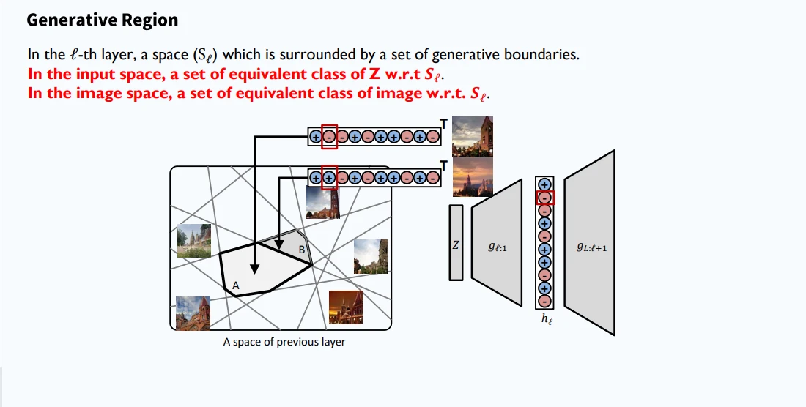

*굵은 선으로 둘러싸인 A와 B가 generative region이다. 위쪽의 +, − 줄이 각 영역의 부호 패턴인데, 이웃한 A와 B는 빨간 네모로 표시한 노드 하나의 부호만 다르다. 출처: 강의 슬라이드*

위 그림에서 A에서 B로 넘어가는 것은 경계선 하나를 넘는 것이고, 그것은 노드 하나의 부호가 뒤집히는 것과 같다. 반대로 한 영역 안에 머무는 동안에는 부호 패턴이 그대로다. 그래서 한 영역 안을 촘촘히 샘플링해 생성 결과를 보면, 그 영역에서 GAN이 어떤 이미지를 만드는지 알 수 있다. 연구가 푸는 문제도 이것이다. GAN $G$, 살펴볼 layer $\ell$, 질의로 줄 입력 $z_0$가 주어졌을 때, $z_0$와 같은 generative region에서 만들어지는 이미지들을 찾는다.

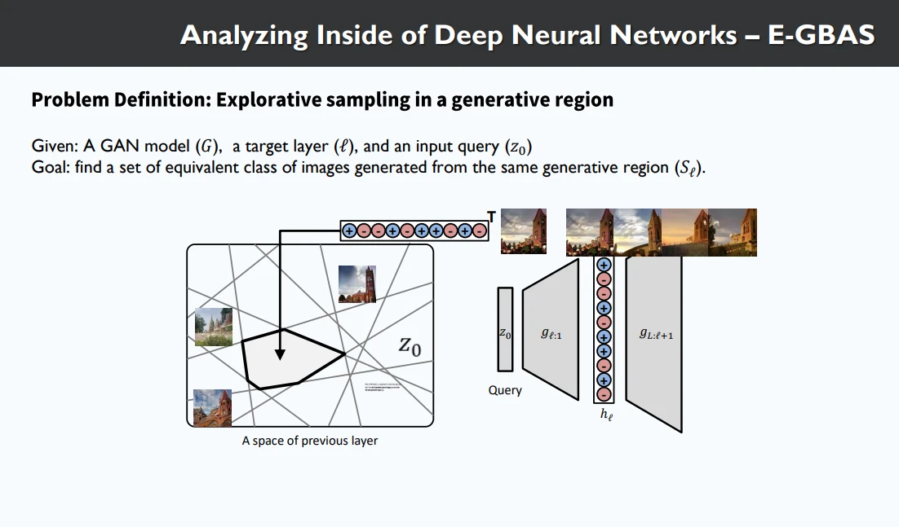

*질의 $z_0$가 속한 영역(굵은 선) 안에서 표본을 뽑으면, 오른쪽 위처럼 같은 탑이 하늘과 조명만 달라진 이미지들이 나온다. 출처: 강의 슬라이드*

경계의 수가 너무 많은 것이 첫 번째 어려움이다. 경계를 전부 쓰면 영역이 지나치게 좁아지고 계산도 비싸다. 그런데 모든 경계가 출력에 같은 정도로 영향을 주는 것은 아니므로 중요한 것만 남긴다.

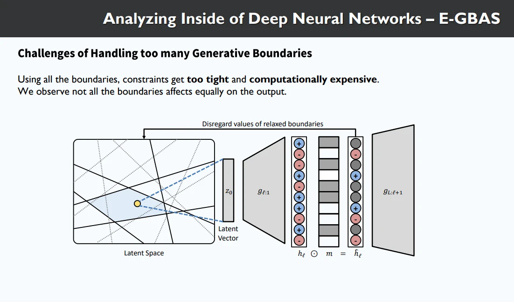

*오른쪽에서 노드의 값 $h_\ell$에 mask $m$을 곱해 일부 노드를 끈다(회색). 꺼진 노드의 경계는 왼쪽 공간에서 점선이 되어 무시되고, 실선만으로 둘러싸인 영역(하늘색)이 남는다. 출처: 강의 슬라이드*

어떤 노드를 끌지는 **Bernoulli mask optimization**으로 정한다. 각 노드에 켜질지 꺼질지를 정하는 mask $m$을 두고 그 확률 $\theta$를 학습한다. 1이면 항상 켜지고 0이면 항상 꺼진다. 목적은 두 가지다. Mask를 씌운 채로 생성한 결과가 원래 결과와 비슷해야 하고, 켜져 있는 값은 가능한 한 적어야 한다. 슬라이드의 식으로는 다음과 같다.

$$
\theta^* = \arg\min_\theta\ \big\lVert g_{L:\ell+1}\big(g_{\ell:1}(z_0) \odot m\big) - G(z_0) \big\rVert + \lambda \lVert \theta \rVert_1, \qquad m \sim \mathrm{Ber}(\theta)
$$

앞의 항이 mask를 씌운 이미지와 원래 이미지의 차이(reconstruction error)이고, 뒤의 항이 켜진 노드를 줄이는 L1 정규화다. 이렇게 하면 어떤 경계가 중요한지 간접적으로 알 수 있다.

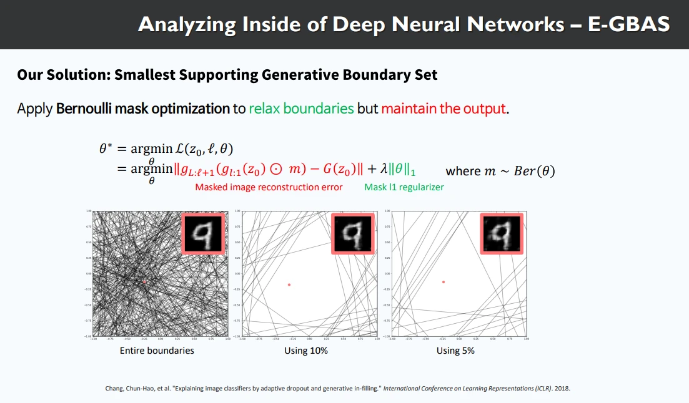

*세 칸은 같은 입력(빨간 점) 주변의 경계를 전부, 10%, 5%만 그린 것이고, 각 칸 오른쪽 위가 그때 생성된 숫자다. 경계가 훨씬 줄어도 숫자 9는 거의 그대로다. 출처: 강의 슬라이드*

실제로 경계의 10%나 5%만 써도 결과가 생각보다 크게 달라지지 않는다.

두 번째 어려움은 영역 안에서 샘플링하는 일이다. 차원이 높고 초평면이 많아서 다루기 어렵고(슬라이드의 예로는 PGGAN의 네 번째 layer가 512차원을 8192차원으로 보낸다), 비선형 activation 때문에 위쪽 layer에서는 영역이 볼록하지 않다.

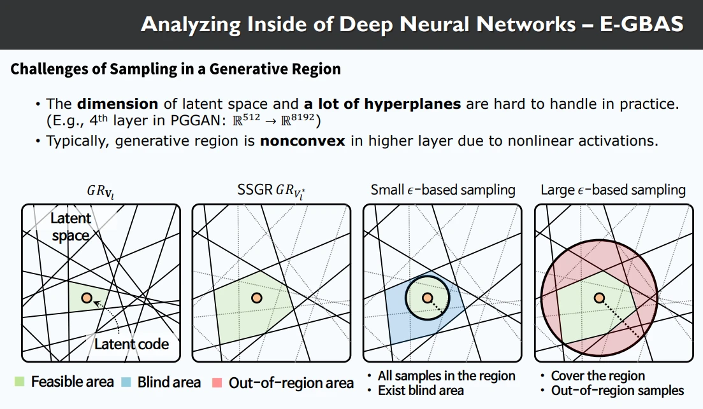

*초록이 표본을 뽑아야 하는 영역, 파랑이 놓치는 영역(blind area), 빨강이 영역 밖이다. 첫 칸은 경계를 전부 쓴 영역, 둘째 칸은 경계를 줄여 넓힌 영역, 셋째와 넷째 칸은 반경 $\epsilon$이 작을 때와 클 때다. 출처: 강의 슬라이드*

한 점을 중심으로 반경 $\epsilon$ 안에서 샘플링하는 방식($\epsilon$-based sampling)을 위 그림의 오른쪽 두 칸에서 볼 수 있다. $\epsilon$이 작으면 원 안의 표본은 모두 영역 안에 있지만 영역을 다 덮지 못해 파란 부분을 놓친다. $\epsilon$이 크면 영역은 다 덮지만 경계를 넘어 빨간 부분, 곧 영역 밖의 표본이 섞인다. 원 하나로는 다각형 모양의 영역을 맞출 수 없다.

이 문제를 풀려고 쓴 것이 **GB-RRT**(Generative Boundary constrained Rapidly-exploring Random Tree)다. RRT는 나무가 가지를 뻗듯 공간을 탐색하는 알고리즘인데, 탐색만 하는 것이 아니라 probabilistically complete하다는 성질이 있다. 시간을 충분히 주면 아주 좁은 곳도 촘촘히 채운다. 경계를 넘지 않도록 제약을 건 RRT로 영역 안을 탐색하므로, 뽑힌 표본은 항상 영역 안에 있다.

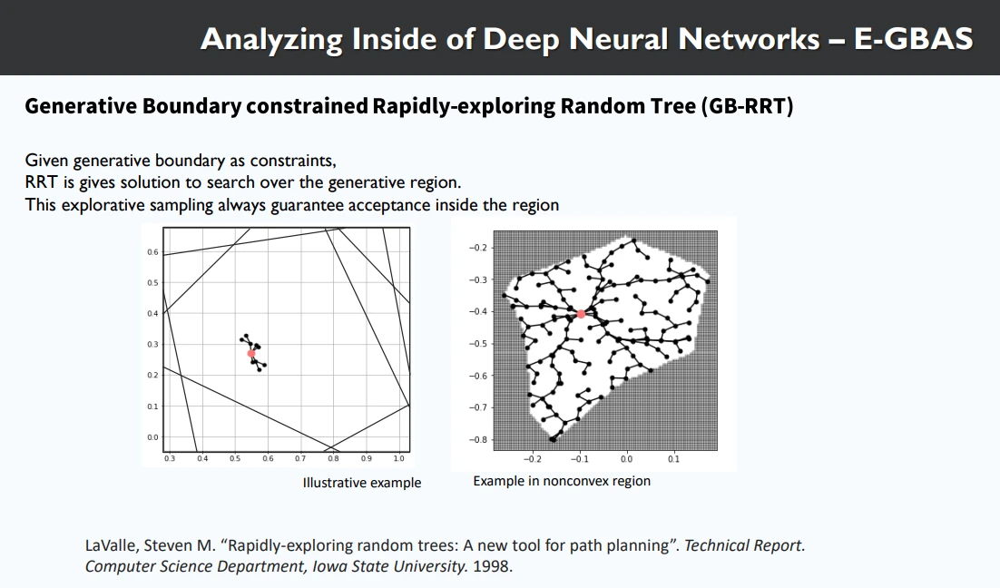

*왼쪽은 질의 점(빨간 점)에서 가지가 뻗기 시작하는 모습이고, 오른쪽은 볼록하지 않은 영역(흰 부분)을 가지가 구석까지 채운 모습이다. 출처: 강의 슬라이드*

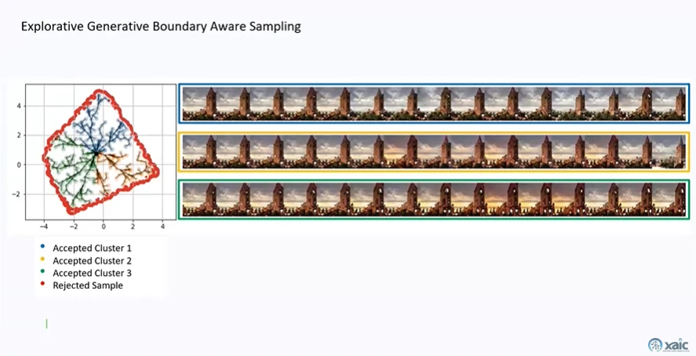

*왼쪽에서 파랑, 노랑, 초록이 받아들인 표본의 세 묶음이고, 가장자리의 빨간 점이 경계를 넘어 버린 표본이다. 오른쪽은 묶음별로 생성한 이미지다. 출처: 강의 슬라이드*

실제 GAN에 적용한 결과가 위 그림이다. 빨간 점들이 영역의 테두리를 그리고 있고 그 안쪽을 가지가 채운다. 세 묶음에서 만든 이미지는 모두 같은 탑이고, 묶음에 따라 하늘의 색과 밝기 정도가 다르다.

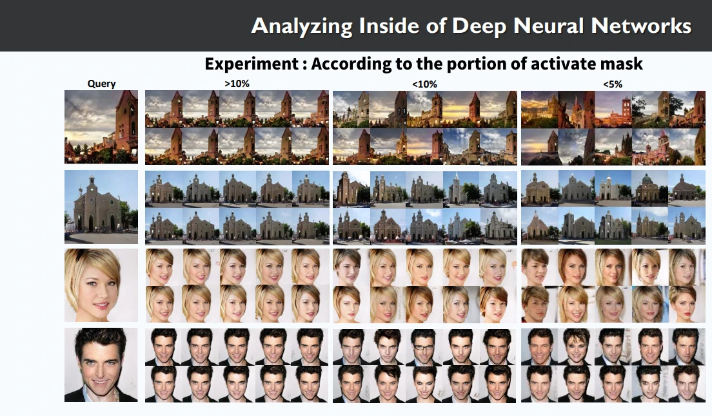

*맨 왼쪽이 질의 이미지이고, 오른쪽으로 갈수록 남기는 경계의 비율이 줄어든다(10% 초과, 10% 미만, 5% 미만). 출처: 강의 슬라이드*

파라미터(경계)를 얼마나 남기느냐에 따라 탐색되는 영역이 달라진다. 위 그림에서 경계를 많이 남기면 질의와 거의 같은 이미지만 나오고, 적게 남길수록 영역이 넓어져 건물의 모양이나 얼굴의 방향, 머리 모양까지 달라진 이미지가 나온다.

## 5. 잘못 동작하는 unit을 찾고 제어할 수 있는가

두 번째와 세 번째 질문이다. 전수조사를 하지 않고도 artifact를 만드는 unit을 찾을 수 있는가, 그리고 그것을 통제할 수 있는가.

### GAN Dissection

GAN Dissection은 생성 모델의 unit 하나가 이미지의 무엇을 만드는지를 찾는 방법이다. Unit의 activation을 semantic segmentation과 비교한다.

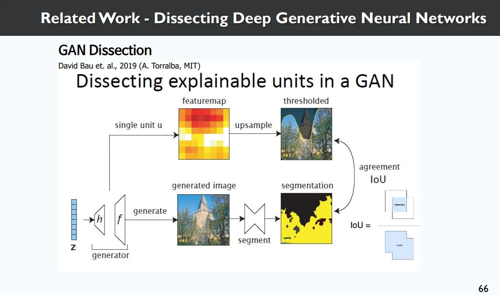

*위 줄은 unit 하나의 feature map을 키워서(upsample) 값이 큰 영역만 남긴 것이고, 아래 줄은 생성된 이미지를 segmentation한 것이다. 두 영역이 얼마나 겹치는지를 IoU로 잰다. 출처: 강의 슬라이드(D. Bau 외, 2019의 그림)*

어떤 unit이 강하게 켜진 영역이 segmentation의 "나무" 영역과 많이 겹치면 그 unit은 나무를 만드는 unit이라고 본다. 이렇게 하면 어떤 unit이 활성화될 때 어떤 결과가 나오는지 볼 수 있다.

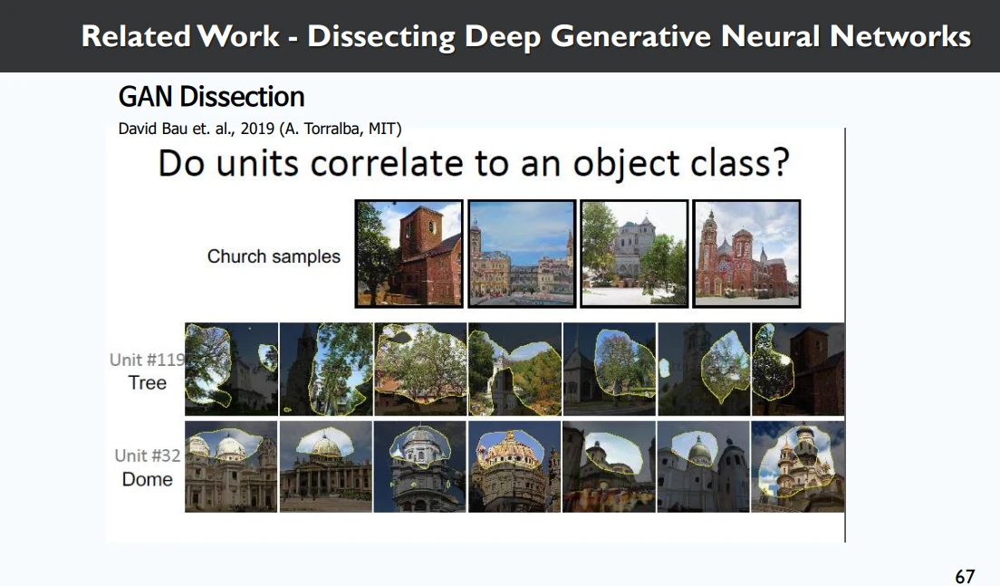

*교회 이미지를 생성하는 GAN에서 Unit #119가 켜진 영역(노란 테두리)은 나무이고, Unit #32가 켜진 영역은 돔이다. 출처: 강의 슬라이드(D. Bau 외, 2019의 그림)*

같은 방법으로 잘못된 결과를 만드는 unit도 찾을 수 있다.

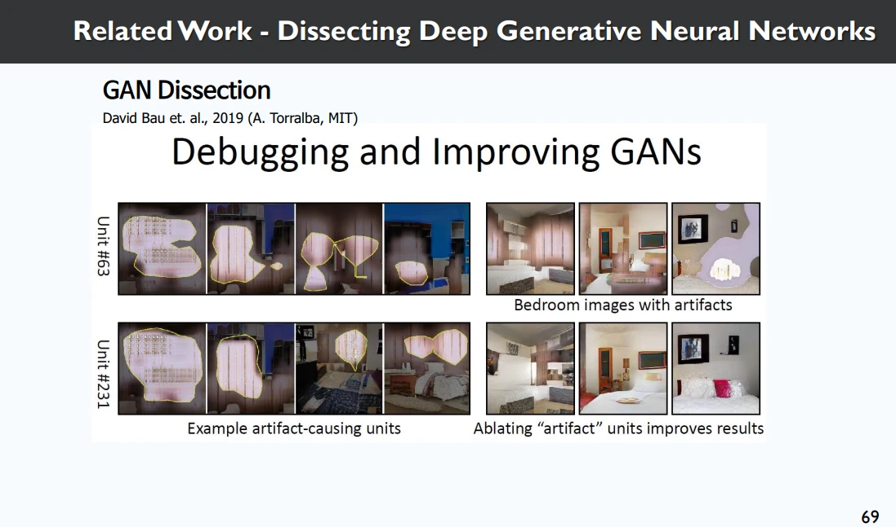

*왼쪽은 Unit #63과 #231이 켜진 영역으로, 모두 뭉개진 무늬다. 오른쪽 위는 artifact가 낀 침실 이미지이고, 오른쪽 아래는 그 unit들을 끄고 다시 생성한 이미지다. 출처: 강의 슬라이드(D. Bau 외, 2019의 그림)*

침실 이미지를 생성할 때 artifact가 끼는 경우가 있는데, 관련된 unit을 수동으로 찾아 끄면 위 그림 오른쪽 아래처럼 온전한 이미지가 생성된다.

### Artifact를 만드는 unit의 자동 교정

수동으로 끄는 대신 자동으로 찾고자 한 연구다. 흐름은 아래 그림의 위쪽 줄을 왼쪽에서 오른쪽으로 따라가면 된다.

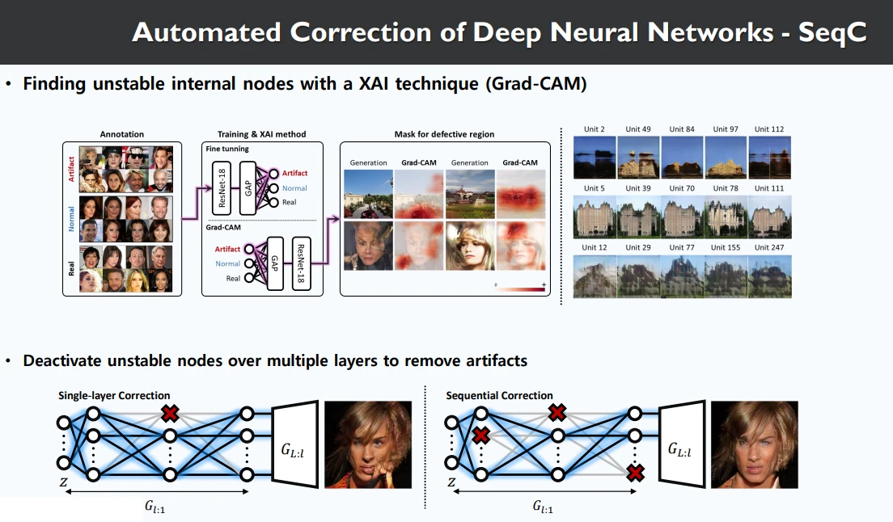

*위 줄은 label 붙이기, classifier 학습과 Grad-CAM, 문제 영역의 mask, 그 mask와 비슷하게 켜지는 unit들이다. 아래 줄은 한 layer에서만 unit을 끈 결과와 여러 layer에 걸쳐 차례로 끈 결과다. 출처: 강의 슬라이드*

1. 생성 결과에 artifact가 있는지 label을 붙인다(artifact, normal, real).
2. 그 label로 artifact 여부를 판별하는 classifier를 학습한다.
3. Artifact가 있다고 판별된 이미지에 Grad-CAM을 적용하면 어느 영역이 문제인지 표시할 수 있다(그림의 붉은 영역). Grad-CAM은 마지막 단에서 양의 출력에 어디가 기여했는지를 계산하는 방법이라고 이해하면 된다.
4. 그 다음은 Network Dissection과 같은 방식이다. Grad-CAM 결과를 mask로 삼아 이것과 activation이 가장 비슷한 unit을 찾는다.

그런 unit을 순차적으로 끄면 이미지가 개선된다. 그림 아래 줄의 두 얼굴을 비교하면, 한 layer에서만 끈 왼쪽보다 여러 layer에 걸쳐 차례로 끈 오른쪽이 더 자연스럽다.

### 관찰: discriminator가 속는 경우

모든 decision boundary가 나쁜 것은 아니다. 다만 생성 공간은 연속적이어서, 두 점 사이를 이동하며 결과를 보면 중간중간 애매한 구간이 생길 수밖에 없다.

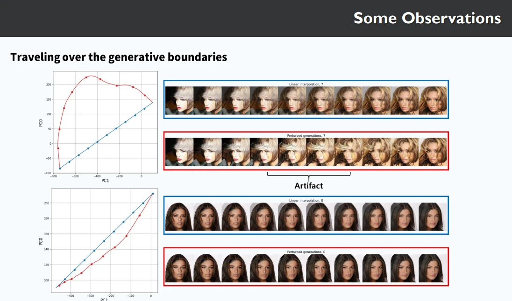

*왼쪽 그래프의 파란 선은 두 점을 직선으로 잇는 경로(linear interpolation), 빨간 선은 그 경로를 흔든 경로(perturbed)다. 오른쪽은 경로를 따라 생성한 이미지로, 위 예의 빨간 경로에서는 중간에 artifact가 나타나고 아래 예에서는 두 경로 모두 문제가 없다. 출처: 강의 슬라이드*

같은 방식으로 discriminator도 살펴보았다. Discriminator의 출력은 높으면 real, 낮으면 fake다. 입력 공간의 한 점 주변을 격자로 조금씩 움직이며 이 값을 그려 본다.

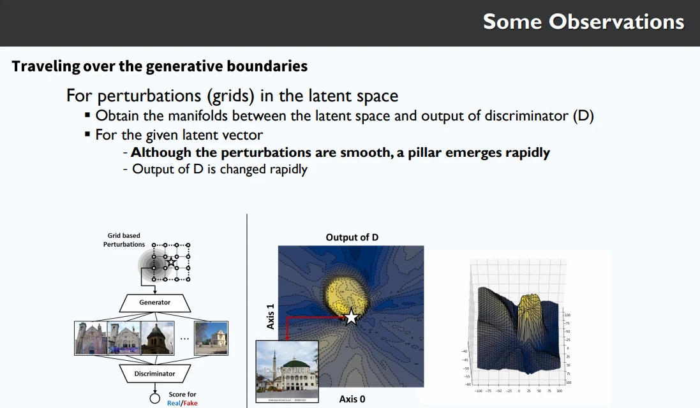

*가운데 등고선과 오른쪽 3차원 그림이 discriminator의 출력이다. 입력은 부드럽게 바꾸었는데 노란 부분에서만 값이 기둥처럼 솟는다. 출처: 강의 슬라이드*

그려 보면 국소적인 spike가 나타난다. 조사해 보니 그 지점의 이미지에는 watermark가 들어 있었다(노트에는 caption이라고 적었다). 학습 데이터에 watermark가 찍힌 이미지가 섞여 있었기 때문이다.

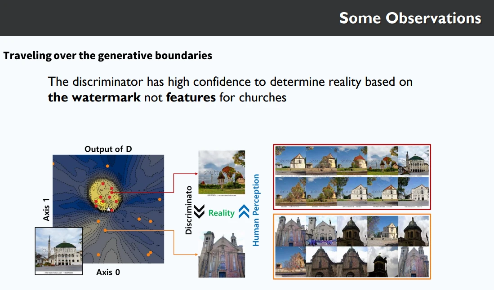

*빨간 점(기둥 안)에서 생성한 이미지에는 사진 판매 사이트의 watermark가 찍혀 있고, 주황 점(기둥 밖)에서 생성한 이미지에는 없다. 출처: 강의 슬라이드*

Discriminator는 교회의 특징이 아니라 watermark를 보고 진짜라고 확신한 것이다. 슬라이드는 이것을 discriminator의 판단과 사람이 느끼는 사실감이 어긋나는 예로 들었다.

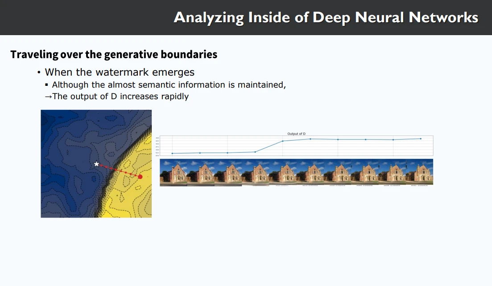

*왼쪽의 별에서 빨간 점까지 이동하며 생성한 이미지와 그때의 discriminator 출력이다. 건물은 거의 그대로인데, 아래쪽에 watermark 글자가 나타나기 시작하는 지점에서 출력이 계단처럼 오른다. 출처: 강의 슬라이드*

이미지 자체가 더 진짜 같은 것이 아닌데도 watermark가 들어가기 시작하는 지점부터 값이 갑자기 올라간다. 값이 높다고 항상 진짜 같은 것은 아니고, 모델이 속은 것이다.

## 6. label 없이 고칠 수 있는가

네 번째 질문은 잘못 동작하는 unit을 unsupervised로 교정할 수 있는가다. 앞의 연구에서 label을 붙여 가며 좋은 unit과 나쁜 unit의 특징을 어느 정도 파악했으므로 그 특징을 가설로 세울 수 있다. 아직은 휴리스틱에 가깝다.

**가설 1. 국소적으로 활성화되는 뉴런은 불안정하다.** 입력이 변할 때 아주 좁은 영역에서만 강하게 활성화되었다가 사라지는 unit이 있다. 원래 없어져야 했는데 학습 과정에서 없어지지 못한 것으로 본다.

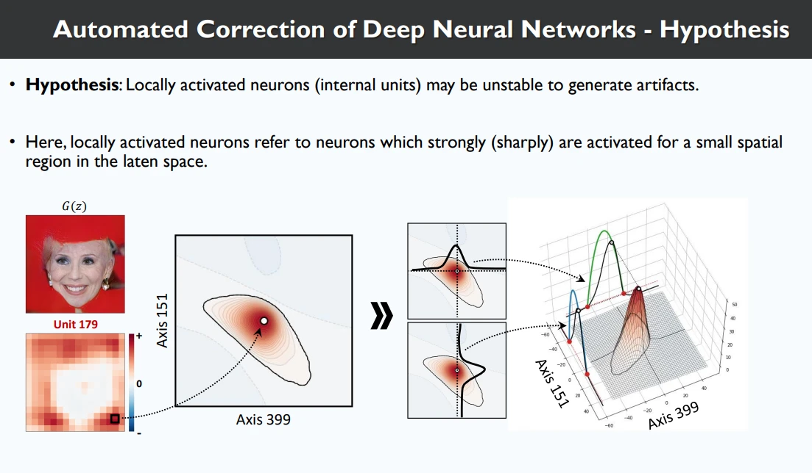

*왼쪽은 생성된 이미지와 Unit 179의 activation map이다. 가운데와 오른쪽은 입력의 두 축(151, 399)을 움직일 때 이 unit의 값이 어떻게 변하는지를 그린 것으로, 좁은 범위에서만 뾰족하게 솟는다. 출처: 강의 슬라이드*

어떤 unit은 입력이 조금만 달라져도 activation이 날카롭게 변하고, 어떤 unit은 부드럽게 변한다.

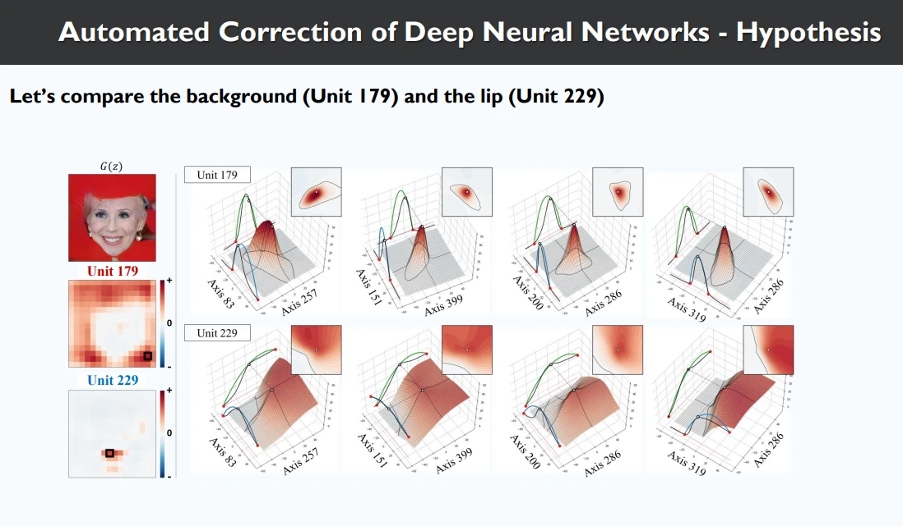

*위 줄이 배경에 반응하는 Unit 179, 아래 줄이 입술에 반응하는 Unit 229다. 축의 조합을 네 가지로 바꾸어도 위 줄은 뾰족한 봉우리이고 아래 줄은 완만한 언덕이다. 출처: 강의 슬라이드*

위 그림에서 Unit 179는 어느 축으로 움직여도 좁은 범위에서만 날카롭게 켜지고, Unit 229는 입력에 따라 부드럽게 변한다. 이 차이를 수치로 재려고 정의한 것이 curvature of local activation(CLA)이다.

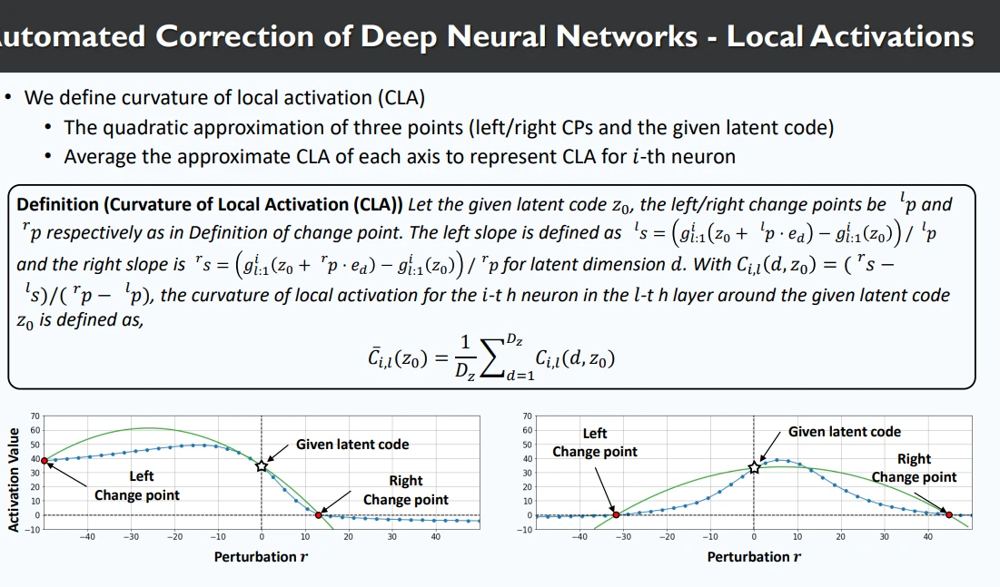

*아래 두 그래프에서 파란 점선이 입력의 한 축을 $r$만큼 움직일 때의 activation이고, 초록 곡선이 세 점(왼쪽 change point, 주어진 입력, 오른쪽 change point)을 지나는 이차함수다. 출처: 강의 슬라이드*

한 축의 값을 키우거나 줄이면서 activation의 변화를 보고, 왼쪽과 오른쪽의 change point와 주어진 입력의 세 점을 이차함수로 적합해 곡률을 구한다. 왼쪽과 오른쪽 change point의 위치를 ${}^{l}p$, ${}^{r}p$라 하고 주어진 입력에서 각 change point까지의 기울기를 ${}^{l}s$, ${}^{r}s$라 하면, 축 $d$에서의 곡률과 그것을 모든 축에 대해 평균한 값은 다음과 같다.

$$
C_{i,\ell}(d, z_0) = \frac{{}^{r}s - {}^{l}s}{{}^{r}p - {}^{l}p}, \qquad \bar{C}_{i,\ell}(z_0) = \frac{1}{D_z}\sum_{d=1}^{D_z} C_{i,\ell}(d, z_0)
$$

$D_z$는 입력의 차원 수이고, $\bar{C}_{i,\ell}(z_0)$가 $\ell$번째 layer의 $i$번째 뉴런이 입력 $z_0$ 근처에서 얼마나 날카롭게 변하는지를 나타낸다. 이 값으로 생성 결과를 나누어 보았다. 입력 1만 개를 무작위로 뽑아 생성마다 점수를 계산하고, 점수가 높은 1천 개와 낮은 1천 개를 비교한다.

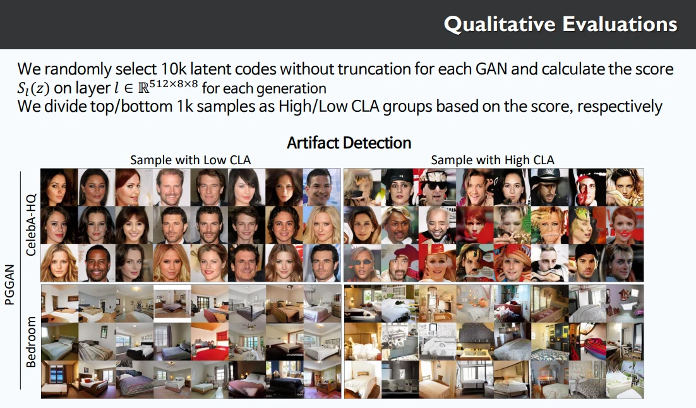

*왼쪽이 CLA가 낮은 표본, 오른쪽이 높은 표본이다. 위는 얼굴(CelebA-HQ), 아래는 침실이다. 출처: 강의 슬라이드*

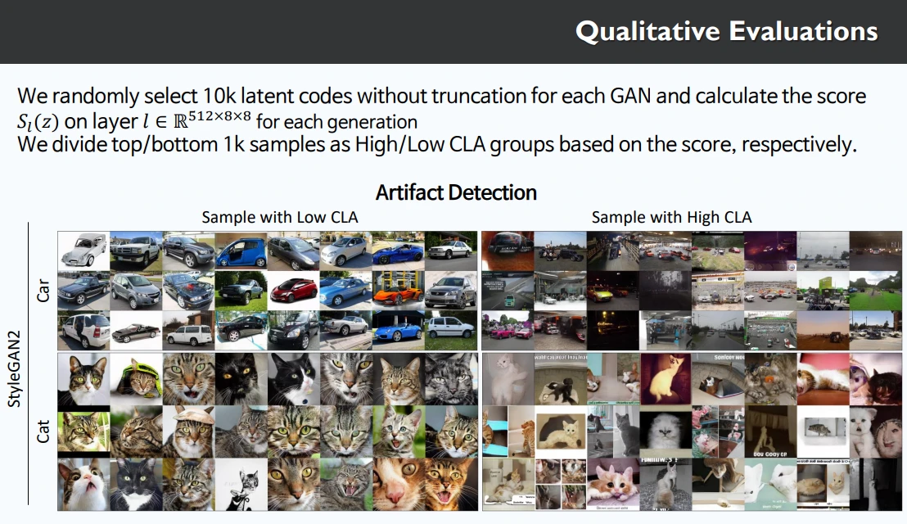

*같은 비교를 StyleGAN2의 자동차와 고양이에 한 것이다. 오른쪽에는 형체를 알아보기 어려운 이미지가 많다. 출처: 강의 슬라이드*

결과적으로 부드럽게 변하는 쪽(왼쪽)에서는 이상한 이미지가 나오지 않고, 날카롭게 변하는 쪽(오른쪽)에서 artifact가 나타났다.

다만 부드러운 쪽은 이미지의 다양성이 많이 부족하다. 위 그림의 왼쪽을 보면 얼굴은 대부분 정면이고 고양이도 얼굴을 크게 잡은 사진뿐이다. 그래서 artifact가 없으면서도 조밀하게 변하는 방향으로 가야 창의적인 결과가 나온다는 것이 강의의 정리였다.

**가설 2. 자주 활성화되는 unit과 드물게 활성화되는 unit은 다르다.** 슬라이드는 드물게 활성화되는 뉴런을 LR-neuron, 자주 활성화되는 뉴런을 HR-neuron이라고 부른다. LR-neuron은 실패를 포함한 다양한 구성 요소를 만드는 데 쓰이고, HR-neuron은 진짜 같은 이미지에 꼭 필요한 일반적인 구성 요소를 만드는 데 쓰인다는 가설이다.

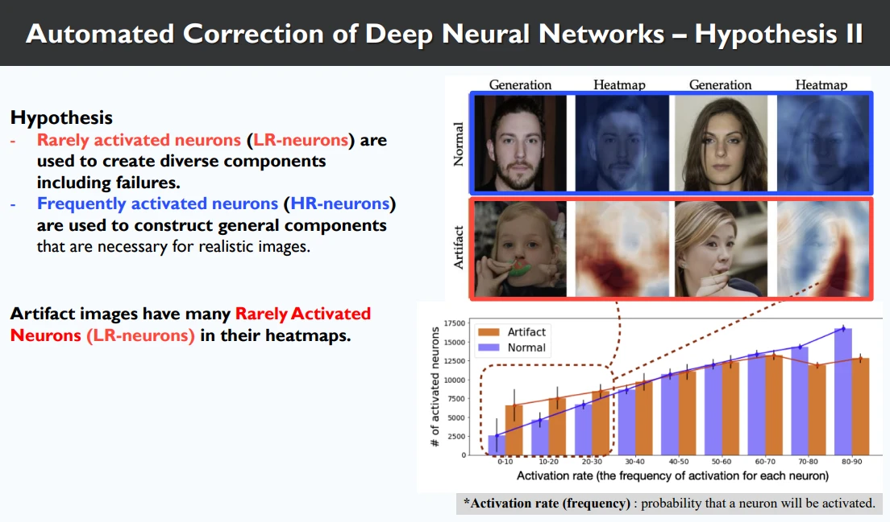

*아래 막대그래프의 가로축은 뉴런의 활성화 빈도, 세로축은 그 빈도 구간에서 켜진 뉴런의 수다. 주황이 artifact 이미지, 보라가 정상 이미지다. 출처: 강의 슬라이드*

두 부류가 artifact 이미지와 정상 이미지에 각각 얼마나 기여하는지 비교하면, 드물게 활성화되는 unit은 artifact에 대한 기여가 크고 자주 활성화되는 unit은 정상 이미지에 대한 기여가 크다. 위 그래프에서 빈도가 낮은 왼쪽 구간(점선 상자)에서는 주황 막대가 더 높고, 빈도가 높은 오른쪽 구간에서는 보라 막대가 더 높다. 드물게 활성화되는 이유는 학습 데이터가 적어서일 수도 있고 검증이 부족해서일 수도 있다.

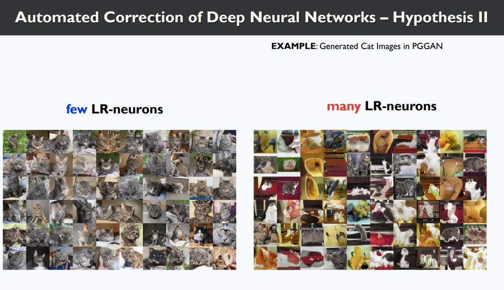

*PGGAN이 생성한 고양이 이미지다. LR-neuron이 적게 켜진 왼쪽은 고양이로 보이고, 많이 켜진 오른쪽은 대부분 형체가 무너져 있다. 출처: 강의 슬라이드*

이 가설을 교정에 쓰면 label이 필요 없다. 슬라이드가 제시한 방법은 sequential ablation이다. 활성화 빈도가 기준 $R$보다 낮은 뉴런(LR-neuron) 가운데 지금 켜져 있는 것을, 정해 둔 layer들을 지나갈 때마다 0으로 만든다.

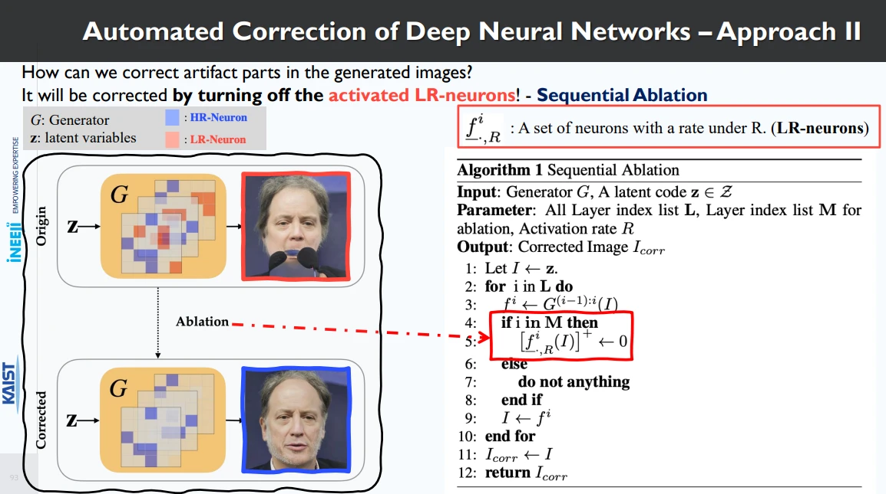

*왼쪽에서 붉은 칸이 LR-neuron, 푸른 칸이 HR-neuron이다. 위(Origin)의 붉은 칸을 끈 것이 아래(Corrected)이고, 오른쪽 알고리즘의 빨간 상자가 그 연산이다. 출처: 강의 슬라이드*

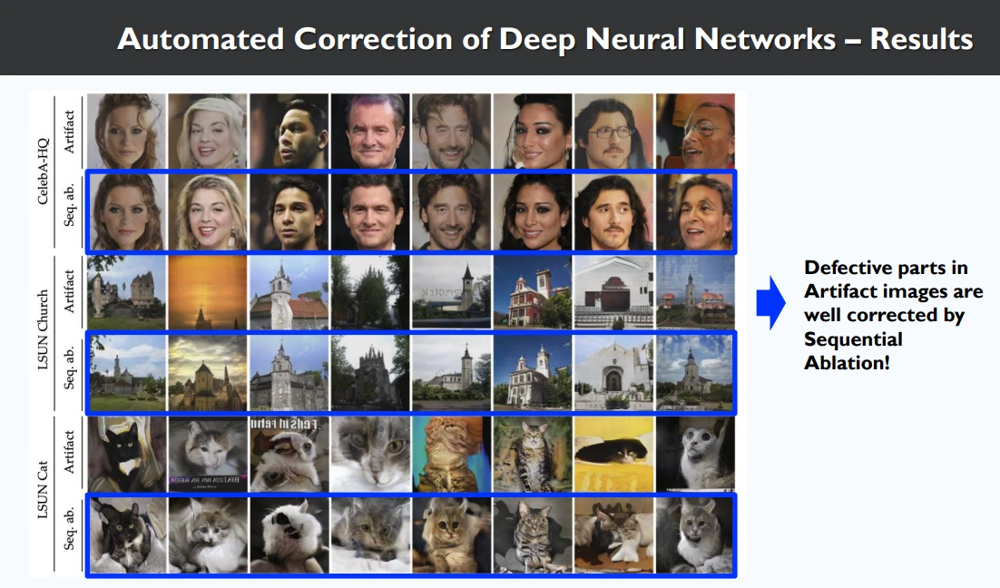

*데이터셋마다 위 줄이 artifact가 있는 원래 이미지, 파란 테두리의 아래 줄이 교정한 이미지다. 출처: 강의 슬라이드*

얼굴, 교회, 고양이 모두에서 일그러진 부분이 교정된 것을 볼 수 있다.

## 남았던 질문과 답

공부할 당시에는 풀지 못하고 남겨 둔 질문들이다. 글을 정리하면서 답을 찾아 덧붙였다.

**Q. 양의 기여와 음의 기여를 나누기 어렵다는 것은 무슨 뜻인가.**

한 뉴런의 값이 양의 항과 음의 항의 합일 때, 그 뉴런이 받은 relevance를 입력들에 나누는 방법이 하나로 정해지지 않는다는 뜻이다. 뉴런의 값이 $z = 3 + (-2) = 1$이고 이 뉴런이 받은 relevance가 1이라고 하자. 기여에 비례해 나누면 두 입력은 $+3$과 $-2$를 받는다. 양의 항만 인정하면 $+1$과 $0$을 받는다. 양의 항과 음의 항을 따로 정규화한 뒤 $\alpha = 2$, $\beta = 1$로 섞으면 $+2$와 $-1$을 받는다. 세 경우 모두 합은 1로 보존되지만 설명은 서로 다르다. 첫째 방식은 양과 음이 거의 상쇄되어 $z$가 0에 가까워지면 나눈 값이 폭주하고, 둘째 방식은 음의 증거를 버린다. LRP의 $\alpha\beta$ 규칙에서는 $\alpha - \beta = 1$만 지키면 어떤 값이든 쓸 수 있는데, 이것이 "나누는 방법에 정답이 없다"는 말의 구체적인 내용이다.

**Q. ReLU를 지나며 접히거나 구멍이 뚫린다는 "공간"은 노드 하나에 대한 것인가, layer 전체에 대한 것인가.**

layer 전체에 대한 것이라는 짐작이 맞다. 노드가 $n$개인 layer의 출력은 $\mathbb{R}^n$의 점 하나이고, 따지는 것은 입력의 집합(예를 들어 한 점 주변의 perturbation 영역)이 사상 $x \mapsto \mathrm{ReLU}(Wx + b)$를 지나 이 공간에서 어떤 모양이 되는가다. 노드 하나는 이 공간의 축 하나에 해당한다. ReLU는 축마다 따로 적용되어 그 축의 음수 쪽을 0으로 눌러 붙이므로, 노드 하나가 초평면 $w_i^\top x + b_i = 0$을 따라 접는 선 하나를 만든다. 노드가 $n$개이면 접는 선도 $n$개이고, 입력 영역이 이 선들에 걸쳐 있으면 그 상(image)은 여러 선형 조각이 이어진, 볼록하지 않은 모양이 된다. layer를 거듭할수록 조각의 수가 늘어나므로 그 모양을 정확히 따라가기 어렵다. ReLU 신경망의 성질을 검증하는 문제가 NP-complete라는 것은 Katz 외(2017)가 보였다.

**Q. Generative boundary는 노드의 부호만 본다. 부호만으로 모든 것을 판단할 수 있는가. 경계는 값의 크기에 따라서도 달라지지 않는가.**

부호가 정하는 것은 출력이 아니라 어떤 노드가 켜져 있는가다. ReLU 계열처럼 조각별로 선형인 activation을 쓰는 신경망은, 첫 layer부터 해당 layer까지 모든 노드의 부호 패턴이 같은 입력들에 대해서는 하나의 affine 함수로 동작한다. 같은 영역 안에서 값의 크기가 달라지면 출력은 그 affine 함수를 따라 연속적으로 달라진다. 따라서 같은 generative region의 표본들은 같은 이미지가 아니라, 같은 노드 조합으로 만들어진 이미지들이다. 논문도 한 layer의 모든 노드에서 부호가 같은 두 입력을 neural representation을 공유한다고 정의할 뿐이다. 경계 자체는 노드의 값이 0인 점들의 집합으로 정의되므로 값의 크기에 따라 움직이지 않는다. 크기는 그 점이 경계에서 얼마나 떨어져 있는지에 해당한다. 한편 tanh처럼 조각별 선형이 아닌 activation에서는 부호 패턴이 같아도 선형으로 동작한다고 말할 수 없다.

**Q. $\epsilon$-based sampling의 $\epsilon$은 정확히 무엇인가.**

샘플링 반경으로 이해한 것이 맞다. 논문은 $\epsilon$-based sampling을 $L_p$ 거리를 기준으로 표본을 모으는 방법이라고 설명하며, 질의(query)로 주어진 latent 벡터를 중심으로 하는 $\epsilon$-ball 안에서 표본을 뽑는다. 비교 실험에서는 $L_2$ 거리와 $L_\infty$ 거리 두 가지를 쓴다. $\epsilon$의 값은 보통 사람이 직접 정한다는 점도 논문이 언급한다.

### 아직 남은 질문

- 강의에서 든 예, 곧 모든 activation이 ReLU이고 마지막에만 음의 값이 나오는 모델이 무엇을 보여 주려는 것이었는지는 여전히 알지 못한다. 강의의 해당 부분을 다시 들어야 한다.

## 참고 자료

- XAI Tutorial 2023, "Recent Trends in Explainable Artificial Intelligence": <https://www.youtube.com/watch?v=k0VJtkRxEsY>
- 강의에서 다룬 연구(제목은 강의 슬라이드에 적힌 대로 옮겼다): Network Dissection, GAN Dissection, "Explorative Generative Boundary Aware Sampling", "Attribution Preservation in Network Compression for Reliable Network Interpretation", "Automatic Correction of Artifact Generating Internal Units"
- G. Katz, C. Barrett, D. Dill, K. Julian, M. Kochenderfer, "Reluplex: An Efficient SMT Solver for Verifying Deep Neural Networks", 2017. <https://arxiv.org/abs/1702.01135>
