# Symbolic AI와 Markov Logic Network

작성일 2025-01-02
{ .post-date }

"XAI Tutorial 2023"의 강의 "Symbolic AI methods"를 듣고 정리한 노트다. 딥러닝 모델에 설명을 붙이는 [앞의 두 글](01-xai-overview.md)과 달리, 이 강의는 처음부터 사람이 읽을 수 있는 규칙으로 추론하는 방법들을 다룬다. 흐름은 다음과 같다.

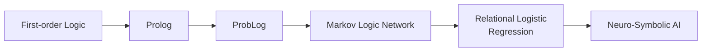

가장 오래 붙잡고 있던 부분은 Markov Logic Network가 확률을 어떻게 부여하는가였다. 그 부분은 스스로 세 단계로 다시 정리했고, 강의를 들으며 생긴 질문 두 개와 찾은 답도 함께 적었다. 그림은 강의 슬라이드에서 가져왔다.

## 1. Symbolic AI

Symbolic AI는 상황을 이름 붙인 기호(symbol)로 나타내고, 기호 사이의 규칙으로 추론하는 방법이다. 집에 강도가 들어 경보가 울리는 상황을 생각하자.

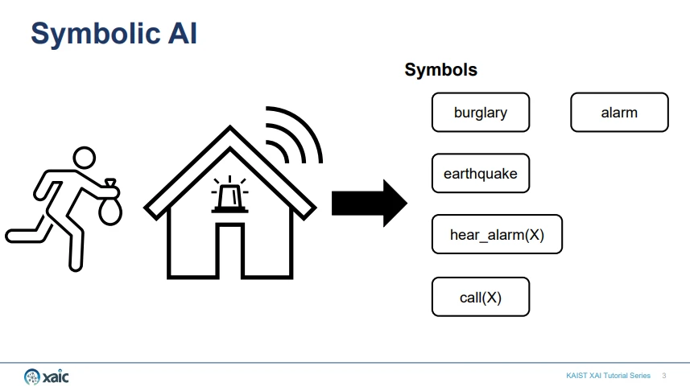

*왼쪽의 상황에서 오른쪽의 symbol 다섯 개를 뽑아낸다. 출처: 강의 슬라이드*

여기서 symbol은 개념, 사람, 사건, 행동 무엇이든 될 수 있다.

- `burglary`: 강도
- `alarm`: 경보
- `earthquake`: 지진(우연히 경보를 울릴 수 있는 것)
- `hear_alarm(X)`: X가 경보를 들었다
- `call(X)`: X가 신고 전화를 했다

Symbolic AI는 이런 symbol 사이의 규칙으로 추론한다.

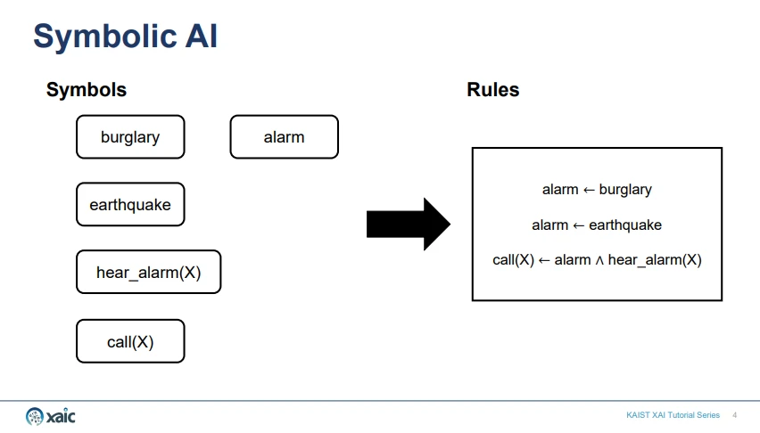

*왼쪽의 symbol들을 화살표(←)로 이어 오른쪽의 rule 세 개를 만든다. 화살표의 오른쪽이 조건, 왼쪽이 결론이다. 출처: 강의 슬라이드*

```text
alarm   ← burglary
alarm   ← earthquake
call(X) ← alarm and hear_alarm(X)
```

강도가 들면 경보가 울리고, 지진이 나도 경보가 울린다. 경보가 울렸고 X가 그것을 들었으면 X가 신고 전화를 한다. 이 규칙들은 나무 모양으로 그릴 수 있다.

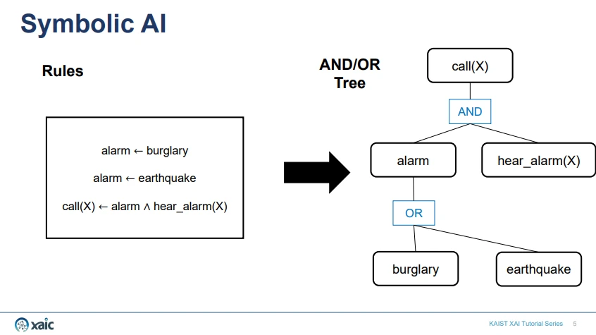

*오른쪽이 같은 rule을 그린 AND/OR tree다. 위에서 아래로 "이 결론이 성립하려면 무엇이 필요한가"를 따라 읽는다. 출처: 강의 슬라이드*

맨 위의 `call(X)`가 성립하려면 `alarm`과 `hear_alarm(X)`가 둘 다 필요하고(AND), `alarm`은 `burglary`나 `earthquake` 가운데 하나만 있어도 된다(OR). 결론이 어떤 조건들에서 나왔는지를 이렇게 거슬러 올라가며 읽을 수 있다는 점이 symbolic AI의 장점이다. 신경망 같은 sub-symbolic AI와 비교하면 다음과 같다.

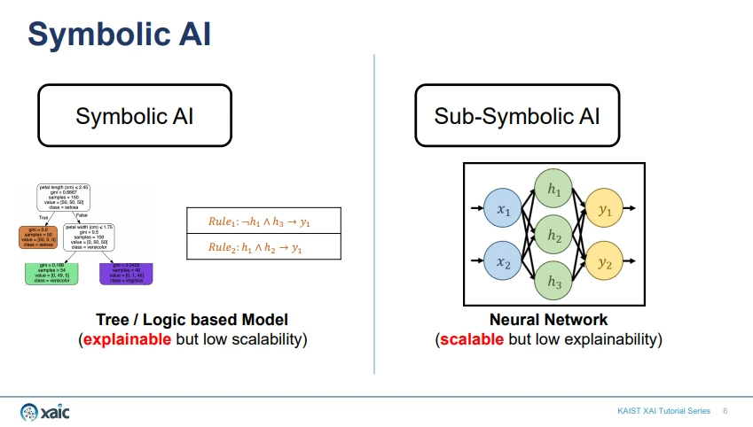

*왼쪽은 tree나 logic으로 쓴 모델, 오른쪽은 신경망이다. 한쪽은 설명 가능하지만 확장성이 낮고, 다른 쪽은 확장성이 좋지만 설명하기 어렵다. 출처: 강의 슬라이드*

| | 장점 | 단점 |
|---|---|---|
| Symbolic AI | 사람이 이해하기 쉽다 | 추론 비용이 지수적으로 커지는 경우가 많아 확장성이 떨어진다 |
| Sub-symbolic AI (신경망 등) | 많은 데이터를 효율적으로 처리한다 | 설명성이 떨어진다 |

## 2. Decision Tree

가장 익숙한 symbolic 모델은 decision tree다. 질문을 차례로 던져 샘플을 갈라 나가는 모델이다.

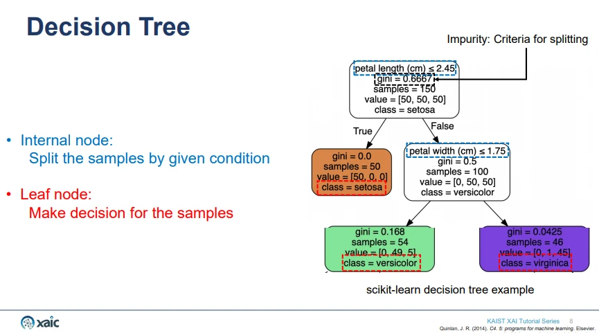

*scikit-learn으로 붓꽃 데이터를 분류한 예다. 파란 점선이 내부 노드의 조건, 빨간 점선이 leaf 노드의 결정이다. 출처: 강의 슬라이드*

내부 노드는 샘플을 어느 분기로 보낼지 정하는 조건이고, leaf 노드는 분기를 거쳐 도착한 샘플이 어떤 class로 분류되는지를 나타낸다. 위 그림의 맨 위 노드는 "꽃잎 길이가 2.45cm 이하인가"를 묻는다. 그렇다면 왼쪽 leaf로 가서 setosa로 분류되고, 아니라면 오른쪽에서 "꽃잎 너비가 1.75cm 이하인가"를 다시 묻는다. 노드에 적힌 `gini`는 그 노드에 서로 다른 class가 얼마나 섞여 있는지를 나타내는 불순도(impurity)로, 어떤 조건으로 나눌지를 고르는 기준이 된다. 조건을 위에서부터 읽으면 분류의 이유가 그대로 드러난다.

Tree 계열 모델은 지금도 성능이 좋다. Kaggle 대회에서는 XGBoost를 앙상블한 모델이 여전히 상위권에 있고, 대출 여부를 정하는 신용 위험 평가에서도 XGBoost가 좋은 성능을 보인다. 다만 XGBoost는 decision tree 하나와 달리 사람이 이해하기 어렵다. 여러 tree의 앙상블이고 tree마다 가중치까지 고려해야 하기 때문이다.

## 3. First-order Logic

Logic 기반 모델에서 가장 많이 쓰이는 것이 first-order logic(FOL)이다. Logic을 쓰면 많은 정보를 압축해서 표현할 수 있다.

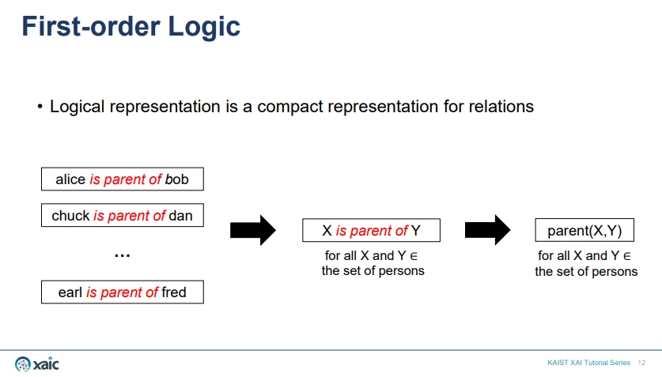

*왼쪽처럼 "누가 누구의 부모다"를 하나씩 적는 대신, 변수 X와 Y를 써서 오른쪽의 `parent(X,Y)` 하나로 쓴다. 출처: 강의 슬라이드*

사람 1,000명 사이의 관계를 하나하나 적으면 1,000 × 1,000 크기의 표가 필요하지만, FOL로는 `parent(X, Y)`, X와 Y는 사람의 집합에 속한다는 식 하나로 쓸 수 있다. 이 절의 용어는 뒤에서 계속 쓰이므로 표로 정리해 둔다.

| 용어 | 뜻 | 예 |
|---|---|---|
| Term | 상수 또는 변수 | `"alice"`(상수), `X`(변수) |
| Predicate symbol | term 사이의 관계나 term의 성질 | `friend`, `smoke` |
| Predicate | predicate symbol과 괄호로 묶은 term 목록 | `friend("alice", X)`, `smoke("bob")` |
| Rule (formula) | predicate를 connective로 이은 것. $\wedge$(conjunction), $\vee$(disjunction), $\neg$(negation), $\rightarrow$(implication) | `smoke(X) → cancer(X)` |
| Knowledge base (KB) | predicate와 rule의 집합. 미리 알려진 정보를 모아 둔 것 | `{friend(X,Y) ∧ friend(Y,Z) → friend(X,Z), smoke(X) → cancer(X)}` |
| Ground predicate | 변수가 없는 predicate. 참 또는 거짓으로 평가할 수 있다 | `smoke("bob")` |
| Ground rule | ground predicate만으로 이루어진 rule | `smoke("bob") → cancer("bob")` |
| Ground KB | ground rule의 집합 | `{smoke("alice") → cancer("alice"), smoke("bob") → cancer("bob"), …}` |
| World | ground KB에 등장하는 모든 ground predicate에 참/거짓을 하나씩 부여한 경우 하나 | |

**Grounding**은 변수가 있는 논리식을 구체적인 상수로 바꾸는 과정이다. 변수가 있는 식은 참/거짓을 평가할 수 없으므로, 모든 predicate의 변수를 도메인의 상수로 치환해 구체적인 사례(ground atom)를 만든다.

가능한 world의 수는 $2^{|\text{ground predicates}|}$다. Predicate의 수는 쉽게 셀 수 있지만 world의 수는 지수적으로 늘어난다. Logic 기반 모델이 확장성을 확보하기 어려운 이유가 여기에 있다.

## 4. Prolog

Prolog는 논리 추론을 위한 프로그래밍 언어다. 이미 알고 있는 사실(fact, evidence)과 규칙을 적어 두고 질의를 던진다.

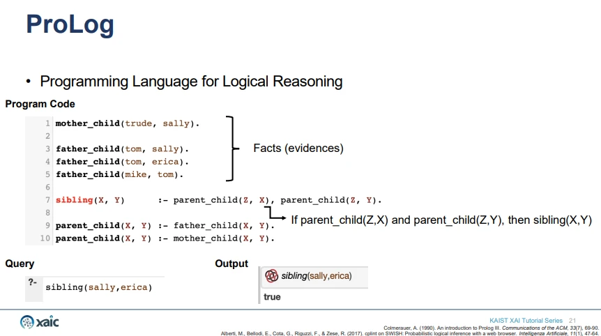

*위의 1~5행이 fact, 7~10행이 규칙이다. 아래 왼쪽에 질의를 넣으면 오른쪽에 답이 나온다. 출처: 강의 슬라이드*

```prolog
mother_child(trude, sally).
father_child(tom, sally).
father_child(tom, erica).
father_child(mike, tom).

sibling(X, Y)      :- parent_child(Z, X), parent_child(Z, Y).
parent_child(X, Y) :- father_child(X, Y).
parent_child(X, Y) :- mother_child(X, Y).
```

`:-`는 논리적 함의와 비슷한 뜻이다. 첫 번째 규칙은 "Z가 X의 부모이고 Z가 Y의 부모이면 X와 Y는 형제다"로 읽는다. 여기에 `sibling(sally, erica)`를 질의하면 `true`가 나온다. 프로그램에 적힌 fact에서 그 결론을 끌어낼 수 있기 때문이다.

추론은 질의를 더 작은 질의(sub-query)로 쪼개어 내려가는 방식으로 진행된다. 아래 그림이 `sibling(sally, erica)`를 푸는 과정이다.

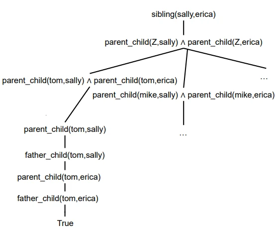

*맨 위가 질의이고, 아래로 내려갈수록 더 작은 질의다. 왼쪽 가지가 fact에 닿아 True로 끝난다. 출처: 강의 슬라이드*

1. `sibling(sally, erica)`를 만족하려면 `parent_child(Z, sally) ∧ parent_child(Z, erica)`를 만족해야 한다. `Z`는 변수다. 그림의 둘째 줄이다.
2. `Z`에 들어갈 수 있는 모든 사람을 대입한 sub-query를 만든다. 그림의 셋째 줄에서 `Z`가 `tom`인 갈래, `mike`인 갈래 등으로 나뉜다.
3. Sub-query 하나를 골라 그것의 sub-query를 다시 만든다. 이렇게 깊이 우선 탐색(DFS)으로 내려간다. 그림에서는 `tom` 갈래를 골라, `parent_child(tom, sally)`를 `father_child(tom, sally)`로, `parent_child(tom, erica)`를 `father_child(tom, erica)`로 바꾸어 간다. 둘 다 프로그램에 적힌 fact다.
4. 참을 찾으면 `true`를 반환하고, 거짓이면 아직 방문하지 않은 다른 갈래로 넘어간다.

## 5. ProbLog

Prolog에서는 fact가 주어지면 그것으로 끝이다. ProbLog에서는 fact가 확률을 갖는다.

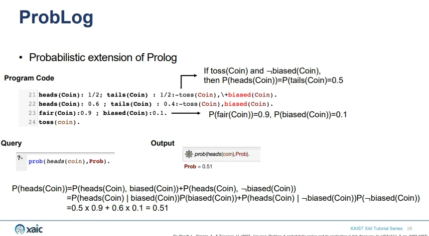

*동전 던지기 예다. 프로그램의 각 행 옆에 그 뜻이 적혀 있고, 아래에 질의와 출력 0.51, 그 값이 나오는 계산이 있다. 출처: 강의 슬라이드*

```prolog
heads(Coin): 1/2; tails(Coin): 1/2 :- toss(Coin), \+biased(Coin).
heads(Coin): 0.6; tails(Coin): 0.4 :- toss(Coin), biased(Coin).
fair(Coin): 0.9; biased(Coin): 0.1.
toss(coin).
```

이 예시의 표기는 엄밀히는 ProbLog의 문법이 아니라, 같은 계열의 확률 논리 프로그래밍 언어인 LPAD(Logic Programs with Annotated Disjunctions)를 구현한 cplint의 문법이다. ProbLog에서는 `0.6::heads(Coin); 0.4::tails(Coin) :- toss(Coin), biased(Coin).`처럼 확률을 `::`로 앞에 붙여 적고 `query(heads(coin)).`으로 질의한다. 표기만 다르고 뜻과 계산되는 확률은 같다.

- 동전을 던졌고 편향되지 않았다면 $P(\text{heads}) = P(\text{tails}) = 0.5$다.
- 동전을 던졌고 편향되었다면 $P(\text{heads}) = 0.6$, $P(\text{tails}) = 0.4$다.
- 동전이 공정할 확률은 0.9, 편향되었을 확률은 0.1이다.

`prob(heads(coin), Prob).`를 질의하면 0.51이 나온다. 편향된 경우와 아닌 경우를 나누어 더한 값이다.

$$
\begin{aligned}
P(\text{heads}) &= P(\text{heads} \mid \text{biased})\,P(\text{biased}) + P(\text{heads} \mid \neg\text{biased})\,P(\neg\text{biased}) \\
&= 0.6 \times 0.1 + 0.5 \times 0.9 = 0.51
\end{aligned}
$$

추론 과정은 Prolog와 비슷하되 확률이 계속 곱해진다고 생각하면 된다. Prolog의 목적은 어떤 predicate가 참인지 거짓인지를 답하는 것이고, ProbLog의 목적은 그 predicate의 확률을 답하는 것이다.

## 6. Markov Logic Network

Markov Logic Network(MLN)는 이 계열에서 가장 널리 알려지고 많이 쓰이는 모델이다. FOL로 쓴 rule마다 실수 가중치(weight)가 붙는다.

$$
\begin{aligned}
rule_1 &: \text{smoke}(X) \rightarrow \text{cancer}(X), & w_1 &= 1.5 \\
rule_2 &: \text{friend}(X, Y) \rightarrow \big(\text{smoke}(X) \Leftrightarrow \text{smoke}(Y)\big), & w_2 &= 1.1 \\
M_1 &= \{(rule_1, w_1), (rule_2, w_2)\}
\end{aligned}
$$

$rule_1$은 담배를 피우면 암에 걸린다는 규칙이고, $rule_2$는 X와 Y가 친구라면 둘 다 담배를 피우거나 둘 다 피우지 않는다는 규칙이다($\Leftrightarrow$는 논리적 동치). $M_1$이 MLN 하나다.

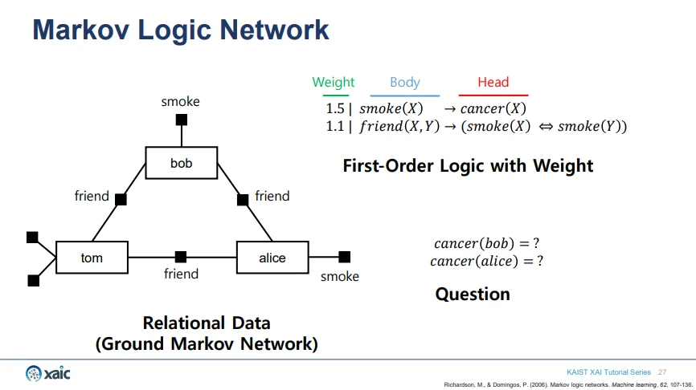

*왼쪽이 주어진 관계형 데이터, 오른쪽 위가 가중치가 붙은 rule, 오른쪽 아래가 알고 싶은 것이다. 출처: 강의 슬라이드*

위 그림이 MLN이 푸는 문제를 한 장으로 보여 준다. 왼쪽에서 bob, tom, alice는 서로 친구(friend)이고 bob과 alice에게는 담배를 피운다(smoke)는 표시가 붙어 있다. 이 데이터와 오른쪽 위의 rule 두 개를 가지고 "bob은 암에 걸렸는가, alice는 암에 걸렸는가"에 확률로 답하려는 것이다.

가중치의 의미는 다음과 같다.

- 0이면 그 rule은 아무 영향도 주지 않는다.
- $+\infty$에 가까우면 그 rule은 반드시 만족해야 한다.
- $-\infty$에 가까우면 그 rule은 만족하면 안 된다.

MLN에 grounding을 적용하면 ground Markov network(Markov random field)가 된다. Ground predicate가 노드가 되고, 같은 ground rule에 함께 등장하는 노드들이 연결되는 무방향 그래프다. Grounding이 거창한 일은 아니고, 확률을 계산하는 추론을 준비하는 과정이라고 이해했다.

### World의 확률

MLN은 world에 확률을 부여한다.

$$
P_{M_1}(\omega) = \frac{1}{Z}\exp\Big(\sum_i w_i\, n_{rule_i}(\omega)\Big), \qquad Z = \sum_{\omega'} \exp\Big(\sum_i w_i\, n_{rule_i}(\omega')\Big)
$$

$n_{rule_i}(\omega)$는 world $\omega$에서 $rule_i$의 ground rule 가운데 만족된 것의 개수(counting)다. $Z$는 모든 world의 지수 항을 더한 값으로, 전체 확률의 합을 1로 만들기 위한 정규화 항이다.

가중치와 counting을 곱한 값이 클수록 world의 확률이 올라간다. 가중치가 큰 rule을 많이 만족하는 world는 확률이 높고, 가중치가 음수인 rule을 많이 만족하는 world는 확률이 낮다.

### 세 단계로 다시 정리

MLN에서 특정 predicate의 확률을 구하는 과정을 스스로 세 단계로 요약했다.

1. **가능한 모든 world를 고려한다.** Ground predicate들에 참/거짓을 부여하는 조합 하나하나가 world다. 각 world가 rule을 얼마나 만족하는지(counting)에 가중치를 곱해 점수를 매긴다.
2. **점수로 확률 분포를 만든다.** World마다 점수를 지수 함수에 넣고, 모든 world의 값을 더한 것으로 나누면 그 world의 확률이 된다. 이렇게 해서 MLN은 모든 world에 대한 결합 확률 분포(joint probability)를 갖는다.
3. **특정 predicate의 확률을 계산한다.** 그 predicate가 참인 world들의 확률을 모두 더한다.

$$
P(q) = \sum_{\omega\,:\,q\text{가 참}} P_{M_1}(\omega)
$$

실제로는 world가 너무 많아 이 합을 그대로 계산할 수 없으므로 MCMC 같은 샘플링 기법으로 근사한다.

### 질문 1. 변수가 없는데 왜 모든 경우의 수를 따지는가

Ground predicate는 변수가 없고 상수만으로 이루어진 predicate다. 그런데 왜 추론에서는 변수에 값을 넣어 보듯 모든 경우의 수를 구하는가? World의 수가 ground predicate의 수에 따라 지수적으로 늘어난다는 것까지는 받아들였지만, 이 부분에서 막혔다.

정리하다가 찾은 답은 이렇다. Grounding으로 사라지는 것은 논리식의 변수다. 그렇게 만든 ground predicate가 참인지 거짓인지는 여전히 정해져 있지 않다. Evidence로 주어진 것만 값이 정해지고 나머지는 모른다. 그래서 각 ground predicate가 참일 때와 거짓일 때를 모두 고려해 world를 만들어야 하고, world의 수가 $2^{|\text{ground predicates}|}$가 된다. Ground predicate의 참/거짓이 정해지면 그에 따라 ground rule의 만족 여부도 정해진다.

이어서 "counting은 왜 world마다 달라지는가"도 풀렸다. Rule은 하나지만 그 rule의 ground rule은 여러 개다. `Friends(x, y) ∧ Smokes(x) → Smokes(y)`라는 rule이 있을 때, 그것을 만족하는 사람의 쌍이 몇 개인지는 world마다 다르다. Rule이 몇 번 만족되었는지(counting)와 그 rule의 가중치가 함께 그 world에서 rule의 영향력을 정한다.

### 질문 2. world의 joint probability는 왜 구하는가

MLN의 식은 world 전체의 확률을 준다. 그런데 알고 싶은 것은 `Cancer(x)`처럼 특정 predicate의 확률이다. 둘이 어떻게 이어지는가?

Query는 주어진 evidence와 rule을 바탕으로 특정 predicate가 참일 확률을 계산하는 확률적 추론이다. 위의 3단계가 바로 그 연결이다. Predicate의 확률은 그 predicate가 참인 world들의 확률을 더한 것이므로, world의 joint probability가 먼저 정의되어 있어야 한다. 실제 계산은 다음 순서로 진행된다.

1. **Grounding.** `Cancer(x)`의 `x`를 상수로 치환한다.
2. **Markov network 생성.** Rule과 evidence를 바탕으로 ground atom을 노드로, ground rule을 edge로 하는 Markov network를 만든다.
3. **확률 계산.** 이 network에서 추론 알고리즘으로 query의 확률을 근사적으로 계산한다.

### 프로그램으로 보기

MLN은 코드로는 predicate와 rule을 정의한 프로그램이 된다. Evidence와 query를 주면 확률을 돌려준다.

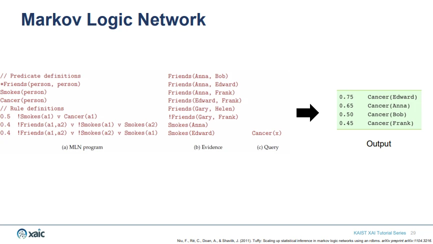

*왼쪽부터 (a) 프로그램, (b) evidence, (c) query이고, 화살표 오른쪽이 출력이다. 출처: 강의 슬라이드(Tuffy 논문의 그림)*

그림의 세 부분을 차례로 옮기면 다음과 같다.

```text
// Predicate definitions
*Friends(person, person)
Smokes(person)
Cancer(person)

// Rule definitions
0.5  !Smokes(a1) v Cancer(a1)
0.4  !Friends(a1,a2) v !Smokes(a1) v Smokes(a2)
0.4  !Friends(a1,a2) v !Smokes(a2) v Smokes(a1)
```

세 rule은 각각 다음과 같이 읽는다.

- `Smokes(a1) → Cancer(a1)`: a1이 담배를 피우면 암에 걸린다. 가중치 0.5.
- `Friends(a1, a2) → (Smokes(a1) → Smokes(a2))`: a1과 a2가 친구이고 a1이 담배를 피우면 a2도 피운다. 가중치 0.4.
- `Friends(a1, a2) → (Smokes(a2) → Smokes(a1))`: 반대 방향. 가중치 0.4.

맨 앞의 숫자는 확률이 아니라 가중치다. "a1이 담배를 피우면 암에 걸릴 확률이 0.5"라는 뜻이 아니다. 위의 식대로, 이 rule을 만족하는 ground rule이 하나 늘 때마다 world의 정규화 전 점수에 $e^{0.5}$가 곱해진다는 뜻이다. 처음 정리할 때는 이것을 확률로 읽어서 틀리게 적어 두었다.

Evidence와 query는 다음과 같다.

```text
// Evidence
Friends(Anna, Bob)
Friends(Anna, Edward)
Friends(Anna, Frank)
Friends(Edward, Frank)
Friends(Gary, Helen)
!Friends(Gary, Frank)
Smokes(Anna)
Smokes(Edward)

// Query
Cancer(x)
```

| 출력 | 확률 |
|---|---|
| `Cancer(Edward)` | 0.75 |
| `Cancer(Anna)` | 0.65 |
| `Cancer(Bob)` | 0.50 |
| `Cancer(Frank)` | 0.45 |

이 결과에는 눈여겨볼 점이 두 가지 있다.

**Anna와 Edward의 값이 다르다.** `Cancer`가 등장하는 rule은 첫 번째뿐이고, Anna와 Edward는 둘 다 `Smokes`가 evidence로 주어져 있다. 그러니 두 사람의 결과는 같아야 한다. 다르게 나온 이유는 근사 때문이다. World의 수가 지수적으로 늘어나 정규화 항 $Z$를 정확히 계산할 수 없으므로, 제약을 두어 계산 가능하게 만들거나 근사할 수밖에 없다. 그러다 보니 이렇게 간단한 문제에서도 결과가 어긋난다.

**Helen과 Gary가 없다.** 두 사람은 evidence에 등장하지만 서로하고만 친구다. `Smokes`에 대한 evidence가 없으므로 흡연 여부는 rule을 통해 유추해야 하는데, 흡연 evidence가 있는 사람과 이어져 있지 않다. 그래서 결과에 나타나지 않고 `Cancer(Edward)`, `Cancer(Anna)`, `Cancer(Bob)`, `Cancer(Frank)`만 구해진 것으로 이해했다.

### 학습

가중치는 gradient descent로 학습한다. World $\omega$의 log 확률을 가중치 $w_k$로 미분한다. 슬라이드의 유도를 옮기면, 먼저 log를 취해 정규화 항을 떼어 내고

$$
\log P(\omega) = \sum_i w_i\, n_i(\omega) - \log Z
$$

$Z$를 $w_k$로 미분한다. $Z$는 모든 world의 지수 항의 합이므로, 미분하면 world마다 $n_k(\omega')$가 앞으로 나온다.

$$
\frac{1}{Z}\frac{\partial Z}{\partial w_k} = \sum_{\omega'} n_k(\omega')\,\frac{\exp\big(\sum_i w_i\, n_i(\omega')\big)}{Z} = \mathbb{E}_{\omega'}\big[n_k(\omega')\big]
$$

분수 부분이 world $\omega'$의 확률이므로 이 합은 $n_k$의 기댓값이다. 결과는 다음과 같다.

$$
\frac{\partial}{\partial w_k}\log P(\omega) = n_k(\omega) - \mathbb{E}_{\omega'}\big[n_k(\omega')\big]
$$

정규화 항 $Z$ 때문에 모든 world에 대한 기댓값이 나타난다. 이 항은 계산하기 어려워서(intractable) 여기서도 근사가 필요하다.

정리하면 MLN은 FOL로 쓴 가중치 있는 rule로 무방향 그래프를 만들고, 그 위에서 특정 predicate의 확률을 구하는 모델이다. 가중치는 gradient descent로 최적화할 수 있고, 정규화 항 $Z$를 구하기 어렵다는 문제 때문에 추론과 학습 모두 근사에 의존한다.

## 7. Relational Logistic Regression

Relational Logistic Regression(RLR)은 관계형 데이터를 위한 logistic regression이다. MLN과는 두 가지가 다르다.

- MLN은 무방향 그래프이고, RLR은 방향성을 갖는다.
- MLN은 일반적인 FOL 식을 rule로 쓰고, RLR은 positive conjunction만 쓴다. Positive conjunction은 negation이 없는 conjunction이다. 실수 가중치를 갖는 것은 같다.

모델은 $M = \{(w_0, \text{True}), (w_1, conj_1), (w_2, conj_2), \dots\}$이고, evidence $\epsilon$이 주어졌을 때 target $Q$의 조건부 확률은 다음과 같다.

$$
P(Q \mid \epsilon) = \sigma\Big(w_0 + \sum_{(w_i,\ conj_i)} w_i\, n_{conj_i}(Q, \epsilon)\Big)
$$

- $Q$: 모델이 예측하려는 predicate.
- $\epsilon$: evidence. 추론할 때 주어지는 데이터.
- $\sigma$: sigmoid 함수.
- $w_0$: 절편.
- $n_{conj_i}(Q, \epsilon)$: evidence가 주어졌을 때 $conj_i$의 ground conjunction 가운데 만족된 것의 개수.

가중치와 counting을 곱해 더하는 것은 MLN과 같다. 지수 함수와 정규화 대신 sigmoid를 통과시켜 logistic regression의 형태가 된다는 점이 다르다. 방향성이 있으므로 식이 조건부 확률로 쓰인다. MLN은 모든 변수의 결합 분포를 정의하는 모델이어서 evidence가 모델의 정의에는 들어가지 않고 추론할 때 고정된 조건으로 다루어지는 반면, RLR은 처음부터 특정 target의 조건부 확률을 계산하는 모델이어서 evidence가 식에 들어간다.

강의의 예시는 사람 Z가 행복한지를 예측하는 모델이다.

- $\langle \text{True}, w_1 \rangle$: 절편
- $\langle \text{friend}(z, y), w_2 \rangle$: Z의 친구 수
- $\langle \text{friend}(z, y) * \text{kind}(y), w_3 \rangle$: 슬라이드의 표에서는 Z의 친구 가운데 친절한 사람의 수에 대응한다

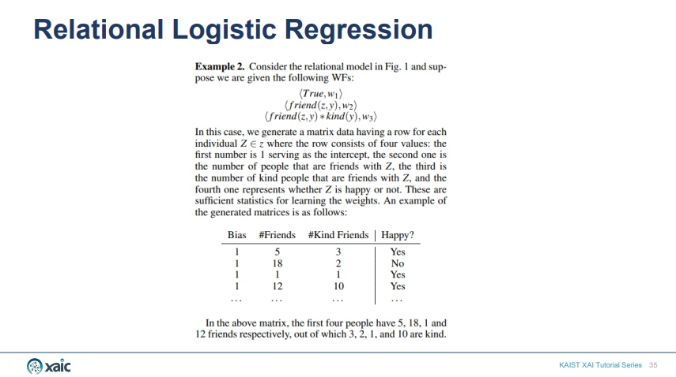

*아래쪽 표에서 한 행이 사람 한 명이다. 앞의 세 열이 위의 세 항에 대응하는 값이고 마지막 열이 맞혀야 할 답이다. 출처: 강의 슬라이드(RLR 논문의 예제)*

위 그림의 표가 이 모델에 들어가는 데이터다. 사람 Z마다 절편 1, 친구 수, 친절한 친구 수의 세 값이 한 행이 되고, 네 번째 열이 그 사람이 행복한지다. 첫 네 사람은 친구가 5, 18, 1, 12명이고 그 가운데 친절한 사람이 3, 2, 1, 10명이다. 관계형 데이터가 counting을 거치면 보통의 logistic regression이 쓰는 표가 된다는 것을 보여 준다.

Negation이 들어간 식의 counting은 positive conjunction의 counting을 더하고 빼서 나타낼 수 있다.

$$
\sum_x R(x) \wedge \neg S(x) = \sum_x R(x) - \sum_x R(x) \wedge S(x)
$$

슬라이드에는 나머지 경우도 함께 적혀 있다. $\lvert x \rvert = \sum_x \text{True}$는 $x$가 될 수 있는 대상의 수다.

$$
\begin{aligned}
\sum_x \neg R(x) \wedge S(x) &= \sum_x S(x) - \sum_x R(x) \wedge S(x) \\
\sum_x \neg R(x) \wedge \neg S(x) &= \lvert x \rvert - \sum_x R(x) - \sum_x S(x) + \sum_x R(x) \wedge S(x)
\end{aligned}
$$

따라서 MLN으로 표현할 수 있는 것은 RLR로도 표현할 수 있다.

## 8. Neuro-Symbolic AI

Neuro-symbolic AI의 목표는 설명 가능하다는 symbolic AI의 장점과 확장성이 좋다는 신경망의 장점을 합치는 것이다.

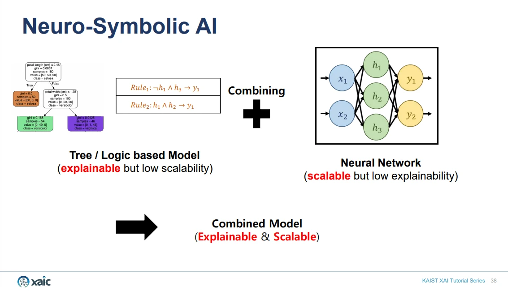

*1절에서 본 두 모델을 더해(Combining), 설명 가능하면서 확장성도 좋은 모델을 만들고자 한다. 출처: 강의 슬라이드*

주된 방법은 두 갈래다.

| 갈래 | 내용 | 주로 쓰는 모델 |
|---|---|---|
| Symbolic knowledge extraction (이전 방식) | 학습된 신경망에서 symbolic 표현을 뽑아낸다 | Decision tree |
| Symbolic knowledge injection (최근 방식) | 신경망을 학습할 때 symbolic 표현을 넣어 사람이 이해하기 쉽게 학습시킨다 | Logic 기반 모델 |

### CRED와 DeepRED

**CRED**는 은닉층이 하나인 학습된 신경망에서 decision tree를 뽑아낸다.

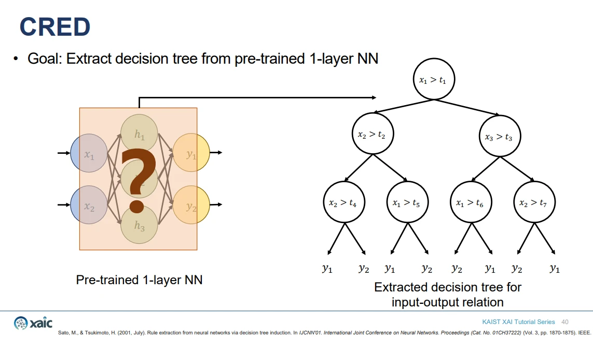

*왼쪽의 학습된 신경망(물음표로 가린 부분)을, 입력 $x$에 대한 조건만으로 출력 $y$를 정하는 오른쪽의 decision tree로 바꾸는 것이 목표다. 출처: 강의 슬라이드*

신경망의 입력과 출력만 맞추어 decision tree를 학습시킬 수도 있지만, 신경망의 구조를 따라가며 추출해야 성능이 더 잘 나온다. 그래서 신경망을 뒤쪽 절반과 앞쪽 절반으로 나누어 차례로 tree로 바꾼다.

**1단계.** 데이터셋에 대해 hidden 값을 구하고, hidden과 output 사이의 관계를 나타내는 decision tree를 만든다.

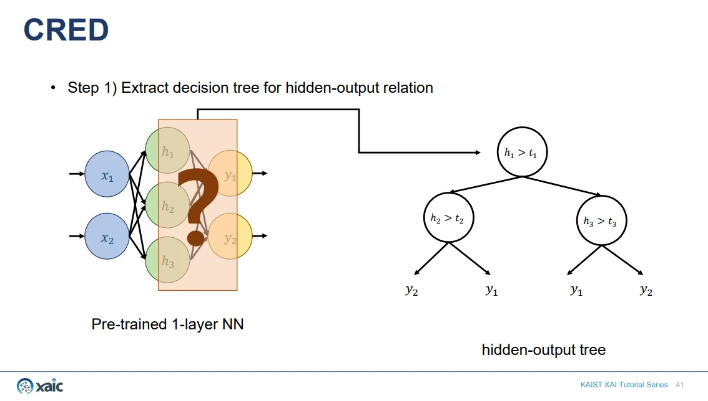

*신경망의 뒤쪽 절반(hidden에서 output까지)만 tree로 바꾼다. 오른쪽 tree의 조건은 입력이 아니라 hidden unit에 대한 것($h_1 > t_1$ 등)이다. 출처: 강의 슬라이드*

**2단계.** 이 tree의 내부 노드 하나하나를 이진 값으로 본다. 각 내부 노드에 대해, 입력과 그 노드 사이의 관계를 나타내는 decision tree를 만든다.

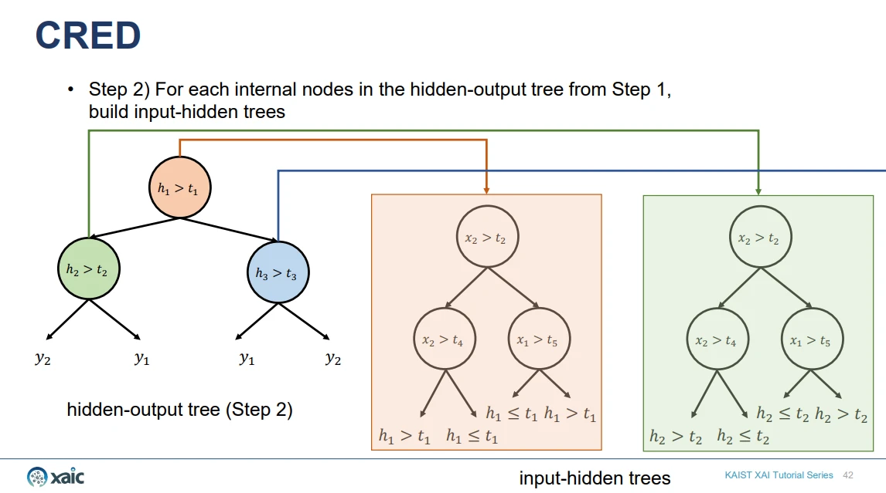

*왼쪽이 1단계의 tree다. 그 내부 노드마다(주황, 초록, 파랑) 같은 색 상자의 tree를 하나씩 만든다(파란 노드의 상자는 화면 밖으로 잘렸다). 상자 안의 tree는 입력 $x$에 대한 조건으로 "$h_1 > t_1$인가 아닌가"를 가려낸다. 출처: 강의 슬라이드*

1단계의 tree에 있던 "$h_1 > t_1$" 같은 조건은 hidden unit에 대한 것이어서 사람이 읽을 수 없다. 2단계는 그 조건 하나하나를 입력에 대한 조건으로 풀어 쓰는 일이다.

**3단계.** Hidden-output tree와 input-hidden tree들을 합치고 단순화해, 입력과 출력의 관계를 나타내는 최종 decision tree를 얻는다. 1단계 tree의 각 노드 자리에 2단계에서 만든 tree를 끼워 넣는다고 보면 되고, 결과가 맨 처음 그림 오른쪽의 tree다.

**DeepRED**는 CRED를 깊은 신경망으로 확장한 것이다.

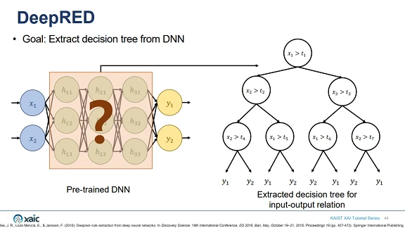

*CRED와 같은 그림인데 신경망의 hidden layer가 세 개로 늘었다. 출처: 강의 슬라이드*

알고리즘은 크게 다르지 않다. Layer 하나에서 tree를 추출하던 것을 layer별로 반복해 늘려 나간다.

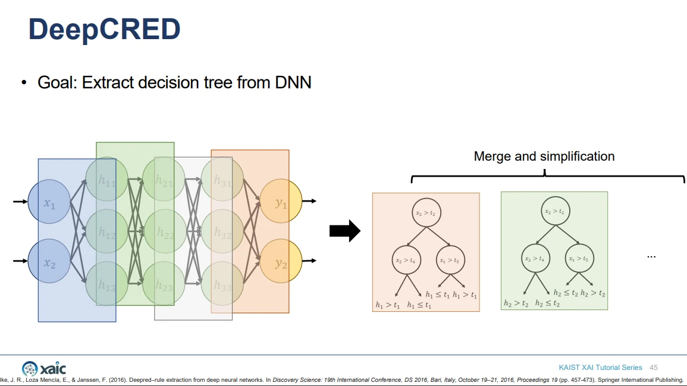

*왼쪽의 색 상자가 이웃한 layer 한 쌍이고, 쌍마다 오른쪽의 tree가 하나씩 나온다. 이 tree들을 합치고 단순화한다. 출처: 강의 슬라이드*

### DeepProbLog

DeepProbLog는 ProbLog를 딥러닝과 결합한다. 딥러닝을 encoder로 쓰는 방식이다. 이미지에서 바로 predicate를 만들기는 어렵다. 그래서 신경망이 이미지를 받아 one-hot에 가까운 벡터를 만들고, 그것으로 predicate를 만든 뒤 ProbLog로 논리 추론을 한다.

```prolog
nn(m_digit, [X], Y, [0...9]) :: digit(X, Y).
addition(X, Y, Z) :- digit(X, N1), digit(Y, N2), Z is N1+N2.
```

`m_digit`은 MNIST 숫자를 분류하는 신경망, `X`는 입력 이미지, `Y`는 label이다. 신경망은 입력 이미지가 0부터 9까지의 각 숫자일 확률을 계산한다. 그 확률을 "이 이미지는 숫자 0이다" 같은 predicate `digit(X, Y)`의 확률로 쓴다. 그 뒤는 ProbLog와 같다. 이 확률을 가지고 `addition` 같은 규칙에 대한 추론을 진행한다.

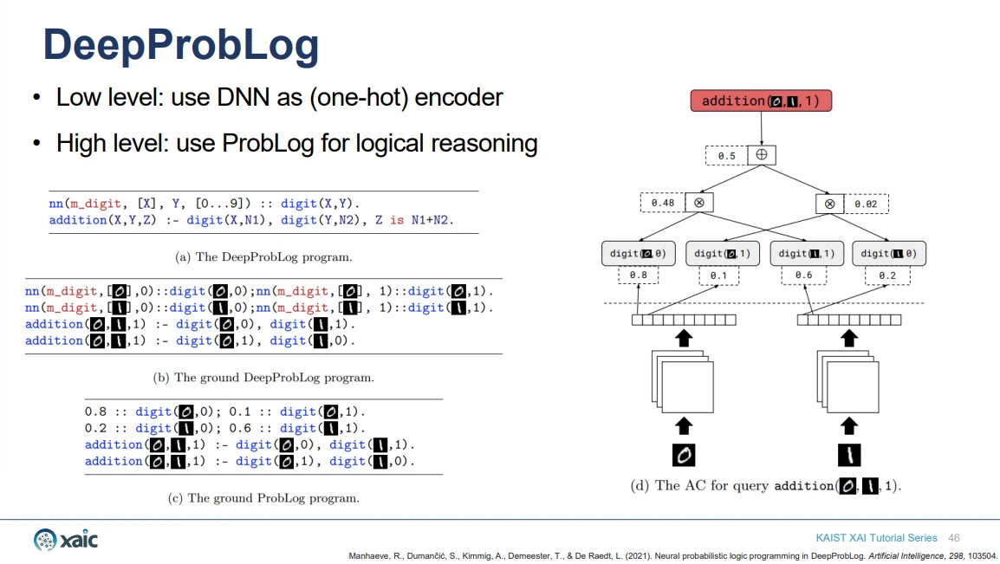

*왼쪽은 위에서부터 프로그램, 이미지를 대입한 프로그램, 신경망의 출력을 확률로 써넣은 프로그램이다. 오른쪽은 "두 이미지의 합이 1인가"를 계산하는 과정으로, 아래에서 위로 읽는다. 출처: 강의 슬라이드(DeepProbLog 논문의 그림)*

그림 오른쪽을 아래에서부터 따라가 보자. 숫자 이미지 두 장이 각각 신경망을 지나 확률이 된다. 첫 번째 이미지는 0일 확률이 0.8, 1일 확률이 0.1이고, 두 번째 이미지는 1일 확률이 0.6, 0일 확률이 0.2다(예시를 간단히 하려고 0과 1만 따진다). 합이 1이 되는 경우는 (0, 1)과 (1, 0) 두 가지이므로 각각의 확률을 곱하고($0.8 \times 0.6 = 0.48$, $0.1 \times 0.2 = 0.02$) 더하면 0.5가 된다. 점선 아래가 신경망이 하는 일이고, 점선 위가 ProbLog가 하는 일이다.

### Relational Neural Networks

Relational Neural Networks(RelNNs)는 symbolic 모델을 신경망처럼 쌓는 방법이다. RLR을 layer로 쌓고, 아래 layer의 출력을 임의의 새 predicate라고 가정한다. 그 predicate를 다음 layer에서 latent feature로 쓴다. 이렇게 모델이 스스로 만든 predicate가 추론에 쓰이는 것을 predicate invention이라고 한다.

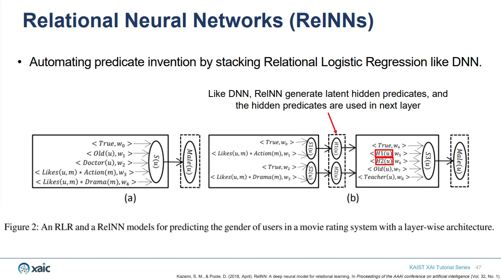

*영화 평점 데이터에서 사용자의 성별을 예측하는 예다. (a)는 RLR 하나, (b)는 RLR을 두 층으로 쌓은 RelNN이다. 빨간 네모가 아래 층이 만든 새 predicate `H1(u)`, `H2(u)`다. 출처: 강의 슬라이드(RelNN 논문의 그림)*

(a)에서는 나이, 직업, "액션 영화를 좋아하는가", "드라마를 좋아하는가" 같은 항이 한꺼번에 들어가 `Male(u)`를 예측한다. (b)에서는 아래 층의 RLR 두 개가 먼저 영화 취향에 대한 항으로 `H1(u)`와 `H2(u)`를 만들고, 위 층의 RLR이 그것을 `Old(u)`, `Teacher(u)` 같은 원래의 predicate와 함께 입력으로 받는다. `H1(u)`, `H2(u)`는 사람이 이름 붙인 predicate가 아니라 모델이 만든 것이어서 신경망의 hidden unit과 같은 자리에 있다.

성능은 잘 나오지만 설명성은 거의 잃는다. 다음 layer에서 새로 만든 predicate뿐 아니라 기존 predicate도 함께 쓰는데, 구조를 어떻게 짤지는 더 연구가 필요하다.

## 남았던 질문과 답

공부할 당시에는 풀지 못하고 남겨 둔 질문들이다. 글을 정리하면서 답을 찾아 덧붙였다.

**Q. RLR 예시의 `friend(z, y) * kind(y)`에서 연산자 `*`는 무엇인가. 수를 의미하는가.**

곱셈으로 읽어도 conjunction으로 읽어도 같은 값이 된다. RLR 논문은 논리식을 산술식 안에 쓸 때 참인 식을 1, 거짓인 식을 0으로 둔다고 정한다. 이 관례에서 두 atom의 곱은 둘 다 참일 때만 1이므로 $\text{friend}(z, y) \wedge \text{kind}(y)$와 같다. 모델은 이 값을 모든 $y$에 대해 더한다.

$$
\sum_y \text{friend}(z, y) \cdot \text{kind}(y) = \big\vert \{\, y : \text{friend}(z, y) \wedge \text{kind}(y) \,\} \big\vert
$$

즉 `*` 자체가 수를 뜻하는 것이 아니라, 곱을 모든 $y$에 대해 더한 결과가 "Z의 친구 가운데 친절한 사람의 수"가 된다. 슬라이드의 표와도 맞는다. 강의 슬라이드가 `*` 표기를 어디에서 가져왔는지까지는 확인하지 못했다.

**Q. CRED는 hidden과 output 사이의 관계를 decision tree로 어떻게 만드는가. 세 단계는 어떤 과정인가.**

decision tree를 학습시킬 데이터를 신경망에서 만들어 낸다. DeepRED 논문의 설명에 따르면 과정은 다음과 같다. 1단계에서는 학습 데이터를 신경망에 넣어 표본마다 hidden unit의 값과 신경망이 예측한 class를 기록한다. hidden unit의 값을 feature로, 예측한 class를 label로 하는 표가 생기고, 여기에 C4.5를 적용하면 내부 노드가 "$h_2 > 0.5$" 같은 hidden unit에 대한 조건이고 leaf가 class인 tree가 나온다. 2단계에서는 그 tree에 쓰인 조건 하나하나(예: $h_2 > 0.5$)를 참/거짓 label로 삼아, 이번에는 신경망의 입력을 feature로 하는 tree를 조건마다 하나씩 학습한다. 3단계에서는 1단계의 규칙에 나오는 조건을 2단계에서 얻은 입력에 대한 규칙으로 치환하고 합쳐, 입력만으로 쓰인 규칙을 얻는다. decision tree의 학습 자체는, 매 노드에서 label을 가장 잘 가르는 feature와 분할점을 골라 데이터를 나누는 일을 leaf가 충분히 순수해질 때까지 반복하는 것이다.

**Q. MLN 예시에서 Helen과 Gary가 결과에 없는 이유는 무엇인가.**

추측한 방향이 맞고, 원인은 모델이 아니라 추론 도구가 grounding을 하는 방식에 있다. Tuffy 논문은 가능한 ground clause를 모두 만들지 않고 active closure만 만든다고 설명한다. 값이 정해지지 않은 atom을 일단 모두 거짓으로 두고, 그 상태에서 위반되는 ground clause와 거기에 등장하는 atom을 active로 삼은 뒤, active atom의 값을 뒤집으면 위반될 수 있는 clause를 더해 가는 일을 더 늘어나지 않을 때까지 반복한다. 이 예에 적용하면 다음과 같다. `Smokes(Anna)`와 `Smokes(Edward)`가 참이므로 `Cancer(Anna)`, `Cancer(Edward)`가 거짓인 상태는 첫 번째 rule을 위반하고, `Smokes(Bob)`, `Smokes(Frank)`가 거짓인 상태는 친구에 대한 rule을 위반한다. 그래서 이 atom들이 active가 되고, 이어서 `Cancer(Bob)`과 `Cancer(Frank)`도 active가 된다. 반면 Gary와 Helen은 `Smokes`가 거짓인 초기 상태에서 관련된 ground clause가 모두 만족되고, 그것을 뒤집을 active atom과도 이어져 있지 않다. 따라서 두 사람의 atom은 ground network에 들어가지 않는다. MLN의 정의대로 모든 world를 따져 계산한다면 `Cancer(Gary)`에도 0이 아닌 확률이 부여된다. 이 설명은 논문에 적힌 알고리즘을 예시에 손으로 적용해 본 것이고, 도구를 직접 실행해 확인한 것은 아니다.

## 참고 자료

- XAI Tutorial 2023, "Symbolic AI methods". 노트에 이 강의의 링크는 남겨 두지 않았다. 같은 튜토리얼의 다른 강의는 <https://www.youtube.com/watch?v=k0VJtkRxEsY> 에 있다.
- 강의 슬라이드가 출처로 든 문헌: "Markov logic networks" (Machine Learning, 2006), "Tuffy: Scaling up Statistical Inference in Markov Logic Networks using an RDBMS" (arXiv:1104.3216). MLN 프로그램 예시는 뒤의 문헌에서 온 것이다.
- S. M. Kazemi, D. Buchman, K. Kersting, S. Natarajan, D. Poole, "Relational Logistic Regression", KR 2014. (RLR)
- J. R. Zilke, E. Loza Mencía, F. Janssen, "DeepRED – Rule Extraction from Deep Neural Networks", Discovery Science 2016. <https://doi.org/10.1007/978-3-319-46307-0_29>
